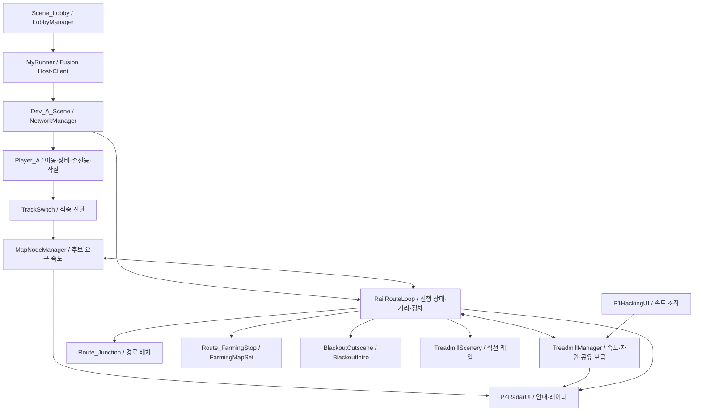

# DeadRail 게임 파일 안내

기준일 2026-11-18 · 프로젝트 D:/Projects/DeadRail/DeadRailGame

## 먼저 볼 곳

**지금 만드는 게임 흐름의 중심은 RailRouteLoop.cs이고, 화면에서 보이는 배치는 Dev_A_Scene.unity에 저장됩니다.**

| 바꾸고 싶은 것 | 먼저 열 파일/위치 | 함께 확인할 것 |
|---|---|---|
| 직선 주행→분기→전환→정차→파밍→출발 반복 | [RailRouteLoop.cs](<D:/Projects/DeadRail/DeadRailGame/Assets/_Dev_A/Scripts/RailRouteLoop.cs>) | 메인 씬 TreadmillManager의 RailRouteLoop 컴포넌트 |
| ThreeWay, 변환기, 곡선 레일 배치 | [Dev_A_Scene.unity](<D:/Projects/DeadRail/DeadRailGame/Assets/_Dev_A/_Scenes/Dev_A_Scene.unity>) > Route_Junction | 원본 예시는 보여주기, 생성 도구는 RailRouteAuthoring |
| 8개 파밍 맵의 바닥·벽·소품·조명 | 같은 씬 > Route_FarmingStop | FarmingMapAuthoring, FarmingMapSet |
| 맵 이름·후보·요구 속도·좌우 후보 배정 | [MapNodeManager.cs](<D:/Projects/DeadRail/DeadRailGame/Assets/_Dev_A/Scripts/MapNodeManager.cs>) | RailRouteLoop의 확정 경로/맵 인덱스 |
| 연료·배터리·최대 용량·수집 수량 | [TreadmillManager.cs](<D:/Projects/DeadRail/DeadRailGame/Assets/_Dev_A/Scripts/TreadmillManager.cs>) | P4RadarUI 표시, RailRouteLoop 수집 판정 |
| 정차·서행·출발 조작 화면 | [P1HackingUI.cs](<D:/Projects/DeadRail/DeadRailGame/Assets/_Dev_A/Scripts/P1HackingUI.cs>) | Terminal_Canvas > P1_Hacking_Panel |
| 레이더·남은 거리·보상·자원 표시 | [P4RadarUI.cs](<D:/Projects/DeadRail/DeadRailGame/Assets/_Dev_A/Scripts/P4RadarUI.cs>) | Terminal_Canvas > P4_Radar_Panel |
| 작살로 스위치 맞히기 | [HarpoonFarming.cs](<D:/Projects/DeadRail/DeadRailGame/Assets/_Dev_B/HarpoonFarming.cs>) | TrackSwitch.cs, MapNodeManager.cs |
| 블랙아웃 카메라 연출 | [BlackoutIntro.playable](<D:/Projects/DeadRail/DeadRailGame/Assets/_Dev_A/BlackoutIntro.playable>) | 씬의 BlackoutCutscene와 RailRouteLoop |
| 캐릭터 이동·장비·IK | Player_A.prefab, PlayerMovement.cs, EquipmentPivotController.cs | 네트워크·Animator·뼈대 참조를 함께 확인 |
| 방 생성·참가·기지 스폰 | LobbyManager.cs, NetworkManager.cs | MyRunner.prefab, Player_A.prefab, RailYard/Spawn_P1~P4 |

## 이번 안내의 범위와 확인 방법

- 프로젝트 폴더의 일반 파일 **1,298개**를 목록화했습니다. 이 안내 파일을 추가하기 직전의 목록입니다. Assets 1,209개, 그 밖 89개이며 전체 중 .meta는 659개입니다.
- 직접 제작 영역 Assets/_Dev_A와 Assets/_Dev_B의 에셋은 .meta를 제외하면 **86개**입니다. 자체 C# **28개·4,874줄**의 구현과 다른 자체 코드 호출을 읽고, 씬·프리팹·모델 GUID 참조를 대조했습니다.
- Assets 전체 C#은 **158개**이며 나머지 130개는 Photon·TextMesh Pro·템플릿 코드입니다. 외부 소스도 선언·구현을 열어 담당 계층을 분류했습니다. 외부 SDK 전체의 동작 보증이나 보안 감사는 아닙니다.
- FBX·Blend·이미지·DLL 등은 자산 유형, 제작 문서, 임포트 GUID와 연결 위치를 기준으로 분류했습니다. 이 조사에서 모델을 다시 렌더하거나 DLL을 역컴파일하지 않았습니다.
- Library, Temp, Logs, obj, .vs, .idea, .git 내부는 재생성 캐시·로그·도구/버전 관리 데이터로 분리했습니다. 해당 폴더의 개별 캐시 파일을 게임 원본 목록에 넣지 않았습니다. Packages 캐시 내부도 별도 열거하지 않았으며 manifest/lock에 의존성이 기록되어 있습니다.
- 압축 2개는 내부 항목 목록까지 확인했습니다. 내부 코드를 실행하거나 압축을 풀지는 않았습니다. 마지막 부록에 보관 파일의 내용도 적었습니다.
- 사용 상태는 **코드와 저장된 씬/프리팹 참조 기준**입니다. ‘직접 참조 없음’은 삭제 가능 판정이 아닙니다. Resources 로드·문자열 검색·런타임 생성·외부 패키지 참조도 따로 고려했습니다.
- 이번 요청에서는 안내 문서와 설명용 지도만 만들었습니다. 게임 코드·씬·프리팹·패키지를 수정하지 않았고 Unity 실행·컴파일·2인 플레이를 새로 수행하지 않았습니다. 이전 작업의 런타임 검증과 이번 정적 조사를 구분합니다.
- Git HEAD 파일과 Dev_A 브랜치 참조는 bb51fc6을 가리킵니다. 현재 도구의 git status/log 재실행은 경로 오류로 실패했으므로 이번 문서는 새 Git 차이 검사의 결과를 주장하지 않습니다. 아래 ‘작업 위치’는 기존 작업 기록과 현재 파일 내용의 기능 분류입니다.

## 실행 순서와 파일 연결

활성 Build Settings는 Scene_Lobby(0) → Dev_A_Scene(1)입니다. Scene_Dev_B와 SampleScene, Photon/TMP 예제 씬은 이 목록에 포함되어 있지 않습니다.



열차 자체를 긴 맵 끝까지 전진시키는 구조 대신, 열차 주변 선로·맵을 이동/회전시켜 주행을 보여줍니다. 새 루프는 표시 속도 km/h를 /3.6 하여 거리 m로 환산합니다.

## Hierarchy에서 보이는 것

| 객체 | 역할 | 수정 위치/주의할 연결 |
|---|---|---|
| NetworkManager | Runner 연결·입력·플레이어 스폰 | Player_A 프리팹과 기지 스폰 배열 |
| RailYard | 출발 기지 바닥·계단·스폰 지점 | Spawn_P1~P4 |
| Train | 실제 플레이 열차와 장비·소켓 | 3D 모델·콘솔·장비 피벗의 기준 |
| TreadmillManager | TreadmillManager + MapNodeManager + RailRouteLoop 네트워크 컴포넌트 | 속도·자원·전체 진행을 함께 연결하는 핵심 객체 |
| Track_Group | 8m 직선 선로 9개 | 각 TreadmillScenery가 72m 구간에서 재배치 |
| 보여주기 | 사용자가 배치한 ThreeWay/터널/곡선/변환기 예시 | 실행용 분기 복제의 원본. 루프에서 평상시 숨기고 터널 연출 때 표시 |
| Route_Junction | 실행 중 접근하는 분기 배치 | Example geometry, TrackSwitch, 좌/중앙/우 경로·컷 마커와 중앙 바리케이드 |
| Route_FarmingStop | 정차 구간 공통 바닥·보급·8개 맵 변형 | FarmingStopGeometry 프리팹 인스턴스 + 씬에 추가된 FarmingMapSet/variants |
| Terminal_Canvas | P1/P4 UI | TerminalUIManager, P1_Hacking_Panel, P4_Radar_Panel |
| BlackoutCutscene | PlayableDirector | BlackoutIntro Timeline과 카메라/연출 객체 바인딩 |
| BlackoutCamera / BlackoutTrainCamera / Train(Cutscene) | 블랙아웃 전용 카메라·열차 연출 객체 | 평상시 비활성. 실제 플레이어 열차와 구분 |
| Junction_Event_Set | 기존 분기 테스트 프리팹 인스턴스 | 메인 씬 비활성. 새 Route_Junction과 중복 이름/기능에 유의 |
| Main Camera / Directional Light / EventSystem | 기본 카메라·태양광·UI 입력 | 플레이어·컷신의 카메라 전환 및 렌더 설정과 연동 |

**보여주기 수정이 이미 만들어진 Route_Junction에 자동 복사되지는 않습니다.** RailRouteAuthoring은 생성 시점에 복제합니다. 현재 실행 배치를 다듬을 때는 Route_Junction과 연결 경로/컷 마커를 함께 확인해야 합니다. 파밍 맵도 생성기 코드와 이미 저장된 씬 배치가 함께 존재합니다.

## 자체 C# 28개 — 기능별 상세
### 로비·접속
#### LobbyManager.cs

[Assets/_Dev_A/Scripts/LobbyManager.cs](<D:/Projects/DeadRail/DeadRailGame/Assets/_Dev_A/Scripts/LobbyManager.cs>)

- 역할 — 방 만들기/참가 버튼, 방 이름, MyRunner 생성, Host/Client 시작과 메인 씬 로딩.
- 연결 — Scene_Lobby > LobbyManager
- 상태 — 사용
- 구현 메모 — 중복 접속 버튼 방지와 실패 시 Runner 정리.
- 주요 함수 — `OnClickCreateRoom`, `OnClickJoinRoom`, `StartGame`

#### NetworkManager.cs

[Assets/_Dev_A/Scripts/NetworkManager.cs](<D:/Projects/DeadRail/DeadRailGame/Assets/_Dev_A/Scripts/NetworkManager.cs>)

- 역할 — 로비에서 넘어온 Runner 연결, 입력 수집·전송, 서버의 플레이어 생성/제거와 기지 스폰 좌표 지정.
- 연결 — Dev_A_Scene > NetworkManager
- 상태 — 사용
- 구현 메모 — Player_A와 Spawn_P1~P4 참조. 메인 씬 단독 실행은 Single 모드.
- 주요 함수 — `RegisterPlayerEvents`, `SpawnPlayer`, `ApplySpawnPositionAfterNetworkInitialization`, `GetYardSpawnPoint`, `DespawnPlayer`, `Update`, `SubmitInput`, `OnDestroy`
- 코드에서 참조하는 자체 클래스 — PlayerMovement (텍스트 참조 기준)

### 플레이어
#### CameraFollow.cs

[Assets/_Dev_A/Scripts/CameraFollow.cs](<D:/Projects/DeadRail/DeadRailGame/Assets/_Dev_A/Scripts/CameraFollow.cs>)

- 역할 — 대상 뒤쪽 오프셋으로 카메라를 보간 이동하고 대상을 바라봄.
- 연결 — PlayerStateManager가 Camera.main에 추가
- 상태 — 동적 연결
- 구현 메모 — 씬에 직접 붙어 있지 않아도 코드에서 생성됨. PlayerMovement 카메라 처리와 함께 확인.
- 주요 함수 — 별도 함수 없음

#### PlayerMovement.cs

[Assets/_Dev_A/Scripts/PlayerMovement.cs](<D:/Projects/DeadRail/DeadRailGame/Assets/_Dev_A/Scripts/PlayerMovement.cs>)

- 역할 — 이동·점프·중력·시점 회전, 1/3인칭, 줌, Animator Speed, 네트워크 입력 적용.
- 연결 — Player_A.prefab > Player_A
- 상태 — 사용
- 구현 메모 — V 시점 전환, Z/휠 줌. 콘솔·전환 중 입력 잠금과 컷신 카메라 오버라이드.
- 주요 함수 — `Awake`, `Spawned`, `Render`, `ReadLocalInput`, `FixedUpdateNetwork`
- 동기화 데이터 — `CameraPitch`
- 코드에서 참조하는 자체 클래스 — RailRouteLoop, TerminalUIManager (텍스트 참조 기준)

#### PlayerStateManager.cs

[Assets/_Dev_A/Scripts/PlayerStateManager.cs](<D:/Projects/DeadRail/DeadRailGame/Assets/_Dev_A/Scripts/PlayerStateManager.cs>)

- 역할 — 로컬 플레이어에 메인 카메라 추적 대상을 연결하고 CameraFollow를 필요 시 추가.
- 연결 — Player_A.prefab > Player_A
- 상태 — 사용
- 구현 메모 — PlayerMode 열거형이 있지만 별도 상태 전환 시스템 전체를 구현한 파일은 아님.
- 주요 함수 — `Spawned`
- 코드에서 참조하는 자체 클래스 — CameraFollow, PlayerMovement (텍스트 참조 기준)

### 장비·리깅
#### EquipmentPivotController.cs

[Assets/_Dev_B/EquipmentPivotController.cs](<D:/Projects/DeadRail/DeadRailGame/Assets/_Dev_B/EquipmentPivotController.cs>)

- 역할 — 1/2/3 장비 모드, P2 관측·탐조등과 P3 작살 피벗, 손·시선 IK 목표, 리그 가중치와 카메라 제어.
- 연결 — Player_A.prefab > Player_A
- 상태 — 사용
- 구현 메모 — lookTarget 연결 있음. AutoSetupRigAndBones 런타임 호출은 주석 상태. ApplyModeSettings가 RaycastWeapon을 끔.
- 주요 함수 — `AutoSetupRigAndBones`, `Spawned`, `FindTrainEquipment`, `ApplyModeSettings`, `Update`, `Rpc_SetEquipmentMode`, `LateUpdate`
- 동기화 데이터 — `CurrentMode`
- 코드에서 참조하는 자체 클래스 — PlayerMovement, RailRouteLoop, TerminalUIManager, FlashlightToggle, HarpoonFarming, RaycastWeapon (텍스트 참조 기준)

#### FlashlightToggle.cs

[Assets/_Dev_B/FlashlightToggle.cs](<D:/Projects/DeadRail/DeadRailGame/Assets/_Dev_B/FlashlightToggle.cs>)

- 역할 — F 입력으로 손전등 네트워크 상태를 바꾸고 Light에 반영. 배터리 0이면 끔.
- 연결 — Player_A.prefab > Player_A
- 상태 — 사용
- 구현 메모 — 현재 F 입력을 HasStateAuthority에서만 처리. Host/Client 참가자 입력 경로는 별도 확인이 필요함.
- 주요 함수 — `Spawned`, `FixedUpdateNetwork`, `Update`, `Render`
- 동기화 데이터 — `IsLightOn`
- 코드에서 참조하는 자체 클래스 — TreadmillManager (텍스트 참조 기준)

#### HarpoonFarming.cs

[Assets/_Dev_B/HarpoonFarming.cs](<D:/Projects/DeadRail/DeadRailGame/Assets/_Dev_B/HarpoonFarming.cs>)

- 역할 — P3 발사 RPC, 권한 측 피격 검사, 선로 변환기·장애물 처리, 작살 선 표시와 기존 Item 끌어오기.
- 연결 — Player_A.prefab > Player_A
- 상태 — 사용
- 구현 메모 — 프리팹 사거리 50m. 지상 보급품 E 수집은 RailRouteLoop 담당.
- 주요 함수 — `Spawned`, `Update`, `Render`, `GetActiveCamera`, `GetOriginPos`, `GetEffectivePullSpeed`, `TryFarming`, `Rpc_FireHarpoon`, `PullItemCoroutine`, `HitSwitchOrObstacleCoroutine`, `DrawLineShortCoroutine`, `OnGUI`
- 동기화 데이터 — `IsLineActive`, `LineStart`, `LineEnd`
- 코드에서 참조하는 자체 클래스 — PlayerMovement, RailRouteLoop, TerminalUIManager, TreadmillManager, TreadmillObstacle, EquipmentPivotController, RaycastWeapon, TrackSwitch (텍스트 참조 기준)

#### RaycastWeapon.cs

[Assets/_Dev_B/RaycastWeapon.cs](<D:/Projects/DeadRail/DeadRailGame/Assets/_Dev_B/RaycastWeapon.cs>)

- 역할 — 보유 무기의 사격 판정, 장애물 제거 및 TrackSwitch.OnSwitchHit 호출, 무기 획득과 조준점.
- 연결 — Player_A.prefab > Player_A
- 상태 — 모듈 존재·모드에서 꺼짐
- 구현 메모 — EquipmentPivotController가 실제 실행을 비활성화함. 탄약 소모 기능은 없음.
- 주요 함수 — `Spawned`, `GetActiveCamera`, `Update`, `FireWeapon`, `AcquireWeapon`, `OnGUI`
- 코드에서 참조하는 자체 클래스 — TreadmillObstacle, TrackSwitch (텍스트 참조 기준)

### 주행·분기·정차
#### MapNodeManager.cs

[Assets/_Dev_A/Scripts/MapNodeManager.cs](<D:/Projects/DeadRail/DeadRailGame/Assets/_Dev_A/Scripts/MapNodeManager.cs>)

- 역할 — 공유 seed로 좌우 후보 노드·요구 속도 생성, 후보 A/B와 좌우 매핑, 단계·레이더 정보와 변환 요청 처리.
- 연결 — Dev_A_Scene > TreadmillManager
- 상태 — 사용
- 구현 메모 — 일반 6개/블랙아웃 2개 풀 정의. 새 루프 실행 중 기존 거리/회전 진행 분기는 우회함. F8은 디버그.
- 주요 함수 — `GetMapName`, `GetRouteNode`, `EnsureBranchData`, `Awake`, `Spawned`, `FixedUpdateNetwork`, `Render`, `PlayTurnAnimationCoroutine`, `ResetTrackSwitchDirection`, `BeginRouteStage`, `GenerateNextBranch`, `BuildLocalBranchData`, `CreateNode`, `EvaluateBranchArrival`, `Rpc_ToggleTrackSwitch`, `Rpc_ForceRescanBranch`, `Update`
- 동기화 데이터 — `CurrentStage`, `RandomSeed`, `RemainingDistance`, `IsLeftSwitchSelected`, `IsLeftTrackCandidateA`, `TurnSequenceCount`, `lastTurnWasLeft`
- 코드에서 참조하는 자체 클래스 — PlayerMovement, RailRouteLoop, TreadmillManager (텍스트 참조 기준)

#### RailRouteLoop.cs

[Assets/_Dev_A/Scripts/RailRouteLoop.cs](<D:/Projects/DeadRail/DeadRailGame/Assets/_Dev_A/Scripts/RailRouteLoop.cs>)

- 역할 — 직선 주행→분기→암전/컷신→정차 접근→파밍→출발→반복의 상태와 거리, 경로·맵 선택, 탑승 확인, 보급 수집을 서버에서 관리.
- 연결 — Dev_A_Scene > TreadmillManager
- 상태 — 사용
- 구현 메모 — 새 흐름의 중심. 참조·거리·컷 지점은 씬 Inspector 값이 우선.
- 주요 함수 — `RouteName`, `Awake`, `Spawned`, `FixedUpdateNetwork`, `TrySetSpeed`, `StartTransition`, `CycleRoute`, `Rpc_Reapproach`, `Rpc_CollectSupply`, `GetSupplyKind`, `SupplyName`, `SupplyColor`, `IsAboard`, `CountPlayers`, `TravelStatus`, `Render`, `RefreshCollisionGeometry`, `Update`, `PresentTransition`, `BeginCinematic`, `EndCinematic`, `BuildOverlay`, `BuildDistances`, `PathLength`, `GetDistances`, `SamplePath`, `OnDestroy`, `OnDrawGizmosSelected`
- 동기화 데이터 — `Phase`, `SelectedRoute`, `LockedRoute`, `PhaseDistance`, `TravelledDistance`, `TransitionTime`, `VisitNumber`, `CollectedSupplies`, `PlayersAboard`, `PlayerCount`, `DepartureWaiting`, `ActiveMapIndex`, `BranchEntryFailed`
- 코드에서 참조하는 자체 클래스 — FarmingMapSet, MapNodeManager, TerminalUIManager, TreadmillManager (텍스트 참조 기준)

#### TreadmillScenery.cs

[Assets/_Dev_A/Scripts/TreadmillScenery.cs](<D:/Projects/DeadRail/DeadRailGame/Assets/_Dev_A/Scripts/TreadmillScenery.cs>)

- 역할 — 직선 레일을 뒤로 흘리고 72m 범위로 반복 배치. 새 루프의 누적 거리를 써서 분기 구간에서는 렌더러를 숨김.
- 연결 — Dev_A_Scene > Track_Group의 직선 선로 9개
- 상태 — 사용
- 구현 메모 — 기존 속도 직접 이동 코드는 새 루프가 없을 때만 사용.
- 주요 함수 — `Awake`, `CheckBranchSpawn`
- 코드에서 참조하는 자체 클래스 — MapNodeManager, RailRouteLoop, TreadmillManager (텍스트 참조 기준)

#### TrackSwitch.cs

[Assets/_Dev_B/TrackSwitch.cs](<D:/Projects/DeadRail/DeadRailGame/Assets/_Dev_B/TrackSwitch.cs>)

- 역할 — 발사·작살 적중을 방향 전환 요청으로 연결하고 레버·좌/우/중앙 표시등을 경로 상태에 맞춤.
- 연결 — Dev_A_Scene > Route_Junction > Example geometry > DeadRail_TrackSwitch
- 상태 — 사용
- 구현 메모 — 평상시 선택은 좌/우. 중앙은 진입 실패 시 확정되는 블랙아웃 경로.
- 주요 함수 — `Spawned`, `GetMapNodeManager`, `OnSwitchHit`, `Render`
- 코드에서 참조하는 자체 클래스 — MapNodeManager, RailRouteLoop (텍스트 참조 기준)

### 속도·자원
#### TreadmillManager.cs

[Assets/_Dev_A/Scripts/TreadmillManager.cs](<D:/Projects/DeadRail/DeadRailGame/Assets/_Dev_A/Scripts/TreadmillManager.cs>)

- 역할 — 네트워크 속도와 연료·배터리, 최대 용량, 공유 치료템·수리템·탄약 수량, 속도 요청 및 자원 소비/보충을 관리.
- 연결 — Dev_A_Scene > TreadmillManager
- 상태 — 사용
- 구현 메모 — 기본 연료 100km/h에서 0.1/s, 손전등 1개당 배터리 0.15/s. 용량 증가와 현재량 보충은 별도.
- 주요 함수 — `Awake`, `BrakeForFarmingStop`, `ArriveAtFarmingStop`, `ClearFarmingStop`, `ResetFarmingStop`, `Spawned`, `CollectSupply`, `FixedUpdateNetwork`, `Rpc_SetTrainSpeed`
- 동기화 데이터 — `_networkedSpeed`, `Fuel`, `Battery`, `_fuelCapacity`, `_batteryCapacity`, `MedicalKits`, `RepairKits`, `Ammunition`, `FarmingStop`
- 코드에서 참조하는 자체 클래스 — RailRouteLoop, FlashlightToggle (텍스트 참조 기준)

### 파밍·맵
#### FarmingMapSet.cs

[Assets/_Dev_A/Scripts/FarmingMapSet.cs](<D:/Projects/DeadRail/DeadRailGame/Assets/_Dev_A/Scripts/FarmingMapSet.cs>)

- 역할 — 8개 맵 중 선택된 배치만 켜고 지하 구간 안개·환경광을 적용한 뒤 밖으로 나올 때 복원.
- 연결 — Dev_A_Scene > Route_FarmingStop
- 상태 — 사용
- 구현 메모 — 맵 선택 판정은 RailRouteLoop, 이 파일은 화면 표시와 조명 담당.
- 주요 함수 — `Awake`, `Present`, `RestoreLighting`, `OnDestroy`
- 코드에서 참조하는 자체 클래스 — MapNodeManager (텍스트 참조 기준)

### 콘솔·UI
#### ConsoleInteractable.cs

[Assets/_Dev_A/Scripts/ConsoleInteractable.cs](<D:/Projects/DeadRail/DeadRailGame/Assets/_Dev_A/Scripts/ConsoleInteractable.cs>)

- 역할 — 콘솔 근처 2.5m에서 E 안내와 P1/P4 패널 열기.
- 연결 — Dev_A_Scene의 콘솔 상호작용 컴포넌트 4개
- 상태 — 사용
- 구현 메모 — 실제 각 인스턴스의 consoleType·연결 참조로 화면이 정해짐.
- 주요 함수 — `Update`, `OnGUI`
- 코드에서 참조하는 자체 클래스 — PlayerMovement, TerminalUIManager (텍스트 참조 기준)

#### P1HackingUI.cs

[Assets/_Dev_A/Scripts/P1HackingUI.cs](<D:/Projects/DeadRail/DeadRailGame/Assets/_Dev_A/Scripts/P1HackingUI.cs>)

- 역할 — 속도 슬라이더와 해킹 퍼즐 3종, 성공 시 속도 적용, 0km/h 정차·5km/h 서행·재접근 버튼과 진행 상태 표시.
- 연결 — Dev_A_Scene > Terminal_Canvas > P1_Hacking_Panel
- 상태 — 사용
- 구현 메모 — 퍼즐은 방향키/WASD, Space 타이밍, 순서 버튼. 실제 속도는 TreadmillManager로 요청.
- 주요 함수 — `Awake`, `Start`, `OnEnable`, `OnSpeedSliderChanged`, `UpdateIdleStatus`, `StartRandomPuzzle`, `Update`, `CreateRouteControls`, `CreateRouteButton`, `SetManeuverSpeed`, `SetupTypeA_Command`, `UpdateTypeA`, `CheckCommandKey`, `RefreshCommandText`, `SetupTypeB_Timing`, `UpdateTypeB`, `SetupTypeC_Nodes`, `UpdateTypeC`, `OnNodeClicked`, `PuzzleResult`, `ClearContainer`, `CreateImage`, `CreateText`
- 코드에서 참조하는 자체 클래스 — RailRouteLoop, TreadmillManager (텍스트 참조 기준)

#### P4RadarUI.cs

[Assets/_Dev_A/Scripts/P4RadarUI.cs](<D:/Projects/DeadRail/DeadRailGame/Assets/_Dev_A/Scripts/P4RadarUI.cs>)

- 역할 — 레이더 스윕·물체 스캔, 노드 A/B, 좌우 보상·중앙 상태, 거리·속도·연료·배터리·공유 보급·탑승 인원 표시.
- 연결 — Dev_A_Scene > Terminal_Canvas > P4_Radar_Panel
- 상태 — 사용
- 구현 메모 — R 재탐색. 노드 생성·자원 변경을 직접 담당하지 않음.
- 주요 함수 — `Start`, `Update`, `RefreshNetworkBriefingText`, `UpdateRouteNodeMarkers`, `UpdateNodeMarker`, `CreateNodeMarker`, `UpdateRadarBlips`, `ShowOnRadar`, `GetOrCreateBlip`
- 코드에서 참조하는 자체 클래스 — MapNodeManager, RailRouteLoop, TreadmillManager, TreadmillObstacle, FarmableItem (텍스트 참조 기준)

#### TerminalUIManager.cs

[Assets/_Dev_A/Scripts/TerminalUIManager.cs](<D:/Projects/DeadRail/DeadRailGame/Assets/_Dev_A/Scripts/TerminalUIManager.cs>)

- 역할 — P1/P4 패널 열기·닫기, 커서와 플레이어 입력 잠금 관리.
- 연결 — Dev_A_Scene > Terminal_Canvas
- 상태 — 사용
- 구현 메모 — T=P1, Y=P4, Esc=닫기. 전환 중 패널 열기 제한.
- 주요 함수 — `Awake`, `Start`, `Update`, `ToggleP1Hacking`, `ToggleP4Radar`, `ToggleTerminal`, `CloseAllTerminals`, `UpdatePlayerAndCursorState`
- 코드에서 참조하는 자체 클래스 — PlayerMovement, RailRouteLoop (텍스트 참조 기준)

### 에디터 제작 도구
#### FarmingMapAuthoring.cs

[Assets/_Dev_A/Editor/FarmingMapAuthoring.cs](<D:/Projects/DeadRail/DeadRailGame/Assets/_Dev_A/Editor/FarmingMapAuthoring.cs>)

- 역할 — 일반 6개·지하 2개 임시 맵, 재질·보급 라벨·중앙 봉쇄물과 지하 조명을 생성·갱신.
- 연결 — Unity 메뉴 DeadRail > Route
- 상태 — Editor 전용
- 구현 메모 — Update farming maps / Refresh underground lighting. 일반적인 위치 조정은 씬에서 가능하며 재생성은 배치에 영향을 줌.
- 주요 함수 — `RefreshUndergroundLighting`, `UpdateMaps`, `ConfigureSupplies`, `BuildOutdoor`, `BuildUnderground`, `NewRoot`, `Box`, `Cylinder`, `Primitive`, `PointLight`, `Material`
- 코드에서 참조하는 자체 클래스 — FarmingMapSet, MapNodeManager, RailRouteLoop (텍스트 참조 기준)

#### RailRouteAuthoring.cs

[Assets/_Dev_A/Editor/RailRouteAuthoring.cs](<D:/Projects/DeadRail/DeadRailGame/Assets/_Dev_A/Editor/RailRouteAuthoring.cs>)

- 역할 — 보여주기를 복제해 Route_Junction·경로·컷 마커·변환기·임시 정차장을 씬에 만드는 제작 메뉴.
- 연결 — Unity 메뉴 DeadRail > Route
- 상태 — Editor 전용
- 구현 메모 — Build from example / Inspect layout. 원본 보여주기와 실행용 Route_Junction은 별도 객체. 기존 생성물이 있으면 재생성 중단.
- 주요 함수 — `BuildFromExample`, `FindDescendant`, `ReadWaypoints`, `AppendSegments`, `AlignSegment`, `TrimAtLength`, `CreateMarker`, `InspectLayout`
- 코드에서 참조하는 자체 클래스 — FarmingMapAuthoring, RailRouteLoop, TreadmillManager, TrackSwitch (텍스트 참조 기준)

### 충돌·기존 실험
#### TrainWalkableColliderBuilder.cs

[Assets/_Dev_A/Scripts/TrainWalkableColliderBuilder.cs](<D:/Projects/DeadRail/DeadRailGame/Assets/_Dev_A/Scripts/TrainWalkableColliderBuilder.cs>)

- 역할 — 열차 메시에서 보행 MeshCollider·얇은 지붕 데크·kinematic Rigidbody를 만드는 보조 코드.
- 연결 — 현재 스캔의 씬/프리팹에 직접 연결 없음
- 상태 — 연결 미확인
- 구현 메모 — 다른 코드의 AddComponent 호출도 찾지 못함. 파일 존재만으로 현재 열차 충돌 생성에 사용된다고 볼 수 없음.
- 주요 함수 — `Awake`

#### TreadmillObstacle.cs

[Assets/_Dev_A/Scripts/TreadmillObstacle.cs](<D:/Projects/DeadRail/DeadRailGame/Assets/_Dev_A/Scripts/TreadmillObstacle.cs>)

- 역할 — 장애물을 뒤로 이동시키고 Train 접촉·피격 시 네트워크 제거.
- 연결 — 현재 스캔의 씬/프리팹에 직접 연결 없음
- 상태 — 연결 미확인
- 구현 메모 — 기차 체력 -10은 로그이며 실제 체력 감소 구현은 없음. 이전 방식의 이동 단위 사용.
- 주요 함수 — `FixedUpdateNetwork`, `OnTriggerEnter`, `Rpc_TakeDamage`
- 코드에서 참조하는 자체 클래스 — TreadmillManager (텍스트 참조 기준)

#### DevB_TestStarter.cs

[Assets/_Dev_B/DevB_TestStarter.cs](<D:/Projects/DeadRail/DeadRailGame/Assets/_Dev_B/DevB_TestStarter.cs>)

- 역할 — 현재 씬을 Single 모드 Runner로 실행하는 개발 B 테스트용 시작 코드.
- 연결 — Scene_Dev_B > LocalNetworkRunner
- 상태 — 테스트
- 구현 메모 — 현재 Build Settings의 활성 씬 목록에는 Scene_Dev_B가 없음.
- 주요 함수 — 별도 함수 없음
- 코드에서 참조하는 자체 클래스 — TreadmillManager (텍스트 참조 기준)

#### FarmableItem.cs

[Assets/_Dev_B/FarmableItem.cs](<D:/Projects/DeadRail/DeadRailGame/Assets/_Dev_B/FarmableItem.cs>)

- 역할 — isPulled일 때 지정 목표로 이동하고 가까워지면 오브젝트 제거.
- 연결 — Scene_Dev_B > Item_Test
- 상태 — 테스트
- 구현 메모 — 새 정차장 공유 보급 수집과 별개인 기존 끌어오기 실험.
- 주요 함수 — 별도 함수 없음

#### JunctionBranchDirector.cs

[Assets/_Dev_B/JunctionBranchDirector.cs](<D:/Projects/DeadRail/DeadRailGame/Assets/_Dev_B/JunctionBranchDirector.cs>)

- 역할 — 기존 고위험 분기 속도 판정, 카메라 기울기·안개·암전 연출.
- 연결 — Junction_Event_Set.prefab > JunctionDirector
- 상태 — 이전 방식
- 구현 메모 — 기존 J 디버그/Train 트리거. 새 BlackoutIntro 재생은 RailRouteLoop 담당.
- 주요 함수 — `Spawned`, `Update`, `EvaluateAndTriggerJunction`, `GetCurrentTrainSpeed`, `Rpc_PlayJunctionTransition`, `JunctionTransitionRoutine`, `OnGUI`, `OnTriggerEnter`
- 코드에서 참조하는 자체 클래스 — MapNodeManager, PlayerMovement, TreadmillManager, TrackSwitch (텍스트 참조 기준)

#### SearchlightSignboard.cs

[Assets/_Dev_B/SearchlightSignboard.cs](<D:/Projects/DeadRail/DeadRailGame/Assets/_Dev_B/SearchlightSignboard.cs>)

- 역할 — 탐조등 SpotLight 방향·거리를 확인하여 표지판 숨은 글자 노출.
- 연결 — Junction_Event_Set.prefab > Signboard__Test
- 상태 — 이전 방식
- 구현 메모 — 표지판의 기본 80km/h 텍스트는 노드 요구 속도와 자동 연동되지 않음.
- 주요 함수 — `Start`, `SetupTextComponents`, `RefreshLightList`, `Update`, `CheckIfIlluminatedBySearchlight`, `ApplyVisualAlpha`

#### TreadmillJunctionPack.cs

[Assets/_Dev_B/TreadmillJunctionPack.cs](<D:/Projects/DeadRail/DeadRailGame/Assets/_Dev_B/TreadmillJunctionPack.cs>)

- 역할 — 기존 분기점 세트 접근·되돌리기와 정차장 자동 제동을 묶던 코드.
- 연결 — Junction_Event_Set.prefab 루트
- 상태 — 이전 방식
- 구현 메모 — 메인 씬의 해당 세트는 비활성, 새 RailRouteLoop가 준비되면 기존 갱신을 우회.
- 주요 함수 — `Awake`, `AutoLinkChildren`, `FixedUpdateNetwork`, `Render`
- 코드에서 참조하는 자체 클래스 — MapNodeManager, RailRouteLoop, TreadmillManager, JunctionBranchDirector, SearchlightSignboard, TrackSwitch (텍스트 참조 기준)

## 주행·정차·파밍 흐름의 현재 구현

| 단계 | 담당 | 현재 저장된 기준 |
|---|---|---|
| 직선 주행 | RailRouteLoop + TreadmillScenery | 순항 거리 300m. 속도 0이면 거리 진행도 멈춤 |
| 분기 접근 | RailRouteLoop + Route_Junction | 남은 거리 150m에서 배치 표시. 변환기는 ThreeWay 앞 8m×3=24m 구간 기준 |
| 좌/우 선택 | TrackSwitch → MapNodeManager → RailRouteLoop | 일반 선택은 좌/우. 후보 요구 속도를 충족하지 못하면 중앙 실패 경로 |
| 분기 후 전환 | RailRouteLoop + 컷 마커 | 좌측 약 59m, 우측 약 45m, 중앙 약 54m의 임시 경로. 사진 위치를 근거로 만든 조정 대상 |
| 암전/컷신 | RailRouteLoop + BlackoutIntro | fadeSeconds 0.65. 일반 경로는 암전 전환, 블랙아웃은 터널 Timeline 연출 사용 |
| 정차 접근 | RailRouteLoop + P1HackingUI | 접근 거리 85m, 정차 구역 ±14m에서 P1이 0km/h로 내려 정차 |
| 정차 실패 | RailRouteLoop + P1HackingUI | MissedStop에서 재접근 기능. 5km/h 서행 버튼 제공 |
| 파밍 | RailRouteLoop + FarmingMapSet + TreadmillManager | E로 근접 보급 수집. 거리·권한·현재 단계·중복 수집 여부 검사 |
| 재출발 | RailRouteLoop + TreadmillManager | 전원 탑승 확인 후 출발/나가는 전환. 다음 방문에는 보급 재생성, 수량·용량은 유지 |

거리·속도·컷 위치는 코드 기본값보다 **씬 Inspector 직렬화 값**을 먼저 확인해야 합니다. 현재 보딩 범위 중심 (0,2.5,-6), extent (2.4,3,8.5)도 씬에 저장되어 있습니다.

### 8개 파밍 맵

일반 좌/우 경로는 같은 일반 풀 6개에서 후보를 정하고, 노드 난이도/요구 속도는 맵 그룹에 따라 생성합니다. 왼쪽이 항상 낮은 난이도이고 오른쪽이 항상 높은 난이도인 고정 배정은 아닙니다.

| 인덱스 | 맵 | 풀/용도 | 현재 제작 형태 |
|---|---|---|---|
| 0 | 외곽 우회 선로 | 일반 Low | 지상 임시 배치 |
| 1 | 버려진 간이역 | 일반 Low | 지상 임시 배치 |
| 2 | 고철 처리장 | 일반 Low | 지상 임시 배치 |
| 3 | 건조한 평야 지대 | 일반 Low | 지상 임시 배치 |
| 4 | 폐기된 군수공장 | 일반 High | 지상 임시 배치 |
| 5 | 붕괴된 연구단지 | 일반 High | 지상 임시 배치 |
| 6 | 오염된 지하터널 | 블랙아웃 High | 터널 내부·오염 탱크/액체·작업등 |
| 7 | 블랙마켓 화물역 | 블랙아웃 High | 터널 내부·화물/선반·작업등 |

이름별로 별도 .unity 파일이 있는 구조가 아닙니다. Route_FarmingStop 아래 8개 GameObject 묶음 중 하나를 FarmingMapSet이 활성화합니다. 아직 임시 지형/소품 단계이며 최종 아트 맵 완성을 뜻하지 않습니다.

지하 2개는 터널을 빠져나오기 전의 파밍 구간입니다. 터널 셸을 길게 반복하고 벽·바닥·조명을 배치하며 안개/환경광도 전환합니다. 일반 맵의 뒤편 터널/ThreeWay가 보이지 않도록 메인 씬 프리팹 인스턴스에 비활성 오버라이드가 있습니다. 원본 프리팹에 남아 있는 모델과 메인 씬의 표시 상태를 구분해야 합니다.

### 보급품과 최대 용량

| 보급 슬롯 | 지급/효과 | 처리 파일 |
|---|---|---|
| RouteCapacity | 왼쪽 연료 최대 용량 +25 / 오른쪽 배터리 최대 용량 +25 / 블랙아웃 탄약 +30 | RailRouteLoop.GetSupplyKind → TreadmillManager |
| MedicalKit | 공유 치료템 +1 | TreadmillManager |
| RepairKit | 공유 수리템 +1 | TreadmillManager |
| Ammunition | 공유 탄약 +30 | TreadmillManager |
| Fuel | 현재 연료 +25, 최대 용량 제한 | TreadmillManager |
| Battery | 현재 배터리 +25, 최대 용량 제한 | TreadmillManager |

연료·배터리 최대 용량과 현재 남은 양은 별도 네트워크 값입니다. 최대 용량 업그레이드 자체가 자원을 가득 채우지는 않습니다. 치료·수리·탄약은 현재 공유 수집 수량이 구현된 상태이며, 체력 회복·열차 수리·무기 탄약 소비가 여기서 자동 완성되지는 않습니다.

## 씬·프리팹·애니메이션·모델·재질 전체

직접 제작 영역에서 C# 이외의 **58개** 에셋입니다. 아래 ‘참조’는 저장된 문서에서 GUID가 확인된 위치이며 활성 상태나 화면 노출까지 보증하지 않습니다. UserSettings의 에디터 바로가기 참조는 제외했습니다.

| 파일 | 담당 | 저장된 직접 참조 |
|---|---|---|
| [Assets/_Dev_A/Animations/Aim_UpperBody.anim](<D:/Projects/DeadRail/DeadRailGame/Assets/_Dev_A/Animations/Aim_UpperBody.anim>) | 상체 조준 자세 클립. PlayerAnim의 Aim_UpperBody 상태에서 참조 | [PlayerAnim.controller](<D:/Projects/DeadRail/DeadRailGame/Assets/_Dev_A/Animations/PlayerAnim.controller>) |
| [Assets/_Dev_A/Animations/PlayerAnim.controller](<D:/Projects/DeadRail/DeadRailGame/Assets/_Dev_A/Animations/PlayerAnim.controller>) | 플레이어 Speed 기반 Idle/Jogging Blend Tree와 Aim_UpperBody 상태. 현재 레이어는 Base Layer 1개 | [Player_A.prefab](<D:/Projects/DeadRail/DeadRailGame/Assets/_Dev_A/Prefabs/Player_A.prefab>), [Player_A_IK_DevB.prefab](<D:/Projects/DeadRail/DeadRailGame/Assets/_Dev_B/Prefabs/Player_A_IK_DevB.prefab>) |
| [Assets/_Dev_A/Animations/UpperBodyMask.mask](<D:/Projects/DeadRail/DeadRailGame/Assets/_Dev_A/Animations/UpperBodyMask.mask>) | 상체 분리용 Avatar Mask 자산. 현재 PlayerAnim의 레이어에는 연결되어 있지 않음 | 현재 읽은 씬/프리팹/설정에서 직접 GUID 참조 없음 |
| [Assets/_Dev_A/Animations/X Bot@Idle.fbx](<D:/Projects/DeadRail/DeadRailGame/Assets/_Dev_A/Animations/X Bot@Idle.fbx>) | 플레이어 대기 애니메이션 FBX의 Unity 임포트 자산 | [PlayerAnim.controller](<D:/Projects/DeadRail/DeadRailGame/Assets/_Dev_A/Animations/PlayerAnim.controller>) |
| [Assets/_Dev_A/Animations/X Bot@Jogging.fbx](<D:/Projects/DeadRail/DeadRailGame/Assets/_Dev_A/Animations/X Bot@Jogging.fbx>) | 플레이어 달리기 애니메이션 FBX의 Unity 임포트 자산 | [PlayerAnim.controller](<D:/Projects/DeadRail/DeadRailGame/Assets/_Dev_A/Animations/PlayerAnim.controller>) |
| [Assets/_Dev_A/BlackoutIntro.playable](<D:/Projects/DeadRail/DeadRailGame/Assets/_Dev_A/BlackoutIntro.playable>) | 블랙아웃 전환 Timeline. 카메라·연출 객체 활성 및 애니메이션 트랙 | [Dev_A_Scene.unity](<D:/Projects/DeadRail/DeadRailGame/Assets/_Dev_A/_Scenes/Dev_A_Scene.unity>) |
| [Assets/_Dev_A/Mat_CRT.mat](<D:/Projects/DeadRail/DeadRailGame/Assets/_Dev_A/Mat_CRT.mat>) | 콘솔 CRT 화면 오버레이 재질 | [Dev_A_Scene.unity](<D:/Projects/DeadRail/DeadRailGame/Assets/_Dev_A/_Scenes/Dev_A_Scene.unity>) |
| [Assets/_Dev_A/Materials/FarmingMaps/Concrete.mat](<D:/Projects/DeadRail/DeadRailGame/Assets/_Dev_A/Materials/FarmingMaps/Concrete.mat>) | 파밍 맵의 콘크리트 재질 | [Dev_A_Scene.unity](<D:/Projects/DeadRail/DeadRailGame/Assets/_Dev_A/_Scenes/Dev_A_Scene.unity>) |
| [Assets/_Dev_A/Materials/FarmingMaps/Contaminated liquid.mat](<D:/Projects/DeadRail/DeadRailGame/Assets/_Dev_A/Materials/FarmingMaps/Contaminated liquid.mat>) | 파밍 맵의 오염 액체 재질 | [Dev_A_Scene.unity](<D:/Projects/DeadRail/DeadRailGame/Assets/_Dev_A/_Scenes/Dev_A_Scene.unity>) |
| [Assets/_Dev_A/Materials/FarmingMaps/Rust.mat](<D:/Projects/DeadRail/DeadRailGame/Assets/_Dev_A/Materials/FarmingMaps/Rust.mat>) | 파밍 맵의 녹슨 철 재질 | [Dev_A_Scene.unity](<D:/Projects/DeadRail/DeadRailGame/Assets/_Dev_A/_Scenes/Dev_A_Scene.unity>) |
| [Assets/_Dev_A/Materials/FarmingMaps/Sand.mat](<D:/Projects/DeadRail/DeadRailGame/Assets/_Dev_A/Materials/FarmingMaps/Sand.mat>) | 파밍 맵의 모래 재질 | [Dev_A_Scene.unity](<D:/Projects/DeadRail/DeadRailGame/Assets/_Dev_A/_Scenes/Dev_A_Scene.unity>) |
| [Assets/_Dev_A/Materials/FarmingMaps/Steel.mat](<D:/Projects/DeadRail/DeadRailGame/Assets/_Dev_A/Materials/FarmingMaps/Steel.mat>) | 파밍 맵의 금속 재질 | [Dev_A_Scene.unity](<D:/Projects/DeadRail/DeadRailGame/Assets/_Dev_A/_Scenes/Dev_A_Scene.unity>) |
| [Assets/_Dev_A/Materials/FarmingMaps/Supply.mat](<D:/Projects/DeadRail/DeadRailGame/Assets/_Dev_A/Materials/FarmingMaps/Supply.mat>) | 파밍 맵의 보급품 재질 | [Dev_A_Scene.unity](<D:/Projects/DeadRail/DeadRailGame/Assets/_Dev_A/_Scenes/Dev_A_Scene.unity>) |
| [Assets/_Dev_A/Models/DeadRail_Train.fbx](<D:/Projects/DeadRail/DeadRailGame/Assets/_Dev_A/Models/DeadRail_Train.fbx>) | 열차 본체·장치·소켓을 포함한 전체 모델의 Unity 임포트 자산 | 현재 읽은 씬/프리팹/설정에서 직접 GUID 참조 없음 |
| [Assets/_Dev_A/Models/New_FBX/DeadRail_Approach_Roadblock.fbx](<D:/Projects/DeadRail/DeadRailGame/Assets/_Dev_A/Models/New_FBX/DeadRail_Approach_Roadblock.fbx>) | 중앙 진입 봉쇄용 바리케이드의 Unity 임포트 자산 | [Dev_A_Scene.unity](<D:/Projects/DeadRail/DeadRailGame/Assets/_Dev_A/_Scenes/Dev_A_Scene.unity>) |
| [Assets/_Dev_A/Models/New_FBX/DeadRail_Battery_30kg.fbx](<D:/Projects/DeadRail/DeadRailGame/Assets/_Dev_A/Models/New_FBX/DeadRail_Battery_30kg.fbx>) | 열차 배터리 외형의 Unity 임포트 자산 | 현재 읽은 씬/프리팹/설정에서 직접 GUID 참조 없음 |
| [Assets/_Dev_A/Models/New_FBX/DeadRail_Blackout_Tunnel.fbx](<D:/Projects/DeadRail/DeadRailGame/Assets/_Dev_A/Models/New_FBX/DeadRail_Blackout_Tunnel.fbx>) | 24m 블랙아웃 터널 셸과 내부 통로의 Unity 임포트 자산 | [FarmingStopGeometry.prefab](<D:/Projects/DeadRail/DeadRailGame/Assets/_Dev_A/Prefabs/FarmingStopGeometry.prefab>), [Dev_A_Scene.unity](<D:/Projects/DeadRail/DeadRailGame/Assets/_Dev_A/_Scenes/Dev_A_Scene.unity>) |
| [Assets/_Dev_A/Models/New_FBX/DeadRail_Diesel_Engine.fbx](<D:/Projects/DeadRail/DeadRailGame/Assets/_Dev_A/Models/New_FBX/DeadRail_Diesel_Engine.fbx>) | 디젤 엔진 외형의 Unity 임포트 자산 | 현재 읽은 씬/프리팹/설정에서 직접 GUID 참조 없음 |
| [Assets/_Dev_A/Models/New_FBX/DeadRail_Drive_Console.fbx](<D:/Projects/DeadRail/DeadRailGame/Assets/_Dev_A/Models/New_FBX/DeadRail_Drive_Console.fbx>) | P1 운전 콘솔 외형의 Unity 임포트 자산 | 현재 읽은 씬/프리팹/설정에서 직접 GUID 참조 없음 |
| [Assets/_Dev_A/Models/New_FBX/DeadRail_Exit_Roadblock.fbx](<D:/Projects/DeadRail/DeadRailGame/Assets/_Dev_A/Models/New_FBX/DeadRail_Exit_Roadblock.fbx>) | 터널 출구 바리케이드의 Unity 임포트 자산 | 현재 읽은 씬/프리팹/설정에서 직접 GUID 참조 없음 |
| [Assets/_Dev_A/Models/New_FBX/DeadRail_Manual_Generator.fbx](<D:/Projects/DeadRail/DeadRailGame/Assets/_Dev_A/Models/New_FBX/DeadRail_Manual_Generator.fbx>) | 수동 발전기 외형의 Unity 임포트 자산 | 현재 읽은 씬/프리팹/설정에서 직접 GUID 참조 없음 |
| [Assets/_Dev_A/Models/New_FBX/DeadRail_P2_Camera.fbx](<D:/Projects/DeadRail/DeadRailGame/Assets/_Dev_A/Models/New_FBX/DeadRail_P2_Camera.fbx>) | P2 관측 카메라 외형·장착 구조의 Unity 임포트 자산 | 현재 읽은 씬/프리팹/설정에서 직접 GUID 참조 없음 |
| [Assets/_Dev_A/Models/New_FBX/DeadRail_Radar_Console.fbx](<D:/Projects/DeadRail/DeadRailGame/Assets/_Dev_A/Models/New_FBX/DeadRail_Radar_Console.fbx>) | P4 레이더 콘솔 외형의 Unity 임포트 자산 | 현재 읽은 씬/프리팹/설정에서 직접 GUID 참조 없음 |
| [Assets/_Dev_A/Models/New_FBX/DeadRail_Search_Control.fbx](<D:/Projects/DeadRail/DeadRailGame/Assets/_Dev_A/Models/New_FBX/DeadRail_Search_Control.fbx>) | P2 탐조등 조작대 외형의 Unity 임포트 자산 | 현재 읽은 씬/프리팹/설정에서 직접 GUID 참조 없음 |
| [Assets/_Dev_A/Models/New_FBX/DeadRail_Searchlight.fbx](<D:/Projects/DeadRail/DeadRailGame/Assets/_Dev_A/Models/New_FBX/DeadRail_Searchlight.fbx>) | 탐조등 외형·회전 구조의 Unity 임포트 자산 | 현재 읽은 씬/프리팹/설정에서 직접 GUID 참조 없음 |
| [Assets/_Dev_A/Models/New_FBX/DeadRail_TrackSwitch.fbx](<D:/Projects/DeadRail/DeadRailGame/Assets/_Dev_A/Models/New_FBX/DeadRail_TrackSwitch.fbx>) | 표적·레버·좌/중앙/우 표시등을 가진 선로변환기 외형의 Unity 임포트 자산 | [FarmingStopGeometry.prefab](<D:/Projects/DeadRail/DeadRailGame/Assets/_Dev_A/Prefabs/FarmingStopGeometry.prefab>), [Dev_A_Scene.unity](<D:/Projects/DeadRail/DeadRailGame/Assets/_Dev_A/_Scenes/Dev_A_Scene.unity>) |
| [Assets/_Dev_A/Models/New_FBX/DeadRail_Track_8m.fbx](<D:/Projects/DeadRail/DeadRailGame/Assets/_Dev_A/Models/New_FBX/DeadRail_Track_8m.fbx>) | 8m 직선 선로 모듈의 Unity 임포트 자산 | [Dev_A_Scene.unity](<D:/Projects/DeadRail/DeadRailGame/Assets/_Dev_A/_Scenes/Dev_A_Scene.unity>) |
| [Assets/_Dev_A/Models/New_FBX/DeadRail_Track_ThreeWay.fbx](<D:/Projects/DeadRail/DeadRailGame/Assets/_Dev_A/Models/New_FBX/DeadRail_Track_ThreeWay.fbx>) | 좌/중앙/우 3갈래 선로와 경로 마커의 Unity 임포트 자산 | [FarmingStopGeometry.prefab](<D:/Projects/DeadRail/DeadRailGame/Assets/_Dev_A/Prefabs/FarmingStopGeometry.prefab>), [Dev_A_Scene.unity](<D:/Projects/DeadRail/DeadRailGame/Assets/_Dev_A/_Scenes/Dev_A_Scene.unity>) |
| [Assets/_Dev_A/Models/New_FBX/DeadRail_Train.fbx](<D:/Projects/DeadRail/DeadRailGame/Assets/_Dev_A/Models/New_FBX/DeadRail_Train.fbx>) | 열차 본체·장치·소켓을 포함한 전체 모델의 Unity 임포트 자산 | [Dev_A_Scene.unity](<D:/Projects/DeadRail/DeadRailGame/Assets/_Dev_A/_Scenes/Dev_A_Scene.unity>) |
| [Assets/_Dev_A/Models/New_FBX/DeadRail_Tunnel_Entry_Boards.fbx](<D:/Projects/DeadRail/DeadRailGame/Assets/_Dev_A/Models/New_FBX/DeadRail_Tunnel_Entry_Boards.fbx>) | 터널 입구 봉쇄 목재의 Unity 임포트 자산 | [Dev_A_Scene.unity](<D:/Projects/DeadRail/DeadRailGame/Assets/_Dev_A/_Scenes/Dev_A_Scene.unity>) |
| [Assets/_Dev_A/Models/New_FBX/DeadRail_Tunnel_Entry_Debris.fbx](<D:/Projects/DeadRail/DeadRailGame/Assets/_Dev_A/Models/New_FBX/DeadRail_Tunnel_Entry_Debris.fbx>) | 터널 입구 목재 파편 메시의 Unity 임포트 자산 | 현재 읽은 씬/프리팹/설정에서 직접 GUID 참조 없음 |
| [Assets/_Dev_A/Models/New_FBX/DeadRail_Tunnel_Exit_Boards.fbx](<D:/Projects/DeadRail/DeadRailGame/Assets/_Dev_A/Models/New_FBX/DeadRail_Tunnel_Exit_Boards.fbx>) | 터널 출구 봉쇄 목재의 Unity 임포트 자산 | 현재 읽은 씬/프리팹/설정에서 직접 GUID 참조 없음 |
| [Assets/_Dev_A/Models/New_FBX/DeadRail_Tunnel_Exit_Debris.fbx](<D:/Projects/DeadRail/DeadRailGame/Assets/_Dev_A/Models/New_FBX/DeadRail_Tunnel_Exit_Debris.fbx>) | 터널 출구 목재 파편 메시의 Unity 임포트 자산 | 현재 읽은 씬/프리팹/설정에서 직접 GUID 참조 없음 |
| [Assets/_Dev_A/Models/New_FBX/DeadRail_Weapon_Mount.fbx](<D:/Projects/DeadRail/DeadRailGame/Assets/_Dev_A/Models/New_FBX/DeadRail_Weapon_Mount.fbx>) | P3 무기·작살 거치대 외형의 Unity 임포트 자산 | 현재 읽은 씬/프리팹/설정에서 직접 GUID 참조 없음 |
| [Assets/_Dev_A/Models/Props/DeadRail_Battery_30kg.fbx](<D:/Projects/DeadRail/DeadRailGame/Assets/_Dev_A/Models/Props/DeadRail_Battery_30kg.fbx>) | 열차 배터리 외형의 Unity 임포트 자산 | 현재 읽은 씬/프리팹/설정에서 직접 GUID 참조 없음 |
| [Assets/_Dev_A/Models/Props/DeadRail_Drive_Console.fbx](<D:/Projects/DeadRail/DeadRailGame/Assets/_Dev_A/Models/Props/DeadRail_Drive_Console.fbx>) | P1 운전 콘솔 외형의 Unity 임포트 자산 | 현재 읽은 씬/프리팹/설정에서 직접 GUID 참조 없음 |
| [Assets/_Dev_A/Models/Props/DeadRail_Manual_Generator.fbx](<D:/Projects/DeadRail/DeadRailGame/Assets/_Dev_A/Models/Props/DeadRail_Manual_Generator.fbx>) | 수동 발전기 외형의 Unity 임포트 자산 | 현재 읽은 씬/프리팹/설정에서 직접 GUID 참조 없음 |
| [Assets/_Dev_A/Models/Props/DeadRail_Radar_Console.fbx](<D:/Projects/DeadRail/DeadRailGame/Assets/_Dev_A/Models/Props/DeadRail_Radar_Console.fbx>) | P4 레이더 콘솔 외형의 Unity 임포트 자산 | 현재 읽은 씬/프리팹/설정에서 직접 GUID 참조 없음 |
| [Assets/_Dev_A/Models/Props/DeadRail_Search_Control.fbx](<D:/Projects/DeadRail/DeadRailGame/Assets/_Dev_A/Models/Props/DeadRail_Search_Control.fbx>) | P2 탐조등 조작대 외형의 Unity 임포트 자산 | 현재 읽은 씬/프리팹/설정에서 직접 GUID 참조 없음 |
| [Assets/_Dev_A/Models/Props/DeadRail_Searchlight.fbx](<D:/Projects/DeadRail/DeadRailGame/Assets/_Dev_A/Models/Props/DeadRail_Searchlight.fbx>) | 탐조등 외형·회전 구조의 Unity 임포트 자산 | 현재 읽은 씬/프리팹/설정에서 직접 GUID 참조 없음 |
| [Assets/_Dev_A/Models/Props/DeadRail_Weapon_Mount.fbx](<D:/Projects/DeadRail/DeadRailGame/Assets/_Dev_A/Models/Props/DeadRail_Weapon_Mount.fbx>) | P3 무기·작살 거치대 외형의 Unity 임포트 자산 | 현재 읽은 씬/프리팹/설정에서 직접 GUID 참조 없음 |
| [Assets/_Dev_A/Models/Tracks/DeadRail_TrackCurve_Left_30deg.fbx](<D:/Projects/DeadRail/DeadRailGame/Assets/_Dev_A/Models/Tracks/DeadRail_TrackCurve_Left_30deg.fbx>) | 좌 30도 곡선 선로의 Unity 임포트 자산 | [Dev_A_Scene.unity](<D:/Projects/DeadRail/DeadRailGame/Assets/_Dev_A/_Scenes/Dev_A_Scene.unity>) |
| [Assets/_Dev_A/Models/Tracks/DeadRail_TrackCurve_Left_60deg.fbx](<D:/Projects/DeadRail/DeadRailGame/Assets/_Dev_A/Models/Tracks/DeadRail_TrackCurve_Left_60deg.fbx>) | 좌 60도 곡선 선로의 Unity 임포트 자산 | [Dev_A_Scene.unity](<D:/Projects/DeadRail/DeadRailGame/Assets/_Dev_A/_Scenes/Dev_A_Scene.unity>) |
| [Assets/_Dev_A/Models/Tracks/DeadRail_TrackCurve_Right_30deg.fbx](<D:/Projects/DeadRail/DeadRailGame/Assets/_Dev_A/Models/Tracks/DeadRail_TrackCurve_Right_30deg.fbx>) | 우 30도 곡선 선로의 Unity 임포트 자산 | [Dev_A_Scene.unity](<D:/Projects/DeadRail/DeadRailGame/Assets/_Dev_A/_Scenes/Dev_A_Scene.unity>) |
| [Assets/_Dev_A/Models/Tracks/DeadRail_TrackCurve_Right_60deg.fbx](<D:/Projects/DeadRail/DeadRailGame/Assets/_Dev_A/Models/Tracks/DeadRail_TrackCurve_Right_60deg.fbx>) | 우 60도 곡선 선로의 Unity 임포트 자산 | [Dev_A_Scene.unity](<D:/Projects/DeadRail/DeadRailGame/Assets/_Dev_A/_Scenes/Dev_A_Scene.unity>) |
| [Assets/_Dev_A/Models/Tracks/DeadRail_TrackTurnout_Left.fbx](<D:/Projects/DeadRail/DeadRailGame/Assets/_Dev_A/Models/Tracks/DeadRail_TrackTurnout_Left.fbx>) | 이전 좌측 분기 선로 모듈의 Unity 임포트 자산 | 현재 읽은 씬/프리팹/설정에서 직접 GUID 참조 없음 |
| [Assets/_Dev_A/Models/Tracks/DeadRail_TrackTurnout_Right.fbx](<D:/Projects/DeadRail/DeadRailGame/Assets/_Dev_A/Models/Tracks/DeadRail_TrackTurnout_Right.fbx>) | 이전 우측 분기 선로 모듈의 Unity 임포트 자산 | [Dev_A_Scene.unity](<D:/Projects/DeadRail/DeadRailGame/Assets/_Dev_A/_Scenes/Dev_A_Scene.unity>) |
| [Assets/_Dev_A/Models/Tracks/DeadRail_Track_8m.fbx](<D:/Projects/DeadRail/DeadRailGame/Assets/_Dev_A/Models/Tracks/DeadRail_Track_8m.fbx>) | 8m 직선 선로 모듈의 Unity 임포트 자산 | [Dev_A_Scene.unity](<D:/Projects/DeadRail/DeadRailGame/Assets/_Dev_A/_Scenes/Dev_A_Scene.unity>) |
| [Assets/_Dev_A/Models/X Bot.fbx](<D:/Projects/DeadRail/DeadRailGame/Assets/_Dev_A/Models/X Bot.fbx>) | 플레이어 Humanoid 캐릭터·뼈대·Avatar의 Unity 임포트 자산 | [Player_A.prefab](<D:/Projects/DeadRail/DeadRailGame/Assets/_Dev_A/Prefabs/Player_A.prefab>), [Player_A_IK_DevB.prefab](<D:/Projects/DeadRail/DeadRailGame/Assets/_Dev_B/Prefabs/Player_A_IK_DevB.prefab>) |
| [Assets/_Dev_A/Prefabs/FarmingStopGeometry.prefab](<D:/Projects/DeadRail/DeadRailGame/Assets/_Dev_A/Prefabs/FarmingStopGeometry.prefab>) | 임시 파밍 정차장의 공통 바닥·선로·보급품 기반. 8종 맵의 완성 배치는 메인 씬 인스턴스에 추가됨 | [Dev_A_Scene.unity](<D:/Projects/DeadRail/DeadRailGame/Assets/_Dev_A/_Scenes/Dev_A_Scene.unity>) |
| [Assets/_Dev_A/Prefabs/MyRunner.prefab](<D:/Projects/DeadRail/DeadRailGame/Assets/_Dev_A/Prefabs/MyRunner.prefab>) | 로비가 생성하는 Fusion NetworkRunner 기반 네트워크 세션 프리팹 | [Scene_Lobby.unity](<D:/Projects/DeadRail/DeadRailGame/Assets/_Dev_A/_Scenes/Scene_Lobby.unity>) |
| [Assets/_Dev_A/Prefabs/Player_A.prefab](<D:/Projects/DeadRail/DeadRailGame/Assets/_Dev_A/Prefabs/Player_A.prefab>) | 현재 네트워크 스폰 플레이어. 이동·카메라·장비·작살·손전등·Animator·Fusion·IK 구성 보유 | [Dev_A_Scene.unity](<D:/Projects/DeadRail/DeadRailGame/Assets/_Dev_A/_Scenes/Dev_A_Scene.unity>) |
| [Assets/_Dev_A/UI_CRT_Overlay.shader](<D:/Projects/DeadRail/DeadRailGame/Assets/_Dev_A/UI_CRT_Overlay.shader>) | 콘솔 CRT 화면의 주사선·화면 효과를 그리는 커스텀 UI 셰이더 | [Mat_CRT.mat](<D:/Projects/DeadRail/DeadRailGame/Assets/_Dev_A/Mat_CRT.mat>) |
| [Assets/_Dev_A/_Scenes/Dev_A_Scene.unity](<D:/Projects/DeadRail/DeadRailGame/Assets/_Dev_A/_Scenes/Dev_A_Scene.unity>) | 현재 본게임 씬. 기지·열차·직선 레일·실행 분기·8종 파밍 맵·콘솔·컷신 배치와 Inspector 참조 | [EditorBuildSettings.asset](<D:/Projects/DeadRail/DeadRailGame/ProjectSettings/EditorBuildSettings.asset>) |
| [Assets/_Dev_A/_Scenes/Scene_Lobby.unity](<D:/Projects/DeadRail/DeadRailGame/Assets/_Dev_A/_Scenes/Scene_Lobby.unity>) | 빌드 첫 씬. 방 이름과 생성/참가 UI, LobbyManager | [EditorBuildSettings.asset](<D:/Projects/DeadRail/DeadRailGame/ProjectSettings/EditorBuildSettings.asset>) |
| [Assets/_Dev_B/Prefabs/Junction_Event_Set.prefab](<D:/Projects/DeadRail/DeadRailGame/Assets/_Dev_B/Prefabs/Junction_Event_Set.prefab>) | 기존 스위치·표지판·블랙아웃 분기 테스트 세트. 메인 씬 인스턴스 비활성 | [Dev_A_Scene.unity](<D:/Projects/DeadRail/DeadRailGame/Assets/_Dev_A/_Scenes/Dev_A_Scene.unity>) |
| [Assets/_Dev_B/Prefabs/Player_A_IK_DevB.prefab](<D:/Projects/DeadRail/DeadRailGame/Assets/_Dev_B/Prefabs/Player_A_IK_DevB.prefab>) | 개발 B의 플레이어/IK 실험 프리팹. 현재 메인 스폰 참조는 Player_A | 현재 읽은 씬/프리팹/설정에서 직접 GUID 참조 없음 |
| [Assets/_Dev_B/Scene_Dev_B.unity](<D:/Projects/DeadRail/DeadRailGame/Assets/_Dev_B/Scene_Dev_B.unity>) | 장비·아이템·레일 등의 개발 B 테스트 씬. 현재 활성 빌드 씬 목록 밖 | 현재 읽은 씬/프리팹/설정에서 직접 GUID 참조 없음 |

### 모델 원본과 게임 기능의 차이

- New_FBX의 모델에는 외형·회전 피벗·소켓·경로 마커가 포함됩니다. 모델 파일 자체가 네트워크 선택, 자원 소비, 파밍 지급, 컷신 재생을 수행하지는 않습니다. 기능은 해당 C#과 씬 컴포넌트 연결에서 실행됩니다.
- 전체 Train FBX 안에 엔진·배터리·콘솔·탐조등·거치대가 포함될 수 있습니다. 개별 장치 FBX의 직접 참조가 없다는 것이 해당 장치 외형도 보이지 않는다는 뜻은 아닙니다.
- Art/DeadRail_Diesel_v2/FBX는 제작 내보내기 자료이고 Assets/_Dev_A/Models/New_FBX는 Unity가 임포트하는 자산입니다. 게임에서 사용하는 모델은 Assets 쪽 참조를 따라갑니다.

## 외부 SDK·예제·프로젝트 설정

| 영역 | 게임에서 맡는 계층 | 구분 |
|---|---|---|
| Assets/Photon/Fusion | Runner·네트워크 객체·동기화·씬 관리·코드 생성·에디터·통계 | 기반 SDK. 자체 NetworkManager.cs와 이름이 비슷한 SDK 파일을 구분 |
| Assets/Photon/PhotonRealtime | Photon 연결·인증·방/로비·지역·이벤트 통신 | Fusion 하부 연결 계층. DeadRail 게임 규칙 코드와 별도 |
| Assets/Photon/PhotonLibs | DLL·플랫폼 소켓·WebGL 연결 | 외부 라이브러리 |
| Assets/Photon/FusionDemos | Shared 모드 색상 게임·이동·스폰·메뉴 | 설치된 예제. DeadRail의 Host/Client 시작 흐름과 구분 |
| Assets/TextMesh Pro/Resources, Fonts, Shaders, Sprites | 글꼴·문자/아이콘 렌더링·설정 | 공통 글자 표시 자산 |
| Assets/TextMesh Pro/Examples & Extras | 데모 씬·글자 변형·성능·선택·입력 예제 | 설치된 예제. 파일이 있어도 본게임에 연결됐다는 뜻은 아님 |
| Assets/Settings | PC/Mobile URP 파이프라인·렌더러·Volume | 조명·그림자·후처리 설정 |
| Packages | Unity 기능 패키지 버전·의존성 | manifest와 lock |
| ProjectSettings | 빌드·입력·태그·물리·품질·Player Settings | 프로젝트 전체 적용 |
| UserSettings | 에디터 창 배치·로컬 검색·사용자 설정 | 해당 PC의 편집 환경 |
| Art | Blender 원본·생성기·FBX 전달본·미리보기·검증 기록 | Assets 밖의 제작 자료 |
| 루트 .csproj/.sln/.slnx | IDE에서 프로젝트를 여는 생성 파일 | 실제 게임 로직 원본은 Assets의 코드 |

직접 패키지에는 URP 17.3.0, Animation Rigging 1.4.1, Input System 1.20.0, Timeline 1.8.13, UGUI 2.0.0 등이 선언되어 있습니다. 패키지 설치는 해당 게임 기능을 모두 사용한다는 뜻은 아닙니다. 예를 들어 AI Navigation이 있어도 자체 적 AI 구현을 확인한 것은 아닙니다.

### 외부 C# 130개 개별 역할

동명 PlayerMovement.cs가 Photon 데모에도 있습니다. 수정할 파일을 고를 때 전체 경로를 확인하세요.

| 파일 | 담당 계층/역할 | 선언 형식 일부 |
|---|---|---|
| [Assets/Photon/Fusion/CodeGen/Fusion.CodeGen.User.cs](<D:/Projects/DeadRail/DeadRailGame/Assets/Photon/Fusion/CodeGen/Fusion.CodeGen.User.cs>) | Photon Fusion SDK — 네트워크 속성/RPC 코드 생성 (Fusion.CodeGen.User) | ILWeaverSettings |
| [Assets/Photon/Fusion/CodeGen/Fusion.CodeGen.cs](<D:/Projects/DeadRail/DeadRailGame/Assets/Photon/Fusion/CodeGen/Fusion.CodeGen.cs>) | Photon Fusion SDK — 네트워크 속성/RPC 코드 생성 (Fusion.CodeGen) | NewArrayWithLengthEqualToOtherArrayOrZero, GetCollectionCountOrZero, EnsureMacro, ForLoopMacro, DictionaryForEachMacro |
| [Assets/Photon/Fusion/Editor/Fusion.Unity.Editor.AssemblyAttributes.cs](<D:/Projects/DeadRail/DeadRailGame/Assets/Photon/Fusion/Editor/Fusion.Unity.Editor.AssemblyAttributes.cs>) | Photon Fusion SDK — 에디터 도구·설정·검사기 (Fusion.Unity.Editor.AssemblyAttributes) | 어셈블리 속성/부분 구현 |
| [Assets/Photon/Fusion/Editor/Fusion.Unity.Editor.cs](<D:/Projects/DeadRail/DeadRailGame/Assets/Photon/Fusion/Editor/Fusion.Unity.Editor.cs>) | Photon Fusion SDK — 에디터 도구·설정·검사기 (Fusion.Unity.Editor) | AssetObjectEditor, BehaviourEditor, ChangeDllManager, FusionEditorHubSrpTools, FixedBufferPropertyAttributeDrawer |
| [Assets/Photon/Fusion/Editor/FusionEditorAssetLibrary.cs](<D:/Projects/DeadRail/DeadRailGame/Assets/Photon/Fusion/Editor/FusionEditorAssetLibrary.cs>) | Photon Fusion SDK — 에디터 도구·설정·검사기 (FusionEditorAssetLibrary) | FusionEditorAssetLibrary |
| [Assets/Photon/Fusion/Editor/FusionEditorHubModeSelectionWindow.cs](<D:/Projects/DeadRail/DeadRailGame/Assets/Photon/Fusion/Editor/FusionEditorHubModeSelectionWindow.cs>) | Photon Fusion SDK — 에디터 도구·설정·검사기 (FusionEditorHubModeSelectionWindow) | FusionEditorHubModeSelectionWindow |
| [Assets/Photon/Fusion/Editor/FusionEditorHubPageSO.cs](<D:/Projects/DeadRail/DeadRailGame/Assets/Photon/Fusion/Editor/FusionEditorHubPageSO.cs>) | Photon Fusion SDK — 에디터 도구·설정·검사기 (FusionEditorHubPageSO) | FusionEditorHubPageSO |
| [Assets/Photon/Fusion/Editor/FusionEditorHubWindow.cs](<D:/Projects/DeadRail/DeadRailGame/Assets/Photon/Fusion/Editor/FusionEditorHubWindow.cs>) | Photon Fusion SDK — 에디터 도구·설정·검사기 (FusionEditorHubWindow) | to, FusionEditorHubWindow, FusionEditorHubWindowAssetPostprocessor |
| [Assets/Photon/Fusion/Editor/FusionEditorHubWindowSdk.cs](<D:/Projects/DeadRail/DeadRailGame/Assets/Photon/Fusion/Editor/FusionEditorHubWindowSdk.cs>) | Photon Fusion SDK — 에디터 도구·설정·검사기 (FusionEditorHubWindowSdk) | FusionEditorHubWindow, FusionEditorHubWidgetTypeDrawer, FusionEditorHubConditionDrawer, FusionEditorHubWindowSdk, CustomWidgetTypes |
| [Assets/Photon/Fusion/Editor/FusionEditorSkin.cs](<D:/Projects/DeadRail/DeadRailGame/Assets/Photon/Fusion/Editor/FusionEditorSkin.cs>) | Photon Fusion SDK — 에디터 도구·설정·검사기 (FusionEditorSkin) | FusionEditorSkin |
| [Assets/Photon/Fusion/Editor/FusionHubWindow.cs](<D:/Projects/DeadRail/DeadRailGame/Assets/Photon/Fusion/Editor/FusionHubWindow.cs>) | Photon Fusion SDK — 에디터 도구·설정·검사기 (FusionHubWindow) | 어셈블리 속성/부분 구현 |
| [Assets/Photon/Fusion/Editor/FusionPluginProjectSettings.cs](<D:/Projects/DeadRail/DeadRailGame/Assets/Photon/Fusion/Editor/FusionPluginProjectSettings.cs>) | Photon Fusion SDK — 에디터 도구·설정·검사기 (FusionPluginProjectSettings) | FusionPluginProjectSettings, PostProcessor, FusionPluginAutoExportFlags, FusionPluginExportCallbacks |
| [Assets/Photon/Fusion/Editor/FusionRunnerVisibilityControlsWindow.cs](<D:/Projects/DeadRail/DeadRailGame/Assets/Photon/Fusion/Editor/FusionRunnerVisibilityControlsWindow.cs>) | Photon Fusion SDK — 에디터 도구·설정·검사기 (FusionRunnerVisibilityControlsWindow) | FusionRunnerVisibilityControlsWindow, Labels |
| [Assets/Photon/Fusion/Editor/FusionWeaverTriggerImporter.cs](<D:/Projects/DeadRail/DeadRailGame/Assets/Photon/Fusion/Editor/FusionWeaverTriggerImporter.cs>) | Photon Fusion SDK — 에디터 도구·설정·검사기 (FusionWeaverTriggerImporter) | FusionWeaverTriggerImporter, Postprocessor |
| [Assets/Photon/Fusion/Editor/NetworkPrefabsInspector.cs](<D:/Projects/DeadRail/DeadRailGame/Assets/Photon/Fusion/Editor/NetworkPrefabsInspector.cs>) | Photon Fusion SDK — 에디터 도구·설정·검사기 (NetworkPrefabsInspector) | NetworkPrefabsInspector, LoadState, InspectorTreeViewState, GridItem, Grid |
| [Assets/Photon/Fusion/Editor/NetworkProjectConfigImporter.cs](<D:/Projects/DeadRail/DeadRailGame/Assets/Photon/Fusion/Editor/NetworkProjectConfigImporter.cs>) | Photon Fusion SDK — 에디터 도구·설정·검사기 (NetworkProjectConfigImporter) | NetworkProjectConfigImporter, Postprocessor |
| [Assets/Photon/Fusion/Editor/NetworkProjectConfigImporterEditor.cs](<D:/Projects/DeadRail/DeadRailGame/Assets/Photon/Fusion/Editor/NetworkProjectConfigImporterEditor.cs>) | Photon Fusion SDK — 에디터 도구·설정·검사기 (NetworkProjectConfigImporterEditor) | NetworkProjectConfigImporterEditor |
| [Assets/Photon/Fusion/Runtime/Fusion.Unity.AssemblyAttributes.cs](<D:/Projects/DeadRail/DeadRailGame/Assets/Photon/Fusion/Runtime/Fusion.Unity.AssemblyAttributes.cs>) | Photon Fusion SDK — Unity SDK 연동·어셈블리 설정 (Fusion.Unity.AssemblyAttributes) | 어셈블리 속성/부분 구현 |
| [Assets/Photon/Fusion/Runtime/Fusion.Unity.cs](<D:/Projects/DeadRail/DeadRailGame/Assets/Photon/Fusion/Runtime/Fusion.Unity.cs>) | Photon Fusion SDK — Unity SDK 연동·어셈블리 설정 (Fusion.Unity) | NetworkAssetSourceAddressable, NetworkAssetSourceAssetBundle, NetworkAssetSourceAssetBundle, NetworkAssetSourceResource, NetworkAssetSourceStatic |
| [Assets/Photon/Fusion/Runtime/FusionAddressablePrefabsPreloader.cs](<D:/Projects/DeadRail/DeadRailGame/Assets/Photon/Fusion/Runtime/FusionAddressablePrefabsPreloader.cs>) | Photon Fusion SDK — Addressables 네트워크 프리팹 사전 로딩 (FusionAddressablePrefabsPreloader) | FusionAddressablePrefabsPreloader |
| [Assets/Photon/Fusion/Runtime/FusionBasicBillboard.cs](<D:/Projects/DeadRail/DeadRailGame/Assets/Photon/Fusion/Runtime/FusionBasicBillboard.cs>) | Photon Fusion SDK — 카메라 방향으로 자동 회전 (FusionBasicBillboard) | FusionBasicBillboard |
| [Assets/Photon/Fusion/Runtime/FusionBootstrap.cs](<D:/Projects/DeadRail/DeadRailGame/Assets/Photon/Fusion/Runtime/FusionBootstrap.cs>) | Photon Fusion SDK — 프로토타입 네트워크 시작 (FusionBootstrap) | for, FusionBootstrap, StartModes, Stage, StartCommand |
| [Assets/Photon/Fusion/Runtime/FusionBootstrapDebugGUI.cs](<D:/Projects/DeadRail/DeadRailGame/Assets/Photon/Fusion/Runtime/FusionBootstrapDebugGUI.cs>) | Photon Fusion SDK — 프로토타입 시작 메뉴 (FusionBootstrapDebugGUI) | FusionBootstrapDebugGUI, buttons, will |
| [Assets/Photon/Fusion/Runtime/FusionMenuSceneInfo.cs](<D:/Projects/DeadRail/DeadRailGame/Assets/Photon/Fusion/Runtime/FusionMenuSceneInfo.cs>) | Photon Fusion SDK — SDK 메뉴에서 선택할 씬 정보 (FusionMenuSceneInfo) | FusionMenuSceneInfo |
| [Assets/Photon/Fusion/Runtime/NetworkCharacterController.cs](<D:/Projects/DeadRail/DeadRailGame/Assets/Photon/Fusion/Runtime/NetworkCharacterController.cs>) | Photon Fusion SDK — SDK 캐릭터 이동 예제 (NetworkCharacterController) | NetworkCCData, NetworkCharacterController |
| [Assets/Photon/Fusion/Runtime/NetworkObjectProviderDefault.cs](<D:/Projects/DeadRail/DeadRailGame/Assets/Photon/Fusion/Runtime/NetworkObjectProviderDefault.cs>) | Photon Fusion SDK — 네트워크 객체 인스턴스 제공 (NetworkObjectProviderDefault) | NetworkObjectProviderDefault |
| [Assets/Photon/Fusion/Runtime/NetworkSceneManagerDefault.cs](<D:/Projects/DeadRail/DeadRailGame/Assets/Photon/Fusion/Runtime/NetworkSceneManagerDefault.cs>) | Photon Fusion SDK — 네트워크 씬 로딩·다중 Runner 씬 분리 (NetworkSceneManagerDefault) | NetworkSceneManagerDefault, GetAddressableScenesResult, MultiPeerSceneRoot, LoadingScope |
| [Assets/Photon/Fusion/Runtime/Statistics/Scripts/FusionBehaviourStatisticsPage.cs](<D:/Projects/DeadRail/DeadRailGame/Assets/Photon/Fusion/Runtime/Statistics/Scripts/FusionBehaviourStatisticsPage.cs>) | Photon Fusion SDK — 네트워크 성능 통계·차트·진단 (FusionBehaviourStatisticsPage) | FusionBehaviourStatisticsPage |
| [Assets/Photon/Fusion/Runtime/Statistics/Scripts/FusionBehaviourStats.cs](<D:/Projects/DeadRail/DeadRailGame/Assets/Photon/Fusion/Runtime/Statistics/Scripts/FusionBehaviourStats.cs>) | Photon Fusion SDK — 네트워크 성능 통계·차트·진단 (FusionBehaviourStats) | FusionBehaviourStats |
| [Assets/Photon/Fusion/Runtime/Statistics/Scripts/FusionStatistics.cs](<D:/Projects/DeadRail/DeadRailGame/Assets/Photon/Fusion/Runtime/Statistics/Scripts/FusionStatistics.cs>) | Photon Fusion SDK — 네트워크 성능 통계·차트·진단 (FusionStatistics) | to, FusionStatistics, StatisticsExtensions |
| [Assets/Photon/Fusion/Runtime/Statistics/Scripts/FusionStatisticsConfig.cs](<D:/Projects/DeadRail/DeadRailGame/Assets/Photon/Fusion/Runtime/Statistics/Scripts/FusionStatisticsConfig.cs>) | Photon Fusion SDK — 네트워크 성능 통계·차트·진단 (FusionStatisticsConfig) | FusionStatisticsConfig, Side |
| [Assets/Photon/Fusion/Runtime/Statistics/Scripts/FusionStatisticsForecastObjectPage.cs](<D:/Projects/DeadRail/DeadRailGame/Assets/Photon/Fusion/Runtime/Statistics/Scripts/FusionStatisticsForecastObjectPage.cs>) | Photon Fusion SDK — 네트워크 성능 통계·차트·진단 (FusionStatisticsForecastObjectPage) | FusionStatisticsForecastObjectPage |
| [Assets/Photon/Fusion/Runtime/Statistics/Scripts/FusionStatisticsForecastObjectStats.cs](<D:/Projects/DeadRail/DeadRailGame/Assets/Photon/Fusion/Runtime/Statistics/Scripts/FusionStatisticsForecastObjectStats.cs>) | Photon Fusion SDK — 네트워크 성능 통계·차트·진단 (FusionStatisticsForecastObjectStats) | FusionStatisticsForecastObjectStats |
| [Assets/Photon/Fusion/Runtime/Statistics/Scripts/FusionStatisticsMemoryPage.cs](<D:/Projects/DeadRail/DeadRailGame/Assets/Photon/Fusion/Runtime/Statistics/Scripts/FusionStatisticsMemoryPage.cs>) | Photon Fusion SDK — 네트워크 성능 통계·차트·진단 (FusionStatisticsMemoryPage) | FusionStatisticsMemoryPage |
| [Assets/Photon/Fusion/Runtime/Statistics/Scripts/FusionStatisticsNetworkObjectPage.cs](<D:/Projects/DeadRail/DeadRailGame/Assets/Photon/Fusion/Runtime/Statistics/Scripts/FusionStatisticsNetworkObjectPage.cs>) | Photon Fusion SDK — 네트워크 성능 통계·차트·진단 (FusionStatisticsNetworkObjectPage) | FusionStatisticsNetworkObjectPage |
| [Assets/Photon/Fusion/Runtime/Statistics/Scripts/FusionStatisticsNetworkObjectStats.cs](<D:/Projects/DeadRail/DeadRailGame/Assets/Photon/Fusion/Runtime/Statistics/Scripts/FusionStatisticsNetworkObjectStats.cs>) | Photon Fusion SDK — 네트워크 성능 통계·차트·진단 (FusionStatisticsNetworkObjectStats) | FusionStatisticsNetworkObjectStats |
| [Assets/Photon/Fusion/Runtime/Statistics/Scripts/FusionStatisticsNetworkPage.cs](<D:/Projects/DeadRail/DeadRailGame/Assets/Photon/Fusion/Runtime/Statistics/Scripts/FusionStatisticsNetworkPage.cs>) | Photon Fusion SDK — 네트워크 성능 통계·차트·진단 (FusionStatisticsNetworkPage) | FusionStatisticsNetworkPage |
| [Assets/Photon/Fusion/Runtime/Statistics/Scripts/FusionStatisticsRoot.cs](<D:/Projects/DeadRail/DeadRailGame/Assets/Photon/Fusion/Runtime/Statistics/Scripts/FusionStatisticsRoot.cs>) | Photon Fusion SDK — 네트워크 성능 통계·차트·진단 (FusionStatisticsRoot) | FusionStatisticsRoot |
| [Assets/Photon/Fusion/Runtime/Statistics/Scripts/FusionStatisticsSimulationPage.cs](<D:/Projects/DeadRail/DeadRailGame/Assets/Photon/Fusion/Runtime/Statistics/Scripts/FusionStatisticsSimulationPage.cs>) | Photon Fusion SDK — 네트워크 성능 통계·차트·진단 (FusionStatisticsSimulationPage) | FusionStatisticsSimulationPage |
| [Assets/Photon/Fusion/Runtime/Statistics/Scripts/LagCompensationStatisticsPage.cs](<D:/Projects/DeadRail/DeadRailGame/Assets/Photon/Fusion/Runtime/Statistics/Scripts/LagCompensationStatisticsPage.cs>) | Photon Fusion SDK — 네트워크 성능 통계·차트·진단 (LagCompensationStatisticsPage) | LagCompensationStatisticsPage |
| [Assets/Photon/Fusion/Runtime/Statistics/Scripts/LineChart.cs](<D:/Projects/DeadRail/DeadRailGame/Assets/Photon/Fusion/Runtime/Statistics/Scripts/LineChart.cs>) | Photon Fusion SDK — 네트워크 성능 통계·차트·진단 (LineChart) | LineChart |
| [Assets/Photon/Fusion/Runtime/Statistics/Scripts/MultilineGraph.cs](<D:/Projects/DeadRail/DeadRailGame/Assets/Photon/Fusion/Runtime/Statistics/Scripts/MultilineGraph.cs>) | Photon Fusion SDK — 네트워크 성능 통계·차트·진단 (MultilineGraph) | MultilineGraph, RangeType, MultilineGraphData |
| [Assets/Photon/Fusion/Runtime/Statistics/Scripts/MultilineGraphLegendItem.cs](<D:/Projects/DeadRail/DeadRailGame/Assets/Photon/Fusion/Runtime/Statistics/Scripts/MultilineGraphLegendItem.cs>) | Photon Fusion SDK — 네트워크 성능 통계·차트·진단 (MultilineGraphLegendItem) | MultilineGraphLegendItem |
| [Assets/Photon/Fusion/Runtime/Statistics/Scripts/MultipleOptionsPanel.cs](<D:/Projects/DeadRail/DeadRailGame/Assets/Photon/Fusion/Runtime/Statistics/Scripts/MultipleOptionsPanel.cs>) | Photon Fusion SDK — 네트워크 성능 통계·차트·진단 (MultipleOptionsPanel) | MultipleOptionsPanel |
| [Assets/Photon/Fusion/Runtime/Statistics/Scripts/RadialChart.cs](<D:/Projects/DeadRail/DeadRailGame/Assets/Photon/Fusion/Runtime/Statistics/Scripts/RadialChart.cs>) | Photon Fusion SDK — 네트워크 성능 통계·차트·진단 (RadialChart) | RadialChart |
| [Assets/Photon/Fusion/Runtime/Statistics/Scripts/TimeStatisticsPage.cs](<D:/Projects/DeadRail/DeadRailGame/Assets/Photon/Fusion/Runtime/Statistics/Scripts/TimeStatisticsPage.cs>) | Photon Fusion SDK — 네트워크 성능 통계·차트·진단 (TimeStatisticsPage) | TimeStatisticsPage |
| [Assets/Photon/Fusion/Runtime/Utilities/RunnerVisibility/EnableOnSingleRunner.cs](<D:/Projects/DeadRail/DeadRailGame/Assets/Photon/Fusion/Runtime/Utilities/RunnerVisibility/EnableOnSingleRunner.cs>) | Photon Fusion SDK — 다중 Runner 표시·관심영역/보상 판정 시각화 (EnableOnSingleRunner) | EnableOnSingleRunner |
| [Assets/Photon/Fusion/Runtime/Utilities/RunnerVisibility/RunnerAOIGizmos.cs](<D:/Projects/DeadRail/DeadRailGame/Assets/Photon/Fusion/Runtime/Utilities/RunnerVisibility/RunnerAOIGizmos.cs>) | Photon Fusion SDK — 다중 Runner 표시·관심영역/보상 판정 시각화 (RunnerAOIGizmos) | RunnerAOIGizmos, GizmoOptionsEnum, CustomOptions |
| [Assets/Photon/Fusion/Runtime/Utilities/RunnerVisibility/RunnerEnableVisibility.cs](<D:/Projects/DeadRail/DeadRailGame/Assets/Photon/Fusion/Runtime/Utilities/RunnerVisibility/RunnerEnableVisibility.cs>) | Photon Fusion SDK — 다중 Runner 표시·관심영역/보상 판정 시각화 (RunnerEnableVisibility) | RunnerEnableVisibility |
| [Assets/Photon/Fusion/Runtime/Utilities/RunnerVisibility/RunnerLagCompensationGizmos.cs](<D:/Projects/DeadRail/DeadRailGame/Assets/Photon/Fusion/Runtime/Utilities/RunnerVisibility/RunnerLagCompensationGizmos.cs>) | Photon Fusion SDK — 다중 Runner 표시·관심영역/보상 판정 시각화 (RunnerLagCompensationGizmos) | RunnerLagCompensationGizmos |
| [Assets/Photon/Fusion/Runtime/Utilities/RunnerVisibility/RunnerVisibilityLink.cs](<D:/Projects/DeadRail/DeadRailGame/Assets/Photon/Fusion/Runtime/Utilities/RunnerVisibility/RunnerVisibilityLink.cs>) | Photon Fusion SDK — 다중 Runner 표시·관심영역/보상 판정 시각화 (RunnerVisibilityLink) | as, IRunnerVisibilityRecognizedType, RunnerVisibilityLink, PreferredRunners, ComponentType |
| [Assets/Photon/Fusion/Runtime/Utilities/RunnerVisibility/RunnerVisibilityLinksRoot.cs](<D:/Projects/DeadRail/DeadRailGame/Assets/Photon/Fusion/Runtime/Utilities/RunnerVisibility/RunnerVisibilityLinksRoot.cs>) | Photon Fusion SDK — 다중 Runner 표시·관심영역/보상 판정 시각화 (RunnerVisibilityLinksRoot) | RunnerVisibilityLinksRoot |
| [Assets/Photon/FusionDemos/Fusion-Intro-Shared/Scripts/ColorDeposit.cs](<D:/Projects/DeadRail/DeadRailGame/Assets/Photon/FusionDemos/Fusion-Intro-Shared/Scripts/ColorDeposit.cs>) | Photon 데모 — 색상 넣기 상호작용 (ColorDeposit) | for, ColorDeposit |
| [Assets/Photon/FusionDemos/Fusion-Intro-Shared/Scripts/ColorPicker.cs](<D:/Projects/DeadRail/DeadRailGame/Assets/Photon/FusionDemos/Fusion-Intro-Shared/Scripts/ColorPicker.cs>) | Photon 데모 — 색상 가져오기 상호작용 (ColorPicker) | ColorPicker, UncompressedFloat |
| [Assets/Photon/FusionDemos/Fusion-Intro-Shared/Scripts/ColorResult.cs](<D:/Projects/DeadRail/DeadRailGame/Assets/Photon/FusionDemos/Fusion-Intro-Shared/Scripts/ColorResult.cs>) | Photon 데모 — 색상 조합 결과 (ColorResult) | ColorResult |
| [Assets/Photon/FusionDemos/Fusion-Intro-Shared/Scripts/IInteractable.cs](<D:/Projects/DeadRail/DeadRailGame/Assets/Photon/FusionDemos/Fusion-Intro-Shared/Scripts/IInteractable.cs>) | Photon 데모 — 샘플 상호작용 인터페이스 (IInteractable) | IInteractable |
| [Assets/Photon/FusionDemos/Fusion-Intro-Shared/Scripts/IntroInput.cs](<D:/Projects/DeadRail/DeadRailGame/Assets/Photon/FusionDemos/Fusion-Intro-Shared/Scripts/IntroInput.cs>) | Photon 데모 — 샘플 입력 데이터 (IntroInput) | IntroInput |
| [Assets/Photon/FusionDemos/Fusion-Intro-Shared/Scripts/PlayerColor.cs](<D:/Projects/DeadRail/DeadRailGame/Assets/Photon/FusionDemos/Fusion-Intro-Shared/Scripts/PlayerColor.cs>) | Photon 데모 — 샘플 플레이어 색상 (PlayerColor) | PlayerColor |
| [Assets/Photon/FusionDemos/Fusion-Intro-Shared/Scripts/PlayerInteract.cs](<D:/Projects/DeadRail/DeadRailGame/Assets/Photon/FusionDemos/Fusion-Intro-Shared/Scripts/PlayerInteract.cs>) | Photon 데모 — 샘플 색상 상호작용 (PlayerInteract) | PlayerInteract, call |
| [Assets/Photon/FusionDemos/Fusion-Intro-Shared/Scripts/PlayerMovement.cs](<D:/Projects/DeadRail/DeadRailGame/Assets/Photon/FusionDemos/Fusion-Intro-Shared/Scripts/PlayerMovement.cs>) | Photon 데모 — 샘플 Shared 모드 플레이어 이동 (PlayerMovement) | for, PlayerMovement |
| [Assets/Photon/FusionDemos/Fusion-Intro-Shared/Scripts/PlayerSpawner.cs](<D:/Projects/DeadRail/DeadRailGame/Assets/Photon/FusionDemos/Fusion-Intro-Shared/Scripts/PlayerSpawner.cs>) | Photon 데모 — 샘플 플레이어 생성 (PlayerSpawner) | PlayerSpawner |
| [Assets/Photon/FusionDemos/Fusion-Intro-Shared/Scripts/SimpleStartMenu.cs](<D:/Projects/DeadRail/DeadRailGame/Assets/Photon/FusionDemos/Fusion-Intro-Shared/Scripts/SimpleStartMenu.cs>) | Photon 데모 — 샘플 방 시작 메뉴 (SimpleStartMenu) | SimpleStartMenu |
| [Assets/Photon/PhotonLibs/WebSocket/SocketWebTcp.cs](<D:/Projects/DeadRail/DeadRailGame/Assets/Photon/PhotonLibs/WebSocket/SocketWebTcp.cs>) | Photon 통신 라이브러리 — WebSocket 전송 어댑터 (SocketWebTcp) | to, to, SocketWebTcp |
| [Assets/Photon/PhotonLibs/WebSocket/WebSocket.cs](<D:/Projects/DeadRail/DeadRailGame/Assets/Photon/PhotonLibs/WebSocket/WebSocket.cs>) | Photon 통신 라이브러리 — WebGL/에디터 WebSocket 연결 (WebSocket) | WebSocket, SerializationProtocol, WebSocket, WebSocket |
| [Assets/Photon/PhotonRealtime/Code/AppSettings.cs](<D:/Projects/DeadRail/DeadRailGame/Assets/Photon/PhotonRealtime/Code/AppSettings.cs>) | Photon Realtime SDK — Photon 접속 설정 데이터 (AppSettings) | AppSettings |
| [Assets/Photon/PhotonRealtime/Code/AsyncExtensions.cs](<D:/Projects/DeadRail/DeadRailGame/Assets/Photon/PhotonRealtime/Code/AsyncExtensions.cs>) | Photon Realtime SDK — 비동기 API 보조 (AsyncExtensions) | AsyncSetup, AsyncExtensions, AsyncOperationHandler, AsyncConfig, ConnectionServiceScope |
| [Assets/Photon/PhotonRealtime/Code/AuthenticationValues.cs](<D:/Projects/DeadRail/DeadRailGame/Assets/Photon/PhotonRealtime/Code/AuthenticationValues.cs>) | Photon Realtime SDK — 인증 데이터 (AuthenticationValues) | AuthenticationValues |
| [Assets/Photon/PhotonRealtime/Code/Callbacks.cs](<D:/Projects/DeadRail/DeadRailGame/Assets/Photon/PhotonRealtime/Code/Callbacks.cs>) | Photon Realtime SDK — 접속·방 이벤트 콜백 (Callbacks) | must, implementing, implementing, IConnectionCallbacks, description |
| [Assets/Photon/PhotonRealtime/Code/ConnectionHandler.cs](<D:/Projects/DeadRail/DeadRailGame/Assets/Photon/PhotonRealtime/Code/ConnectionHandler.cs>) | Photon Realtime SDK — 연결 유지 (ConnectionHandler) | to, to, ConnectionHandler, ConnectionHandler, SystemConnectionSummary |
| [Assets/Photon/PhotonRealtime/Code/CustomTypesUnity.cs](<D:/Projects/DeadRail/DeadRailGame/Assets/Photon/PhotonRealtime/Code/CustomTypesUnity.cs>) | Photon Realtime SDK — Unity 형식 직렬화 (CustomTypesUnity) | CustomTypesUnity |
| [Assets/Photon/PhotonRealtime/Code/EnterRoomArgs.cs](<D:/Projects/DeadRail/DeadRailGame/Assets/Photon/PhotonRealtime/Code/EnterRoomArgs.cs>) | Photon Realtime SDK — 방 입장 인자 (EnterRoomArgs) | EnterRoomArgs, EnterRoomParams |
| [Assets/Photon/PhotonRealtime/Code/Enums.cs](<D:/Projects/DeadRail/DeadRailGame/Assets/Photon/PhotonRealtime/Code/Enums.cs>) | Photon Realtime SDK — Realtime 공통 열거형 (Enums) | ClientState, EncryptionDataParameters, JoinType, DisconnectCause, ServerConnection |
| [Assets/Photon/PhotonRealtime/Code/ErrorInfo.cs](<D:/Projects/DeadRail/DeadRailGame/Assets/Photon/PhotonRealtime/Code/ErrorInfo.cs>) | Photon Realtime SDK — 서버 오류 정보 (ErrorInfo) | ErrorInfo |
| [Assets/Photon/PhotonRealtime/Code/EventBetter.cs](<D:/Projects/DeadRail/DeadRailGame/Assets/Photon/PhotonRealtime/Code/EventBetter.cs>) | Photon Realtime SDK — 이벤트 처리 보조 (EventBetter) | EventBetter, YieldListener, ManualHandlerDisposable, HandlerFlags, EventBetterWorker |
| [Assets/Photon/PhotonRealtime/Code/Extensions.cs](<D:/Projects/DeadRail/DeadRailGame/Assets/Photon/PhotonRealtime/Code/Extensions.cs>) | Photon Realtime SDK — 컬렉션 확장 (Extensions) | defines, Extensions |
| [Assets/Photon/PhotonRealtime/Code/FindFriendsArgs.cs](<D:/Projects/DeadRail/DeadRailGame/Assets/Photon/PhotonRealtime/Code/FindFriendsArgs.cs>) | Photon Realtime SDK — 친구 검색 인자 (FindFriendsArgs) | FindFriendsArgs, FindFriendsOptions |
| [Assets/Photon/PhotonRealtime/Code/FriendInfo.cs](<D:/Projects/DeadRail/DeadRailGame/Assets/Photon/PhotonRealtime/Code/FriendInfo.cs>) | Photon Realtime SDK — 친구 상태 (FriendInfo) | FriendInfo |
| [Assets/Photon/PhotonRealtime/Code/JoinRandomRoomArgs.cs](<D:/Projects/DeadRail/DeadRailGame/Assets/Photon/PhotonRealtime/Code/JoinRandomRoomArgs.cs>) | Photon Realtime SDK — 랜덤 방 입장 인자 (JoinRandomRoomArgs) | JoinRandomRoomArgs, OpJoinRandomRoomParams |
| [Assets/Photon/PhotonRealtime/Code/Lobby.cs](<D:/Projects/DeadRail/DeadRailGame/Assets/Photon/PhotonRealtime/Code/Lobby.cs>) | Photon Realtime SDK — 로비 데이터 (Lobby) | TypedLobbyInfo, TypedLobby |
| [Assets/Photon/PhotonRealtime/Code/Log.cs](<D:/Projects/DeadRail/DeadRailGame/Assets/Photon/PhotonRealtime/Code/Log.cs>) | Photon Realtime SDK — 로그 보조 (Log) | to, Log, PrefixOptions, LogOutputOption |
| [Assets/Photon/PhotonRealtime/Code/MatchmakingExtensions.cs](<D:/Projects/DeadRail/DeadRailGame/Assets/Photon/PhotonRealtime/Code/MatchmakingExtensions.cs>) | Photon Realtime SDK — 비동기 매치메이킹 (MatchmakingExtensions) | to, MatchmakingExtensions, MatchmakingArguments, MatchmakingReconnectInformation |
| [Assets/Photon/PhotonRealtime/Code/PhotonPing.cs](<D:/Projects/DeadRail/DeadRailGame/Assets/Photon/PhotonRealtime/Code/PhotonPing.cs>) | Photon Realtime SDK — 지역 지연시간 검사 (PhotonPing) | is, PhotonPing, from, PingMono, to |
| [Assets/Photon/PhotonRealtime/Code/PhotonUtilitiesUnity.cs](<D:/Projects/DeadRail/DeadRailGame/Assets/Photon/PhotonRealtime/Code/PhotonUtilitiesUnity.cs>) | Photon Realtime SDK — Unity 연동 보조 (PhotonUtilitiesUnity) | PhotonUtilitiesUnity |
| [Assets/Photon/PhotonRealtime/Code/Player.cs](<D:/Projects/DeadRail/DeadRailGame/Assets/Photon/PhotonRealtime/Code/Player.cs>) | Photon Realtime SDK — 방 참가자 데이터 (Player) | Player, to |
| [Assets/Photon/PhotonRealtime/Code/ProtocolPorts.cs](<D:/Projects/DeadRail/DeadRailGame/Assets/Photon/PhotonRealtime/Code/ProtocolPorts.cs>) | Photon Realtime SDK — 프로토콜별 포트 (ProtocolPorts) | ProtocolPorts, ServerPorts |
| [Assets/Photon/PhotonRealtime/Code/RaiseEventArgs.cs](<D:/Projects/DeadRail/DeadRailGame/Assets/Photon/PhotonRealtime/Code/RaiseEventArgs.cs>) | Photon Realtime SDK — 이벤트 발송 인자 (RaiseEventArgs) | RaiseEventArgs |
| [Assets/Photon/PhotonRealtime/Code/RealtimeClient.cs](<D:/Projects/DeadRail/DeadRailGame/Assets/Photon/PhotonRealtime/Code/RealtimeClient.cs>) | Photon Realtime SDK — Photon Realtime 클라이언트 상태·연결 (RealtimeClient) | of, is, RealtimeClient, ClientWorkflowOption, to |
| [Assets/Photon/PhotonRealtime/Code/RealtimeClientOps.cs](<D:/Projects/DeadRail/DeadRailGame/Assets/Photon/PhotonRealtime/Code/RealtimeClientOps.cs>) | Photon Realtime SDK — Photon 서버 연산 요청 (RealtimeClientOps) | RealtimeClient |
| [Assets/Photon/PhotonRealtime/Code/RealtimeClientVersion.cs](<D:/Projects/DeadRail/DeadRailGame/Assets/Photon/PhotonRealtime/Code/RealtimeClientVersion.cs>) | Photon Realtime SDK — 라이브러리 버전 (RealtimeClientVersion) | RealtimeClient |
| [Assets/Photon/PhotonRealtime/Code/Region.cs](<D:/Projects/DeadRail/DeadRailGame/Assets/Photon/PhotonRealtime/Code/Region.cs>) | Photon Realtime SDK — 접속 지역 정보 (Region) | Region |
| [Assets/Photon/PhotonRealtime/Code/RegionHandler.cs](<D:/Projects/DeadRail/DeadRailGame/Assets/Photon/PhotonRealtime/Code/RegionHandler.cs>) | Photon Realtime SDK — 접속 지역 선택·핑 (RegionHandler) | RegionHandler, RegionPinger, MonoBehaviourEmpty |
| [Assets/Photon/PhotonRealtime/Code/Room.cs](<D:/Projects/DeadRail/DeadRailGame/Assets/Photon/PhotonRealtime/Code/Room.cs>) | Photon Realtime SDK — 방 상태·연산 (Room) | represents, should, Room |
| [Assets/Photon/PhotonRealtime/Code/RoomInfo.cs](<D:/Projects/DeadRail/DeadRailGame/Assets/Photon/PhotonRealtime/Code/RoomInfo.cs>) | Photon Realtime SDK — 로비의 방 목록 정보 (RoomInfo) | resembles, RoomInfo |
| [Assets/Photon/PhotonRealtime/Code/RoomOptions.cs](<D:/Projects/DeadRail/DeadRailGame/Assets/Photon/PhotonRealtime/Code/RoomOptions.cs>) | Photon Realtime SDK — 방 생성 옵션 (RoomOptions) | RoomOptions |
| [Assets/TextMesh Pro/Examples & Extras/Scripts/Benchmark01.cs](<D:/Projects/DeadRail/DeadRailGame/Assets/TextMesh Pro/Examples & Extras/Scripts/Benchmark01.cs>) | TextMesh Pro 예제 — 문자 효과·입력·선택·성능 예제 코드 (Benchmark01) | Benchmark01 |
| [Assets/TextMesh Pro/Examples & Extras/Scripts/Benchmark01_UGUI.cs](<D:/Projects/DeadRail/DeadRailGame/Assets/TextMesh Pro/Examples & Extras/Scripts/Benchmark01_UGUI.cs>) | TextMesh Pro 예제 — 문자 효과·입력·선택·성능 예제 코드 (Benchmark01_UGUI) | Benchmark01_UGUI |
| [Assets/TextMesh Pro/Examples & Extras/Scripts/Benchmark02.cs](<D:/Projects/DeadRail/DeadRailGame/Assets/TextMesh Pro/Examples & Extras/Scripts/Benchmark02.cs>) | TextMesh Pro 예제 — 문자 효과·입력·선택·성능 예제 코드 (Benchmark02) | Benchmark02 |
| [Assets/TextMesh Pro/Examples & Extras/Scripts/Benchmark03.cs](<D:/Projects/DeadRail/DeadRailGame/Assets/TextMesh Pro/Examples & Extras/Scripts/Benchmark03.cs>) | TextMesh Pro 예제 — 문자 효과·입력·선택·성능 예제 코드 (Benchmark03) | Benchmark03, BenchmarkType |
| [Assets/TextMesh Pro/Examples & Extras/Scripts/Benchmark04.cs](<D:/Projects/DeadRail/DeadRailGame/Assets/TextMesh Pro/Examples & Extras/Scripts/Benchmark04.cs>) | TextMesh Pro 예제 — 문자 효과·입력·선택·성능 예제 코드 (Benchmark04) | Benchmark04 |
| [Assets/TextMesh Pro/Examples & Extras/Scripts/CameraController.cs](<D:/Projects/DeadRail/DeadRailGame/Assets/TextMesh Pro/Examples & Extras/Scripts/CameraController.cs>) | TextMesh Pro 예제 — 문자 효과·입력·선택·성능 예제 코드 (CameraController) | CameraController, CameraModes |
| [Assets/TextMesh Pro/Examples & Extras/Scripts/ChatController.cs](<D:/Projects/DeadRail/DeadRailGame/Assets/TextMesh Pro/Examples & Extras/Scripts/ChatController.cs>) | TextMesh Pro 예제 — 문자 효과·입력·선택·성능 예제 코드 (ChatController) | ChatController |
| [Assets/TextMesh Pro/Examples & Extras/Scripts/DropdownSample.cs](<D:/Projects/DeadRail/DeadRailGame/Assets/TextMesh Pro/Examples & Extras/Scripts/DropdownSample.cs>) | TextMesh Pro 예제 — 문자 효과·입력·선택·성능 예제 코드 (DropdownSample) | DropdownSample |
| [Assets/TextMesh Pro/Examples & Extras/Scripts/EnvMapAnimator.cs](<D:/Projects/DeadRail/DeadRailGame/Assets/TextMesh Pro/Examples & Extras/Scripts/EnvMapAnimator.cs>) | TextMesh Pro 예제 — 문자 효과·입력·선택·성능 예제 코드 (EnvMapAnimator) | EnvMapAnimator |
| [Assets/TextMesh Pro/Examples & Extras/Scripts/ObjectSpin.cs](<D:/Projects/DeadRail/DeadRailGame/Assets/TextMesh Pro/Examples & Extras/Scripts/ObjectSpin.cs>) | TextMesh Pro 예제 — 문자 효과·입력·선택·성능 예제 코드 (ObjectSpin) | ObjectSpin, MotionType |
| [Assets/TextMesh Pro/Examples & Extras/Scripts/ShaderPropAnimator.cs](<D:/Projects/DeadRail/DeadRailGame/Assets/TextMesh Pro/Examples & Extras/Scripts/ShaderPropAnimator.cs>) | TextMesh Pro 예제 — 문자 효과·입력·선택·성능 예제 코드 (ShaderPropAnimator) | ShaderPropAnimator |
| [Assets/TextMesh Pro/Examples & Extras/Scripts/SimpleScript.cs](<D:/Projects/DeadRail/DeadRailGame/Assets/TextMesh Pro/Examples & Extras/Scripts/SimpleScript.cs>) | TextMesh Pro 예제 — 문자 효과·입력·선택·성능 예제 코드 (SimpleScript) | SimpleScript |
| [Assets/TextMesh Pro/Examples & Extras/Scripts/SkewTextExample.cs](<D:/Projects/DeadRail/DeadRailGame/Assets/TextMesh Pro/Examples & Extras/Scripts/SkewTextExample.cs>) | TextMesh Pro 예제 — 문자 효과·입력·선택·성능 예제 코드 (SkewTextExample) | SkewTextExample |
| [Assets/TextMesh Pro/Examples & Extras/Scripts/TMP_DigitValidator.cs](<D:/Projects/DeadRail/DeadRailGame/Assets/TextMesh Pro/Examples & Extras/Scripts/TMP_DigitValidator.cs>) | TextMesh Pro 예제 — 문자 효과·입력·선택·성능 예제 코드 (TMP_DigitValidator) | TMP_DigitValidator |
| [Assets/TextMesh Pro/Examples & Extras/Scripts/TMP_ExampleScript_01.cs](<D:/Projects/DeadRail/DeadRailGame/Assets/TextMesh Pro/Examples & Extras/Scripts/TMP_ExampleScript_01.cs>) | TextMesh Pro 예제 — 문자 효과·입력·선택·성능 예제 코드 (TMP_ExampleScript_01) | TMP_ExampleScript_01, objectType |
| [Assets/TextMesh Pro/Examples & Extras/Scripts/TMP_FrameRateCounter.cs](<D:/Projects/DeadRail/DeadRailGame/Assets/TextMesh Pro/Examples & Extras/Scripts/TMP_FrameRateCounter.cs>) | TextMesh Pro 예제 — 문자 효과·입력·선택·성능 예제 코드 (TMP_FrameRateCounter) | TMP_FrameRateCounter, FpsCounterAnchorPositions |
| [Assets/TextMesh Pro/Examples & Extras/Scripts/TMP_PhoneNumberValidator.cs](<D:/Projects/DeadRail/DeadRailGame/Assets/TextMesh Pro/Examples & Extras/Scripts/TMP_PhoneNumberValidator.cs>) | TextMesh Pro 예제 — 문자 효과·입력·선택·성능 예제 코드 (TMP_PhoneNumberValidator) | TMP_PhoneNumberValidator |
| [Assets/TextMesh Pro/Examples & Extras/Scripts/TMP_TextEventCheck.cs](<D:/Projects/DeadRail/DeadRailGame/Assets/TextMesh Pro/Examples & Extras/Scripts/TMP_TextEventCheck.cs>) | TextMesh Pro 예제 — 문자 효과·입력·선택·성능 예제 코드 (TMP_TextEventCheck) | TMP_TextEventCheck |
| [Assets/TextMesh Pro/Examples & Extras/Scripts/TMP_TextEventHandler.cs](<D:/Projects/DeadRail/DeadRailGame/Assets/TextMesh Pro/Examples & Extras/Scripts/TMP_TextEventHandler.cs>) | TextMesh Pro 예제 — 문자 효과·입력·선택·성능 예제 코드 (TMP_TextEventHandler) | TMP_TextEventHandler, CharacterSelectionEvent, SpriteSelectionEvent, WordSelectionEvent, LineSelectionEvent |
| [Assets/TextMesh Pro/Examples & Extras/Scripts/TMP_TextInfoDebugTool.cs](<D:/Projects/DeadRail/DeadRailGame/Assets/TextMesh Pro/Examples & Extras/Scripts/TMP_TextInfoDebugTool.cs>) | TextMesh Pro 예제 — 문자 효과·입력·선택·성능 예제 코드 (TMP_TextInfoDebugTool) | TMP_TextInfoDebugTool |
| [Assets/TextMesh Pro/Examples & Extras/Scripts/TMP_TextSelector_A.cs](<D:/Projects/DeadRail/DeadRailGame/Assets/TextMesh Pro/Examples & Extras/Scripts/TMP_TextSelector_A.cs>) | TextMesh Pro 예제 — 문자 효과·입력·선택·성능 예제 코드 (TMP_TextSelector_A) | TMP_TextSelector_A |
| [Assets/TextMesh Pro/Examples & Extras/Scripts/TMP_TextSelector_B.cs](<D:/Projects/DeadRail/DeadRailGame/Assets/TextMesh Pro/Examples & Extras/Scripts/TMP_TextSelector_B.cs>) | TextMesh Pro 예제 — 문자 효과·입력·선택·성능 예제 코드 (TMP_TextSelector_B) | TMP_TextSelector_B |
| [Assets/TextMesh Pro/Examples & Extras/Scripts/TMP_UiFrameRateCounter.cs](<D:/Projects/DeadRail/DeadRailGame/Assets/TextMesh Pro/Examples & Extras/Scripts/TMP_UiFrameRateCounter.cs>) | TextMesh Pro 예제 — 문자 효과·입력·선택·성능 예제 코드 (TMP_UiFrameRateCounter) | TMP_UiFrameRateCounter, FpsCounterAnchorPositions |
| [Assets/TextMesh Pro/Examples & Extras/Scripts/TMPro_InstructionOverlay.cs](<D:/Projects/DeadRail/DeadRailGame/Assets/TextMesh Pro/Examples & Extras/Scripts/TMPro_InstructionOverlay.cs>) | TextMesh Pro 예제 — 문자 효과·입력·선택·성능 예제 코드 (TMPro_InstructionOverlay) | TMPro_InstructionOverlay, FpsCounterAnchorPositions |
| [Assets/TextMesh Pro/Examples & Extras/Scripts/TeleType.cs](<D:/Projects/DeadRail/DeadRailGame/Assets/TextMesh Pro/Examples & Extras/Scripts/TeleType.cs>) | TextMesh Pro 예제 — 문자 효과·입력·선택·성능 예제 코드 (TeleType) | TeleType |
| [Assets/TextMesh Pro/Examples & Extras/Scripts/TextConsoleSimulator.cs](<D:/Projects/DeadRail/DeadRailGame/Assets/TextMesh Pro/Examples & Extras/Scripts/TextConsoleSimulator.cs>) | TextMesh Pro 예제 — 문자 효과·입력·선택·성능 예제 코드 (TextConsoleSimulator) | TextConsoleSimulator |
| [Assets/TextMesh Pro/Examples & Extras/Scripts/TextMeshProFloatingText.cs](<D:/Projects/DeadRail/DeadRailGame/Assets/TextMesh Pro/Examples & Extras/Scripts/TextMeshProFloatingText.cs>) | TextMesh Pro 예제 — 문자 효과·입력·선택·성능 예제 코드 (TextMeshProFloatingText) | TextMeshProFloatingText |
| [Assets/TextMesh Pro/Examples & Extras/Scripts/TextMeshSpawner.cs](<D:/Projects/DeadRail/DeadRailGame/Assets/TextMesh Pro/Examples & Extras/Scripts/TextMeshSpawner.cs>) | TextMesh Pro 예제 — 문자 효과·입력·선택·성능 예제 코드 (TextMeshSpawner) | TextMeshSpawner |
| [Assets/TextMesh Pro/Examples & Extras/Scripts/VertexColorCycler.cs](<D:/Projects/DeadRail/DeadRailGame/Assets/TextMesh Pro/Examples & Extras/Scripts/VertexColorCycler.cs>) | TextMesh Pro 예제 — 문자 효과·입력·선택·성능 예제 코드 (VertexColorCycler) | VertexColorCycler |
| [Assets/TextMesh Pro/Examples & Extras/Scripts/VertexJitter.cs](<D:/Projects/DeadRail/DeadRailGame/Assets/TextMesh Pro/Examples & Extras/Scripts/VertexJitter.cs>) | TextMesh Pro 예제 — 문자 효과·입력·선택·성능 예제 코드 (VertexJitter) | VertexJitter, VertexAnim |
| [Assets/TextMesh Pro/Examples & Extras/Scripts/VertexShakeA.cs](<D:/Projects/DeadRail/DeadRailGame/Assets/TextMesh Pro/Examples & Extras/Scripts/VertexShakeA.cs>) | TextMesh Pro 예제 — 문자 효과·입력·선택·성능 예제 코드 (VertexShakeA) | VertexShakeA |
| [Assets/TextMesh Pro/Examples & Extras/Scripts/VertexShakeB.cs](<D:/Projects/DeadRail/DeadRailGame/Assets/TextMesh Pro/Examples & Extras/Scripts/VertexShakeB.cs>) | TextMesh Pro 예제 — 문자 효과·입력·선택·성능 예제 코드 (VertexShakeB) | VertexShakeB |
| [Assets/TextMesh Pro/Examples & Extras/Scripts/VertexZoom.cs](<D:/Projects/DeadRail/DeadRailGame/Assets/TextMesh Pro/Examples & Extras/Scripts/VertexZoom.cs>) | TextMesh Pro 예제 — 문자 효과·입력·선택·성능 예제 코드 (VertexZoom) | VertexZoom |
| [Assets/TextMesh Pro/Examples & Extras/Scripts/WarpTextExample.cs](<D:/Projects/DeadRail/DeadRailGame/Assets/TextMesh Pro/Examples & Extras/Scripts/WarpTextExample.cs>) | TextMesh Pro 예제 — 문자 효과·입력·선택·성능 예제 코드 (WarpTextExample) | WarpTextExample |
| [Assets/TutorialInfo/Scripts/Editor/ReadmeEditor.cs](<D:/Projects/DeadRail/DeadRailGame/Assets/TutorialInfo/Scripts/Editor/ReadmeEditor.cs>) | Unity 템플릿 안내용 Readme 에디터/데이터 코드 | ReadmeEditor |
| [Assets/TutorialInfo/Scripts/Readme.cs](<D:/Projects/DeadRail/DeadRailGame/Assets/TutorialInfo/Scripts/Readme.cs>) | Unity 템플릿 안내용 Readme 에디터/데이터 코드 | Readme, Section |

### Packages에 선언된 직접 의존성

| 패키지 | 선언 버전/위치 |
|---|---|
| `com.unity.ai.navigation` | 2.0.14 |
| `com.unity.animation.rigging` | 1.4.1 |
| `com.unity.collab-proxy` | 2.13.6 |
| `com.unity.ide.rider` | 3.0.40 |
| `com.unity.ide.visualstudio` | 2.0.26 |
| `com.unity.inputsystem` | 1.20.0 |
| `com.unity.multiplayer.center` | 1.0.1 |
| `com.unity.nuget.mono-cecil` | 1.10.2 |
| `com.unity.render-pipelines.universal` | 17.3.0 |
| `com.unity.test-framework` | 1.6.0 |
| `com.unity.timeline` | 1.8.13 |
| `com.unity.ugui` | 2.0.0 |
| `com.unity.visualscripting` | 1.9.12 |
| `com.valentinchik.editor-controls` | https://github.com/Valentinchik/editor-controls-for-unity.git?path=/unity#v0.6.4 |
| `com.unity.modules.accessibility` | 1.0.0 |
| `com.unity.modules.adaptiveperformance` | 1.0.0 |
| `com.unity.modules.ai` | 1.0.0 |
| `com.unity.modules.androidjni` | 1.0.0 |
| `com.unity.modules.animation` | 1.0.0 |
| `com.unity.modules.assetbundle` | 1.0.0 |
| `com.unity.modules.audio` | 1.0.0 |
| `com.unity.modules.cloth` | 1.0.0 |
| `com.unity.modules.director` | 1.0.0 |
| `com.unity.modules.imageconversion` | 1.0.0 |
| `com.unity.modules.imgui` | 1.0.0 |
| `com.unity.modules.jsonserialize` | 1.0.0 |
| `com.unity.modules.particlesystem` | 1.0.0 |
| `com.unity.modules.physics` | 1.0.0 |
| `com.unity.modules.physics2d` | 1.0.0 |
| `com.unity.modules.screencapture` | 1.0.0 |
| `com.unity.modules.terrain` | 1.0.0 |
| `com.unity.modules.terrainphysics` | 1.0.0 |
| `com.unity.modules.tilemap` | 1.0.0 |
| `com.unity.modules.ui` | 1.0.0 |
| `com.unity.modules.uielements` | 1.0.0 |
| `com.unity.modules.umbra` | 1.0.0 |
| `com.unity.modules.unityanalytics` | 1.0.0 |
| `com.unity.modules.unitywebrequest` | 1.0.0 |
| `com.unity.modules.unitywebrequestassetbundle` | 1.0.0 |
| `com.unity.modules.unitywebrequestaudio` | 1.0.0 |
| `com.unity.modules.unitywebrequesttexture` | 1.0.0 |
| `com.unity.modules.unitywebrequestwww` | 1.0.0 |
| `com.unity.modules.vectorgraphics` | 1.0.0 |
| `com.unity.modules.vehicles` | 1.0.0 |
| `com.unity.modules.video` | 1.0.0 |
| `com.unity.modules.vr` | 1.0.0 |
| `com.unity.modules.wind` | 1.0.0 |
| `com.unity.modules.xr` | 1.0.0 |

## 지금까지 작업한 위치를 찾는 기준

| 작업 묶음 | 중심 파일 | 씬에서 볼 곳 |
|---|---|---|
| 후보 노드·레이더 | MapNodeManager, P4RadarUI | TreadmillManager / Terminal_Canvas |
| 자원 소비·표시·적중 연결 | TreadmillManager, FlashlightToggle 연결, TrackSwitch, HarpoonFarming/RaycastWeapon | 플레이어·분기 변환기·P4 |
| 사진 예시 기반 주행→정차→출발 루프 | RailRouteLoop, RailRouteAuthoring, TreadmillScenery, P1HackingUI, TerminalUIManager | Route_Junction / Route_FarmingStop / TreadmillManager |
| 좌우 용량 차이·일반 6개·지하 2개 수정 | MapNodeManager, RailRouteLoop, TreadmillManager, FarmingMapSet, FarmingMapAuthoring, P4RadarUI | Route_FarmingStop의 8개 variants, 중앙 봉쇄물 |
| 지하 가시성 | FarmingMapSet, FarmingMapAuthoring, 맵 재질과 저장된 조명 | 지하 맵 작업등·환경광 |
| 전환 중 입력/장비 제어 | PlayerMovement, TerminalUIManager, EquipmentPivotController, HarpoonFarming | Player_A의 기존 컴포넌트와 전환 상태 참조 |

이 표는 기능별 작업 위치입니다. 모든 해당 파일을 처음부터 Codex가 만들었다는 작성자 판정이나 현재 Git diff 목록을 뜻하지 않습니다. 사용자가 만든 보여주기, Timeline·컷신 객체, 프리팹 내부 모델 배치도 함께 연결되어 있습니다.

## 조사하면서 확인한 구현 경계

1. **기존 HANDOVER와 현재 파일이 다릅니다.** HANDOVER는 리그 제거/병합 전 상태를 설명하지만 현재 Player_A에는 RigBuilder·양팔 TwoBoneIK·MultiAim·Rig와 NetworkMecanimAnimator가 저장되어 있습니다. 이번에는 리깅을 변경하지 않았습니다.
2. **PlayerAnim.controller는 현재 Base Layer 1개입니다.** Aim_UpperBody 상태는 있지만 UpperBodyMask는 그 레이어에 연결되어 있지 않습니다. EquipmentPivotController의 상체 레이어 관련 코드 존재와 실제 상체 레이어 완성 여부를 구분해야 합니다.
3. **TrainWalkableColliderBuilder.cs는 코드가 있지만 현재 읽은 씬/프리팹에 스크립트 GUID가 없습니다.** 다른 자체 코드의 동적 추가 호출도 찾지 못했습니다. 실제 열차 충돌 상태를 이 파일 존재만으로 설명하지 않았습니다.
4. **TreadmillObstacle의 열차 피해는 로그 수준입니다.** 실제 열차 체력 시스템의 구현 완료로 분류하지 않았습니다.
5. **RaycastWeapon은 Player_A에 있지만 장비 모드 적용 코드가 비활성화합니다.** 현재 사격/작살 흐름을 볼 때 HarpoonFarming과 함께 확인해야 합니다.
6. **FlashlightToggle 입력은 StateAuthority 기준입니다.** Host/Client 참가자 F 입력이 권한 측으로 전달되는 별도 경로는 이 파일에서 찾지 못했습니다. 이번 조사에서 손전등 2인 입력을 성공했다고 보고하지 않습니다.
7. **현재 QualitySettings 파일은 읽을 수 있는 YAML입니다.** 예전 메모의 ‘LFS 포인터만 있으므로 Unity에서만 확인’ 상태와 다릅니다. Git LFS 저장 방식과 현재 작업 폴더에 내려받은 실제 파일은 구분합니다.
8. **튜토리얼·테스트·보관 문서는 과거 상태를 포함합니다.** Art의 컷신 제작 안내에 ‘아직 연결 전’이라고 적힌 부분도 현재 RailRouteLoop/씬 연결을 기준으로 다시 판단해야 합니다.

위 항목은 이번 정적 조사에서 찾은 경계입니다. 자동 수정하지 않았습니다. 다음 구현을 시작할 때 이 안내에서 담당 파일을 골라 변경 범위를 먼저 확인할 수 있습니다.

## 전체 파일 목록 — 1,298개

각 행은 실제 파일 1개입니다. .meta는 GUID와 임포트 설정을 가진 Unity 연결 파일이며 에셋/폴더와 짝을 이룹니다. 전체 경로는 클릭해서 열 수 있고 이 문서에서 Ctrl+F로 파일명·기능을 찾을 수 있습니다.

### 프로젝트 루트 (12개)

| 파일 | 담당 |
|---|---|
| [.gitattributes](<D:/Projects/DeadRail/DeadRailGame/.gitattributes>) | Git LFS 대상과 파일별 처리 규칙 |
| [.gitignore](<D:/Projects/DeadRail/DeadRailGame/.gitignore>) | Unity 캐시·로그·빌드 중간 산출물 등의 Git 제외 규칙 |
| [.vsconfig](<D:/Projects/DeadRail/DeadRailGame/.vsconfig>) | Visual Studio 개발 워크로드 요구 |
| [Assembly-CSharp-Editor.csproj](<D:/Projects/DeadRail/DeadRailGame/Assembly-CSharp-Editor.csproj>) | Unity가 생성하는 IDE 솔루션·컴파일 참조 목록. 게임 로직 원본은 Assets의 .cs |
| [Assembly-CSharp.csproj](<D:/Projects/DeadRail/DeadRailGame/Assembly-CSharp.csproj>) | Unity가 생성하는 IDE 솔루션·컴파일 참조 목록. 게임 로직 원본은 Assets의 .cs |
| [DeadRailGame.sln](<D:/Projects/DeadRail/DeadRailGame/DeadRailGame.sln>) | Unity가 생성하는 IDE 솔루션·컴파일 참조 목록. 게임 로직 원본은 Assets의 .cs |
| [DeadRailGame.slnx](<D:/Projects/DeadRail/DeadRailGame/DeadRailGame.slnx>) | Unity가 생성하는 IDE 솔루션·컴파일 참조 목록. 게임 로직 원본은 Assets의 .cs |
| [Fusion.Unity.Editor.csproj](<D:/Projects/DeadRail/DeadRailGame/Fusion.Unity.Editor.csproj>) | Unity가 생성하는 IDE 솔루션·컴파일 참조 목록. 게임 로직 원본은 Assets의 .cs |
| [Fusion.Unity.csproj](<D:/Projects/DeadRail/DeadRailGame/Fusion.Unity.csproj>) | Unity가 생성하는 IDE 솔루션·컴파일 참조 목록. 게임 로직 원본은 Assets의 .cs |
| [Photon.Realtime.csproj](<D:/Projects/DeadRail/DeadRailGame/Photon.Realtime.csproj>) | Unity가 생성하는 IDE 솔루션·컴파일 참조 목록. 게임 로직 원본은 Assets의 .cs |
| [Unity.Fusion.CodeGen.csproj](<D:/Projects/DeadRail/DeadRailGame/Unity.Fusion.CodeGen.csproj>) | Unity가 생성하는 IDE 솔루션·컴파일 참조 목록. 게임 로직 원본은 Assets의 .cs |
| [UpgradeLog.htm](<D:/Projects/DeadRail/DeadRailGame/UpgradeLog.htm>) | Unity/IDE 프로젝트 업그레이드 기록 |

### Art/DeadRail_Diesel (8개)

| 파일 | 담당 |
|---|---|
| [Art/DeadRail_Diesel/01_Diesel_Exterior.png](<D:/Projects/DeadRail/DeadRailGame/Art/DeadRail_Diesel/01_Diesel_Exterior.png>) | 제작 모델 미리보기 렌더. 01_Diesel_Exterior |
| [Art/DeadRail_Diesel/02_Diesel_Interior.png](<D:/Projects/DeadRail/DeadRailGame/Art/DeadRail_Diesel/02_Diesel_Interior.png>) | 제작 모델 미리보기 렌더. 02_Diesel_Interior |
| [Art/DeadRail_Diesel/03_TrackSwitch.png](<D:/Projects/DeadRail/DeadRailGame/Art/DeadRail_Diesel/03_TrackSwitch.png>) | 제작 모델 미리보기 렌더. 03_TrackSwitch |
| [Art/DeadRail_Diesel/DeadRail_Diesel.blend](<D:/Projects/DeadRail/DeadRailGame/Art/DeadRail_Diesel/DeadRail_Diesel.blend>) | Blender 편집 원본. Unity Assets 밖의 제작 자료 |
| [Art/DeadRail_Diesel/DeadRail_Diesel_Blender_4_4_1.py](<D:/Projects/DeadRail/DeadRailGame/Art/DeadRail_Diesel/DeadRail_Diesel_Blender_4_4_1.py>) | Blender v1 열차·장치·기존 선로 생성 및 FBX 내보내기 |
| [Art/DeadRail_Diesel/README_KO.md](<D:/Projects/DeadRail/DeadRailGame/Art/DeadRail_Diesel/README_KO.md>) | 해당 Blender 모델 버전의 제작 내용·사용 안내 |
| [Art/DeadRail_Diesel/build_previews.py](<D:/Projects/DeadRail/DeadRailGame/Art/DeadRail_Diesel/build_previews.py>) | Blender v1 생성기 실행·저장·미리보기 렌더와 검증 자료 작성 |
| [Art/DeadRail_Diesel/validation.json](<D:/Projects/DeadRail/DeadRailGame/Art/DeadRail_Diesel/validation.json>) | 제작 시점의 모델 구조·치수 검증 기록 |

### Art/DeadRail_Diesel_v2 (35개)

| 파일 | 담당 |
|---|---|
| [Art/DeadRail_Diesel_v2/01_Train_Upgrade.png](<D:/Projects/DeadRail/DeadRailGame/Art/DeadRail_Diesel_v2/01_Train_Upgrade.png>) | 제작 모델 미리보기 렌더. 01_Train_Upgrade |
| [Art/DeadRail_Diesel_v2/02_P2_Camera.png](<D:/Projects/DeadRail/DeadRailGame/Art/DeadRail_Diesel_v2/02_P2_Camera.png>) | 제작 모델 미리보기 렌더. 02_P2_Camera |
| [Art/DeadRail_Diesel_v2/03_Roof_Safety.png](<D:/Projects/DeadRail/DeadRailGame/Art/DeadRail_Diesel_v2/03_Roof_Safety.png>) | 제작 모델 미리보기 렌더. 03_Roof_Safety |
| [Art/DeadRail_Diesel_v2/04_ThreeWay_Tunnel.png](<D:/Projects/DeadRail/DeadRailGame/Art/DeadRail_Diesel_v2/04_ThreeWay_Tunnel.png>) | 제작 모델 미리보기 렌더. 04_ThreeWay_Tunnel |
| [Art/DeadRail_Diesel_v2/05_Tunnel_Entrance.png](<D:/Projects/DeadRail/DeadRailGame/Art/DeadRail_Diesel_v2/05_Tunnel_Entrance.png>) | 제작 모델 미리보기 렌더. 05_Tunnel_Entrance |
| [Art/DeadRail_Diesel_v2/DeadRail_Diesel_v2.blend](<D:/Projects/DeadRail/DeadRailGame/Art/DeadRail_Diesel_v2/DeadRail_Diesel_v2.blend>) | Blender 편집 원본. Unity Assets 밖의 제작 자료 |
| [Art/DeadRail_Diesel_v2/DeadRail_Diesel_v2_Blender_4_4_1.py](<D:/Projects/DeadRail/DeadRailGame/Art/DeadRail_Diesel_v2/DeadRail_Diesel_v2_Blender_4_4_1.py>) | Blender v2 열차·3갈래·터널·봉쇄물의 독립 실행 생성기 |
| [Art/DeadRail_Diesel_v2/DeadRail_v2_Unity_Assets.zip](<D:/Projects/DeadRail/DeadRailGame/Art/DeadRail_Diesel_v2/DeadRail_v2_Unity_Assets.zip>) | 개별 FBX 20개와 안내를 묶은 전달용 압축. 22개 항목 |
| [Art/DeadRail_Diesel_v2/FBX/DeadRail_Approach_Roadblock.fbx](<D:/Projects/DeadRail/DeadRailGame/Art/DeadRail_Diesel_v2/FBX/DeadRail_Approach_Roadblock.fbx>) | 중앙 진입 봉쇄용 바리케이드의 내보내기 원본. Unity 사용 사본은 Assets 안에 존재 |
| [Art/DeadRail_Diesel_v2/FBX/DeadRail_Battery_30kg.fbx](<D:/Projects/DeadRail/DeadRailGame/Art/DeadRail_Diesel_v2/FBX/DeadRail_Battery_30kg.fbx>) | 열차 배터리 외형의 내보내기 원본. Unity 사용 사본은 Assets 안에 존재 |
| [Art/DeadRail_Diesel_v2/FBX/DeadRail_Blackout_Tunnel.fbx](<D:/Projects/DeadRail/DeadRailGame/Art/DeadRail_Diesel_v2/FBX/DeadRail_Blackout_Tunnel.fbx>) | 24m 블랙아웃 터널 셸과 내부 통로의 내보내기 원본. Unity 사용 사본은 Assets 안에 존재 |
| [Art/DeadRail_Diesel_v2/FBX/DeadRail_Diesel_Engine.fbx](<D:/Projects/DeadRail/DeadRailGame/Art/DeadRail_Diesel_v2/FBX/DeadRail_Diesel_Engine.fbx>) | 디젤 엔진 외형의 내보내기 원본. Unity 사용 사본은 Assets 안에 존재 |
| [Art/DeadRail_Diesel_v2/FBX/DeadRail_Drive_Console.fbx](<D:/Projects/DeadRail/DeadRailGame/Art/DeadRail_Diesel_v2/FBX/DeadRail_Drive_Console.fbx>) | P1 운전 콘솔 외형의 내보내기 원본. Unity 사용 사본은 Assets 안에 존재 |
| [Art/DeadRail_Diesel_v2/FBX/DeadRail_Exit_Roadblock.fbx](<D:/Projects/DeadRail/DeadRailGame/Art/DeadRail_Diesel_v2/FBX/DeadRail_Exit_Roadblock.fbx>) | 터널 출구 바리케이드의 내보내기 원본. Unity 사용 사본은 Assets 안에 존재 |
| [Art/DeadRail_Diesel_v2/FBX/DeadRail_Manual_Generator.fbx](<D:/Projects/DeadRail/DeadRailGame/Art/DeadRail_Diesel_v2/FBX/DeadRail_Manual_Generator.fbx>) | 수동 발전기 외형의 내보내기 원본. Unity 사용 사본은 Assets 안에 존재 |
| [Art/DeadRail_Diesel_v2/FBX/DeadRail_P2_Camera.fbx](<D:/Projects/DeadRail/DeadRailGame/Art/DeadRail_Diesel_v2/FBX/DeadRail_P2_Camera.fbx>) | P2 관측 카메라 외형·장착 구조의 내보내기 원본. Unity 사용 사본은 Assets 안에 존재 |
| [Art/DeadRail_Diesel_v2/FBX/DeadRail_Radar_Console.fbx](<D:/Projects/DeadRail/DeadRailGame/Art/DeadRail_Diesel_v2/FBX/DeadRail_Radar_Console.fbx>) | P4 레이더 콘솔 외형의 내보내기 원본. Unity 사용 사본은 Assets 안에 존재 |
| [Art/DeadRail_Diesel_v2/FBX/DeadRail_Search_Control.fbx](<D:/Projects/DeadRail/DeadRailGame/Art/DeadRail_Diesel_v2/FBX/DeadRail_Search_Control.fbx>) | P2 탐조등 조작대 외형의 내보내기 원본. Unity 사용 사본은 Assets 안에 존재 |
| [Art/DeadRail_Diesel_v2/FBX/DeadRail_Searchlight.fbx](<D:/Projects/DeadRail/DeadRailGame/Art/DeadRail_Diesel_v2/FBX/DeadRail_Searchlight.fbx>) | 탐조등 외형·회전 구조의 내보내기 원본. Unity 사용 사본은 Assets 안에 존재 |
| [Art/DeadRail_Diesel_v2/FBX/DeadRail_TrackSwitch.fbx](<D:/Projects/DeadRail/DeadRailGame/Art/DeadRail_Diesel_v2/FBX/DeadRail_TrackSwitch.fbx>) | 표적·레버·좌/중앙/우 표시등을 가진 선로변환기 외형의 내보내기 원본. Unity 사용 사본은 Assets 안에 존재 |
| [Art/DeadRail_Diesel_v2/FBX/DeadRail_Track_8m.fbx](<D:/Projects/DeadRail/DeadRailGame/Art/DeadRail_Diesel_v2/FBX/DeadRail_Track_8m.fbx>) | 8m 직선 선로 모듈의 내보내기 원본. Unity 사용 사본은 Assets 안에 존재 |
| [Art/DeadRail_Diesel_v2/FBX/DeadRail_Track_ThreeWay.fbx](<D:/Projects/DeadRail/DeadRailGame/Art/DeadRail_Diesel_v2/FBX/DeadRail_Track_ThreeWay.fbx>) | 좌/중앙/우 3갈래 선로와 경로 마커의 내보내기 원본. Unity 사용 사본은 Assets 안에 존재 |
| [Art/DeadRail_Diesel_v2/FBX/DeadRail_Train.fbx](<D:/Projects/DeadRail/DeadRailGame/Art/DeadRail_Diesel_v2/FBX/DeadRail_Train.fbx>) | 열차 본체·장치·소켓을 포함한 전체 모델의 내보내기 원본. Unity 사용 사본은 Assets 안에 존재 |
| [Art/DeadRail_Diesel_v2/FBX/DeadRail_Tunnel_Entry_Boards.fbx](<D:/Projects/DeadRail/DeadRailGame/Art/DeadRail_Diesel_v2/FBX/DeadRail_Tunnel_Entry_Boards.fbx>) | 터널 입구 봉쇄 목재의 내보내기 원본. Unity 사용 사본은 Assets 안에 존재 |
| [Art/DeadRail_Diesel_v2/FBX/DeadRail_Tunnel_Entry_Debris.fbx](<D:/Projects/DeadRail/DeadRailGame/Art/DeadRail_Diesel_v2/FBX/DeadRail_Tunnel_Entry_Debris.fbx>) | 터널 입구 목재 파편 메시의 내보내기 원본. Unity 사용 사본은 Assets 안에 존재 |
| [Art/DeadRail_Diesel_v2/FBX/DeadRail_Tunnel_Exit_Boards.fbx](<D:/Projects/DeadRail/DeadRailGame/Art/DeadRail_Diesel_v2/FBX/DeadRail_Tunnel_Exit_Boards.fbx>) | 터널 출구 봉쇄 목재의 내보내기 원본. Unity 사용 사본은 Assets 안에 존재 |
| [Art/DeadRail_Diesel_v2/FBX/DeadRail_Tunnel_Exit_Debris.fbx](<D:/Projects/DeadRail/DeadRailGame/Art/DeadRail_Diesel_v2/FBX/DeadRail_Tunnel_Exit_Debris.fbx>) | 터널 출구 목재 파편 메시의 내보내기 원본. Unity 사용 사본은 Assets 안에 존재 |
| [Art/DeadRail_Diesel_v2/FBX/DeadRail_Weapon_Mount.fbx](<D:/Projects/DeadRail/DeadRailGame/Art/DeadRail_Diesel_v2/FBX/DeadRail_Weapon_Mount.fbx>) | P3 무기·작살 거치대 외형의 내보내기 원본. Unity 사용 사본은 Assets 안에 존재 |
| [Art/DeadRail_Diesel_v2/README_KO.md](<D:/Projects/DeadRail/DeadRailGame/Art/DeadRail_Diesel_v2/README_KO.md>) | 해당 Blender 모델 버전의 제작 내용·사용 안내 |
| [Art/DeadRail_Diesel_v2/Unity_Cutscene_Guide_KO.md](<D:/Projects/DeadRail/DeadRailGame/Art/DeadRail_Diesel_v2/Unity_Cutscene_Guide_KO.md>) | 모델 전달 당시 Unity 컷신 연결 안내. 현재 구현과 다른 과거 제안도 포함 |
| [Art/DeadRail_Diesel_v2/build_v2.py](<D:/Projects/DeadRail/DeadRailGame/Art/DeadRail_Diesel_v2/build_v2.py>) | v2 생성기 실행, Blend/FBX 저장·렌더·검증 보고서 생성 |
| [Art/DeadRail_Diesel_v2/fbx_roundtrip_validation.json](<D:/Projects/DeadRail/DeadRailGame/Art/DeadRail_Diesel_v2/fbx_roundtrip_validation.json>) | FBX 재임포트 후 파편 개수·출구 마커 보존 검사 기록 |
| [Art/DeadRail_Diesel_v2/v2_additions.py](<D:/Projects/DeadRail/DeadRailGame/Art/DeadRail_Diesel_v2/v2_additions.py>) | v2 생성기에 포함되는 카메라·옥상·ThreeWay·터널·봉쇄물 추가 생성 코드 |
| [Art/DeadRail_Diesel_v2/validation.json](<D:/Projects/DeadRail/DeadRailGame/Art/DeadRail_Diesel_v2/validation.json>) | 제작 시점의 모델 구조·치수 검증 기록 |
| [Art/DeadRail_Diesel_v2/verify_delivery.py](<D:/Projects/DeadRail/DeadRailGame/Art/DeadRail_Diesel_v2/verify_delivery.py>) | Blender 납품 자산·파편·경로 마커 등의 구조 검증 스크립트 |

### Assets (40개)

| 파일 | 담당 |
|---|---|
| [Assets/InputSystem_Actions.inputactions](<D:/Projects/DeadRail/DeadRailGame/Assets/InputSystem_Actions.inputactions>) | Input System 액션 맵 자산. 현재 자체 게임 입력은 대부분 코드에서 직접 키/마우스를 읽음 |
| [Assets/InputSystem_Actions.inputactions.meta](<D:/Projects/DeadRail/DeadRailGame/Assets/InputSystem_Actions.inputactions.meta>) | 해당 에셋의 GUID·임포트 설정. 대상 Assets/InputSystem_Actions.inputactions |
| [Assets/New Terrain.asset](<D:/Projects/DeadRail/DeadRailGame/Assets/New Terrain.asset>) | Unity Terrain 지형 데이터 자산. 현재 메인 배치의 직접 참조는 확인되지 않음 |
| [Assets/New Terrain.asset.meta](<D:/Projects/DeadRail/DeadRailGame/Assets/New Terrain.asset.meta>) | 해당 에셋의 GUID·임포트 설정. 대상 Assets/New Terrain.asset |
| [Assets/Photon.meta](<D:/Projects/DeadRail/DeadRailGame/Assets/Photon.meta>) | 해당 폴더의 GUID·임포트 설정. 대상 Assets/Photon |
| [Assets/Readme.asset](<D:/Projects/DeadRail/DeadRailGame/Assets/Readme.asset>) | Unity 프로젝트 템플릿 시작 안내 |
| [Assets/Readme.asset.meta](<D:/Projects/DeadRail/DeadRailGame/Assets/Readme.asset.meta>) | 해당 에셋의 GUID·임포트 설정. 대상 Assets/Readme.asset |
| [Assets/Scenes.meta](<D:/Projects/DeadRail/DeadRailGame/Assets/Scenes.meta>) | 해당 폴더의 GUID·임포트 설정. 대상 Assets/Scenes |
| [Assets/Scenes/SampleScene.unity](<D:/Projects/DeadRail/DeadRailGame/Assets/Scenes/SampleScene.unity>) | URP 프로젝트 템플릿 샘플 씬. 현재 활성 빌드 씬 목록 밖 |
| [Assets/Scenes/SampleScene.unity.meta](<D:/Projects/DeadRail/DeadRailGame/Assets/Scenes/SampleScene.unity.meta>) | 해당 에셋의 GUID·임포트 설정. 대상 Assets/Scenes/SampleScene.unity |
| [Assets/Settings.meta](<D:/Projects/DeadRail/DeadRailGame/Assets/Settings.meta>) | 해당 폴더의 GUID·임포트 설정. 대상 Assets/Settings |
| [Assets/Settings/DefaultVolumeProfile.asset](<D:/Projects/DeadRail/DeadRailGame/Assets/Settings/DefaultVolumeProfile.asset>) | 기본 화면 후처리 Volume 프로필 |
| [Assets/Settings/DefaultVolumeProfile.asset.meta](<D:/Projects/DeadRail/DeadRailGame/Assets/Settings/DefaultVolumeProfile.asset.meta>) | 해당 에셋의 GUID·임포트 설정. 대상 Assets/Settings/DefaultVolumeProfile.asset |
| [Assets/Settings/Mobile_RPAsset.asset](<D:/Projects/DeadRail/DeadRailGame/Assets/Settings/Mobile_RPAsset.asset>) | 모바일 품질의 URP 파이프라인 자산 |
| [Assets/Settings/Mobile_RPAsset.asset.meta](<D:/Projects/DeadRail/DeadRailGame/Assets/Settings/Mobile_RPAsset.asset.meta>) | 해당 에셋의 GUID·임포트 설정. 대상 Assets/Settings/Mobile_RPAsset.asset |
| [Assets/Settings/Mobile_Renderer.asset](<D:/Projects/DeadRail/DeadRailGame/Assets/Settings/Mobile_Renderer.asset>) | 모바일용 Universal Renderer 설정 |
| [Assets/Settings/Mobile_Renderer.asset.meta](<D:/Projects/DeadRail/DeadRailGame/Assets/Settings/Mobile_Renderer.asset.meta>) | 해당 에셋의 GUID·임포트 설정. 대상 Assets/Settings/Mobile_Renderer.asset |
| [Assets/Settings/PC_RPAsset.asset](<D:/Projects/DeadRail/DeadRailGame/Assets/Settings/PC_RPAsset.asset>) | PC 품질의 URP 파이프라인 자산 |
| [Assets/Settings/PC_RPAsset.asset.meta](<D:/Projects/DeadRail/DeadRailGame/Assets/Settings/PC_RPAsset.asset.meta>) | 해당 에셋의 GUID·임포트 설정. 대상 Assets/Settings/PC_RPAsset.asset |
| [Assets/Settings/PC_Renderer.asset](<D:/Projects/DeadRail/DeadRailGame/Assets/Settings/PC_Renderer.asset>) | PC용 Universal Renderer·렌더 기능 설정 |
| [Assets/Settings/PC_Renderer.asset.meta](<D:/Projects/DeadRail/DeadRailGame/Assets/Settings/PC_Renderer.asset.meta>) | 해당 에셋의 GUID·임포트 설정. 대상 Assets/Settings/PC_Renderer.asset |
| [Assets/Settings/SampleSceneProfile.asset](<D:/Projects/DeadRail/DeadRailGame/Assets/Settings/SampleSceneProfile.asset>) | 샘플 씬 Volume 프로필 |
| [Assets/Settings/SampleSceneProfile.asset.meta](<D:/Projects/DeadRail/DeadRailGame/Assets/Settings/SampleSceneProfile.asset.meta>) | 해당 에셋의 GUID·임포트 설정. 대상 Assets/Settings/SampleSceneProfile.asset |
| [Assets/Settings/UniversalRenderPipelineGlobalSettings.asset](<D:/Projects/DeadRail/DeadRailGame/Assets/Settings/UniversalRenderPipelineGlobalSettings.asset>) | URP 전역 렌더링 설정 |
| [Assets/Settings/UniversalRenderPipelineGlobalSettings.asset.meta](<D:/Projects/DeadRail/DeadRailGame/Assets/Settings/UniversalRenderPipelineGlobalSettings.asset.meta>) | 해당 에셋의 GUID·임포트 설정. 대상 Assets/Settings/UniversalRenderPipelineGlobalSettings.asset |
| [Assets/TextMesh Pro.meta](<D:/Projects/DeadRail/DeadRailGame/Assets/TextMesh Pro.meta>) | 해당 폴더의 GUID·임포트 설정. 대상 Assets/TextMesh Pro |
| [Assets/TutorialInfo.meta](<D:/Projects/DeadRail/DeadRailGame/Assets/TutorialInfo.meta>) | 해당 폴더의 GUID·임포트 설정. 대상 Assets/TutorialInfo |
| [Assets/TutorialInfo/Icons.meta](<D:/Projects/DeadRail/DeadRailGame/Assets/TutorialInfo/Icons.meta>) | 해당 폴더의 GUID·임포트 설정. 대상 Assets/TutorialInfo/Icons |
| [Assets/TutorialInfo/Icons/URP.png](<D:/Projects/DeadRail/DeadRailGame/Assets/TutorialInfo/Icons/URP.png>) | Unity 템플릿 안내용 레이아웃·아이콘 |
| [Assets/TutorialInfo/Icons/URP.png.meta](<D:/Projects/DeadRail/DeadRailGame/Assets/TutorialInfo/Icons/URP.png.meta>) | 해당 에셋의 GUID·임포트 설정. 대상 Assets/TutorialInfo/Icons/URP.png |
| [Assets/TutorialInfo/Layout.wlt](<D:/Projects/DeadRail/DeadRailGame/Assets/TutorialInfo/Layout.wlt>) | Unity 템플릿 안내용 레이아웃·아이콘 |
| [Assets/TutorialInfo/Layout.wlt.meta](<D:/Projects/DeadRail/DeadRailGame/Assets/TutorialInfo/Layout.wlt.meta>) | 해당 에셋의 GUID·임포트 설정. 대상 Assets/TutorialInfo/Layout.wlt |
| [Assets/TutorialInfo/Scripts.meta](<D:/Projects/DeadRail/DeadRailGame/Assets/TutorialInfo/Scripts.meta>) | 해당 폴더의 GUID·임포트 설정. 대상 Assets/TutorialInfo/Scripts |
| [Assets/TutorialInfo/Scripts/Editor.meta](<D:/Projects/DeadRail/DeadRailGame/Assets/TutorialInfo/Scripts/Editor.meta>) | 해당 폴더의 GUID·임포트 설정. 대상 Assets/TutorialInfo/Scripts/Editor |
| [Assets/TutorialInfo/Scripts/Editor/ReadmeEditor.cs](<D:/Projects/DeadRail/DeadRailGame/Assets/TutorialInfo/Scripts/Editor/ReadmeEditor.cs>) | Unity 템플릿 안내용 Readme 에디터/데이터 코드 |
| [Assets/TutorialInfo/Scripts/Editor/ReadmeEditor.cs.meta](<D:/Projects/DeadRail/DeadRailGame/Assets/TutorialInfo/Scripts/Editor/ReadmeEditor.cs.meta>) | 해당 에셋의 GUID·임포트 설정. 대상 Assets/TutorialInfo/Scripts/Editor/ReadmeEditor.cs |
| [Assets/TutorialInfo/Scripts/Readme.cs](<D:/Projects/DeadRail/DeadRailGame/Assets/TutorialInfo/Scripts/Readme.cs>) | Unity 템플릿 안내용 Readme 에디터/데이터 코드 |
| [Assets/TutorialInfo/Scripts/Readme.cs.meta](<D:/Projects/DeadRail/DeadRailGame/Assets/TutorialInfo/Scripts/Readme.cs.meta>) | 해당 에셋의 GUID·임포트 설정. 대상 Assets/TutorialInfo/Scripts/Readme.cs |
| [Assets/병합할거.zip](<D:/Projects/DeadRail/DeadRailGame/Assets/병합할거.zip>) | 개발 B 전달본 보관 압축. 42개 항목. 내부 .cs는 압축을 풀어 Assets에 넣기 전에는 게임 코드로 컴파일되지 않음 |
| [Assets/병합할거.zip.meta](<D:/Projects/DeadRail/DeadRailGame/Assets/병합할거.zip.meta>) | 해당 에셋의 GUID·임포트 설정. 대상 Assets/병합할거.zip |

### Assets/Photon/Fusion.meta (1개)

| 파일 | 담당 |
|---|---|
| [Assets/Photon/Fusion.meta](<D:/Projects/DeadRail/DeadRailGame/Assets/Photon/Fusion.meta>) | 해당 폴더의 GUID·임포트 설정. 대상 Assets/Photon/Fusion |

### Assets/Photon/Fusion (431개)

| 파일 | 담당 |
|---|---|
| [Assets/Photon/Fusion/Assemblies.meta](<D:/Projects/DeadRail/DeadRailGame/Assets/Photon/Fusion/Assemblies.meta>) | 해당 폴더의 GUID·임포트 설정. 대상 Assets/Photon/Fusion/Assemblies |
| [Assets/Photon/Fusion/Assemblies/Debug.meta](<D:/Projects/DeadRail/DeadRailGame/Assets/Photon/Fusion/Assemblies/Debug.meta>) | 해당 폴더의 GUID·임포트 설정. 대상 Assets/Photon/Fusion/Assemblies/Debug |
| [Assets/Photon/Fusion/Assemblies/Debug/Fusion.Common.dll.debug](<D:/Projects/DeadRail/DeadRailGame/Assets/Photon/Fusion/Assemblies/Debug/Fusion.Common.dll.debug>) | Photon Fusion SDK 컴파일 라이브러리. 역컴파일 분석 대상에 포함하지 않음 |
| [Assets/Photon/Fusion/Assemblies/Debug/Fusion.Common.dll.debug.meta](<D:/Projects/DeadRail/DeadRailGame/Assets/Photon/Fusion/Assemblies/Debug/Fusion.Common.dll.debug.meta>) | 해당 에셋의 GUID·임포트 설정. 대상 Assets/Photon/Fusion/Assemblies/Debug/Fusion.Common.dll.debug |
| [Assets/Photon/Fusion/Assemblies/Debug/Fusion.Common.pdb.debug](<D:/Projects/DeadRail/DeadRailGame/Assets/Photon/Fusion/Assemblies/Debug/Fusion.Common.pdb.debug>) | Photon Fusion SDK 디버그 심볼 |
| [Assets/Photon/Fusion/Assemblies/Debug/Fusion.Common.pdb.debug.meta](<D:/Projects/DeadRail/DeadRailGame/Assets/Photon/Fusion/Assemblies/Debug/Fusion.Common.pdb.debug.meta>) | 해당 에셋의 GUID·임포트 설정. 대상 Assets/Photon/Fusion/Assemblies/Debug/Fusion.Common.pdb.debug |
| [Assets/Photon/Fusion/Assemblies/Debug/Fusion.Log.dll.debug](<D:/Projects/DeadRail/DeadRailGame/Assets/Photon/Fusion/Assemblies/Debug/Fusion.Log.dll.debug>) | Photon Fusion SDK 컴파일 라이브러리. 역컴파일 분석 대상에 포함하지 않음 |
| [Assets/Photon/Fusion/Assemblies/Debug/Fusion.Log.dll.debug.meta](<D:/Projects/DeadRail/DeadRailGame/Assets/Photon/Fusion/Assemblies/Debug/Fusion.Log.dll.debug.meta>) | 해당 에셋의 GUID·임포트 설정. 대상 Assets/Photon/Fusion/Assemblies/Debug/Fusion.Log.dll.debug |
| [Assets/Photon/Fusion/Assemblies/Debug/Fusion.Realtime.dll.debug](<D:/Projects/DeadRail/DeadRailGame/Assets/Photon/Fusion/Assemblies/Debug/Fusion.Realtime.dll.debug>) | Photon Fusion SDK 컴파일 라이브러리. 역컴파일 분석 대상에 포함하지 않음 |
| [Assets/Photon/Fusion/Assemblies/Debug/Fusion.Realtime.dll.debug.meta](<D:/Projects/DeadRail/DeadRailGame/Assets/Photon/Fusion/Assemblies/Debug/Fusion.Realtime.dll.debug.meta>) | 해당 에셋의 GUID·임포트 설정. 대상 Assets/Photon/Fusion/Assemblies/Debug/Fusion.Realtime.dll.debug |
| [Assets/Photon/Fusion/Assemblies/Debug/Fusion.Realtime.pdb.debug](<D:/Projects/DeadRail/DeadRailGame/Assets/Photon/Fusion/Assemblies/Debug/Fusion.Realtime.pdb.debug>) | Photon Fusion SDK 디버그 심볼 |
| [Assets/Photon/Fusion/Assemblies/Debug/Fusion.Realtime.pdb.debug.meta](<D:/Projects/DeadRail/DeadRailGame/Assets/Photon/Fusion/Assemblies/Debug/Fusion.Realtime.pdb.debug.meta>) | 해당 에셋의 GUID·임포트 설정. 대상 Assets/Photon/Fusion/Assemblies/Debug/Fusion.Realtime.pdb.debug |
| [Assets/Photon/Fusion/Assemblies/Debug/Fusion.Runtime.dll.debug](<D:/Projects/DeadRail/DeadRailGame/Assets/Photon/Fusion/Assemblies/Debug/Fusion.Runtime.dll.debug>) | Photon Fusion SDK 컴파일 라이브러리. 역컴파일 분석 대상에 포함하지 않음 |
| [Assets/Photon/Fusion/Assemblies/Debug/Fusion.Runtime.dll.debug.meta](<D:/Projects/DeadRail/DeadRailGame/Assets/Photon/Fusion/Assemblies/Debug/Fusion.Runtime.dll.debug.meta>) | 해당 에셋의 GUID·임포트 설정. 대상 Assets/Photon/Fusion/Assemblies/Debug/Fusion.Runtime.dll.debug |
| [Assets/Photon/Fusion/Assemblies/Debug/Fusion.Runtime.pdb.debug](<D:/Projects/DeadRail/DeadRailGame/Assets/Photon/Fusion/Assemblies/Debug/Fusion.Runtime.pdb.debug>) | Photon Fusion SDK 디버그 심볼 |
| [Assets/Photon/Fusion/Assemblies/Debug/Fusion.Runtime.pdb.debug.meta](<D:/Projects/DeadRail/DeadRailGame/Assets/Photon/Fusion/Assemblies/Debug/Fusion.Runtime.pdb.debug.meta>) | 해당 에셋의 GUID·임포트 설정. 대상 Assets/Photon/Fusion/Assemblies/Debug/Fusion.Runtime.pdb.debug |
| [Assets/Photon/Fusion/Assemblies/Debug/Fusion.Sockets.dll.debug](<D:/Projects/DeadRail/DeadRailGame/Assets/Photon/Fusion/Assemblies/Debug/Fusion.Sockets.dll.debug>) | Photon Fusion SDK 컴파일 라이브러리. 역컴파일 분석 대상에 포함하지 않음 |
| [Assets/Photon/Fusion/Assemblies/Debug/Fusion.Sockets.dll.debug.meta](<D:/Projects/DeadRail/DeadRailGame/Assets/Photon/Fusion/Assemblies/Debug/Fusion.Sockets.dll.debug.meta>) | 해당 에셋의 GUID·임포트 설정. 대상 Assets/Photon/Fusion/Assemblies/Debug/Fusion.Sockets.dll.debug |
| [Assets/Photon/Fusion/Assemblies/Debug/Fusion.Sockets.pdb.debug](<D:/Projects/DeadRail/DeadRailGame/Assets/Photon/Fusion/Assemblies/Debug/Fusion.Sockets.pdb.debug>) | Photon Fusion SDK 디버그 심볼 |
| [Assets/Photon/Fusion/Assemblies/Debug/Fusion.Sockets.pdb.debug.meta](<D:/Projects/DeadRail/DeadRailGame/Assets/Photon/Fusion/Assemblies/Debug/Fusion.Sockets.pdb.debug.meta>) | 해당 에셋의 GUID·임포트 설정. 대상 Assets/Photon/Fusion/Assemblies/Debug/Fusion.Sockets.pdb.debug |
| [Assets/Photon/Fusion/Assemblies/Fusion.Common.dll](<D:/Projects/DeadRail/DeadRailGame/Assets/Photon/Fusion/Assemblies/Fusion.Common.dll>) | Photon Fusion SDK 컴파일 라이브러리. 역컴파일 분석 대상에 포함하지 않음 |
| [Assets/Photon/Fusion/Assemblies/Fusion.Common.dll.meta](<D:/Projects/DeadRail/DeadRailGame/Assets/Photon/Fusion/Assemblies/Fusion.Common.dll.meta>) | 해당 에셋의 GUID·임포트 설정. 대상 Assets/Photon/Fusion/Assemblies/Fusion.Common.dll |
| [Assets/Photon/Fusion/Assemblies/Fusion.Common.xml](<D:/Projects/DeadRail/DeadRailGame/Assets/Photon/Fusion/Assemblies/Fusion.Common.xml>) | Photon Fusion SDK의 API 문서 — Fusion.Common.xml |
| [Assets/Photon/Fusion/Assemblies/Fusion.Common.xml.meta](<D:/Projects/DeadRail/DeadRailGame/Assets/Photon/Fusion/Assemblies/Fusion.Common.xml.meta>) | 해당 에셋의 GUID·임포트 설정. 대상 Assets/Photon/Fusion/Assemblies/Fusion.Common.xml |
| [Assets/Photon/Fusion/Assemblies/Fusion.Log.dll](<D:/Projects/DeadRail/DeadRailGame/Assets/Photon/Fusion/Assemblies/Fusion.Log.dll>) | Photon Fusion SDK 컴파일 라이브러리. 역컴파일 분석 대상에 포함하지 않음 |
| [Assets/Photon/Fusion/Assemblies/Fusion.Log.dll.meta](<D:/Projects/DeadRail/DeadRailGame/Assets/Photon/Fusion/Assemblies/Fusion.Log.dll.meta>) | 해당 에셋의 GUID·임포트 설정. 대상 Assets/Photon/Fusion/Assemblies/Fusion.Log.dll |
| [Assets/Photon/Fusion/Assemblies/Fusion.Log.xml](<D:/Projects/DeadRail/DeadRailGame/Assets/Photon/Fusion/Assemblies/Fusion.Log.xml>) | Photon Fusion SDK의 API 문서 — Fusion.Log.xml |
| [Assets/Photon/Fusion/Assemblies/Fusion.Log.xml.meta](<D:/Projects/DeadRail/DeadRailGame/Assets/Photon/Fusion/Assemblies/Fusion.Log.xml.meta>) | 해당 에셋의 GUID·임포트 설정. 대상 Assets/Photon/Fusion/Assemblies/Fusion.Log.xml |
| [Assets/Photon/Fusion/Assemblies/Fusion.Realtime.dll](<D:/Projects/DeadRail/DeadRailGame/Assets/Photon/Fusion/Assemblies/Fusion.Realtime.dll>) | Photon Fusion SDK 컴파일 라이브러리. 역컴파일 분석 대상에 포함하지 않음 |
| [Assets/Photon/Fusion/Assemblies/Fusion.Realtime.dll.meta](<D:/Projects/DeadRail/DeadRailGame/Assets/Photon/Fusion/Assemblies/Fusion.Realtime.dll.meta>) | 해당 에셋의 GUID·임포트 설정. 대상 Assets/Photon/Fusion/Assemblies/Fusion.Realtime.dll |
| [Assets/Photon/Fusion/Assemblies/Fusion.Realtime.xml](<D:/Projects/DeadRail/DeadRailGame/Assets/Photon/Fusion/Assemblies/Fusion.Realtime.xml>) | Photon Fusion SDK의 API 문서 — Fusion.Realtime.xml |
| [Assets/Photon/Fusion/Assemblies/Fusion.Realtime.xml.meta](<D:/Projects/DeadRail/DeadRailGame/Assets/Photon/Fusion/Assemblies/Fusion.Realtime.xml.meta>) | 해당 에셋의 GUID·임포트 설정. 대상 Assets/Photon/Fusion/Assemblies/Fusion.Realtime.xml |
| [Assets/Photon/Fusion/Assemblies/Fusion.Runtime.dll](<D:/Projects/DeadRail/DeadRailGame/Assets/Photon/Fusion/Assemblies/Fusion.Runtime.dll>) | Photon Fusion SDK 컴파일 라이브러리. 역컴파일 분석 대상에 포함하지 않음 |
| [Assets/Photon/Fusion/Assemblies/Fusion.Runtime.dll.meta](<D:/Projects/DeadRail/DeadRailGame/Assets/Photon/Fusion/Assemblies/Fusion.Runtime.dll.meta>) | 해당 에셋의 GUID·임포트 설정. 대상 Assets/Photon/Fusion/Assemblies/Fusion.Runtime.dll |
| [Assets/Photon/Fusion/Assemblies/Fusion.Runtime.xml](<D:/Projects/DeadRail/DeadRailGame/Assets/Photon/Fusion/Assemblies/Fusion.Runtime.xml>) | Photon Fusion SDK의 API 문서 — Fusion.Runtime.xml |
| [Assets/Photon/Fusion/Assemblies/Fusion.Runtime.xml.meta](<D:/Projects/DeadRail/DeadRailGame/Assets/Photon/Fusion/Assemblies/Fusion.Runtime.xml.meta>) | 해당 에셋의 GUID·임포트 설정. 대상 Assets/Photon/Fusion/Assemblies/Fusion.Runtime.xml |
| [Assets/Photon/Fusion/Assemblies/Fusion.Sockets.dll](<D:/Projects/DeadRail/DeadRailGame/Assets/Photon/Fusion/Assemblies/Fusion.Sockets.dll>) | Photon Fusion SDK 컴파일 라이브러리. 역컴파일 분석 대상에 포함하지 않음 |
| [Assets/Photon/Fusion/Assemblies/Fusion.Sockets.dll.meta](<D:/Projects/DeadRail/DeadRailGame/Assets/Photon/Fusion/Assemblies/Fusion.Sockets.dll.meta>) | 해당 에셋의 GUID·임포트 설정. 대상 Assets/Photon/Fusion/Assemblies/Fusion.Sockets.dll |
| [Assets/Photon/Fusion/Assemblies/Fusion.Sockets.xml](<D:/Projects/DeadRail/DeadRailGame/Assets/Photon/Fusion/Assemblies/Fusion.Sockets.xml>) | Photon Fusion SDK의 API 문서 — Fusion.Sockets.xml |
| [Assets/Photon/Fusion/Assemblies/Fusion.Sockets.xml.meta](<D:/Projects/DeadRail/DeadRailGame/Assets/Photon/Fusion/Assemblies/Fusion.Sockets.xml.meta>) | 해당 에셋의 GUID·임포트 설정. 대상 Assets/Photon/Fusion/Assemblies/Fusion.Sockets.xml |
| [Assets/Photon/Fusion/Assemblies/Release.meta](<D:/Projects/DeadRail/DeadRailGame/Assets/Photon/Fusion/Assemblies/Release.meta>) | 해당 폴더의 GUID·임포트 설정. 대상 Assets/Photon/Fusion/Assemblies/Release |
| [Assets/Photon/Fusion/Assemblies/Release/Fusion.Common.dll.release](<D:/Projects/DeadRail/DeadRailGame/Assets/Photon/Fusion/Assemblies/Release/Fusion.Common.dll.release>) | Photon Fusion SDK 컴파일 라이브러리. 역컴파일 분석 대상에 포함하지 않음 |
| [Assets/Photon/Fusion/Assemblies/Release/Fusion.Common.dll.release.meta](<D:/Projects/DeadRail/DeadRailGame/Assets/Photon/Fusion/Assemblies/Release/Fusion.Common.dll.release.meta>) | 해당 에셋의 GUID·임포트 설정. 대상 Assets/Photon/Fusion/Assemblies/Release/Fusion.Common.dll.release |
| [Assets/Photon/Fusion/Assemblies/Release/Fusion.Log.dll.release](<D:/Projects/DeadRail/DeadRailGame/Assets/Photon/Fusion/Assemblies/Release/Fusion.Log.dll.release>) | Photon Fusion SDK 컴파일 라이브러리. 역컴파일 분석 대상에 포함하지 않음 |
| [Assets/Photon/Fusion/Assemblies/Release/Fusion.Log.dll.release.meta](<D:/Projects/DeadRail/DeadRailGame/Assets/Photon/Fusion/Assemblies/Release/Fusion.Log.dll.release.meta>) | 해당 에셋의 GUID·임포트 설정. 대상 Assets/Photon/Fusion/Assemblies/Release/Fusion.Log.dll.release |
| [Assets/Photon/Fusion/Assemblies/Release/Fusion.Realtime.dll.release](<D:/Projects/DeadRail/DeadRailGame/Assets/Photon/Fusion/Assemblies/Release/Fusion.Realtime.dll.release>) | Photon Fusion SDK 컴파일 라이브러리. 역컴파일 분석 대상에 포함하지 않음 |
| [Assets/Photon/Fusion/Assemblies/Release/Fusion.Realtime.dll.release.meta](<D:/Projects/DeadRail/DeadRailGame/Assets/Photon/Fusion/Assemblies/Release/Fusion.Realtime.dll.release.meta>) | 해당 에셋의 GUID·임포트 설정. 대상 Assets/Photon/Fusion/Assemblies/Release/Fusion.Realtime.dll.release |
| [Assets/Photon/Fusion/Assemblies/Release/Fusion.Runtime.dll.release](<D:/Projects/DeadRail/DeadRailGame/Assets/Photon/Fusion/Assemblies/Release/Fusion.Runtime.dll.release>) | Photon Fusion SDK 컴파일 라이브러리. 역컴파일 분석 대상에 포함하지 않음 |
| [Assets/Photon/Fusion/Assemblies/Release/Fusion.Runtime.dll.release.meta](<D:/Projects/DeadRail/DeadRailGame/Assets/Photon/Fusion/Assemblies/Release/Fusion.Runtime.dll.release.meta>) | 해당 에셋의 GUID·임포트 설정. 대상 Assets/Photon/Fusion/Assemblies/Release/Fusion.Runtime.dll.release |
| [Assets/Photon/Fusion/Assemblies/Release/Fusion.Sockets.dll.release](<D:/Projects/DeadRail/DeadRailGame/Assets/Photon/Fusion/Assemblies/Release/Fusion.Sockets.dll.release>) | Photon Fusion SDK 컴파일 라이브러리. 역컴파일 분석 대상에 포함하지 않음 |
| [Assets/Photon/Fusion/Assemblies/Release/Fusion.Sockets.dll.release.meta](<D:/Projects/DeadRail/DeadRailGame/Assets/Photon/Fusion/Assemblies/Release/Fusion.Sockets.dll.release.meta>) | 해당 에셋의 GUID·임포트 설정. 대상 Assets/Photon/Fusion/Assemblies/Release/Fusion.Sockets.dll.release |
| [Assets/Photon/Fusion/CodeGen.meta](<D:/Projects/DeadRail/DeadRailGame/Assets/Photon/Fusion/CodeGen.meta>) | 해당 폴더의 GUID·임포트 설정. 대상 Assets/Photon/Fusion/CodeGen |
| [Assets/Photon/Fusion/CodeGen/Fusion.CodeGen.Trigger.fusionweavertrigger](<D:/Projects/DeadRail/DeadRailGame/Assets/Photon/Fusion/CodeGen/Fusion.CodeGen.Trigger.fusionweavertrigger>) | Photon Fusion SDK의 설치·실행 보조 자산 — Fusion.CodeGen.Trigger.fusionweavertrigger |
| [Assets/Photon/Fusion/CodeGen/Fusion.CodeGen.Trigger.fusionweavertrigger.meta](<D:/Projects/DeadRail/DeadRailGame/Assets/Photon/Fusion/CodeGen/Fusion.CodeGen.Trigger.fusionweavertrigger.meta>) | 해당 에셋의 GUID·임포트 설정. 대상 Assets/Photon/Fusion/CodeGen/Fusion.CodeGen.Trigger.fusionweavertrigger |
| [Assets/Photon/Fusion/CodeGen/Fusion.CodeGen.User.cs](<D:/Projects/DeadRail/DeadRailGame/Assets/Photon/Fusion/CodeGen/Fusion.CodeGen.User.cs>) | Photon Fusion SDK — 네트워크 속성/RPC 코드 생성 (Fusion.CodeGen.User) |
| [Assets/Photon/Fusion/CodeGen/Fusion.CodeGen.User.cs.meta](<D:/Projects/DeadRail/DeadRailGame/Assets/Photon/Fusion/CodeGen/Fusion.CodeGen.User.cs.meta>) | 해당 에셋의 GUID·임포트 설정. 대상 Assets/Photon/Fusion/CodeGen/Fusion.CodeGen.User.cs |
| [Assets/Photon/Fusion/CodeGen/Fusion.CodeGen.asmdef](<D:/Projects/DeadRail/DeadRailGame/Assets/Photon/Fusion/CodeGen/Fusion.CodeGen.asmdef>) | Photon Fusion SDK의 어셈블리 경계 — Fusion.CodeGen.asmdef |
| [Assets/Photon/Fusion/CodeGen/Fusion.CodeGen.asmdef.meta](<D:/Projects/DeadRail/DeadRailGame/Assets/Photon/Fusion/CodeGen/Fusion.CodeGen.asmdef.meta>) | 해당 에셋의 GUID·임포트 설정. 대상 Assets/Photon/Fusion/CodeGen/Fusion.CodeGen.asmdef |
| [Assets/Photon/Fusion/CodeGen/Fusion.CodeGen.cs](<D:/Projects/DeadRail/DeadRailGame/Assets/Photon/Fusion/CodeGen/Fusion.CodeGen.cs>) | Photon Fusion SDK — 네트워크 속성/RPC 코드 생성 (Fusion.CodeGen) |
| [Assets/Photon/Fusion/CodeGen/Fusion.CodeGen.cs.meta](<D:/Projects/DeadRail/DeadRailGame/Assets/Photon/Fusion/CodeGen/Fusion.CodeGen.cs.meta>) | 해당 에셋의 GUID·임포트 설정. 대상 Assets/Photon/Fusion/CodeGen/Fusion.CodeGen.cs |
| [Assets/Photon/Fusion/Editor.meta](<D:/Projects/DeadRail/DeadRailGame/Assets/Photon/Fusion/Editor.meta>) | 해당 폴더의 GUID·임포트 설정. 대상 Assets/Photon/Fusion/Editor |
| [Assets/Photon/Fusion/Editor/EditorResources.meta](<D:/Projects/DeadRail/DeadRailGame/Assets/Photon/Fusion/Editor/EditorResources.meta>) | 해당 폴더의 GUID·임포트 설정. 대상 Assets/Photon/Fusion/Editor/EditorResources |
| [Assets/Photon/Fusion/Editor/EditorResources/Fonts.meta](<D:/Projects/DeadRail/DeadRailGame/Assets/Photon/Fusion/Editor/EditorResources/Fonts.meta>) | 해당 폴더의 GUID·임포트 설정. 대상 Assets/Photon/Fusion/Editor/EditorResources/Fonts |
| [Assets/Photon/Fusion/Editor/EditorResources/Fonts/OFL.txt](<D:/Projects/DeadRail/DeadRailGame/Assets/Photon/Fusion/Editor/EditorResources/Fonts/OFL.txt>) | Photon Fusion SDK의 라이선스·문서 — OFL.txt |
| [Assets/Photon/Fusion/Editor/EditorResources/Fonts/OFL.txt.meta](<D:/Projects/DeadRail/DeadRailGame/Assets/Photon/Fusion/Editor/EditorResources/Fonts/OFL.txt.meta>) | 해당 에셋의 GUID·임포트 설정. 대상 Assets/Photon/Fusion/Editor/EditorResources/Fonts/OFL.txt |
| [Assets/Photon/Fusion/Editor/EditorResources/Fonts/Oswald-Header.ttf](<D:/Projects/DeadRail/DeadRailGame/Assets/Photon/Fusion/Editor/EditorResources/Fonts/Oswald-Header.ttf>) | Photon Fusion SDK의 UI 글꼴 — Oswald-Header.ttf |
| [Assets/Photon/Fusion/Editor/EditorResources/Fonts/Oswald-Header.ttf.meta](<D:/Projects/DeadRail/DeadRailGame/Assets/Photon/Fusion/Editor/EditorResources/Fonts/Oswald-Header.ttf.meta>) | 해당 에셋의 GUID·임포트 설정. 대상 Assets/Photon/Fusion/Editor/EditorResources/Fonts/Oswald-Header.ttf |
| [Assets/Photon/Fusion/Editor/EditorResources/Fusion-dark-help-button-off.png](<D:/Projects/DeadRail/DeadRailGame/Assets/Photon/Fusion/Editor/EditorResources/Fusion-dark-help-button-off.png>) | Photon Fusion SDK의 에디터/샘플 UI 이미지 — Fusion-dark-help-button-off.png |
| [Assets/Photon/Fusion/Editor/EditorResources/Fusion-dark-help-button-off.png.meta](<D:/Projects/DeadRail/DeadRailGame/Assets/Photon/Fusion/Editor/EditorResources/Fusion-dark-help-button-off.png.meta>) | 해당 에셋의 GUID·임포트 설정. 대상 Assets/Photon/Fusion/Editor/EditorResources/Fusion-dark-help-button-off.png |
| [Assets/Photon/Fusion/Editor/EditorResources/Fusion-dark-help-button-on.png](<D:/Projects/DeadRail/DeadRailGame/Assets/Photon/Fusion/Editor/EditorResources/Fusion-dark-help-button-on.png>) | Photon Fusion SDK의 에디터/샘플 UI 이미지 — Fusion-dark-help-button-on.png |
| [Assets/Photon/Fusion/Editor/EditorResources/Fusion-dark-help-button-on.png.meta](<D:/Projects/DeadRail/DeadRailGame/Assets/Photon/Fusion/Editor/EditorResources/Fusion-dark-help-button-on.png.meta>) | 해당 에셋의 GUID·임포트 설정. 대상 Assets/Photon/Fusion/Editor/EditorResources/Fusion-dark-help-button-on.png |
| [Assets/Photon/Fusion/Editor/EditorResources/Fusion-inline-box-2x.png](<D:/Projects/DeadRail/DeadRailGame/Assets/Photon/Fusion/Editor/EditorResources/Fusion-inline-box-2x.png>) | Photon Fusion SDK의 에디터/샘플 UI 이미지 — Fusion-inline-box-2x.png |
| [Assets/Photon/Fusion/Editor/EditorResources/Fusion-inline-box-2x.png.meta](<D:/Projects/DeadRail/DeadRailGame/Assets/Photon/Fusion/Editor/EditorResources/Fusion-inline-box-2x.png.meta>) | 해당 에셋의 GUID·임포트 설정. 대상 Assets/Photon/Fusion/Editor/EditorResources/Fusion-inline-box-2x.png |
| [Assets/Photon/Fusion/Editor/EditorResources/Fusion-inline-box-no-vertical-borders.png](<D:/Projects/DeadRail/DeadRailGame/Assets/Photon/Fusion/Editor/EditorResources/Fusion-inline-box-no-vertical-borders.png>) | Photon Fusion SDK의 에디터/샘플 UI 이미지 — Fusion-inline-box-no-vertical-borders.png |
| [Assets/Photon/Fusion/Editor/EditorResources/Fusion-inline-box-no-vertical-borders.png.meta](<D:/Projects/DeadRail/DeadRailGame/Assets/Photon/Fusion/Editor/EditorResources/Fusion-inline-box-no-vertical-borders.png.meta>) | 해당 에셋의 GUID·임포트 설정. 대상 Assets/Photon/Fusion/Editor/EditorResources/Fusion-inline-box-no-vertical-borders.png |
| [Assets/Photon/Fusion/Editor/EditorResources/Fusion-inline-box.png](<D:/Projects/DeadRail/DeadRailGame/Assets/Photon/Fusion/Editor/EditorResources/Fusion-inline-box.png>) | Photon Fusion SDK의 에디터/샘플 UI 이미지 — Fusion-inline-box.png |
| [Assets/Photon/Fusion/Editor/EditorResources/Fusion-inline-box.png.meta](<D:/Projects/DeadRail/DeadRailGame/Assets/Photon/Fusion/Editor/EditorResources/Fusion-inline-box.png.meta>) | 해당 에셋의 GUID·임포트 설정. 대상 Assets/Photon/Fusion/Editor/EditorResources/Fusion-inline-box.png |
| [Assets/Photon/Fusion/Editor/EditorResources/Fusion-inline-help-box.png](<D:/Projects/DeadRail/DeadRailGame/Assets/Photon/Fusion/Editor/EditorResources/Fusion-inline-help-box.png>) | Photon Fusion SDK의 에디터/샘플 UI 이미지 — Fusion-inline-help-box.png |
| [Assets/Photon/Fusion/Editor/EditorResources/Fusion-inline-help-box.png.meta](<D:/Projects/DeadRail/DeadRailGame/Assets/Photon/Fusion/Editor/EditorResources/Fusion-inline-help-box.png.meta>) | 해당 에셋의 GUID·임포트 설정. 대상 Assets/Photon/Fusion/Editor/EditorResources/Fusion-inline-help-box.png |
| [Assets/Photon/Fusion/Editor/EditorResources/Fusion-inline-selector.png](<D:/Projects/DeadRail/DeadRailGame/Assets/Photon/Fusion/Editor/EditorResources/Fusion-inline-selector.png>) | Photon Fusion SDK의 에디터/샘플 UI 이미지 — Fusion-inline-selector.png |
| [Assets/Photon/Fusion/Editor/EditorResources/Fusion-inline-selector.png.meta](<D:/Projects/DeadRail/DeadRailGame/Assets/Photon/Fusion/Editor/EditorResources/Fusion-inline-selector.png.meta>) | 해당 에셋의 GUID·임포트 설정. 대상 Assets/Photon/Fusion/Editor/EditorResources/Fusion-inline-selector.png |
| [Assets/Photon/Fusion/Editor/EditorResources/Fusion-light-help-button-off.png](<D:/Projects/DeadRail/DeadRailGame/Assets/Photon/Fusion/Editor/EditorResources/Fusion-light-help-button-off.png>) | Photon Fusion SDK의 에디터/샘플 UI 이미지 — Fusion-light-help-button-off.png |
| [Assets/Photon/Fusion/Editor/EditorResources/Fusion-light-help-button-off.png.meta](<D:/Projects/DeadRail/DeadRailGame/Assets/Photon/Fusion/Editor/EditorResources/Fusion-light-help-button-off.png.meta>) | 해당 에셋의 GUID·임포트 설정. 대상 Assets/Photon/Fusion/Editor/EditorResources/Fusion-light-help-button-off.png |
| [Assets/Photon/Fusion/Editor/EditorResources/Fusion-light-help-button-on.png](<D:/Projects/DeadRail/DeadRailGame/Assets/Photon/Fusion/Editor/EditorResources/Fusion-light-help-button-on.png>) | Photon Fusion SDK의 에디터/샘플 UI 이미지 — Fusion-light-help-button-on.png |
| [Assets/Photon/Fusion/Editor/EditorResources/Fusion-light-help-button-on.png.meta](<D:/Projects/DeadRail/DeadRailGame/Assets/Photon/Fusion/Editor/EditorResources/Fusion-light-help-button-on.png.meta>) | 해당 에셋의 GUID·임포트 설정. 대상 Assets/Photon/Fusion/Editor/EditorResources/Fusion-light-help-button-on.png |
| [Assets/Photon/Fusion/Editor/EditorResources/Fusion-logo-2x.png](<D:/Projects/DeadRail/DeadRailGame/Assets/Photon/Fusion/Editor/EditorResources/Fusion-logo-2x.png>) | Photon Fusion SDK의 에디터/샘플 UI 이미지 — Fusion-logo-2x.png |
| [Assets/Photon/Fusion/Editor/EditorResources/Fusion-logo-2x.png.meta](<D:/Projects/DeadRail/DeadRailGame/Assets/Photon/Fusion/Editor/EditorResources/Fusion-logo-2x.png.meta>) | 해당 에셋의 GUID·임포트 설정. 대상 Assets/Photon/Fusion/Editor/EditorResources/Fusion-logo-2x.png |
| [Assets/Photon/Fusion/Editor/EditorResources/Fusion-logo.png](<D:/Projects/DeadRail/DeadRailGame/Assets/Photon/Fusion/Editor/EditorResources/Fusion-logo.png>) | Photon Fusion SDK의 에디터/샘플 UI 이미지 — Fusion-logo.png |
| [Assets/Photon/Fusion/Editor/EditorResources/Fusion-logo.png.meta](<D:/Projects/DeadRail/DeadRailGame/Assets/Photon/Fusion/Editor/EditorResources/Fusion-logo.png.meta>) | 해당 에셋의 GUID·임포트 설정. 대상 Assets/Photon/Fusion/Editor/EditorResources/Fusion-logo.png |
| [Assets/Photon/Fusion/Editor/EditorResources/Fusion-outline-box.png](<D:/Projects/DeadRail/DeadRailGame/Assets/Photon/Fusion/Editor/EditorResources/Fusion-outline-box.png>) | Photon Fusion SDK의 에디터/샘플 UI 이미지 — Fusion-outline-box.png |
| [Assets/Photon/Fusion/Editor/EditorResources/Fusion-outline-box.png.meta](<D:/Projects/DeadRail/DeadRailGame/Assets/Photon/Fusion/Editor/EditorResources/Fusion-outline-box.png.meta>) | 해당 에셋의 GUID·임포트 설정. 대상 Assets/Photon/Fusion/Editor/EditorResources/Fusion-outline-box.png |
| [Assets/Photon/Fusion/Editor/EditorResources/Fusion-script-header-2x.png](<D:/Projects/DeadRail/DeadRailGame/Assets/Photon/Fusion/Editor/EditorResources/Fusion-script-header-2x.png>) | Photon Fusion SDK의 에디터/샘플 UI 이미지 — Fusion-script-header-2x.png |
| [Assets/Photon/Fusion/Editor/EditorResources/Fusion-script-header-2x.png.meta](<D:/Projects/DeadRail/DeadRailGame/Assets/Photon/Fusion/Editor/EditorResources/Fusion-script-header-2x.png.meta>) | 해당 에셋의 GUID·임포트 설정. 대상 Assets/Photon/Fusion/Editor/EditorResources/Fusion-script-header-2x.png |
| [Assets/Photon/Fusion/Editor/EditorResources/Fusion-script-header.png](<D:/Projects/DeadRail/DeadRailGame/Assets/Photon/Fusion/Editor/EditorResources/Fusion-script-header.png>) | Photon Fusion SDK의 에디터/샘플 UI 이미지 — Fusion-script-header.png |
| [Assets/Photon/Fusion/Editor/EditorResources/Fusion-script-header.png.meta](<D:/Projects/DeadRail/DeadRailGame/Assets/Photon/Fusion/Editor/EditorResources/Fusion-script-header.png.meta>) | 해당 에셋의 GUID·임포트 설정. 대상 Assets/Photon/Fusion/Editor/EditorResources/Fusion-script-header.png |
| [Assets/Photon/Fusion/Editor/EditorResources/Fusion.Unity.xml](<D:/Projects/DeadRail/DeadRailGame/Assets/Photon/Fusion/Editor/EditorResources/Fusion.Unity.xml>) | Photon Fusion SDK의 API 문서 — Fusion.Unity.xml |
| [Assets/Photon/Fusion/Editor/EditorResources/Fusion.Unity.xml.meta](<D:/Projects/DeadRail/DeadRailGame/Assets/Photon/Fusion/Editor/EditorResources/Fusion.Unity.xml.meta>) | 해당 에셋의 GUID·임포트 설정. 대상 Assets/Photon/Fusion/Editor/EditorResources/Fusion.Unity.xml |
| [Assets/Photon/Fusion/Editor/EditorResources/FusionEditorAssetLibrary.asset](<D:/Projects/DeadRail/DeadRailGame/Assets/Photon/Fusion/Editor/EditorResources/FusionEditorAssetLibrary.asset>) | Photon Fusion SDK의 설치·실행 보조 자산 — FusionEditorAssetLibrary.asset |
| [Assets/Photon/Fusion/Editor/EditorResources/FusionEditorAssetLibrary.asset.meta](<D:/Projects/DeadRail/DeadRailGame/Assets/Photon/Fusion/Editor/EditorResources/FusionEditorAssetLibrary.asset.meta>) | 해당 에셋의 GUID·임포트 설정. 대상 Assets/Photon/Fusion/Editor/EditorResources/FusionEditorAssetLibrary.asset |
| [Assets/Photon/Fusion/Editor/EditorResources/FusionEditorHubPages.asset](<D:/Projects/DeadRail/DeadRailGame/Assets/Photon/Fusion/Editor/EditorResources/FusionEditorHubPages.asset>) | Photon Fusion SDK의 설치·실행 보조 자산 — FusionEditorHubPages.asset |
| [Assets/Photon/Fusion/Editor/EditorResources/FusionEditorHubPages.asset.meta](<D:/Projects/DeadRail/DeadRailGame/Assets/Photon/Fusion/Editor/EditorResources/FusionEditorHubPages.asset.meta>) | 해당 에셋의 GUID·임포트 설정. 대상 Assets/Photon/Fusion/Editor/EditorResources/FusionEditorHubPages.asset |
| [Assets/Photon/Fusion/Editor/EditorResources/FusionEditorHubPagesBeginner.asset](<D:/Projects/DeadRail/DeadRailGame/Assets/Photon/Fusion/Editor/EditorResources/FusionEditorHubPagesBeginner.asset>) | Photon Fusion SDK의 설치·실행 보조 자산 — FusionEditorHubPagesBeginner.asset |
| [Assets/Photon/Fusion/Editor/EditorResources/FusionEditorHubPagesBeginner.asset.meta](<D:/Projects/DeadRail/DeadRailGame/Assets/Photon/Fusion/Editor/EditorResources/FusionEditorHubPagesBeginner.asset.meta>) | 해당 에셋의 GUID·임포트 설정. 대상 Assets/Photon/Fusion/Editor/EditorResources/FusionEditorHubPagesBeginner.asset |
| [Assets/Photon/Fusion/Editor/EditorResources/FusionEditorSkin.guiskin](<D:/Projects/DeadRail/DeadRailGame/Assets/Photon/Fusion/Editor/EditorResources/FusionEditorSkin.guiskin>) | Photon Fusion SDK의 에디터 UI 스킨 — FusionEditorSkin.guiskin |
| [Assets/Photon/Fusion/Editor/EditorResources/FusionEditorSkin.guiskin.meta](<D:/Projects/DeadRail/DeadRailGame/Assets/Photon/Fusion/Editor/EditorResources/FusionEditorSkin.guiskin.meta>) | 해당 에셋의 GUID·임포트 설정. 대상 Assets/Photon/Fusion/Editor/EditorResources/FusionEditorSkin.guiskin |
| [Assets/Photon/Fusion/Editor/EditorResources/FusionHub.meta](<D:/Projects/DeadRail/DeadRailGame/Assets/Photon/Fusion/Editor/EditorResources/FusionHub.meta>) | 해당 폴더의 GUID·임포트 설정. 대상 Assets/Photon/Fusion/Editor/EditorResources/FusionHub |
| [Assets/Photon/Fusion/Editor/EditorResources/FusionHub/Fusion-hub-community.png.png](<D:/Projects/DeadRail/DeadRailGame/Assets/Photon/Fusion/Editor/EditorResources/FusionHub/Fusion-hub-community.png.png>) | Photon Fusion SDK의 에디터/샘플 UI 이미지 — Fusion-hub-community.png.png |
| [Assets/Photon/Fusion/Editor/EditorResources/FusionHub/Fusion-hub-community.png.png.meta](<D:/Projects/DeadRail/DeadRailGame/Assets/Photon/Fusion/Editor/EditorResources/FusionHub/Fusion-hub-community.png.png.meta>) | 해당 에셋의 GUID·임포트 설정. 대상 Assets/Photon/Fusion/Editor/EditorResources/FusionHub/Fusion-hub-community.png.png |
| [Assets/Photon/Fusion/Editor/EditorResources/FusionHub/Fusion-hub-correct-icon.png](<D:/Projects/DeadRail/DeadRailGame/Assets/Photon/Fusion/Editor/EditorResources/FusionHub/Fusion-hub-correct-icon.png>) | Photon Fusion SDK의 에디터/샘플 UI 이미지 — Fusion-hub-correct-icon.png |
| [Assets/Photon/Fusion/Editor/EditorResources/FusionHub/Fusion-hub-correct-icon.png.meta](<D:/Projects/DeadRail/DeadRailGame/Assets/Photon/Fusion/Editor/EditorResources/FusionHub/Fusion-hub-correct-icon.png.meta>) | 해당 에셋의 GUID·임포트 설정. 대상 Assets/Photon/Fusion/Editor/EditorResources/FusionHub/Fusion-hub-correct-icon.png |
| [Assets/Photon/Fusion/Editor/EditorResources/FusionHub/Fusion-hub-discord.png](<D:/Projects/DeadRail/DeadRailGame/Assets/Photon/Fusion/Editor/EditorResources/FusionHub/Fusion-hub-discord.png>) | Photon Fusion SDK의 에디터/샘플 UI 이미지 — Fusion-hub-discord.png |
| [Assets/Photon/Fusion/Editor/EditorResources/FusionHub/Fusion-hub-discord.png.meta](<D:/Projects/DeadRail/DeadRailGame/Assets/Photon/Fusion/Editor/EditorResources/FusionHub/Fusion-hub-discord.png.meta>) | 해당 에셋의 GUID·임포트 설정. 대상 Assets/Photon/Fusion/Editor/EditorResources/FusionHub/Fusion-hub-discord.png |
| [Assets/Photon/Fusion/Editor/EditorResources/FusionHub/Fusion-hub-icon.png](<D:/Projects/DeadRail/DeadRailGame/Assets/Photon/Fusion/Editor/EditorResources/FusionHub/Fusion-hub-icon.png>) | Photon Fusion SDK의 에디터/샘플 UI 이미지 — Fusion-hub-icon.png |
| [Assets/Photon/Fusion/Editor/EditorResources/FusionHub/Fusion-hub-icon.png.meta](<D:/Projects/DeadRail/DeadRailGame/Assets/Photon/Fusion/Editor/EditorResources/FusionHub/Fusion-hub-icon.png.meta>) | 해당 에셋의 GUID·임포트 설정. 대상 Assets/Photon/Fusion/Editor/EditorResources/FusionHub/Fusion-hub-icon.png |
| [Assets/Photon/Fusion/Editor/EditorResources/FusionHub/Fusion-hub-information.png](<D:/Projects/DeadRail/DeadRailGame/Assets/Photon/Fusion/Editor/EditorResources/FusionHub/Fusion-hub-information.png>) | Photon Fusion SDK의 에디터/샘플 UI 이미지 — Fusion-hub-information.png |
| [Assets/Photon/Fusion/Editor/EditorResources/FusionHub/Fusion-hub-information.png.meta](<D:/Projects/DeadRail/DeadRailGame/Assets/Photon/Fusion/Editor/EditorResources/FusionHub/Fusion-hub-information.png.meta>) | 해당 에셋의 GUID·임포트 설정. 대상 Assets/Photon/Fusion/Editor/EditorResources/FusionHub/Fusion-hub-information.png |
| [Assets/Photon/Fusion/Editor/EditorResources/FusionHub/Fusion-hub-install.png](<D:/Projects/DeadRail/DeadRailGame/Assets/Photon/Fusion/Editor/EditorResources/FusionHub/Fusion-hub-install.png>) | Photon Fusion SDK의 에디터/샘플 UI 이미지 — Fusion-hub-install.png |
| [Assets/Photon/Fusion/Editor/EditorResources/FusionHub/Fusion-hub-install.png.meta](<D:/Projects/DeadRail/DeadRailGame/Assets/Photon/Fusion/Editor/EditorResources/FusionHub/Fusion-hub-install.png.meta>) | 해당 에셋의 GUID·임포트 설정. 대상 Assets/Photon/Fusion/Editor/EditorResources/FusionHub/Fusion-hub-install.png |
| [Assets/Photon/Fusion/Editor/EditorResources/FusionHub/Fusion-hub-link.png](<D:/Projects/DeadRail/DeadRailGame/Assets/Photon/Fusion/Editor/EditorResources/FusionHub/Fusion-hub-link.png>) | Photon Fusion SDK의 에디터/샘플 UI 이미지 — Fusion-hub-link.png |
| [Assets/Photon/Fusion/Editor/EditorResources/FusionHub/Fusion-hub-link.png.meta](<D:/Projects/DeadRail/DeadRailGame/Assets/Photon/Fusion/Editor/EditorResources/FusionHub/Fusion-hub-link.png.meta>) | 해당 에셋의 GUID·임포트 설정. 대상 Assets/Photon/Fusion/Editor/EditorResources/FusionHub/Fusion-hub-link.png |
| [Assets/Photon/Fusion/Editor/EditorResources/FusionHub/Fusion-hub-logo.png](<D:/Projects/DeadRail/DeadRailGame/Assets/Photon/Fusion/Editor/EditorResources/FusionHub/Fusion-hub-logo.png>) | Photon Fusion SDK의 에디터/샘플 UI 이미지 — Fusion-hub-logo.png |
| [Assets/Photon/Fusion/Editor/EditorResources/FusionHub/Fusion-hub-logo.png.meta](<D:/Projects/DeadRail/DeadRailGame/Assets/Photon/Fusion/Editor/EditorResources/FusionHub/Fusion-hub-logo.png.meta>) | 해당 에셋의 GUID·임포트 설정. 대상 Assets/Photon/Fusion/Editor/EditorResources/FusionHub/Fusion-hub-logo.png |
| [Assets/Photon/Fusion/Editor/EditorResources/FusionHub/Fusion-hub-missing.png](<D:/Projects/DeadRail/DeadRailGame/Assets/Photon/Fusion/Editor/EditorResources/FusionHub/Fusion-hub-missing.png>) | Photon Fusion SDK의 에디터/샘플 UI 이미지 — Fusion-hub-missing.png |
| [Assets/Photon/Fusion/Editor/EditorResources/FusionHub/Fusion-hub-missing.png.meta](<D:/Projects/DeadRail/DeadRailGame/Assets/Photon/Fusion/Editor/EditorResources/FusionHub/Fusion-hub-missing.png.meta>) | 해당 에셋의 GUID·임포트 설정. 대상 Assets/Photon/Fusion/Editor/EditorResources/FusionHub/Fusion-hub-missing.png |
| [Assets/Photon/Fusion/Editor/EditorResources/FusionHub/Fusion-hub-photon-cloud-32-dark-2.png](<D:/Projects/DeadRail/DeadRailGame/Assets/Photon/Fusion/Editor/EditorResources/FusionHub/Fusion-hub-photon-cloud-32-dark-2.png>) | Photon Fusion SDK의 에디터/샘플 UI 이미지 — Fusion-hub-photon-cloud-32-dark-2.png |
| [Assets/Photon/Fusion/Editor/EditorResources/FusionHub/Fusion-hub-photon-cloud-32-dark-2.png.meta](<D:/Projects/DeadRail/DeadRailGame/Assets/Photon/Fusion/Editor/EditorResources/FusionHub/Fusion-hub-photon-cloud-32-dark-2.png.meta>) | 해당 에셋의 GUID·임포트 설정. 대상 Assets/Photon/Fusion/Editor/EditorResources/FusionHub/Fusion-hub-photon-cloud-32-dark-2.png |
| [Assets/Photon/Fusion/Editor/EditorResources/FusionHub/Fusion-hub-photon-cloud-32-dark.png](<D:/Projects/DeadRail/DeadRailGame/Assets/Photon/Fusion/Editor/EditorResources/FusionHub/Fusion-hub-photon-cloud-32-dark.png>) | Photon Fusion SDK의 에디터/샘플 UI 이미지 — Fusion-hub-photon-cloud-32-dark.png |
| [Assets/Photon/Fusion/Editor/EditorResources/FusionHub/Fusion-hub-photon-cloud-32-dark.png.meta](<D:/Projects/DeadRail/DeadRailGame/Assets/Photon/Fusion/Editor/EditorResources/FusionHub/Fusion-hub-photon-cloud-32-dark.png.meta>) | 해당 에셋의 GUID·임포트 설정. 대상 Assets/Photon/Fusion/Editor/EditorResources/FusionHub/Fusion-hub-photon-cloud-32-dark.png |
| [Assets/Photon/Fusion/Editor/EditorResources/FusionHub/Fusion-hub-samples.png](<D:/Projects/DeadRail/DeadRailGame/Assets/Photon/Fusion/Editor/EditorResources/FusionHub/Fusion-hub-samples.png>) | Photon Fusion SDK의 에디터/샘플 UI 이미지 — Fusion-hub-samples.png |
| [Assets/Photon/Fusion/Editor/EditorResources/FusionHub/Fusion-hub-samples.png.meta](<D:/Projects/DeadRail/DeadRailGame/Assets/Photon/Fusion/Editor/EditorResources/FusionHub/Fusion-hub-samples.png.meta>) | 해당 에셋의 GUID·임포트 설정. 대상 Assets/Photon/Fusion/Editor/EditorResources/FusionHub/Fusion-hub-samples.png |
| [Assets/Photon/Fusion/Editor/EditorResources/FusionHub/Fusion-hub-samples2.png](<D:/Projects/DeadRail/DeadRailGame/Assets/Photon/Fusion/Editor/EditorResources/FusionHub/Fusion-hub-samples2.png>) | Photon Fusion SDK의 에디터/샘플 UI 이미지 — Fusion-hub-samples2.png |
| [Assets/Photon/Fusion/Editor/EditorResources/FusionHub/Fusion-hub-samples2.png.meta](<D:/Projects/DeadRail/DeadRailGame/Assets/Photon/Fusion/Editor/EditorResources/FusionHub/Fusion-hub-samples2.png.meta>) | 해당 에셋의 GUID·임포트 설정. 대상 Assets/Photon/Fusion/Editor/EditorResources/FusionHub/Fusion-hub-samples2.png |
| [Assets/Photon/Fusion/Editor/EditorResources/FusionHub/Fusion-hub-skin-box.png](<D:/Projects/DeadRail/DeadRailGame/Assets/Photon/Fusion/Editor/EditorResources/FusionHub/Fusion-hub-skin-box.png>) | Photon Fusion SDK의 에디터/샘플 UI 이미지 — Fusion-hub-skin-box.png |
| [Assets/Photon/Fusion/Editor/EditorResources/FusionHub/Fusion-hub-skin-box.png.meta](<D:/Projects/DeadRail/DeadRailGame/Assets/Photon/Fusion/Editor/EditorResources/FusionHub/Fusion-hub-skin-box.png.meta>) | 해당 에셋의 GUID·임포트 설정. 대상 Assets/Photon/Fusion/Editor/EditorResources/FusionHub/Fusion-hub-skin-box.png |
| [Assets/Photon/Fusion/Editor/EditorResources/FusionHub/Fusion-hub-skin-button-active.png](<D:/Projects/DeadRail/DeadRailGame/Assets/Photon/Fusion/Editor/EditorResources/FusionHub/Fusion-hub-skin-button-active.png>) | Photon Fusion SDK의 에디터/샘플 UI 이미지 — Fusion-hub-skin-button-active.png |
| [Assets/Photon/Fusion/Editor/EditorResources/FusionHub/Fusion-hub-skin-button-active.png.meta](<D:/Projects/DeadRail/DeadRailGame/Assets/Photon/Fusion/Editor/EditorResources/FusionHub/Fusion-hub-skin-button-active.png.meta>) | 해당 에셋의 GUID·임포트 설정. 대상 Assets/Photon/Fusion/Editor/EditorResources/FusionHub/Fusion-hub-skin-button-active.png |
| [Assets/Photon/Fusion/Editor/EditorResources/FusionHub/Fusion-hub-skin-button-hover.png](<D:/Projects/DeadRail/DeadRailGame/Assets/Photon/Fusion/Editor/EditorResources/FusionHub/Fusion-hub-skin-button-hover.png>) | Photon Fusion SDK의 에디터/샘플 UI 이미지 — Fusion-hub-skin-button-hover.png |
| [Assets/Photon/Fusion/Editor/EditorResources/FusionHub/Fusion-hub-skin-button-hover.png.meta](<D:/Projects/DeadRail/DeadRailGame/Assets/Photon/Fusion/Editor/EditorResources/FusionHub/Fusion-hub-skin-button-hover.png.meta>) | 해당 에셋의 GUID·임포트 설정. 대상 Assets/Photon/Fusion/Editor/EditorResources/FusionHub/Fusion-hub-skin-button-hover.png |
| [Assets/Photon/Fusion/Editor/EditorResources/FusionHub/Fusion-hub-skin-button.png](<D:/Projects/DeadRail/DeadRailGame/Assets/Photon/Fusion/Editor/EditorResources/FusionHub/Fusion-hub-skin-button.png>) | Photon Fusion SDK의 에디터/샘플 UI 이미지 — Fusion-hub-skin-button.png |
| [Assets/Photon/Fusion/Editor/EditorResources/FusionHub/Fusion-hub-skin-button.png.meta](<D:/Projects/DeadRail/DeadRailGame/Assets/Photon/Fusion/Editor/EditorResources/FusionHub/Fusion-hub-skin-button.png.meta>) | 해당 에셋의 GUID·임포트 설정. 대상 Assets/Photon/Fusion/Editor/EditorResources/FusionHub/Fusion-hub-skin-button.png |
| [Assets/Photon/Fusion/Editor/EditorResources/FusionHub/Fusion-hub-skin-sand.png](<D:/Projects/DeadRail/DeadRailGame/Assets/Photon/Fusion/Editor/EditorResources/FusionHub/Fusion-hub-skin-sand.png>) | Photon Fusion SDK의 에디터/샘플 UI 이미지 — Fusion-hub-skin-sand.png |
| [Assets/Photon/Fusion/Editor/EditorResources/FusionHub/Fusion-hub-skin-sand.png.meta](<D:/Projects/DeadRail/DeadRailGame/Assets/Photon/Fusion/Editor/EditorResources/FusionHub/Fusion-hub-skin-sand.png.meta>) | 해당 에셋의 GUID·임포트 설정. 대상 Assets/Photon/Fusion/Editor/EditorResources/FusionHub/Fusion-hub-skin-sand.png |
| [Assets/Photon/Fusion/Editor/EditorResources/FusionHub/Fusion-hub-skin-steel.png](<D:/Projects/DeadRail/DeadRailGame/Assets/Photon/Fusion/Editor/EditorResources/FusionHub/Fusion-hub-skin-steel.png>) | Photon Fusion SDK의 에디터/샘플 UI 이미지 — Fusion-hub-skin-steel.png |
| [Assets/Photon/Fusion/Editor/EditorResources/FusionHub/Fusion-hub-skin-steel.png.meta](<D:/Projects/DeadRail/DeadRailGame/Assets/Photon/Fusion/Editor/EditorResources/FusionHub/Fusion-hub-skin-steel.png.meta>) | 해당 에셋의 GUID·임포트 설정. 대상 Assets/Photon/Fusion/Editor/EditorResources/FusionHub/Fusion-hub-skin-steel.png |
| [Assets/Photon/Fusion/Editor/EditorResources/FusionHub/Fusion-hub-skin-window.png](<D:/Projects/DeadRail/DeadRailGame/Assets/Photon/Fusion/Editor/EditorResources/FusionHub/Fusion-hub-skin-window.png>) | Photon Fusion SDK의 에디터/샘플 UI 이미지 — Fusion-hub-skin-window.png |
| [Assets/Photon/Fusion/Editor/EditorResources/FusionHub/Fusion-hub-skin-window.png.meta](<D:/Projects/DeadRail/DeadRailGame/Assets/Photon/Fusion/Editor/EditorResources/FusionHub/Fusion-hub-skin-window.png.meta>) | 해당 에셋의 GUID·임포트 설정. 대상 Assets/Photon/Fusion/Editor/EditorResources/FusionHub/Fusion-hub-skin-window.png |
| [Assets/Photon/Fusion/Editor/EditorResources/FusionHub/Fusion-hub-txt.png](<D:/Projects/DeadRail/DeadRailGame/Assets/Photon/Fusion/Editor/EditorResources/FusionHub/Fusion-hub-txt.png>) | Photon Fusion SDK의 에디터/샘플 UI 이미지 — Fusion-hub-txt.png |
| [Assets/Photon/Fusion/Editor/EditorResources/FusionHub/Fusion-hub-txt.png.meta](<D:/Projects/DeadRail/DeadRailGame/Assets/Photon/Fusion/Editor/EditorResources/FusionHub/Fusion-hub-txt.png.meta>) | 해당 에셋의 GUID·임포트 설정. 대상 Assets/Photon/Fusion/Editor/EditorResources/FusionHub/Fusion-hub-txt.png |
| [Assets/Photon/Fusion/Editor/EditorResources/FusionHub/Fusion-mode-selection-ADVANCED.png](<D:/Projects/DeadRail/DeadRailGame/Assets/Photon/Fusion/Editor/EditorResources/FusionHub/Fusion-mode-selection-ADVANCED.png>) | Photon Fusion SDK의 에디터/샘플 UI 이미지 — Fusion-mode-selection-ADVANCED.png |
| [Assets/Photon/Fusion/Editor/EditorResources/FusionHub/Fusion-mode-selection-ADVANCED.png.meta](<D:/Projects/DeadRail/DeadRailGame/Assets/Photon/Fusion/Editor/EditorResources/FusionHub/Fusion-mode-selection-ADVANCED.png.meta>) | 해당 에셋의 GUID·임포트 설정. 대상 Assets/Photon/Fusion/Editor/EditorResources/FusionHub/Fusion-mode-selection-ADVANCED.png |
| [Assets/Photon/Fusion/Editor/EditorResources/FusionHub/Fusion-mode-selection-BEGINNER.png](<D:/Projects/DeadRail/DeadRailGame/Assets/Photon/Fusion/Editor/EditorResources/FusionHub/Fusion-mode-selection-BEGINNER.png>) | Photon Fusion SDK의 에디터/샘플 UI 이미지 — Fusion-mode-selection-BEGINNER.png |
| [Assets/Photon/Fusion/Editor/EditorResources/FusionHub/Fusion-mode-selection-BEGINNER.png.meta](<D:/Projects/DeadRail/DeadRailGame/Assets/Photon/Fusion/Editor/EditorResources/FusionHub/Fusion-mode-selection-BEGINNER.png.meta>) | 해당 에셋의 GUID·임포트 설정. 대상 Assets/Photon/Fusion/Editor/EditorResources/FusionHub/Fusion-mode-selection-BEGINNER.png |
| [Assets/Photon/Fusion/Editor/EditorResources/FusionHub/FusionHubSkin.guiskin](<D:/Projects/DeadRail/DeadRailGame/Assets/Photon/Fusion/Editor/EditorResources/FusionHub/FusionHubSkin.guiskin>) | Photon Fusion SDK의 에디터 UI 스킨 — FusionHubSkin.guiskin |
| [Assets/Photon/Fusion/Editor/EditorResources/FusionHub/FusionHubSkin.guiskin.meta](<D:/Projects/DeadRail/DeadRailGame/Assets/Photon/Fusion/Editor/EditorResources/FusionHub/FusionHubSkin.guiskin.meta>) | 해당 에셋의 GUID·임포트 설정. 대상 Assets/Photon/Fusion/Editor/EditorResources/FusionHub/FusionHubSkin.guiskin |
| [Assets/Photon/Fusion/Editor/EditorResources/networked-property-icon.png](<D:/Projects/DeadRail/DeadRailGame/Assets/Photon/Fusion/Editor/EditorResources/networked-property-icon.png>) | Photon Fusion SDK의 에디터/샘플 UI 이미지 — networked-property-icon.png |
| [Assets/Photon/Fusion/Editor/EditorResources/networked-property-icon.png.meta](<D:/Projects/DeadRail/DeadRailGame/Assets/Photon/Fusion/Editor/EditorResources/networked-property-icon.png.meta>) | 해당 에셋의 GUID·임포트 설정. 대상 Assets/Photon/Fusion/Editor/EditorResources/networked-property-icon.png |
| [Assets/Photon/Fusion/Editor/Fusion.Unity.Editor.AssemblyAttributes.cs](<D:/Projects/DeadRail/DeadRailGame/Assets/Photon/Fusion/Editor/Fusion.Unity.Editor.AssemblyAttributes.cs>) | Photon Fusion SDK — 에디터 도구·설정·검사기 (Fusion.Unity.Editor.AssemblyAttributes) |
| [Assets/Photon/Fusion/Editor/Fusion.Unity.Editor.AssemblyAttributes.cs.meta](<D:/Projects/DeadRail/DeadRailGame/Assets/Photon/Fusion/Editor/Fusion.Unity.Editor.AssemblyAttributes.cs.meta>) | 해당 에셋의 GUID·임포트 설정. 대상 Assets/Photon/Fusion/Editor/Fusion.Unity.Editor.AssemblyAttributes.cs |
| [Assets/Photon/Fusion/Editor/Fusion.Unity.Editor.asmdef](<D:/Projects/DeadRail/DeadRailGame/Assets/Photon/Fusion/Editor/Fusion.Unity.Editor.asmdef>) | Photon Fusion SDK의 어셈블리 경계 — Fusion.Unity.Editor.asmdef |
| [Assets/Photon/Fusion/Editor/Fusion.Unity.Editor.asmdef.meta](<D:/Projects/DeadRail/DeadRailGame/Assets/Photon/Fusion/Editor/Fusion.Unity.Editor.asmdef.meta>) | 해당 에셋의 GUID·임포트 설정. 대상 Assets/Photon/Fusion/Editor/Fusion.Unity.Editor.asmdef |
| [Assets/Photon/Fusion/Editor/Fusion.Unity.Editor.cs](<D:/Projects/DeadRail/DeadRailGame/Assets/Photon/Fusion/Editor/Fusion.Unity.Editor.cs>) | Photon Fusion SDK — 에디터 도구·설정·검사기 (Fusion.Unity.Editor) |
| [Assets/Photon/Fusion/Editor/Fusion.Unity.Editor.cs.meta](<D:/Projects/DeadRail/DeadRailGame/Assets/Photon/Fusion/Editor/Fusion.Unity.Editor.cs.meta>) | 해당 에셋의 GUID·임포트 설정. 대상 Assets/Photon/Fusion/Editor/Fusion.Unity.Editor.cs |
| [Assets/Photon/Fusion/Editor/FusionEditorAssetLibrary.cs](<D:/Projects/DeadRail/DeadRailGame/Assets/Photon/Fusion/Editor/FusionEditorAssetLibrary.cs>) | Photon Fusion SDK — 에디터 도구·설정·검사기 (FusionEditorAssetLibrary) |
| [Assets/Photon/Fusion/Editor/FusionEditorAssetLibrary.cs.meta](<D:/Projects/DeadRail/DeadRailGame/Assets/Photon/Fusion/Editor/FusionEditorAssetLibrary.cs.meta>) | 해당 에셋의 GUID·임포트 설정. 대상 Assets/Photon/Fusion/Editor/FusionEditorAssetLibrary.cs |
| [Assets/Photon/Fusion/Editor/FusionEditorHubModeSelectionWindow.cs](<D:/Projects/DeadRail/DeadRailGame/Assets/Photon/Fusion/Editor/FusionEditorHubModeSelectionWindow.cs>) | Photon Fusion SDK — 에디터 도구·설정·검사기 (FusionEditorHubModeSelectionWindow) |
| [Assets/Photon/Fusion/Editor/FusionEditorHubModeSelectionWindow.cs.meta](<D:/Projects/DeadRail/DeadRailGame/Assets/Photon/Fusion/Editor/FusionEditorHubModeSelectionWindow.cs.meta>) | 해당 에셋의 GUID·임포트 설정. 대상 Assets/Photon/Fusion/Editor/FusionEditorHubModeSelectionWindow.cs |
| [Assets/Photon/Fusion/Editor/FusionEditorHubPageSO.cs](<D:/Projects/DeadRail/DeadRailGame/Assets/Photon/Fusion/Editor/FusionEditorHubPageSO.cs>) | Photon Fusion SDK — 에디터 도구·설정·검사기 (FusionEditorHubPageSO) |
| [Assets/Photon/Fusion/Editor/FusionEditorHubPageSO.cs.meta](<D:/Projects/DeadRail/DeadRailGame/Assets/Photon/Fusion/Editor/FusionEditorHubPageSO.cs.meta>) | 해당 에셋의 GUID·임포트 설정. 대상 Assets/Photon/Fusion/Editor/FusionEditorHubPageSO.cs |
| [Assets/Photon/Fusion/Editor/FusionEditorHubWindow.cs](<D:/Projects/DeadRail/DeadRailGame/Assets/Photon/Fusion/Editor/FusionEditorHubWindow.cs>) | Photon Fusion SDK — 에디터 도구·설정·검사기 (FusionEditorHubWindow) |
| [Assets/Photon/Fusion/Editor/FusionEditorHubWindow.cs.meta](<D:/Projects/DeadRail/DeadRailGame/Assets/Photon/Fusion/Editor/FusionEditorHubWindow.cs.meta>) | 해당 에셋의 GUID·임포트 설정. 대상 Assets/Photon/Fusion/Editor/FusionEditorHubWindow.cs |
| [Assets/Photon/Fusion/Editor/FusionEditorHubWindowSdk.cs](<D:/Projects/DeadRail/DeadRailGame/Assets/Photon/Fusion/Editor/FusionEditorHubWindowSdk.cs>) | Photon Fusion SDK — 에디터 도구·설정·검사기 (FusionEditorHubWindowSdk) |
| [Assets/Photon/Fusion/Editor/FusionEditorHubWindowSdk.cs.meta](<D:/Projects/DeadRail/DeadRailGame/Assets/Photon/Fusion/Editor/FusionEditorHubWindowSdk.cs.meta>) | 해당 에셋의 GUID·임포트 설정. 대상 Assets/Photon/Fusion/Editor/FusionEditorHubWindowSdk.cs |
| [Assets/Photon/Fusion/Editor/FusionEditorSkin.cs](<D:/Projects/DeadRail/DeadRailGame/Assets/Photon/Fusion/Editor/FusionEditorSkin.cs>) | Photon Fusion SDK — 에디터 도구·설정·검사기 (FusionEditorSkin) |
| [Assets/Photon/Fusion/Editor/FusionEditorSkin.cs.meta](<D:/Projects/DeadRail/DeadRailGame/Assets/Photon/Fusion/Editor/FusionEditorSkin.cs.meta>) | 해당 에셋의 GUID·임포트 설정. 대상 Assets/Photon/Fusion/Editor/FusionEditorSkin.cs |
| [Assets/Photon/Fusion/Editor/FusionHubWindow.cs](<D:/Projects/DeadRail/DeadRailGame/Assets/Photon/Fusion/Editor/FusionHubWindow.cs>) | Photon Fusion SDK — 에디터 도구·설정·검사기 (FusionHubWindow) |
| [Assets/Photon/Fusion/Editor/FusionHubWindow.cs.meta](<D:/Projects/DeadRail/DeadRailGame/Assets/Photon/Fusion/Editor/FusionHubWindow.cs.meta>) | 해당 에셋의 GUID·임포트 설정. 대상 Assets/Photon/Fusion/Editor/FusionHubWindow.cs |
| [Assets/Photon/Fusion/Editor/FusionPluginProjectSettings.cs](<D:/Projects/DeadRail/DeadRailGame/Assets/Photon/Fusion/Editor/FusionPluginProjectSettings.cs>) | Photon Fusion SDK — 에디터 도구·설정·검사기 (FusionPluginProjectSettings) |
| [Assets/Photon/Fusion/Editor/FusionPluginProjectSettings.cs.meta](<D:/Projects/DeadRail/DeadRailGame/Assets/Photon/Fusion/Editor/FusionPluginProjectSettings.cs.meta>) | 해당 에셋의 GUID·임포트 설정. 대상 Assets/Photon/Fusion/Editor/FusionPluginProjectSettings.cs |
| [Assets/Photon/Fusion/Editor/FusionRunnerVisibilityControlsWindow.cs](<D:/Projects/DeadRail/DeadRailGame/Assets/Photon/Fusion/Editor/FusionRunnerVisibilityControlsWindow.cs>) | Photon Fusion SDK — 에디터 도구·설정·검사기 (FusionRunnerVisibilityControlsWindow) |
| [Assets/Photon/Fusion/Editor/FusionRunnerVisibilityControlsWindow.cs.meta](<D:/Projects/DeadRail/DeadRailGame/Assets/Photon/Fusion/Editor/FusionRunnerVisibilityControlsWindow.cs.meta>) | 해당 에셋의 GUID·임포트 설정. 대상 Assets/Photon/Fusion/Editor/FusionRunnerVisibilityControlsWindow.cs |
| [Assets/Photon/Fusion/Editor/FusionWeaverTriggerImporter.cs](<D:/Projects/DeadRail/DeadRailGame/Assets/Photon/Fusion/Editor/FusionWeaverTriggerImporter.cs>) | Photon Fusion SDK — 에디터 도구·설정·검사기 (FusionWeaverTriggerImporter) |
| [Assets/Photon/Fusion/Editor/FusionWeaverTriggerImporter.cs.meta](<D:/Projects/DeadRail/DeadRailGame/Assets/Photon/Fusion/Editor/FusionWeaverTriggerImporter.cs.meta>) | 해당 에셋의 GUID·임포트 설정. 대상 Assets/Photon/Fusion/Editor/FusionWeaverTriggerImporter.cs |
| [Assets/Photon/Fusion/Editor/NetworkPrefabsInspector.cs](<D:/Projects/DeadRail/DeadRailGame/Assets/Photon/Fusion/Editor/NetworkPrefabsInspector.cs>) | Photon Fusion SDK — 에디터 도구·설정·검사기 (NetworkPrefabsInspector) |
| [Assets/Photon/Fusion/Editor/NetworkPrefabsInspector.cs.meta](<D:/Projects/DeadRail/DeadRailGame/Assets/Photon/Fusion/Editor/NetworkPrefabsInspector.cs.meta>) | 해당 에셋의 GUID·임포트 설정. 대상 Assets/Photon/Fusion/Editor/NetworkPrefabsInspector.cs |
| [Assets/Photon/Fusion/Editor/NetworkProjectConfigImporter.cs](<D:/Projects/DeadRail/DeadRailGame/Assets/Photon/Fusion/Editor/NetworkProjectConfigImporter.cs>) | Photon Fusion SDK — 에디터 도구·설정·검사기 (NetworkProjectConfigImporter) |
| [Assets/Photon/Fusion/Editor/NetworkProjectConfigImporter.cs.meta](<D:/Projects/DeadRail/DeadRailGame/Assets/Photon/Fusion/Editor/NetworkProjectConfigImporter.cs.meta>) | 해당 에셋의 GUID·임포트 설정. 대상 Assets/Photon/Fusion/Editor/NetworkProjectConfigImporter.cs |
| [Assets/Photon/Fusion/Editor/NetworkProjectConfigImporterEditor.cs](<D:/Projects/DeadRail/DeadRailGame/Assets/Photon/Fusion/Editor/NetworkProjectConfigImporterEditor.cs>) | Photon Fusion SDK — 에디터 도구·설정·검사기 (NetworkProjectConfigImporterEditor) |
| [Assets/Photon/Fusion/Editor/NetworkProjectConfigImporterEditor.cs.meta](<D:/Projects/DeadRail/DeadRailGame/Assets/Photon/Fusion/Editor/NetworkProjectConfigImporterEditor.cs.meta>) | 해당 에셋의 GUID·임포트 설정. 대상 Assets/Photon/Fusion/Editor/NetworkProjectConfigImporterEditor.cs |
| [Assets/Photon/Fusion/Plugins.meta](<D:/Projects/DeadRail/DeadRailGame/Assets/Photon/Fusion/Plugins.meta>) | 해당 폴더의 GUID·임포트 설정. 대상 Assets/Photon/Fusion/Plugins |
| [Assets/Photon/Fusion/Plugins/NanoSockets.meta](<D:/Projects/DeadRail/DeadRailGame/Assets/Photon/Fusion/Plugins/NanoSockets.meta>) | 해당 폴더의 GUID·임포트 설정. 대상 Assets/Photon/Fusion/Plugins/NanoSockets |
| [Assets/Photon/Fusion/Plugins/NanoSockets/Android.meta](<D:/Projects/DeadRail/DeadRailGame/Assets/Photon/Fusion/Plugins/NanoSockets/Android.meta>) | 해당 폴더의 GUID·임포트 설정. 대상 Assets/Photon/Fusion/Plugins/NanoSockets/Android |
| [Assets/Photon/Fusion/Plugins/NanoSockets/Android/arm64-v8a.meta](<D:/Projects/DeadRail/DeadRailGame/Assets/Photon/Fusion/Plugins/NanoSockets/Android/arm64-v8a.meta>) | 해당 폴더의 GUID·임포트 설정. 대상 Assets/Photon/Fusion/Plugins/NanoSockets/Android/arm64-v8a |
| [Assets/Photon/Fusion/Plugins/NanoSockets/Android/arm64-v8a/libnanosockets.so](<D:/Projects/DeadRail/DeadRailGame/Assets/Photon/Fusion/Plugins/NanoSockets/Android/arm64-v8a/libnanosockets.so>) | Photon Fusion SDK의 설치·실행 보조 자산 — libnanosockets.so |
| [Assets/Photon/Fusion/Plugins/NanoSockets/Android/arm64-v8a/libnanosockets.so.meta](<D:/Projects/DeadRail/DeadRailGame/Assets/Photon/Fusion/Plugins/NanoSockets/Android/arm64-v8a/libnanosockets.so.meta>) | 해당 에셋의 GUID·임포트 설정. 대상 Assets/Photon/Fusion/Plugins/NanoSockets/Android/arm64-v8a/libnanosockets.so |
| [Assets/Photon/Fusion/Plugins/NanoSockets/Android/armeabi-v7a.meta](<D:/Projects/DeadRail/DeadRailGame/Assets/Photon/Fusion/Plugins/NanoSockets/Android/armeabi-v7a.meta>) | 해당 폴더의 GUID·임포트 설정. 대상 Assets/Photon/Fusion/Plugins/NanoSockets/Android/armeabi-v7a |
| [Assets/Photon/Fusion/Plugins/NanoSockets/Android/armeabi-v7a/libnanosockets.so](<D:/Projects/DeadRail/DeadRailGame/Assets/Photon/Fusion/Plugins/NanoSockets/Android/armeabi-v7a/libnanosockets.so>) | Photon Fusion SDK의 설치·실행 보조 자산 — libnanosockets.so |
| [Assets/Photon/Fusion/Plugins/NanoSockets/Android/armeabi-v7a/libnanosockets.so.meta](<D:/Projects/DeadRail/DeadRailGame/Assets/Photon/Fusion/Plugins/NanoSockets/Android/armeabi-v7a/libnanosockets.so.meta>) | 해당 에셋의 GUID·임포트 설정. 대상 Assets/Photon/Fusion/Plugins/NanoSockets/Android/armeabi-v7a/libnanosockets.so |
| [Assets/Photon/Fusion/Plugins/NanoSockets/Android/x86.meta](<D:/Projects/DeadRail/DeadRailGame/Assets/Photon/Fusion/Plugins/NanoSockets/Android/x86.meta>) | 해당 폴더의 GUID·임포트 설정. 대상 Assets/Photon/Fusion/Plugins/NanoSockets/Android/x86 |
| [Assets/Photon/Fusion/Plugins/NanoSockets/Android/x86/libnanosockets.so](<D:/Projects/DeadRail/DeadRailGame/Assets/Photon/Fusion/Plugins/NanoSockets/Android/x86/libnanosockets.so>) | Photon Fusion SDK의 설치·실행 보조 자산 — libnanosockets.so |
| [Assets/Photon/Fusion/Plugins/NanoSockets/Android/x86/libnanosockets.so.meta](<D:/Projects/DeadRail/DeadRailGame/Assets/Photon/Fusion/Plugins/NanoSockets/Android/x86/libnanosockets.so.meta>) | 해당 에셋의 GUID·임포트 설정. 대상 Assets/Photon/Fusion/Plugins/NanoSockets/Android/x86/libnanosockets.so |
| [Assets/Photon/Fusion/Plugins/NanoSockets/Android/x86_64.meta](<D:/Projects/DeadRail/DeadRailGame/Assets/Photon/Fusion/Plugins/NanoSockets/Android/x86_64.meta>) | 해당 폴더의 GUID·임포트 설정. 대상 Assets/Photon/Fusion/Plugins/NanoSockets/Android/x86_64 |
| [Assets/Photon/Fusion/Plugins/NanoSockets/Android/x86_64/libnanosockets.so](<D:/Projects/DeadRail/DeadRailGame/Assets/Photon/Fusion/Plugins/NanoSockets/Android/x86_64/libnanosockets.so>) | Photon Fusion SDK의 설치·실행 보조 자산 — libnanosockets.so |
| [Assets/Photon/Fusion/Plugins/NanoSockets/Android/x86_64/libnanosockets.so.meta](<D:/Projects/DeadRail/DeadRailGame/Assets/Photon/Fusion/Plugins/NanoSockets/Android/x86_64/libnanosockets.so.meta>) | 해당 에셋의 GUID·임포트 설정. 대상 Assets/Photon/Fusion/Plugins/NanoSockets/Android/x86_64/libnanosockets.so |
| [Assets/Photon/Fusion/Plugins/NanoSockets/Linux.meta](<D:/Projects/DeadRail/DeadRailGame/Assets/Photon/Fusion/Plugins/NanoSockets/Linux.meta>) | 해당 폴더의 GUID·임포트 설정. 대상 Assets/Photon/Fusion/Plugins/NanoSockets/Linux |
| [Assets/Photon/Fusion/Plugins/NanoSockets/Linux/libnanosockets.so](<D:/Projects/DeadRail/DeadRailGame/Assets/Photon/Fusion/Plugins/NanoSockets/Linux/libnanosockets.so>) | Photon Fusion SDK의 설치·실행 보조 자산 — libnanosockets.so |
| [Assets/Photon/Fusion/Plugins/NanoSockets/Linux/libnanosockets.so.meta](<D:/Projects/DeadRail/DeadRailGame/Assets/Photon/Fusion/Plugins/NanoSockets/Linux/libnanosockets.so.meta>) | 해당 에셋의 GUID·임포트 설정. 대상 Assets/Photon/Fusion/Plugins/NanoSockets/Linux/libnanosockets.so |
| [Assets/Photon/Fusion/Plugins/NanoSockets/Metro.meta](<D:/Projects/DeadRail/DeadRailGame/Assets/Photon/Fusion/Plugins/NanoSockets/Metro.meta>) | 해당 폴더의 GUID·임포트 설정. 대상 Assets/Photon/Fusion/Plugins/NanoSockets/Metro |
| [Assets/Photon/Fusion/Plugins/NanoSockets/Metro/ARM.meta](<D:/Projects/DeadRail/DeadRailGame/Assets/Photon/Fusion/Plugins/NanoSockets/Metro/ARM.meta>) | 해당 폴더의 GUID·임포트 설정. 대상 Assets/Photon/Fusion/Plugins/NanoSockets/Metro/ARM |
| [Assets/Photon/Fusion/Plugins/NanoSockets/Metro/ARM/libnanosockets.dll](<D:/Projects/DeadRail/DeadRailGame/Assets/Photon/Fusion/Plugins/NanoSockets/Metro/ARM/libnanosockets.dll>) | Photon Fusion SDK 컴파일 라이브러리. 역컴파일 분석 대상에 포함하지 않음 |
| [Assets/Photon/Fusion/Plugins/NanoSockets/Metro/ARM/libnanosockets.dll.meta](<D:/Projects/DeadRail/DeadRailGame/Assets/Photon/Fusion/Plugins/NanoSockets/Metro/ARM/libnanosockets.dll.meta>) | 해당 에셋의 GUID·임포트 설정. 대상 Assets/Photon/Fusion/Plugins/NanoSockets/Metro/ARM/libnanosockets.dll |
| [Assets/Photon/Fusion/Plugins/NanoSockets/Metro/ARM64.meta](<D:/Projects/DeadRail/DeadRailGame/Assets/Photon/Fusion/Plugins/NanoSockets/Metro/ARM64.meta>) | 해당 폴더의 GUID·임포트 설정. 대상 Assets/Photon/Fusion/Plugins/NanoSockets/Metro/ARM64 |
| [Assets/Photon/Fusion/Plugins/NanoSockets/Metro/ARM64/libnanosockets.dll](<D:/Projects/DeadRail/DeadRailGame/Assets/Photon/Fusion/Plugins/NanoSockets/Metro/ARM64/libnanosockets.dll>) | Photon Fusion SDK 컴파일 라이브러리. 역컴파일 분석 대상에 포함하지 않음 |
| [Assets/Photon/Fusion/Plugins/NanoSockets/Metro/ARM64/libnanosockets.dll.meta](<D:/Projects/DeadRail/DeadRailGame/Assets/Photon/Fusion/Plugins/NanoSockets/Metro/ARM64/libnanosockets.dll.meta>) | 해당 에셋의 GUID·임포트 설정. 대상 Assets/Photon/Fusion/Plugins/NanoSockets/Metro/ARM64/libnanosockets.dll |
| [Assets/Photon/Fusion/Plugins/NanoSockets/Metro/NanoSockets.dll](<D:/Projects/DeadRail/DeadRailGame/Assets/Photon/Fusion/Plugins/NanoSockets/Metro/NanoSockets.dll>) | Photon Fusion SDK 컴파일 라이브러리. 역컴파일 분석 대상에 포함하지 않음 |
| [Assets/Photon/Fusion/Plugins/NanoSockets/Metro/NanoSockets.dll.meta](<D:/Projects/DeadRail/DeadRailGame/Assets/Photon/Fusion/Plugins/NanoSockets/Metro/NanoSockets.dll.meta>) | 해당 에셋의 GUID·임포트 설정. 대상 Assets/Photon/Fusion/Plugins/NanoSockets/Metro/NanoSockets.dll |
| [Assets/Photon/Fusion/Plugins/NanoSockets/Metro/x64.meta](<D:/Projects/DeadRail/DeadRailGame/Assets/Photon/Fusion/Plugins/NanoSockets/Metro/x64.meta>) | 해당 폴더의 GUID·임포트 설정. 대상 Assets/Photon/Fusion/Plugins/NanoSockets/Metro/x64 |
| [Assets/Photon/Fusion/Plugins/NanoSockets/Metro/x64/libnanosockets.dll](<D:/Projects/DeadRail/DeadRailGame/Assets/Photon/Fusion/Plugins/NanoSockets/Metro/x64/libnanosockets.dll>) | Photon Fusion SDK 컴파일 라이브러리. 역컴파일 분석 대상에 포함하지 않음 |
| [Assets/Photon/Fusion/Plugins/NanoSockets/Metro/x64/libnanosockets.dll.meta](<D:/Projects/DeadRail/DeadRailGame/Assets/Photon/Fusion/Plugins/NanoSockets/Metro/x64/libnanosockets.dll.meta>) | 해당 에셋의 GUID·임포트 설정. 대상 Assets/Photon/Fusion/Plugins/NanoSockets/Metro/x64/libnanosockets.dll |
| [Assets/Photon/Fusion/Plugins/NanoSockets/Metro/x86.meta](<D:/Projects/DeadRail/DeadRailGame/Assets/Photon/Fusion/Plugins/NanoSockets/Metro/x86.meta>) | 해당 폴더의 GUID·임포트 설정. 대상 Assets/Photon/Fusion/Plugins/NanoSockets/Metro/x86 |
| [Assets/Photon/Fusion/Plugins/NanoSockets/Metro/x86/libnanosockets.dll](<D:/Projects/DeadRail/DeadRailGame/Assets/Photon/Fusion/Plugins/NanoSockets/Metro/x86/libnanosockets.dll>) | Photon Fusion SDK 컴파일 라이브러리. 역컴파일 분석 대상에 포함하지 않음 |
| [Assets/Photon/Fusion/Plugins/NanoSockets/Metro/x86/libnanosockets.dll.meta](<D:/Projects/DeadRail/DeadRailGame/Assets/Photon/Fusion/Plugins/NanoSockets/Metro/x86/libnanosockets.dll.meta>) | 해당 에셋의 GUID·임포트 설정. 대상 Assets/Photon/Fusion/Plugins/NanoSockets/Metro/x86/libnanosockets.dll |
| [Assets/Photon/Fusion/Plugins/NanoSockets/NanoSockets.meta](<D:/Projects/DeadRail/DeadRailGame/Assets/Photon/Fusion/Plugins/NanoSockets/NanoSockets.meta>) | 해당 폴더의 GUID·임포트 설정. 대상 Assets/Photon/Fusion/Plugins/NanoSockets/NanoSockets |
| [Assets/Photon/Fusion/Plugins/NanoSockets/NanoSockets/Dynamic.meta](<D:/Projects/DeadRail/DeadRailGame/Assets/Photon/Fusion/Plugins/NanoSockets/NanoSockets/Dynamic.meta>) | 해당 폴더의 GUID·임포트 설정. 대상 Assets/Photon/Fusion/Plugins/NanoSockets/NanoSockets/Dynamic |
| [Assets/Photon/Fusion/Plugins/NanoSockets/NanoSockets/Dynamic/NanoSockets.dll](<D:/Projects/DeadRail/DeadRailGame/Assets/Photon/Fusion/Plugins/NanoSockets/NanoSockets/Dynamic/NanoSockets.dll>) | Photon Fusion SDK 컴파일 라이브러리. 역컴파일 분석 대상에 포함하지 않음 |
| [Assets/Photon/Fusion/Plugins/NanoSockets/NanoSockets/Dynamic/NanoSockets.dll.meta](<D:/Projects/DeadRail/DeadRailGame/Assets/Photon/Fusion/Plugins/NanoSockets/NanoSockets/Dynamic/NanoSockets.dll.meta>) | 해당 에셋의 GUID·임포트 설정. 대상 Assets/Photon/Fusion/Plugins/NanoSockets/NanoSockets/Dynamic/NanoSockets.dll |
| [Assets/Photon/Fusion/Plugins/NanoSockets/NanoSockets/Static.meta](<D:/Projects/DeadRail/DeadRailGame/Assets/Photon/Fusion/Plugins/NanoSockets/NanoSockets/Static.meta>) | 해당 폴더의 GUID·임포트 설정. 대상 Assets/Photon/Fusion/Plugins/NanoSockets/NanoSockets/Static |
| [Assets/Photon/Fusion/Plugins/NanoSockets/NanoSockets/Static/NanoSockets.dll](<D:/Projects/DeadRail/DeadRailGame/Assets/Photon/Fusion/Plugins/NanoSockets/NanoSockets/Static/NanoSockets.dll>) | Photon Fusion SDK 컴파일 라이브러리. 역컴파일 분석 대상에 포함하지 않음 |
| [Assets/Photon/Fusion/Plugins/NanoSockets/NanoSockets/Static/NanoSockets.dll.meta](<D:/Projects/DeadRail/DeadRailGame/Assets/Photon/Fusion/Plugins/NanoSockets/NanoSockets/Static/NanoSockets.dll.meta>) | 해당 에셋의 GUID·임포트 설정. 대상 Assets/Photon/Fusion/Plugins/NanoSockets/NanoSockets/Static/NanoSockets.dll |
| [Assets/Photon/Fusion/Plugins/NanoSockets/WebGL.meta](<D:/Projects/DeadRail/DeadRailGame/Assets/Photon/Fusion/Plugins/NanoSockets/WebGL.meta>) | 해당 폴더의 GUID·임포트 설정. 대상 Assets/Photon/Fusion/Plugins/NanoSockets/WebGL |
| [Assets/Photon/Fusion/Plugins/NanoSockets/WebGL/NanoSockets.dll](<D:/Projects/DeadRail/DeadRailGame/Assets/Photon/Fusion/Plugins/NanoSockets/WebGL/NanoSockets.dll>) | Photon Fusion SDK 컴파일 라이브러리. 역컴파일 분석 대상에 포함하지 않음 |
| [Assets/Photon/Fusion/Plugins/NanoSockets/WebGL/NanoSockets.dll.meta](<D:/Projects/DeadRail/DeadRailGame/Assets/Photon/Fusion/Plugins/NanoSockets/WebGL/NanoSockets.dll.meta>) | 해당 에셋의 GUID·임포트 설정. 대상 Assets/Photon/Fusion/Plugins/NanoSockets/WebGL/NanoSockets.dll |
| [Assets/Photon/Fusion/Plugins/NanoSockets/Windows.meta](<D:/Projects/DeadRail/DeadRailGame/Assets/Photon/Fusion/Plugins/NanoSockets/Windows.meta>) | 해당 폴더의 GUID·임포트 설정. 대상 Assets/Photon/Fusion/Plugins/NanoSockets/Windows |
| [Assets/Photon/Fusion/Plugins/NanoSockets/Windows/arm64.meta](<D:/Projects/DeadRail/DeadRailGame/Assets/Photon/Fusion/Plugins/NanoSockets/Windows/arm64.meta>) | 해당 폴더의 GUID·임포트 설정. 대상 Assets/Photon/Fusion/Plugins/NanoSockets/Windows/arm64 |
| [Assets/Photon/Fusion/Plugins/NanoSockets/Windows/arm64/nanosockets.dll](<D:/Projects/DeadRail/DeadRailGame/Assets/Photon/Fusion/Plugins/NanoSockets/Windows/arm64/nanosockets.dll>) | Photon Fusion SDK 컴파일 라이브러리. 역컴파일 분석 대상에 포함하지 않음 |
| [Assets/Photon/Fusion/Plugins/NanoSockets/Windows/arm64/nanosockets.dll.meta](<D:/Projects/DeadRail/DeadRailGame/Assets/Photon/Fusion/Plugins/NanoSockets/Windows/arm64/nanosockets.dll.meta>) | 해당 에셋의 GUID·임포트 설정. 대상 Assets/Photon/Fusion/Plugins/NanoSockets/Windows/arm64/nanosockets.dll |
| [Assets/Photon/Fusion/Plugins/NanoSockets/Windows/x64.meta](<D:/Projects/DeadRail/DeadRailGame/Assets/Photon/Fusion/Plugins/NanoSockets/Windows/x64.meta>) | 해당 폴더의 GUID·임포트 설정. 대상 Assets/Photon/Fusion/Plugins/NanoSockets/Windows/x64 |
| [Assets/Photon/Fusion/Plugins/NanoSockets/Windows/x64/nanosockets.dll](<D:/Projects/DeadRail/DeadRailGame/Assets/Photon/Fusion/Plugins/NanoSockets/Windows/x64/nanosockets.dll>) | Photon Fusion SDK 컴파일 라이브러리. 역컴파일 분석 대상에 포함하지 않음 |
| [Assets/Photon/Fusion/Plugins/NanoSockets/Windows/x64/nanosockets.dll.meta](<D:/Projects/DeadRail/DeadRailGame/Assets/Photon/Fusion/Plugins/NanoSockets/Windows/x64/nanosockets.dll.meta>) | 해당 에셋의 GUID·임포트 설정. 대상 Assets/Photon/Fusion/Plugins/NanoSockets/Windows/x64/nanosockets.dll |
| [Assets/Photon/Fusion/Plugins/NanoSockets/iOS.meta](<D:/Projects/DeadRail/DeadRailGame/Assets/Photon/Fusion/Plugins/NanoSockets/iOS.meta>) | 해당 폴더의 GUID·임포트 설정. 대상 Assets/Photon/Fusion/Plugins/NanoSockets/iOS |
| [Assets/Photon/Fusion/Plugins/NanoSockets/iOS/libnanosockets.a](<D:/Projects/DeadRail/DeadRailGame/Assets/Photon/Fusion/Plugins/NanoSockets/iOS/libnanosockets.a>) | Photon Fusion SDK의 설치·실행 보조 자산 — libnanosockets.a |
| [Assets/Photon/Fusion/Plugins/NanoSockets/iOS/libnanosockets.a.meta](<D:/Projects/DeadRail/DeadRailGame/Assets/Photon/Fusion/Plugins/NanoSockets/iOS/libnanosockets.a.meta>) | 해당 에셋의 GUID·임포트 설정. 대상 Assets/Photon/Fusion/Plugins/NanoSockets/iOS/libnanosockets.a |
| [Assets/Photon/Fusion/Plugins/NanoSockets/libnanosockets_LICENSE.txt](<D:/Projects/DeadRail/DeadRailGame/Assets/Photon/Fusion/Plugins/NanoSockets/libnanosockets_LICENSE.txt>) | Photon Fusion SDK의 라이선스·문서 — libnanosockets_LICENSE.txt |
| [Assets/Photon/Fusion/Plugins/NanoSockets/libnanosockets_LICENSE.txt.meta](<D:/Projects/DeadRail/DeadRailGame/Assets/Photon/Fusion/Plugins/NanoSockets/libnanosockets_LICENSE.txt.meta>) | 해당 에셋의 GUID·임포트 설정. 대상 Assets/Photon/Fusion/Plugins/NanoSockets/libnanosockets_LICENSE.txt |
| [Assets/Photon/Fusion/Plugins/NanoSockets/macOS.meta](<D:/Projects/DeadRail/DeadRailGame/Assets/Photon/Fusion/Plugins/NanoSockets/macOS.meta>) | 해당 폴더의 GUID·임포트 설정. 대상 Assets/Photon/Fusion/Plugins/NanoSockets/macOS |
| [Assets/Photon/Fusion/Plugins/NanoSockets/macOS/libnanosockets.dylib](<D:/Projects/DeadRail/DeadRailGame/Assets/Photon/Fusion/Plugins/NanoSockets/macOS/libnanosockets.dylib>) | Photon Fusion SDK의 설치·실행 보조 자산 — libnanosockets.dylib |
| [Assets/Photon/Fusion/Plugins/NanoSockets/macOS/libnanosockets.dylib.meta](<D:/Projects/DeadRail/DeadRailGame/Assets/Photon/Fusion/Plugins/NanoSockets/macOS/libnanosockets.dylib.meta>) | 해당 에셋의 GUID·임포트 설정. 대상 Assets/Photon/Fusion/Plugins/NanoSockets/macOS/libnanosockets.dylib |
| [Assets/Photon/Fusion/Plugins/NanoSockets/tvOS.meta](<D:/Projects/DeadRail/DeadRailGame/Assets/Photon/Fusion/Plugins/NanoSockets/tvOS.meta>) | 해당 폴더의 GUID·임포트 설정. 대상 Assets/Photon/Fusion/Plugins/NanoSockets/tvOS |
| [Assets/Photon/Fusion/Plugins/NanoSockets/tvOS/libnanosockets.a](<D:/Projects/DeadRail/DeadRailGame/Assets/Photon/Fusion/Plugins/NanoSockets/tvOS/libnanosockets.a>) | Photon Fusion SDK의 설치·실행 보조 자산 — libnanosockets.a |
| [Assets/Photon/Fusion/Plugins/NanoSockets/tvOS/libnanosockets.a.meta](<D:/Projects/DeadRail/DeadRailGame/Assets/Photon/Fusion/Plugins/NanoSockets/tvOS/libnanosockets.a.meta>) | 해당 에셋의 GUID·임포트 설정. 대상 Assets/Photon/Fusion/Plugins/NanoSockets/tvOS/libnanosockets.a |
| [Assets/Photon/Fusion/Plugins/NanoSockets/visionOS.meta](<D:/Projects/DeadRail/DeadRailGame/Assets/Photon/Fusion/Plugins/NanoSockets/visionOS.meta>) | 해당 폴더의 GUID·임포트 설정. 대상 Assets/Photon/Fusion/Plugins/NanoSockets/visionOS |
| [Assets/Photon/Fusion/Plugins/NanoSockets/visionOS/libnanosockets.a](<D:/Projects/DeadRail/DeadRailGame/Assets/Photon/Fusion/Plugins/NanoSockets/visionOS/libnanosockets.a>) | Photon Fusion SDK의 설치·실행 보조 자산 — libnanosockets.a |
| [Assets/Photon/Fusion/Plugins/NanoSockets/visionOS/libnanosockets.a.meta](<D:/Projects/DeadRail/DeadRailGame/Assets/Photon/Fusion/Plugins/NanoSockets/visionOS/libnanosockets.a.meta>) | 해당 에셋의 GUID·임포트 설정. 대상 Assets/Photon/Fusion/Plugins/NanoSockets/visionOS/libnanosockets.a |
| [Assets/Photon/Fusion/Resources.meta](<D:/Projects/DeadRail/DeadRailGame/Assets/Photon/Fusion/Resources.meta>) | 해당 폴더의 GUID·임포트 설정. 대상 Assets/Photon/Fusion/Resources |
| [Assets/Photon/Fusion/Resources/NetworkProjectConfig.fusion](<D:/Projects/DeadRail/DeadRailGame/Assets/Photon/Fusion/Resources/NetworkProjectConfig.fusion>) | Fusion 시뮬레이션·네트워크·프리팹 테이블 구성 |
| [Assets/Photon/Fusion/Resources/NetworkProjectConfig.fusion.meta](<D:/Projects/DeadRail/DeadRailGame/Assets/Photon/Fusion/Resources/NetworkProjectConfig.fusion.meta>) | 해당 에셋의 GUID·임포트 설정. 대상 Assets/Photon/Fusion/Resources/NetworkProjectConfig.fusion |
| [Assets/Photon/Fusion/Resources/PhotonAppSettings.asset](<D:/Projects/DeadRail/DeadRailGame/Assets/Photon/Fusion/Resources/PhotonAppSettings.asset>) | Photon 애플리케이션과 서버/지역 연결 설정. 설정값·식별자는 이 안내에 복사하지 않음 |
| [Assets/Photon/Fusion/Resources/PhotonAppSettings.asset.meta](<D:/Projects/DeadRail/DeadRailGame/Assets/Photon/Fusion/Resources/PhotonAppSettings.asset.meta>) | 해당 에셋의 GUID·임포트 설정. 대상 Assets/Photon/Fusion/Resources/PhotonAppSettings.asset |
| [Assets/Photon/Fusion/Runtime.meta](<D:/Projects/DeadRail/DeadRailGame/Assets/Photon/Fusion/Runtime.meta>) | 해당 폴더의 GUID·임포트 설정. 대상 Assets/Photon/Fusion/Runtime |
| [Assets/Photon/Fusion/Runtime/Fusion.Unity.AssemblyAttributes.cs](<D:/Projects/DeadRail/DeadRailGame/Assets/Photon/Fusion/Runtime/Fusion.Unity.AssemblyAttributes.cs>) | Photon Fusion SDK — Unity SDK 연동·어셈블리 설정 (Fusion.Unity.AssemblyAttributes) |
| [Assets/Photon/Fusion/Runtime/Fusion.Unity.AssemblyAttributes.cs.meta](<D:/Projects/DeadRail/DeadRailGame/Assets/Photon/Fusion/Runtime/Fusion.Unity.AssemblyAttributes.cs.meta>) | 해당 에셋의 GUID·임포트 설정. 대상 Assets/Photon/Fusion/Runtime/Fusion.Unity.AssemblyAttributes.cs |
| [Assets/Photon/Fusion/Runtime/Fusion.Unity.asmdef](<D:/Projects/DeadRail/DeadRailGame/Assets/Photon/Fusion/Runtime/Fusion.Unity.asmdef>) | Photon Fusion SDK의 어셈블리 경계 — Fusion.Unity.asmdef |
| [Assets/Photon/Fusion/Runtime/Fusion.Unity.asmdef.meta](<D:/Projects/DeadRail/DeadRailGame/Assets/Photon/Fusion/Runtime/Fusion.Unity.asmdef.meta>) | 해당 에셋의 GUID·임포트 설정. 대상 Assets/Photon/Fusion/Runtime/Fusion.Unity.asmdef |
| [Assets/Photon/Fusion/Runtime/Fusion.Unity.cs](<D:/Projects/DeadRail/DeadRailGame/Assets/Photon/Fusion/Runtime/Fusion.Unity.cs>) | Photon Fusion SDK — Unity SDK 연동·어셈블리 설정 (Fusion.Unity) |
| [Assets/Photon/Fusion/Runtime/Fusion.Unity.cs.meta](<D:/Projects/DeadRail/DeadRailGame/Assets/Photon/Fusion/Runtime/Fusion.Unity.cs.meta>) | 해당 에셋의 GUID·임포트 설정. 대상 Assets/Photon/Fusion/Runtime/Fusion.Unity.cs |
| [Assets/Photon/Fusion/Runtime/FusionAddressablePrefabsPreloader.cs](<D:/Projects/DeadRail/DeadRailGame/Assets/Photon/Fusion/Runtime/FusionAddressablePrefabsPreloader.cs>) | Photon Fusion SDK — Addressables 네트워크 프리팹 사전 로딩 (FusionAddressablePrefabsPreloader) |
| [Assets/Photon/Fusion/Runtime/FusionAddressablePrefabsPreloader.cs.meta](<D:/Projects/DeadRail/DeadRailGame/Assets/Photon/Fusion/Runtime/FusionAddressablePrefabsPreloader.cs.meta>) | 해당 에셋의 GUID·임포트 설정. 대상 Assets/Photon/Fusion/Runtime/FusionAddressablePrefabsPreloader.cs |
| [Assets/Photon/Fusion/Runtime/FusionBasicBillboard.cs](<D:/Projects/DeadRail/DeadRailGame/Assets/Photon/Fusion/Runtime/FusionBasicBillboard.cs>) | Photon Fusion SDK — 카메라 방향으로 자동 회전 (FusionBasicBillboard) |
| [Assets/Photon/Fusion/Runtime/FusionBasicBillboard.cs.meta](<D:/Projects/DeadRail/DeadRailGame/Assets/Photon/Fusion/Runtime/FusionBasicBillboard.cs.meta>) | 해당 에셋의 GUID·임포트 설정. 대상 Assets/Photon/Fusion/Runtime/FusionBasicBillboard.cs |
| [Assets/Photon/Fusion/Runtime/FusionBootstrap.cs](<D:/Projects/DeadRail/DeadRailGame/Assets/Photon/Fusion/Runtime/FusionBootstrap.cs>) | Photon Fusion SDK — 프로토타입 네트워크 시작 (FusionBootstrap) |
| [Assets/Photon/Fusion/Runtime/FusionBootstrap.cs.meta](<D:/Projects/DeadRail/DeadRailGame/Assets/Photon/Fusion/Runtime/FusionBootstrap.cs.meta>) | 해당 에셋의 GUID·임포트 설정. 대상 Assets/Photon/Fusion/Runtime/FusionBootstrap.cs |
| [Assets/Photon/Fusion/Runtime/FusionBootstrapDebugGUI.cs](<D:/Projects/DeadRail/DeadRailGame/Assets/Photon/Fusion/Runtime/FusionBootstrapDebugGUI.cs>) | Photon Fusion SDK — 프로토타입 시작 메뉴 (FusionBootstrapDebugGUI) |
| [Assets/Photon/Fusion/Runtime/FusionBootstrapDebugGUI.cs.meta](<D:/Projects/DeadRail/DeadRailGame/Assets/Photon/Fusion/Runtime/FusionBootstrapDebugGUI.cs.meta>) | 해당 에셋의 GUID·임포트 설정. 대상 Assets/Photon/Fusion/Runtime/FusionBootstrapDebugGUI.cs |
| [Assets/Photon/Fusion/Runtime/FusionBootstrapDebugGUISkin.guiskin](<D:/Projects/DeadRail/DeadRailGame/Assets/Photon/Fusion/Runtime/FusionBootstrapDebugGUISkin.guiskin>) | Photon Fusion SDK의 에디터 UI 스킨 — FusionBootstrapDebugGUISkin.guiskin |
| [Assets/Photon/Fusion/Runtime/FusionBootstrapDebugGUISkin.guiskin.meta](<D:/Projects/DeadRail/DeadRailGame/Assets/Photon/Fusion/Runtime/FusionBootstrapDebugGUISkin.guiskin.meta>) | 해당 에셋의 GUID·임포트 설정. 대상 Assets/Photon/Fusion/Runtime/FusionBootstrapDebugGUISkin.guiskin |
| [Assets/Photon/Fusion/Runtime/FusionBootstrapDebugGUIStartButton.png](<D:/Projects/DeadRail/DeadRailGame/Assets/Photon/Fusion/Runtime/FusionBootstrapDebugGUIStartButton.png>) | Photon Fusion SDK의 에디터/샘플 UI 이미지 — FusionBootstrapDebugGUIStartButton.png |
| [Assets/Photon/Fusion/Runtime/FusionBootstrapDebugGUIStartButton.png.meta](<D:/Projects/DeadRail/DeadRailGame/Assets/Photon/Fusion/Runtime/FusionBootstrapDebugGUIStartButton.png.meta>) | 해당 에셋의 GUID·임포트 설정. 대상 Assets/Photon/Fusion/Runtime/FusionBootstrapDebugGUIStartButton.png |
| [Assets/Photon/Fusion/Runtime/FusionBootstrapDebugGUIStartButtonDown.png](<D:/Projects/DeadRail/DeadRailGame/Assets/Photon/Fusion/Runtime/FusionBootstrapDebugGUIStartButtonDown.png>) | Photon Fusion SDK의 에디터/샘플 UI 이미지 — FusionBootstrapDebugGUIStartButtonDown.png |
| [Assets/Photon/Fusion/Runtime/FusionBootstrapDebugGUIStartButtonDown.png.meta](<D:/Projects/DeadRail/DeadRailGame/Assets/Photon/Fusion/Runtime/FusionBootstrapDebugGUIStartButtonDown.png.meta>) | 해당 에셋의 GUID·임포트 설정. 대상 Assets/Photon/Fusion/Runtime/FusionBootstrapDebugGUIStartButtonDown.png |
| [Assets/Photon/Fusion/Runtime/FusionBootstrapDebugGUIStartButtonOver.png](<D:/Projects/DeadRail/DeadRailGame/Assets/Photon/Fusion/Runtime/FusionBootstrapDebugGUIStartButtonOver.png>) | Photon Fusion SDK의 에디터/샘플 UI 이미지 — FusionBootstrapDebugGUIStartButtonOver.png |
| [Assets/Photon/Fusion/Runtime/FusionBootstrapDebugGUIStartButtonOver.png.meta](<D:/Projects/DeadRail/DeadRailGame/Assets/Photon/Fusion/Runtime/FusionBootstrapDebugGUIStartButtonOver.png.meta>) | 해당 에셋의 GUID·임포트 설정. 대상 Assets/Photon/Fusion/Runtime/FusionBootstrapDebugGUIStartButtonOver.png |
| [Assets/Photon/Fusion/Runtime/FusionBootstrapDebugGUIStartWindow.png](<D:/Projects/DeadRail/DeadRailGame/Assets/Photon/Fusion/Runtime/FusionBootstrapDebugGUIStartWindow.png>) | Photon Fusion SDK의 에디터/샘플 UI 이미지 — FusionBootstrapDebugGUIStartWindow.png |
| [Assets/Photon/Fusion/Runtime/FusionBootstrapDebugGUIStartWindow.png.meta](<D:/Projects/DeadRail/DeadRailGame/Assets/Photon/Fusion/Runtime/FusionBootstrapDebugGUIStartWindow.png.meta>) | 해당 에셋의 GUID·임포트 설정. 대상 Assets/Photon/Fusion/Runtime/FusionBootstrapDebugGUIStartWindow.png |
| [Assets/Photon/Fusion/Runtime/FusionMenuSceneInfo.cs](<D:/Projects/DeadRail/DeadRailGame/Assets/Photon/Fusion/Runtime/FusionMenuSceneInfo.cs>) | Photon Fusion SDK — SDK 메뉴에서 선택할 씬 정보 (FusionMenuSceneInfo) |
| [Assets/Photon/Fusion/Runtime/FusionMenuSceneInfo.cs.meta](<D:/Projects/DeadRail/DeadRailGame/Assets/Photon/Fusion/Runtime/FusionMenuSceneInfo.cs.meta>) | 해당 에셋의 GUID·임포트 설정. 대상 Assets/Photon/Fusion/Runtime/FusionMenuSceneInfo.cs |
| [Assets/Photon/Fusion/Runtime/NetworkCharacterController.cs](<D:/Projects/DeadRail/DeadRailGame/Assets/Photon/Fusion/Runtime/NetworkCharacterController.cs>) | Photon Fusion SDK — SDK 캐릭터 이동 예제 (NetworkCharacterController) |
| [Assets/Photon/Fusion/Runtime/NetworkCharacterController.cs.meta](<D:/Projects/DeadRail/DeadRailGame/Assets/Photon/Fusion/Runtime/NetworkCharacterController.cs.meta>) | 해당 에셋의 GUID·임포트 설정. 대상 Assets/Photon/Fusion/Runtime/NetworkCharacterController.cs |
| [Assets/Photon/Fusion/Runtime/NetworkObjectProviderDefault.cs](<D:/Projects/DeadRail/DeadRailGame/Assets/Photon/Fusion/Runtime/NetworkObjectProviderDefault.cs>) | Photon Fusion SDK — 네트워크 객체 인스턴스 제공 (NetworkObjectProviderDefault) |
| [Assets/Photon/Fusion/Runtime/NetworkObjectProviderDefault.cs.meta](<D:/Projects/DeadRail/DeadRailGame/Assets/Photon/Fusion/Runtime/NetworkObjectProviderDefault.cs.meta>) | 해당 에셋의 GUID·임포트 설정. 대상 Assets/Photon/Fusion/Runtime/NetworkObjectProviderDefault.cs |
| [Assets/Photon/Fusion/Runtime/NetworkSceneManagerDefault.cs](<D:/Projects/DeadRail/DeadRailGame/Assets/Photon/Fusion/Runtime/NetworkSceneManagerDefault.cs>) | Photon Fusion SDK — 네트워크 씬 로딩·다중 Runner 씬 분리 (NetworkSceneManagerDefault) |
| [Assets/Photon/Fusion/Runtime/NetworkSceneManagerDefault.cs.meta](<D:/Projects/DeadRail/DeadRailGame/Assets/Photon/Fusion/Runtime/NetworkSceneManagerDefault.cs.meta>) | 해당 에셋의 GUID·임포트 설정. 대상 Assets/Photon/Fusion/Runtime/NetworkSceneManagerDefault.cs |
| [Assets/Photon/Fusion/Runtime/RuntimeAssets.meta](<D:/Projects/DeadRail/DeadRailGame/Assets/Photon/Fusion/Runtime/RuntimeAssets.meta>) | 해당 폴더의 GUID·임포트 설정. 대상 Assets/Photon/Fusion/Runtime/RuntimeAssets |
| [Assets/Photon/Fusion/Runtime/RuntimeAssets/JetBrainsMono OFL.txt](<D:/Projects/DeadRail/DeadRailGame/Assets/Photon/Fusion/Runtime/RuntimeAssets/JetBrainsMono OFL.txt>) | Photon Fusion SDK의 라이선스·문서 — JetBrainsMono OFL.txt |
| [Assets/Photon/Fusion/Runtime/RuntimeAssets/JetBrainsMono OFL.txt.meta](<D:/Projects/DeadRail/DeadRailGame/Assets/Photon/Fusion/Runtime/RuntimeAssets/JetBrainsMono OFL.txt.meta>) | 해당 에셋의 GUID·임포트 설정. 대상 Assets/Photon/Fusion/Runtime/RuntimeAssets/JetBrainsMono OFL.txt |
| [Assets/Photon/Fusion/Runtime/RuntimeAssets/JetBrainsMono-Regular.ttf](<D:/Projects/DeadRail/DeadRailGame/Assets/Photon/Fusion/Runtime/RuntimeAssets/JetBrainsMono-Regular.ttf>) | Photon Fusion SDK의 UI 글꼴 — JetBrainsMono-Regular.ttf |
| [Assets/Photon/Fusion/Runtime/RuntimeAssets/JetBrainsMono-Regular.ttf.meta](<D:/Projects/DeadRail/DeadRailGame/Assets/Photon/Fusion/Runtime/RuntimeAssets/JetBrainsMono-Regular.ttf.meta>) | 해당 에셋의 GUID·임포트 설정. 대상 Assets/Photon/Fusion/Runtime/RuntimeAssets/JetBrainsMono-Regular.ttf |
| [Assets/Photon/Fusion/Runtime/RuntimeAssets/Roboto-Regular.ttf](<D:/Projects/DeadRail/DeadRailGame/Assets/Photon/Fusion/Runtime/RuntimeAssets/Roboto-Regular.ttf>) | Photon Fusion SDK의 UI 글꼴 — Roboto-Regular.ttf |
| [Assets/Photon/Fusion/Runtime/RuntimeAssets/Roboto-Regular.ttf.meta](<D:/Projects/DeadRail/DeadRailGame/Assets/Photon/Fusion/Runtime/RuntimeAssets/Roboto-Regular.ttf.meta>) | 해당 에셋의 GUID·임포트 설정. 대상 Assets/Photon/Fusion/Runtime/RuntimeAssets/Roboto-Regular.ttf |
| [Assets/Photon/Fusion/Runtime/Statistics.meta](<D:/Projects/DeadRail/DeadRailGame/Assets/Photon/Fusion/Runtime/Statistics.meta>) | 해당 폴더의 GUID·임포트 설정. 대상 Assets/Photon/Fusion/Runtime/Statistics |
| [Assets/Photon/Fusion/Runtime/Statistics/Fonts.meta](<D:/Projects/DeadRail/DeadRailGame/Assets/Photon/Fusion/Runtime/Statistics/Fonts.meta>) | 해당 폴더의 GUID·임포트 설정. 대상 Assets/Photon/Fusion/Runtime/Statistics/Fonts |
| [Assets/Photon/Fusion/Runtime/Statistics/Fonts/Roboto-Regular.ttf](<D:/Projects/DeadRail/DeadRailGame/Assets/Photon/Fusion/Runtime/Statistics/Fonts/Roboto-Regular.ttf>) | Photon Fusion SDK의 UI 글꼴 — Roboto-Regular.ttf |
| [Assets/Photon/Fusion/Runtime/Statistics/Fonts/Roboto-Regular.ttf.meta](<D:/Projects/DeadRail/DeadRailGame/Assets/Photon/Fusion/Runtime/Statistics/Fonts/Roboto-Regular.ttf.meta>) | 해당 에셋의 GUID·임포트 설정. 대상 Assets/Photon/Fusion/Runtime/Statistics/Fonts/Roboto-Regular.ttf |
| [Assets/Photon/Fusion/Runtime/Statistics/Icons.meta](<D:/Projects/DeadRail/DeadRailGame/Assets/Photon/Fusion/Runtime/Statistics/Icons.meta>) | 해당 폴더의 GUID·임포트 설정. 대상 Assets/Photon/Fusion/Runtime/Statistics/Icons |
| [Assets/Photon/Fusion/Runtime/Statistics/Icons/RadialChartIcon.png](<D:/Projects/DeadRail/DeadRailGame/Assets/Photon/Fusion/Runtime/Statistics/Icons/RadialChartIcon.png>) | Photon Fusion SDK의 에디터/샘플 UI 이미지 — RadialChartIcon.png |
| [Assets/Photon/Fusion/Runtime/Statistics/Icons/RadialChartIcon.png.meta](<D:/Projects/DeadRail/DeadRailGame/Assets/Photon/Fusion/Runtime/Statistics/Icons/RadialChartIcon.png.meta>) | 해당 에셋의 GUID·임포트 설정. 대상 Assets/Photon/Fusion/Runtime/Statistics/Icons/RadialChartIcon.png |
| [Assets/Photon/Fusion/Runtime/Statistics/Icons/StatisticsButtonIcon.png](<D:/Projects/DeadRail/DeadRailGame/Assets/Photon/Fusion/Runtime/Statistics/Icons/StatisticsButtonIcon.png>) | Photon Fusion SDK의 에디터/샘플 UI 이미지 — StatisticsButtonIcon.png |
| [Assets/Photon/Fusion/Runtime/Statistics/Icons/StatisticsButtonIcon.png.meta](<D:/Projects/DeadRail/DeadRailGame/Assets/Photon/Fusion/Runtime/Statistics/Icons/StatisticsButtonIcon.png.meta>) | 해당 에셋의 GUID·임포트 설정. 대상 Assets/Photon/Fusion/Runtime/Statistics/Icons/StatisticsButtonIcon.png |
| [Assets/Photon/Fusion/Runtime/Statistics/Icons/StatsArrowIcon.png](<D:/Projects/DeadRail/DeadRailGame/Assets/Photon/Fusion/Runtime/Statistics/Icons/StatsArrowIcon.png>) | Photon Fusion SDK의 에디터/샘플 UI 이미지 — StatsArrowIcon.png |
| [Assets/Photon/Fusion/Runtime/Statistics/Icons/StatsArrowIcon.png.meta](<D:/Projects/DeadRail/DeadRailGame/Assets/Photon/Fusion/Runtime/Statistics/Icons/StatsArrowIcon.png.meta>) | 해당 에셋의 GUID·임포트 설정. 대상 Assets/Photon/Fusion/Runtime/Statistics/Icons/StatsArrowIcon.png |
| [Assets/Photon/Fusion/Runtime/Statistics/Icons/StatsCloseIcon.png](<D:/Projects/DeadRail/DeadRailGame/Assets/Photon/Fusion/Runtime/Statistics/Icons/StatsCloseIcon.png>) | Photon Fusion SDK의 에디터/샘플 UI 이미지 — StatsCloseIcon.png |
| [Assets/Photon/Fusion/Runtime/Statistics/Icons/StatsCloseIcon.png.meta](<D:/Projects/DeadRail/DeadRailGame/Assets/Photon/Fusion/Runtime/Statistics/Icons/StatsCloseIcon.png.meta>) | 해당 에셋의 GUID·임포트 설정. 대상 Assets/Photon/Fusion/Runtime/Statistics/Icons/StatsCloseIcon.png |
| [Assets/Photon/Fusion/Runtime/Statistics/Icons/StatsMultipeerIcon.png](<D:/Projects/DeadRail/DeadRailGame/Assets/Photon/Fusion/Runtime/Statistics/Icons/StatsMultipeerIcon.png>) | Photon Fusion SDK의 에디터/샘플 UI 이미지 — StatsMultipeerIcon.png |
| [Assets/Photon/Fusion/Runtime/Statistics/Icons/StatsMultipeerIcon.png.meta](<D:/Projects/DeadRail/DeadRailGame/Assets/Photon/Fusion/Runtime/Statistics/Icons/StatsMultipeerIcon.png.meta>) | 해당 에셋의 GUID·임포트 설정. 대상 Assets/Photon/Fusion/Runtime/Statistics/Icons/StatsMultipeerIcon.png |
| [Assets/Photon/Fusion/Runtime/Statistics/Prefabs.meta](<D:/Projects/DeadRail/DeadRailGame/Assets/Photon/Fusion/Runtime/Statistics/Prefabs.meta>) | 해당 폴더의 GUID·임포트 설정. 대상 Assets/Photon/Fusion/Runtime/Statistics/Prefabs |
| [Assets/Photon/Fusion/Runtime/Statistics/Prefabs/IndividualElements.meta](<D:/Projects/DeadRail/DeadRailGame/Assets/Photon/Fusion/Runtime/Statistics/Prefabs/IndividualElements.meta>) | 해당 폴더의 GUID·임포트 설정. 대상 Assets/Photon/Fusion/Runtime/Statistics/Prefabs/IndividualElements |
| [Assets/Photon/Fusion/Runtime/Statistics/Prefabs/IndividualElements/BehaviourStat.prefab](<D:/Projects/DeadRail/DeadRailGame/Assets/Photon/Fusion/Runtime/Statistics/Prefabs/IndividualElements/BehaviourStat.prefab>) | Photon Fusion SDK — 통계 UI 부품 BehaviourStat |
| [Assets/Photon/Fusion/Runtime/Statistics/Prefabs/IndividualElements/BehaviourStat.prefab.meta](<D:/Projects/DeadRail/DeadRailGame/Assets/Photon/Fusion/Runtime/Statistics/Prefabs/IndividualElements/BehaviourStat.prefab.meta>) | 해당 에셋의 GUID·임포트 설정. 대상 Assets/Photon/Fusion/Runtime/Statistics/Prefabs/IndividualElements/BehaviourStat.prefab |
| [Assets/Photon/Fusion/Runtime/Statistics/Prefabs/IndividualElements/ForecastObjectStats.prefab](<D:/Projects/DeadRail/DeadRailGame/Assets/Photon/Fusion/Runtime/Statistics/Prefabs/IndividualElements/ForecastObjectStats.prefab>) | Photon Fusion SDK — 통계 UI 부품 ForecastObjectStats |
| [Assets/Photon/Fusion/Runtime/Statistics/Prefabs/IndividualElements/ForecastObjectStats.prefab.meta](<D:/Projects/DeadRail/DeadRailGame/Assets/Photon/Fusion/Runtime/Statistics/Prefabs/IndividualElements/ForecastObjectStats.prefab.meta>) | 해당 에셋의 GUID·임포트 설정. 대상 Assets/Photon/Fusion/Runtime/Statistics/Prefabs/IndividualElements/ForecastObjectStats.prefab |
| [Assets/Photon/Fusion/Runtime/Statistics/Prefabs/IndividualElements/LineChart.prefab](<D:/Projects/DeadRail/DeadRailGame/Assets/Photon/Fusion/Runtime/Statistics/Prefabs/IndividualElements/LineChart.prefab>) | Photon Fusion SDK — 통계 UI 부품 LineChart |
| [Assets/Photon/Fusion/Runtime/Statistics/Prefabs/IndividualElements/LineChart.prefab.meta](<D:/Projects/DeadRail/DeadRailGame/Assets/Photon/Fusion/Runtime/Statistics/Prefabs/IndividualElements/LineChart.prefab.meta>) | 해당 에셋의 GUID·임포트 설정. 대상 Assets/Photon/Fusion/Runtime/Statistics/Prefabs/IndividualElements/LineChart.prefab |
| [Assets/Photon/Fusion/Runtime/Statistics/Prefabs/IndividualElements/LineSeparator.prefab](<D:/Projects/DeadRail/DeadRailGame/Assets/Photon/Fusion/Runtime/Statistics/Prefabs/IndividualElements/LineSeparator.prefab>) | Photon Fusion SDK — 통계 UI 부품 LineSeparator |
| [Assets/Photon/Fusion/Runtime/Statistics/Prefabs/IndividualElements/LineSeparator.prefab.meta](<D:/Projects/DeadRail/DeadRailGame/Assets/Photon/Fusion/Runtime/Statistics/Prefabs/IndividualElements/LineSeparator.prefab.meta>) | 해당 에셋의 GUID·임포트 설정. 대상 Assets/Photon/Fusion/Runtime/Statistics/Prefabs/IndividualElements/LineSeparator.prefab |
| [Assets/Photon/Fusion/Runtime/Statistics/Prefabs/IndividualElements/MultiLineGraph.prefab](<D:/Projects/DeadRail/DeadRailGame/Assets/Photon/Fusion/Runtime/Statistics/Prefabs/IndividualElements/MultiLineGraph.prefab>) | Photon Fusion SDK — 통계 UI 부품 MultiLineGraph |
| [Assets/Photon/Fusion/Runtime/Statistics/Prefabs/IndividualElements/MultiLineGraph.prefab.meta](<D:/Projects/DeadRail/DeadRailGame/Assets/Photon/Fusion/Runtime/Statistics/Prefabs/IndividualElements/MultiLineGraph.prefab.meta>) | 해당 에셋의 GUID·임포트 설정. 대상 Assets/Photon/Fusion/Runtime/Statistics/Prefabs/IndividualElements/MultiLineGraph.prefab |
| [Assets/Photon/Fusion/Runtime/Statistics/Prefabs/IndividualElements/MultilineGraphLegendItem.prefab](<D:/Projects/DeadRail/DeadRailGame/Assets/Photon/Fusion/Runtime/Statistics/Prefabs/IndividualElements/MultilineGraphLegendItem.prefab>) | Photon Fusion SDK — 통계 UI 부품 MultilineGraphLegendItem |
| [Assets/Photon/Fusion/Runtime/Statistics/Prefabs/IndividualElements/MultilineGraphLegendItem.prefab.meta](<D:/Projects/DeadRail/DeadRailGame/Assets/Photon/Fusion/Runtime/Statistics/Prefabs/IndividualElements/MultilineGraphLegendItem.prefab.meta>) | 해당 에셋의 GUID·임포트 설정. 대상 Assets/Photon/Fusion/Runtime/Statistics/Prefabs/IndividualElements/MultilineGraphLegendItem.prefab |
| [Assets/Photon/Fusion/Runtime/Statistics/Prefabs/IndividualElements/MultipleOptionsPanel.prefab](<D:/Projects/DeadRail/DeadRailGame/Assets/Photon/Fusion/Runtime/Statistics/Prefabs/IndividualElements/MultipleOptionsPanel.prefab>) | Photon Fusion SDK — 통계 UI 부품 MultipleOptionsPanel |
| [Assets/Photon/Fusion/Runtime/Statistics/Prefabs/IndividualElements/MultipleOptionsPanel.prefab.meta](<D:/Projects/DeadRail/DeadRailGame/Assets/Photon/Fusion/Runtime/Statistics/Prefabs/IndividualElements/MultipleOptionsPanel.prefab.meta>) | 해당 에셋의 GUID·임포트 설정. 대상 Assets/Photon/Fusion/Runtime/Statistics/Prefabs/IndividualElements/MultipleOptionsPanel.prefab |
| [Assets/Photon/Fusion/Runtime/Statistics/Prefabs/IndividualElements/NOStats.prefab](<D:/Projects/DeadRail/DeadRailGame/Assets/Photon/Fusion/Runtime/Statistics/Prefabs/IndividualElements/NOStats.prefab>) | Photon Fusion SDK — 통계 UI 부품 NOStats |
| [Assets/Photon/Fusion/Runtime/Statistics/Prefabs/IndividualElements/NOStats.prefab.meta](<D:/Projects/DeadRail/DeadRailGame/Assets/Photon/Fusion/Runtime/Statistics/Prefabs/IndividualElements/NOStats.prefab.meta>) | 해당 에셋의 GUID·임포트 설정. 대상 Assets/Photon/Fusion/Runtime/Statistics/Prefabs/IndividualElements/NOStats.prefab |
| [Assets/Photon/Fusion/Runtime/Statistics/Prefabs/IndividualElements/RadialChart.prefab](<D:/Projects/DeadRail/DeadRailGame/Assets/Photon/Fusion/Runtime/Statistics/Prefabs/IndividualElements/RadialChart.prefab>) | Photon Fusion SDK — 통계 UI 부품 RadialChart |
| [Assets/Photon/Fusion/Runtime/Statistics/Prefabs/IndividualElements/RadialChart.prefab.meta](<D:/Projects/DeadRail/DeadRailGame/Assets/Photon/Fusion/Runtime/Statistics/Prefabs/IndividualElements/RadialChart.prefab.meta>) | 해당 에셋의 GUID·임포트 설정. 대상 Assets/Photon/Fusion/Runtime/Statistics/Prefabs/IndividualElements/RadialChart.prefab |
| [Assets/Photon/Fusion/Runtime/Statistics/Prefabs/IndividualElements/RateButtons.prefab](<D:/Projects/DeadRail/DeadRailGame/Assets/Photon/Fusion/Runtime/Statistics/Prefabs/IndividualElements/RateButtons.prefab>) | Photon Fusion SDK — 통계 UI 부품 RateButtons |
| [Assets/Photon/Fusion/Runtime/Statistics/Prefabs/IndividualElements/RateButtons.prefab.meta](<D:/Projects/DeadRail/DeadRailGame/Assets/Photon/Fusion/Runtime/Statistics/Prefabs/IndividualElements/RateButtons.prefab.meta>) | 해당 에셋의 GUID·임포트 설정. 대상 Assets/Photon/Fusion/Runtime/Statistics/Prefabs/IndividualElements/RateButtons.prefab |
| [Assets/Photon/Fusion/Runtime/Statistics/Prefabs/IndividualElements/Scrollbar.prefab](<D:/Projects/DeadRail/DeadRailGame/Assets/Photon/Fusion/Runtime/Statistics/Prefabs/IndividualElements/Scrollbar.prefab>) | Photon Fusion SDK — 통계 UI 부품 Scrollbar |
| [Assets/Photon/Fusion/Runtime/Statistics/Prefabs/IndividualElements/Scrollbar.prefab.meta](<D:/Projects/DeadRail/DeadRailGame/Assets/Photon/Fusion/Runtime/Statistics/Prefabs/IndividualElements/Scrollbar.prefab.meta>) | 해당 에셋의 GUID·임포트 설정. 대상 Assets/Photon/Fusion/Runtime/Statistics/Prefabs/IndividualElements/Scrollbar.prefab |
| [Assets/Photon/Fusion/Runtime/Statistics/Prefabs/Pages.meta](<D:/Projects/DeadRail/DeadRailGame/Assets/Photon/Fusion/Runtime/Statistics/Prefabs/Pages.meta>) | 해당 폴더의 GUID·임포트 설정. 대상 Assets/Photon/Fusion/Runtime/Statistics/Prefabs/Pages |
| [Assets/Photon/Fusion/Runtime/Statistics/Prefabs/Pages/BehaviourView.prefab](<D:/Projects/DeadRail/DeadRailGame/Assets/Photon/Fusion/Runtime/Statistics/Prefabs/Pages/BehaviourView.prefab>) | Photon Fusion SDK — 통계 UI 부품 BehaviourView |
| [Assets/Photon/Fusion/Runtime/Statistics/Prefabs/Pages/BehaviourView.prefab.meta](<D:/Projects/DeadRail/DeadRailGame/Assets/Photon/Fusion/Runtime/Statistics/Prefabs/Pages/BehaviourView.prefab.meta>) | 해당 에셋의 GUID·임포트 설정. 대상 Assets/Photon/Fusion/Runtime/Statistics/Prefabs/Pages/BehaviourView.prefab |
| [Assets/Photon/Fusion/Runtime/Statistics/Prefabs/Pages/ForecastObjectView.prefab](<D:/Projects/DeadRail/DeadRailGame/Assets/Photon/Fusion/Runtime/Statistics/Prefabs/Pages/ForecastObjectView.prefab>) | Photon Fusion SDK — 통계 UI 부품 ForecastObjectView |
| [Assets/Photon/Fusion/Runtime/Statistics/Prefabs/Pages/ForecastObjectView.prefab.meta](<D:/Projects/DeadRail/DeadRailGame/Assets/Photon/Fusion/Runtime/Statistics/Prefabs/Pages/ForecastObjectView.prefab.meta>) | 해당 에셋의 GUID·임포트 설정. 대상 Assets/Photon/Fusion/Runtime/Statistics/Prefabs/Pages/ForecastObjectView.prefab |
| [Assets/Photon/Fusion/Runtime/Statistics/Prefabs/Pages/LagCompensationView.prefab](<D:/Projects/DeadRail/DeadRailGame/Assets/Photon/Fusion/Runtime/Statistics/Prefabs/Pages/LagCompensationView.prefab>) | Photon Fusion SDK — 통계 UI 부품 LagCompensationView |
| [Assets/Photon/Fusion/Runtime/Statistics/Prefabs/Pages/LagCompensationView.prefab.meta](<D:/Projects/DeadRail/DeadRailGame/Assets/Photon/Fusion/Runtime/Statistics/Prefabs/Pages/LagCompensationView.prefab.meta>) | 해당 에셋의 GUID·임포트 설정. 대상 Assets/Photon/Fusion/Runtime/Statistics/Prefabs/Pages/LagCompensationView.prefab |
| [Assets/Photon/Fusion/Runtime/Statistics/Prefabs/Pages/MemoryView.prefab](<D:/Projects/DeadRail/DeadRailGame/Assets/Photon/Fusion/Runtime/Statistics/Prefabs/Pages/MemoryView.prefab>) | Photon Fusion SDK — 통계 UI 부품 MemoryView |
| [Assets/Photon/Fusion/Runtime/Statistics/Prefabs/Pages/MemoryView.prefab.meta](<D:/Projects/DeadRail/DeadRailGame/Assets/Photon/Fusion/Runtime/Statistics/Prefabs/Pages/MemoryView.prefab.meta>) | 해당 에셋의 GUID·임포트 설정. 대상 Assets/Photon/Fusion/Runtime/Statistics/Prefabs/Pages/MemoryView.prefab |
| [Assets/Photon/Fusion/Runtime/Statistics/Prefabs/Pages/NetObjectView.prefab](<D:/Projects/DeadRail/DeadRailGame/Assets/Photon/Fusion/Runtime/Statistics/Prefabs/Pages/NetObjectView.prefab>) | Photon Fusion SDK — 통계 UI 부품 NetObjectView |
| [Assets/Photon/Fusion/Runtime/Statistics/Prefabs/Pages/NetObjectView.prefab.meta](<D:/Projects/DeadRail/DeadRailGame/Assets/Photon/Fusion/Runtime/Statistics/Prefabs/Pages/NetObjectView.prefab.meta>) | 해당 에셋의 GUID·임포트 설정. 대상 Assets/Photon/Fusion/Runtime/Statistics/Prefabs/Pages/NetObjectView.prefab |
| [Assets/Photon/Fusion/Runtime/Statistics/Prefabs/Pages/NetworkView.prefab](<D:/Projects/DeadRail/DeadRailGame/Assets/Photon/Fusion/Runtime/Statistics/Prefabs/Pages/NetworkView.prefab>) | Photon Fusion SDK — 통계 UI 부품 NetworkView |
| [Assets/Photon/Fusion/Runtime/Statistics/Prefabs/Pages/NetworkView.prefab.meta](<D:/Projects/DeadRail/DeadRailGame/Assets/Photon/Fusion/Runtime/Statistics/Prefabs/Pages/NetworkView.prefab.meta>) | 해당 에셋의 GUID·임포트 설정. 대상 Assets/Photon/Fusion/Runtime/Statistics/Prefabs/Pages/NetworkView.prefab |
| [Assets/Photon/Fusion/Runtime/Statistics/Prefabs/Pages/SimulationView.prefab](<D:/Projects/DeadRail/DeadRailGame/Assets/Photon/Fusion/Runtime/Statistics/Prefabs/Pages/SimulationView.prefab>) | Photon Fusion SDK — 통계 UI 부품 SimulationView |
| [Assets/Photon/Fusion/Runtime/Statistics/Prefabs/Pages/SimulationView.prefab.meta](<D:/Projects/DeadRail/DeadRailGame/Assets/Photon/Fusion/Runtime/Statistics/Prefabs/Pages/SimulationView.prefab.meta>) | 해당 에셋의 GUID·임포트 설정. 대상 Assets/Photon/Fusion/Runtime/Statistics/Prefabs/Pages/SimulationView.prefab |
| [Assets/Photon/Fusion/Runtime/Statistics/Prefabs/Pages/TimeView.prefab](<D:/Projects/DeadRail/DeadRailGame/Assets/Photon/Fusion/Runtime/Statistics/Prefabs/Pages/TimeView.prefab>) | Photon Fusion SDK — 통계 UI 부품 TimeView |
| [Assets/Photon/Fusion/Runtime/Statistics/Prefabs/Pages/TimeView.prefab.meta](<D:/Projects/DeadRail/DeadRailGame/Assets/Photon/Fusion/Runtime/Statistics/Prefabs/Pages/TimeView.prefab.meta>) | 해당 에셋의 GUID·임포트 설정. 대상 Assets/Photon/Fusion/Runtime/Statistics/Prefabs/Pages/TimeView.prefab |
| [Assets/Photon/Fusion/Runtime/Statistics/Resources.meta](<D:/Projects/DeadRail/DeadRailGame/Assets/Photon/Fusion/Runtime/Statistics/Resources.meta>) | 해당 폴더의 GUID·임포트 설정. 대상 Assets/Photon/Fusion/Runtime/Statistics/Resources |
| [Assets/Photon/Fusion/Runtime/Statistics/Resources/FusionStatsResources.meta](<D:/Projects/DeadRail/DeadRailGame/Assets/Photon/Fusion/Runtime/Statistics/Resources/FusionStatsResources.meta>) | 해당 폴더의 GUID·임포트 설정. 대상 Assets/Photon/Fusion/Runtime/Statistics/Resources/FusionStatsResources |
| [Assets/Photon/Fusion/Runtime/Statistics/Resources/FusionStatsResources/FusionStatisticsDefaultConfig.asset](<D:/Projects/DeadRail/DeadRailGame/Assets/Photon/Fusion/Runtime/Statistics/Resources/FusionStatsResources/FusionStatisticsDefaultConfig.asset>) | Photon Fusion SDK의 설치·실행 보조 자산 — FusionStatisticsDefaultConfig.asset |
| [Assets/Photon/Fusion/Runtime/Statistics/Resources/FusionStatsResources/FusionStatisticsDefaultConfig.asset.meta](<D:/Projects/DeadRail/DeadRailGame/Assets/Photon/Fusion/Runtime/Statistics/Resources/FusionStatsResources/FusionStatisticsDefaultConfig.asset.meta>) | 해당 에셋의 GUID·임포트 설정. 대상 Assets/Photon/Fusion/Runtime/Statistics/Resources/FusionStatsResources/FusionStatisticsDefaultConfig.asset |
| [Assets/Photon/Fusion/Runtime/Statistics/Resources/FusionStatsResources/FusionStatisticsRoot.prefab](<D:/Projects/DeadRail/DeadRailGame/Assets/Photon/Fusion/Runtime/Statistics/Resources/FusionStatsResources/FusionStatisticsRoot.prefab>) | Photon Fusion SDK — 통계 UI 부품 FusionStatisticsRoot |
| [Assets/Photon/Fusion/Runtime/Statistics/Resources/FusionStatsResources/FusionStatisticsRoot.prefab.meta](<D:/Projects/DeadRail/DeadRailGame/Assets/Photon/Fusion/Runtime/Statistics/Resources/FusionStatsResources/FusionStatisticsRoot.prefab.meta>) | 해당 에셋의 GUID·임포트 설정. 대상 Assets/Photon/Fusion/Runtime/Statistics/Resources/FusionStatsResources/FusionStatisticsRoot.prefab |
| [Assets/Photon/Fusion/Runtime/Statistics/Scripts.meta](<D:/Projects/DeadRail/DeadRailGame/Assets/Photon/Fusion/Runtime/Statistics/Scripts.meta>) | 해당 폴더의 GUID·임포트 설정. 대상 Assets/Photon/Fusion/Runtime/Statistics/Scripts |
| [Assets/Photon/Fusion/Runtime/Statistics/Scripts/FusionBehaviourStatisticsPage.cs](<D:/Projects/DeadRail/DeadRailGame/Assets/Photon/Fusion/Runtime/Statistics/Scripts/FusionBehaviourStatisticsPage.cs>) | Photon Fusion SDK — 네트워크 성능 통계·차트·진단 (FusionBehaviourStatisticsPage) |
| [Assets/Photon/Fusion/Runtime/Statistics/Scripts/FusionBehaviourStatisticsPage.cs.meta](<D:/Projects/DeadRail/DeadRailGame/Assets/Photon/Fusion/Runtime/Statistics/Scripts/FusionBehaviourStatisticsPage.cs.meta>) | 해당 에셋의 GUID·임포트 설정. 대상 Assets/Photon/Fusion/Runtime/Statistics/Scripts/FusionBehaviourStatisticsPage.cs |
| [Assets/Photon/Fusion/Runtime/Statistics/Scripts/FusionBehaviourStats.cs](<D:/Projects/DeadRail/DeadRailGame/Assets/Photon/Fusion/Runtime/Statistics/Scripts/FusionBehaviourStats.cs>) | Photon Fusion SDK — 네트워크 성능 통계·차트·진단 (FusionBehaviourStats) |
| [Assets/Photon/Fusion/Runtime/Statistics/Scripts/FusionBehaviourStats.cs.meta](<D:/Projects/DeadRail/DeadRailGame/Assets/Photon/Fusion/Runtime/Statistics/Scripts/FusionBehaviourStats.cs.meta>) | 해당 에셋의 GUID·임포트 설정. 대상 Assets/Photon/Fusion/Runtime/Statistics/Scripts/FusionBehaviourStats.cs |
| [Assets/Photon/Fusion/Runtime/Statistics/Scripts/FusionStatistics.cs](<D:/Projects/DeadRail/DeadRailGame/Assets/Photon/Fusion/Runtime/Statistics/Scripts/FusionStatistics.cs>) | Photon Fusion SDK — 네트워크 성능 통계·차트·진단 (FusionStatistics) |
| [Assets/Photon/Fusion/Runtime/Statistics/Scripts/FusionStatistics.cs.meta](<D:/Projects/DeadRail/DeadRailGame/Assets/Photon/Fusion/Runtime/Statistics/Scripts/FusionStatistics.cs.meta>) | 해당 에셋의 GUID·임포트 설정. 대상 Assets/Photon/Fusion/Runtime/Statistics/Scripts/FusionStatistics.cs |
| [Assets/Photon/Fusion/Runtime/Statistics/Scripts/FusionStatisticsConfig.cs](<D:/Projects/DeadRail/DeadRailGame/Assets/Photon/Fusion/Runtime/Statistics/Scripts/FusionStatisticsConfig.cs>) | Photon Fusion SDK — 네트워크 성능 통계·차트·진단 (FusionStatisticsConfig) |
| [Assets/Photon/Fusion/Runtime/Statistics/Scripts/FusionStatisticsConfig.cs.meta](<D:/Projects/DeadRail/DeadRailGame/Assets/Photon/Fusion/Runtime/Statistics/Scripts/FusionStatisticsConfig.cs.meta>) | 해당 에셋의 GUID·임포트 설정. 대상 Assets/Photon/Fusion/Runtime/Statistics/Scripts/FusionStatisticsConfig.cs |
| [Assets/Photon/Fusion/Runtime/Statistics/Scripts/FusionStatisticsForecastObjectPage.cs](<D:/Projects/DeadRail/DeadRailGame/Assets/Photon/Fusion/Runtime/Statistics/Scripts/FusionStatisticsForecastObjectPage.cs>) | Photon Fusion SDK — 네트워크 성능 통계·차트·진단 (FusionStatisticsForecastObjectPage) |
| [Assets/Photon/Fusion/Runtime/Statistics/Scripts/FusionStatisticsForecastObjectPage.cs.meta](<D:/Projects/DeadRail/DeadRailGame/Assets/Photon/Fusion/Runtime/Statistics/Scripts/FusionStatisticsForecastObjectPage.cs.meta>) | 해당 에셋의 GUID·임포트 설정. 대상 Assets/Photon/Fusion/Runtime/Statistics/Scripts/FusionStatisticsForecastObjectPage.cs |
| [Assets/Photon/Fusion/Runtime/Statistics/Scripts/FusionStatisticsForecastObjectStats.cs](<D:/Projects/DeadRail/DeadRailGame/Assets/Photon/Fusion/Runtime/Statistics/Scripts/FusionStatisticsForecastObjectStats.cs>) | Photon Fusion SDK — 네트워크 성능 통계·차트·진단 (FusionStatisticsForecastObjectStats) |
| [Assets/Photon/Fusion/Runtime/Statistics/Scripts/FusionStatisticsForecastObjectStats.cs.meta](<D:/Projects/DeadRail/DeadRailGame/Assets/Photon/Fusion/Runtime/Statistics/Scripts/FusionStatisticsForecastObjectStats.cs.meta>) | 해당 에셋의 GUID·임포트 설정. 대상 Assets/Photon/Fusion/Runtime/Statistics/Scripts/FusionStatisticsForecastObjectStats.cs |
| [Assets/Photon/Fusion/Runtime/Statistics/Scripts/FusionStatisticsMemoryPage.cs](<D:/Projects/DeadRail/DeadRailGame/Assets/Photon/Fusion/Runtime/Statistics/Scripts/FusionStatisticsMemoryPage.cs>) | Photon Fusion SDK — 네트워크 성능 통계·차트·진단 (FusionStatisticsMemoryPage) |
| [Assets/Photon/Fusion/Runtime/Statistics/Scripts/FusionStatisticsMemoryPage.cs.meta](<D:/Projects/DeadRail/DeadRailGame/Assets/Photon/Fusion/Runtime/Statistics/Scripts/FusionStatisticsMemoryPage.cs.meta>) | 해당 에셋의 GUID·임포트 설정. 대상 Assets/Photon/Fusion/Runtime/Statistics/Scripts/FusionStatisticsMemoryPage.cs |
| [Assets/Photon/Fusion/Runtime/Statistics/Scripts/FusionStatisticsNetworkObjectPage.cs](<D:/Projects/DeadRail/DeadRailGame/Assets/Photon/Fusion/Runtime/Statistics/Scripts/FusionStatisticsNetworkObjectPage.cs>) | Photon Fusion SDK — 네트워크 성능 통계·차트·진단 (FusionStatisticsNetworkObjectPage) |
| [Assets/Photon/Fusion/Runtime/Statistics/Scripts/FusionStatisticsNetworkObjectPage.cs.meta](<D:/Projects/DeadRail/DeadRailGame/Assets/Photon/Fusion/Runtime/Statistics/Scripts/FusionStatisticsNetworkObjectPage.cs.meta>) | 해당 에셋의 GUID·임포트 설정. 대상 Assets/Photon/Fusion/Runtime/Statistics/Scripts/FusionStatisticsNetworkObjectPage.cs |
| [Assets/Photon/Fusion/Runtime/Statistics/Scripts/FusionStatisticsNetworkObjectStats.cs](<D:/Projects/DeadRail/DeadRailGame/Assets/Photon/Fusion/Runtime/Statistics/Scripts/FusionStatisticsNetworkObjectStats.cs>) | Photon Fusion SDK — 네트워크 성능 통계·차트·진단 (FusionStatisticsNetworkObjectStats) |
| [Assets/Photon/Fusion/Runtime/Statistics/Scripts/FusionStatisticsNetworkObjectStats.cs.meta](<D:/Projects/DeadRail/DeadRailGame/Assets/Photon/Fusion/Runtime/Statistics/Scripts/FusionStatisticsNetworkObjectStats.cs.meta>) | 해당 에셋의 GUID·임포트 설정. 대상 Assets/Photon/Fusion/Runtime/Statistics/Scripts/FusionStatisticsNetworkObjectStats.cs |
| [Assets/Photon/Fusion/Runtime/Statistics/Scripts/FusionStatisticsNetworkPage.cs](<D:/Projects/DeadRail/DeadRailGame/Assets/Photon/Fusion/Runtime/Statistics/Scripts/FusionStatisticsNetworkPage.cs>) | Photon Fusion SDK — 네트워크 성능 통계·차트·진단 (FusionStatisticsNetworkPage) |
| [Assets/Photon/Fusion/Runtime/Statistics/Scripts/FusionStatisticsNetworkPage.cs.meta](<D:/Projects/DeadRail/DeadRailGame/Assets/Photon/Fusion/Runtime/Statistics/Scripts/FusionStatisticsNetworkPage.cs.meta>) | 해당 에셋의 GUID·임포트 설정. 대상 Assets/Photon/Fusion/Runtime/Statistics/Scripts/FusionStatisticsNetworkPage.cs |
| [Assets/Photon/Fusion/Runtime/Statistics/Scripts/FusionStatisticsRoot.cs](<D:/Projects/DeadRail/DeadRailGame/Assets/Photon/Fusion/Runtime/Statistics/Scripts/FusionStatisticsRoot.cs>) | Photon Fusion SDK — 네트워크 성능 통계·차트·진단 (FusionStatisticsRoot) |
| [Assets/Photon/Fusion/Runtime/Statistics/Scripts/FusionStatisticsRoot.cs.meta](<D:/Projects/DeadRail/DeadRailGame/Assets/Photon/Fusion/Runtime/Statistics/Scripts/FusionStatisticsRoot.cs.meta>) | 해당 에셋의 GUID·임포트 설정. 대상 Assets/Photon/Fusion/Runtime/Statistics/Scripts/FusionStatisticsRoot.cs |
| [Assets/Photon/Fusion/Runtime/Statistics/Scripts/FusionStatisticsSimulationPage.cs](<D:/Projects/DeadRail/DeadRailGame/Assets/Photon/Fusion/Runtime/Statistics/Scripts/FusionStatisticsSimulationPage.cs>) | Photon Fusion SDK — 네트워크 성능 통계·차트·진단 (FusionStatisticsSimulationPage) |
| [Assets/Photon/Fusion/Runtime/Statistics/Scripts/FusionStatisticsSimulationPage.cs.meta](<D:/Projects/DeadRail/DeadRailGame/Assets/Photon/Fusion/Runtime/Statistics/Scripts/FusionStatisticsSimulationPage.cs.meta>) | 해당 에셋의 GUID·임포트 설정. 대상 Assets/Photon/Fusion/Runtime/Statistics/Scripts/FusionStatisticsSimulationPage.cs |
| [Assets/Photon/Fusion/Runtime/Statistics/Scripts/LagCompensationStatisticsPage.cs](<D:/Projects/DeadRail/DeadRailGame/Assets/Photon/Fusion/Runtime/Statistics/Scripts/LagCompensationStatisticsPage.cs>) | Photon Fusion SDK — 네트워크 성능 통계·차트·진단 (LagCompensationStatisticsPage) |
| [Assets/Photon/Fusion/Runtime/Statistics/Scripts/LagCompensationStatisticsPage.cs.meta](<D:/Projects/DeadRail/DeadRailGame/Assets/Photon/Fusion/Runtime/Statistics/Scripts/LagCompensationStatisticsPage.cs.meta>) | 해당 에셋의 GUID·임포트 설정. 대상 Assets/Photon/Fusion/Runtime/Statistics/Scripts/LagCompensationStatisticsPage.cs |
| [Assets/Photon/Fusion/Runtime/Statistics/Scripts/LineChart.cs](<D:/Projects/DeadRail/DeadRailGame/Assets/Photon/Fusion/Runtime/Statistics/Scripts/LineChart.cs>) | Photon Fusion SDK — 네트워크 성능 통계·차트·진단 (LineChart) |
| [Assets/Photon/Fusion/Runtime/Statistics/Scripts/LineChart.cs.meta](<D:/Projects/DeadRail/DeadRailGame/Assets/Photon/Fusion/Runtime/Statistics/Scripts/LineChart.cs.meta>) | 해당 에셋의 GUID·임포트 설정. 대상 Assets/Photon/Fusion/Runtime/Statistics/Scripts/LineChart.cs |
| [Assets/Photon/Fusion/Runtime/Statistics/Scripts/MultilineGraph.cs](<D:/Projects/DeadRail/DeadRailGame/Assets/Photon/Fusion/Runtime/Statistics/Scripts/MultilineGraph.cs>) | Photon Fusion SDK — 네트워크 성능 통계·차트·진단 (MultilineGraph) |
| [Assets/Photon/Fusion/Runtime/Statistics/Scripts/MultilineGraph.cs.meta](<D:/Projects/DeadRail/DeadRailGame/Assets/Photon/Fusion/Runtime/Statistics/Scripts/MultilineGraph.cs.meta>) | 해당 에셋의 GUID·임포트 설정. 대상 Assets/Photon/Fusion/Runtime/Statistics/Scripts/MultilineGraph.cs |
| [Assets/Photon/Fusion/Runtime/Statistics/Scripts/MultilineGraphLegendItem.cs](<D:/Projects/DeadRail/DeadRailGame/Assets/Photon/Fusion/Runtime/Statistics/Scripts/MultilineGraphLegendItem.cs>) | Photon Fusion SDK — 네트워크 성능 통계·차트·진단 (MultilineGraphLegendItem) |
| [Assets/Photon/Fusion/Runtime/Statistics/Scripts/MultilineGraphLegendItem.cs.meta](<D:/Projects/DeadRail/DeadRailGame/Assets/Photon/Fusion/Runtime/Statistics/Scripts/MultilineGraphLegendItem.cs.meta>) | 해당 에셋의 GUID·임포트 설정. 대상 Assets/Photon/Fusion/Runtime/Statistics/Scripts/MultilineGraphLegendItem.cs |
| [Assets/Photon/Fusion/Runtime/Statistics/Scripts/MultipleOptionsPanel.cs](<D:/Projects/DeadRail/DeadRailGame/Assets/Photon/Fusion/Runtime/Statistics/Scripts/MultipleOptionsPanel.cs>) | Photon Fusion SDK — 네트워크 성능 통계·차트·진단 (MultipleOptionsPanel) |
| [Assets/Photon/Fusion/Runtime/Statistics/Scripts/MultipleOptionsPanel.cs.meta](<D:/Projects/DeadRail/DeadRailGame/Assets/Photon/Fusion/Runtime/Statistics/Scripts/MultipleOptionsPanel.cs.meta>) | 해당 에셋의 GUID·임포트 설정. 대상 Assets/Photon/Fusion/Runtime/Statistics/Scripts/MultipleOptionsPanel.cs |
| [Assets/Photon/Fusion/Runtime/Statistics/Scripts/RadialChart.cs](<D:/Projects/DeadRail/DeadRailGame/Assets/Photon/Fusion/Runtime/Statistics/Scripts/RadialChart.cs>) | Photon Fusion SDK — 네트워크 성능 통계·차트·진단 (RadialChart) |
| [Assets/Photon/Fusion/Runtime/Statistics/Scripts/RadialChart.cs.meta](<D:/Projects/DeadRail/DeadRailGame/Assets/Photon/Fusion/Runtime/Statistics/Scripts/RadialChart.cs.meta>) | 해당 에셋의 GUID·임포트 설정. 대상 Assets/Photon/Fusion/Runtime/Statistics/Scripts/RadialChart.cs |
| [Assets/Photon/Fusion/Runtime/Statistics/Scripts/TimeStatisticsPage.cs](<D:/Projects/DeadRail/DeadRailGame/Assets/Photon/Fusion/Runtime/Statistics/Scripts/TimeStatisticsPage.cs>) | Photon Fusion SDK — 네트워크 성능 통계·차트·진단 (TimeStatisticsPage) |
| [Assets/Photon/Fusion/Runtime/Statistics/Scripts/TimeStatisticsPage.cs.meta](<D:/Projects/DeadRail/DeadRailGame/Assets/Photon/Fusion/Runtime/Statistics/Scripts/TimeStatisticsPage.cs.meta>) | 해당 에셋의 GUID·임포트 설정. 대상 Assets/Photon/Fusion/Runtime/Statistics/Scripts/TimeStatisticsPage.cs |
| [Assets/Photon/Fusion/Runtime/Statistics/ShaderAndMaterial.meta](<D:/Projects/DeadRail/DeadRailGame/Assets/Photon/Fusion/Runtime/Statistics/ShaderAndMaterial.meta>) | 해당 폴더의 GUID·임포트 설정. 대상 Assets/Photon/Fusion/Runtime/Statistics/ShaderAndMaterial |
| [Assets/Photon/Fusion/Runtime/Statistics/ShaderAndMaterial/FusionChartShader.shader](<D:/Projects/DeadRail/DeadRailGame/Assets/Photon/Fusion/Runtime/Statistics/ShaderAndMaterial/FusionChartShader.shader>) | Photon Fusion SDK의 셰이더 — FusionChartShader.shader |
| [Assets/Photon/Fusion/Runtime/Statistics/ShaderAndMaterial/FusionChartShader.shader.meta](<D:/Projects/DeadRail/DeadRailGame/Assets/Photon/Fusion/Runtime/Statistics/ShaderAndMaterial/FusionChartShader.shader.meta>) | 해당 에셋의 GUID·임포트 설정. 대상 Assets/Photon/Fusion/Runtime/Statistics/ShaderAndMaterial/FusionChartShader.shader |
| [Assets/Photon/Fusion/Runtime/Statistics/ShaderAndMaterial/FusionRadialChartShader.shader](<D:/Projects/DeadRail/DeadRailGame/Assets/Photon/Fusion/Runtime/Statistics/ShaderAndMaterial/FusionRadialChartShader.shader>) | Photon Fusion SDK의 셰이더 — FusionRadialChartShader.shader |
| [Assets/Photon/Fusion/Runtime/Statistics/ShaderAndMaterial/FusionRadialChartShader.shader.meta](<D:/Projects/DeadRail/DeadRailGame/Assets/Photon/Fusion/Runtime/Statistics/ShaderAndMaterial/FusionRadialChartShader.shader.meta>) | 해당 에셋의 GUID·임포트 설정. 대상 Assets/Photon/Fusion/Runtime/Statistics/ShaderAndMaterial/FusionRadialChartShader.shader |
| [Assets/Photon/Fusion/Runtime/Statistics/ShaderAndMaterial/MultilineGraph.shader](<D:/Projects/DeadRail/DeadRailGame/Assets/Photon/Fusion/Runtime/Statistics/ShaderAndMaterial/MultilineGraph.shader>) | Photon Fusion SDK의 셰이더 — MultilineGraph.shader |
| [Assets/Photon/Fusion/Runtime/Statistics/ShaderAndMaterial/MultilineGraph.shader.meta](<D:/Projects/DeadRail/DeadRailGame/Assets/Photon/Fusion/Runtime/Statistics/ShaderAndMaterial/MultilineGraph.shader.meta>) | 해당 에셋의 GUID·임포트 설정. 대상 Assets/Photon/Fusion/Runtime/Statistics/ShaderAndMaterial/MultilineGraph.shader |
| [Assets/Photon/Fusion/Runtime/Statistics/ShaderAndMaterial/Unlit_FusionChartShader.mat](<D:/Projects/DeadRail/DeadRailGame/Assets/Photon/Fusion/Runtime/Statistics/ShaderAndMaterial/Unlit_FusionChartShader.mat>) | Photon Fusion SDK의 재질 — Unlit_FusionChartShader.mat |
| [Assets/Photon/Fusion/Runtime/Statistics/ShaderAndMaterial/Unlit_FusionChartShader.mat.meta](<D:/Projects/DeadRail/DeadRailGame/Assets/Photon/Fusion/Runtime/Statistics/ShaderAndMaterial/Unlit_FusionChartShader.mat.meta>) | 해당 에셋의 GUID·임포트 설정. 대상 Assets/Photon/Fusion/Runtime/Statistics/ShaderAndMaterial/Unlit_FusionChartShader.mat |
| [Assets/Photon/Fusion/Runtime/Statistics/ShaderAndMaterial/Unlit_FusionMultilineGraphShader.mat](<D:/Projects/DeadRail/DeadRailGame/Assets/Photon/Fusion/Runtime/Statistics/ShaderAndMaterial/Unlit_FusionMultilineGraphShader.mat>) | Photon Fusion SDK의 재질 — Unlit_FusionMultilineGraphShader.mat |
| [Assets/Photon/Fusion/Runtime/Statistics/ShaderAndMaterial/Unlit_FusionMultilineGraphShader.mat.meta](<D:/Projects/DeadRail/DeadRailGame/Assets/Photon/Fusion/Runtime/Statistics/ShaderAndMaterial/Unlit_FusionMultilineGraphShader.mat.meta>) | 해당 에셋의 GUID·임포트 설정. 대상 Assets/Photon/Fusion/Runtime/Statistics/ShaderAndMaterial/Unlit_FusionMultilineGraphShader.mat |
| [Assets/Photon/Fusion/Runtime/Statistics/ShaderAndMaterial/Unlit_FusionRadialChartShader.mat](<D:/Projects/DeadRail/DeadRailGame/Assets/Photon/Fusion/Runtime/Statistics/ShaderAndMaterial/Unlit_FusionRadialChartShader.mat>) | Photon Fusion SDK의 재질 — Unlit_FusionRadialChartShader.mat |
| [Assets/Photon/Fusion/Runtime/Statistics/ShaderAndMaterial/Unlit_FusionRadialChartShader.mat.meta](<D:/Projects/DeadRail/DeadRailGame/Assets/Photon/Fusion/Runtime/Statistics/ShaderAndMaterial/Unlit_FusionRadialChartShader.mat.meta>) | 해당 에셋의 GUID·임포트 설정. 대상 Assets/Photon/Fusion/Runtime/Statistics/ShaderAndMaterial/Unlit_FusionRadialChartShader.mat |
| [Assets/Photon/Fusion/Runtime/Utilities.meta](<D:/Projects/DeadRail/DeadRailGame/Assets/Photon/Fusion/Runtime/Utilities.meta>) | 해당 폴더의 GUID·임포트 설정. 대상 Assets/Photon/Fusion/Runtime/Utilities |
| [Assets/Photon/Fusion/Runtime/Utilities/RunnerVisibility.meta](<D:/Projects/DeadRail/DeadRailGame/Assets/Photon/Fusion/Runtime/Utilities/RunnerVisibility.meta>) | 해당 폴더의 GUID·임포트 설정. 대상 Assets/Photon/Fusion/Runtime/Utilities/RunnerVisibility |
| [Assets/Photon/Fusion/Runtime/Utilities/RunnerVisibility/EnableOnSingleRunner.cs](<D:/Projects/DeadRail/DeadRailGame/Assets/Photon/Fusion/Runtime/Utilities/RunnerVisibility/EnableOnSingleRunner.cs>) | Photon Fusion SDK — 다중 Runner 표시·관심영역/보상 판정 시각화 (EnableOnSingleRunner) |
| [Assets/Photon/Fusion/Runtime/Utilities/RunnerVisibility/EnableOnSingleRunner.cs.meta](<D:/Projects/DeadRail/DeadRailGame/Assets/Photon/Fusion/Runtime/Utilities/RunnerVisibility/EnableOnSingleRunner.cs.meta>) | 해당 에셋의 GUID·임포트 설정. 대상 Assets/Photon/Fusion/Runtime/Utilities/RunnerVisibility/EnableOnSingleRunner.cs |
| [Assets/Photon/Fusion/Runtime/Utilities/RunnerVisibility/RunnerAOIGizmos.cs](<D:/Projects/DeadRail/DeadRailGame/Assets/Photon/Fusion/Runtime/Utilities/RunnerVisibility/RunnerAOIGizmos.cs>) | Photon Fusion SDK — 다중 Runner 표시·관심영역/보상 판정 시각화 (RunnerAOIGizmos) |
| [Assets/Photon/Fusion/Runtime/Utilities/RunnerVisibility/RunnerAOIGizmos.cs.meta](<D:/Projects/DeadRail/DeadRailGame/Assets/Photon/Fusion/Runtime/Utilities/RunnerVisibility/RunnerAOIGizmos.cs.meta>) | 해당 에셋의 GUID·임포트 설정. 대상 Assets/Photon/Fusion/Runtime/Utilities/RunnerVisibility/RunnerAOIGizmos.cs |
| [Assets/Photon/Fusion/Runtime/Utilities/RunnerVisibility/RunnerEnableVisibility.cs](<D:/Projects/DeadRail/DeadRailGame/Assets/Photon/Fusion/Runtime/Utilities/RunnerVisibility/RunnerEnableVisibility.cs>) | Photon Fusion SDK — 다중 Runner 표시·관심영역/보상 판정 시각화 (RunnerEnableVisibility) |
| [Assets/Photon/Fusion/Runtime/Utilities/RunnerVisibility/RunnerEnableVisibility.cs.meta](<D:/Projects/DeadRail/DeadRailGame/Assets/Photon/Fusion/Runtime/Utilities/RunnerVisibility/RunnerEnableVisibility.cs.meta>) | 해당 에셋의 GUID·임포트 설정. 대상 Assets/Photon/Fusion/Runtime/Utilities/RunnerVisibility/RunnerEnableVisibility.cs |
| [Assets/Photon/Fusion/Runtime/Utilities/RunnerVisibility/RunnerLagCompensationGizmos.cs](<D:/Projects/DeadRail/DeadRailGame/Assets/Photon/Fusion/Runtime/Utilities/RunnerVisibility/RunnerLagCompensationGizmos.cs>) | Photon Fusion SDK — 다중 Runner 표시·관심영역/보상 판정 시각화 (RunnerLagCompensationGizmos) |
| [Assets/Photon/Fusion/Runtime/Utilities/RunnerVisibility/RunnerLagCompensationGizmos.cs.meta](<D:/Projects/DeadRail/DeadRailGame/Assets/Photon/Fusion/Runtime/Utilities/RunnerVisibility/RunnerLagCompensationGizmos.cs.meta>) | 해당 에셋의 GUID·임포트 설정. 대상 Assets/Photon/Fusion/Runtime/Utilities/RunnerVisibility/RunnerLagCompensationGizmos.cs |
| [Assets/Photon/Fusion/Runtime/Utilities/RunnerVisibility/RunnerVisibilityLink.cs](<D:/Projects/DeadRail/DeadRailGame/Assets/Photon/Fusion/Runtime/Utilities/RunnerVisibility/RunnerVisibilityLink.cs>) | Photon Fusion SDK — 다중 Runner 표시·관심영역/보상 판정 시각화 (RunnerVisibilityLink) |
| [Assets/Photon/Fusion/Runtime/Utilities/RunnerVisibility/RunnerVisibilityLink.cs.meta](<D:/Projects/DeadRail/DeadRailGame/Assets/Photon/Fusion/Runtime/Utilities/RunnerVisibility/RunnerVisibilityLink.cs.meta>) | 해당 에셋의 GUID·임포트 설정. 대상 Assets/Photon/Fusion/Runtime/Utilities/RunnerVisibility/RunnerVisibilityLink.cs |
| [Assets/Photon/Fusion/Runtime/Utilities/RunnerVisibility/RunnerVisibilityLinksRoot.cs](<D:/Projects/DeadRail/DeadRailGame/Assets/Photon/Fusion/Runtime/Utilities/RunnerVisibility/RunnerVisibilityLinksRoot.cs>) | Photon Fusion SDK — 다중 Runner 표시·관심영역/보상 판정 시각화 (RunnerVisibilityLinksRoot) |
| [Assets/Photon/Fusion/Runtime/Utilities/RunnerVisibility/RunnerVisibilityLinksRoot.cs.meta](<D:/Projects/DeadRail/DeadRailGame/Assets/Photon/Fusion/Runtime/Utilities/RunnerVisibility/RunnerVisibilityLinksRoot.cs.meta>) | 해당 에셋의 GUID·임포트 설정. 대상 Assets/Photon/Fusion/Runtime/Utilities/RunnerVisibility/RunnerVisibilityLinksRoot.cs |
| [Assets/Photon/Fusion/build_info.txt](<D:/Projects/DeadRail/DeadRailGame/Assets/Photon/Fusion/build_info.txt>) | Photon Fusion SDK의 라이선스·문서 — build_info.txt |
| [Assets/Photon/Fusion/build_info.txt.meta](<D:/Projects/DeadRail/DeadRailGame/Assets/Photon/Fusion/build_info.txt.meta>) | 해당 에셋의 GUID·임포트 설정. 대상 Assets/Photon/Fusion/build_info.txt |
| [Assets/Photon/Fusion/package.json](<D:/Projects/DeadRail/DeadRailGame/Assets/Photon/Fusion/package.json>) | Photon Fusion SDK의 설정 데이터 — package.json |
| [Assets/Photon/Fusion/package.json.meta](<D:/Projects/DeadRail/DeadRailGame/Assets/Photon/Fusion/package.json.meta>) | 해당 에셋의 GUID·임포트 설정. 대상 Assets/Photon/Fusion/package.json |
| [Assets/Photon/Fusion/release_history.txt](<D:/Projects/DeadRail/DeadRailGame/Assets/Photon/Fusion/release_history.txt>) | Photon Fusion SDK의 라이선스·문서 — release_history.txt |
| [Assets/Photon/Fusion/release_history.txt.meta](<D:/Projects/DeadRail/DeadRailGame/Assets/Photon/Fusion/release_history.txt.meta>) | 해당 에셋의 GUID·임포트 설정. 대상 Assets/Photon/Fusion/release_history.txt |

### Assets/Photon/FusionDemos.meta (1개)

| 파일 | 담당 |
|---|---|
| [Assets/Photon/FusionDemos.meta](<D:/Projects/DeadRail/DeadRailGame/Assets/Photon/FusionDemos.meta>) | 해당 폴더의 GUID·임포트 설정. 대상 Assets/Photon/FusionDemos |

### Assets/Photon/FusionDemos (90개)

| 파일 | 담당 |
|---|---|
| [Assets/Photon/FusionDemos/Fusion-Intro-Shared.meta](<D:/Projects/DeadRail/DeadRailGame/Assets/Photon/FusionDemos/Fusion-Intro-Shared.meta>) | 해당 폴더의 GUID·임포트 설정. 대상 Assets/Photon/FusionDemos/Fusion-Intro-Shared |
| [Assets/Photon/FusionDemos/Fusion-Intro-Shared/Models.meta](<D:/Projects/DeadRail/DeadRailGame/Assets/Photon/FusionDemos/Fusion-Intro-Shared/Models.meta>) | 해당 폴더의 GUID·임포트 설정. 대상 Assets/Photon/FusionDemos/Fusion-Intro-Shared/Models |
| [Assets/Photon/FusionDemos/Fusion-Intro-Shared/Models/CapsuleDummy.meta](<D:/Projects/DeadRail/DeadRailGame/Assets/Photon/FusionDemos/Fusion-Intro-Shared/Models/CapsuleDummy.meta>) | 해당 폴더의 GUID·임포트 설정. 대상 Assets/Photon/FusionDemos/Fusion-Intro-Shared/Models/CapsuleDummy |
| [Assets/Photon/FusionDemos/Fusion-Intro-Shared/Models/CapsuleDummy/Materials.meta](<D:/Projects/DeadRail/DeadRailGame/Assets/Photon/FusionDemos/Fusion-Intro-Shared/Models/CapsuleDummy/Materials.meta>) | 해당 폴더의 GUID·임포트 설정. 대상 Assets/Photon/FusionDemos/Fusion-Intro-Shared/Models/CapsuleDummy/Materials |
| [Assets/Photon/FusionDemos/Fusion-Intro-Shared/Models/CapsuleDummy/Materials/Capsule.mat](<D:/Projects/DeadRail/DeadRailGame/Assets/Photon/FusionDemos/Fusion-Intro-Shared/Models/CapsuleDummy/Materials/Capsule.mat>) | Photon 데모의 재질 — Capsule.mat |
| [Assets/Photon/FusionDemos/Fusion-Intro-Shared/Models/CapsuleDummy/Materials/Capsule.mat.meta](<D:/Projects/DeadRail/DeadRailGame/Assets/Photon/FusionDemos/Fusion-Intro-Shared/Models/CapsuleDummy/Materials/Capsule.mat.meta>) | 해당 에셋의 GUID·임포트 설정. 대상 Assets/Photon/FusionDemos/Fusion-Intro-Shared/Models/CapsuleDummy/Materials/Capsule.mat |
| [Assets/Photon/FusionDemos/Fusion-Intro-Shared/Models/CapsuleDummy/Materials/Capsule_URP.mat](<D:/Projects/DeadRail/DeadRailGame/Assets/Photon/FusionDemos/Fusion-Intro-Shared/Models/CapsuleDummy/Materials/Capsule_URP.mat>) | Photon 데모의 재질 — Capsule_URP.mat |
| [Assets/Photon/FusionDemos/Fusion-Intro-Shared/Models/CapsuleDummy/Materials/Capsule_URP.mat.meta](<D:/Projects/DeadRail/DeadRailGame/Assets/Photon/FusionDemos/Fusion-Intro-Shared/Models/CapsuleDummy/Materials/Capsule_URP.mat.meta>) | 해당 에셋의 GUID·임포트 설정. 대상 Assets/Photon/FusionDemos/Fusion-Intro-Shared/Models/CapsuleDummy/Materials/Capsule_URP.mat |
| [Assets/Photon/FusionDemos/Fusion-Intro-Shared/Models/CapsuleDummy/Materials/Eye.mat](<D:/Projects/DeadRail/DeadRailGame/Assets/Photon/FusionDemos/Fusion-Intro-Shared/Models/CapsuleDummy/Materials/Eye.mat>) | Photon 데모의 재질 — Eye.mat |
| [Assets/Photon/FusionDemos/Fusion-Intro-Shared/Models/CapsuleDummy/Materials/Eye.mat.meta](<D:/Projects/DeadRail/DeadRailGame/Assets/Photon/FusionDemos/Fusion-Intro-Shared/Models/CapsuleDummy/Materials/Eye.mat.meta>) | 해당 에셋의 GUID·임포트 설정. 대상 Assets/Photon/FusionDemos/Fusion-Intro-Shared/Models/CapsuleDummy/Materials/Eye.mat |
| [Assets/Photon/FusionDemos/Fusion-Intro-Shared/Models/CapsuleDummy/Materials/Eye_URP.mat](<D:/Projects/DeadRail/DeadRailGame/Assets/Photon/FusionDemos/Fusion-Intro-Shared/Models/CapsuleDummy/Materials/Eye_URP.mat>) | Photon 데모의 재질 — Eye_URP.mat |
| [Assets/Photon/FusionDemos/Fusion-Intro-Shared/Models/CapsuleDummy/Materials/Eye_URP.mat.meta](<D:/Projects/DeadRail/DeadRailGame/Assets/Photon/FusionDemos/Fusion-Intro-Shared/Models/CapsuleDummy/Materials/Eye_URP.mat.meta>) | 해당 에셋의 GUID·임포트 설정. 대상 Assets/Photon/FusionDemos/Fusion-Intro-Shared/Models/CapsuleDummy/Materials/Eye_URP.mat |
| [Assets/Photon/FusionDemos/Fusion-Intro-Shared/Models/CapsuleDummy/Materials/PhotonCapBlue.mat](<D:/Projects/DeadRail/DeadRailGame/Assets/Photon/FusionDemos/Fusion-Intro-Shared/Models/CapsuleDummy/Materials/PhotonCapBlue.mat>) | Photon 데모의 재질 — PhotonCapBlue.mat |
| [Assets/Photon/FusionDemos/Fusion-Intro-Shared/Models/CapsuleDummy/Materials/PhotonCapBlue.mat.meta](<D:/Projects/DeadRail/DeadRailGame/Assets/Photon/FusionDemos/Fusion-Intro-Shared/Models/CapsuleDummy/Materials/PhotonCapBlue.mat.meta>) | 해당 에셋의 GUID·임포트 설정. 대상 Assets/Photon/FusionDemos/Fusion-Intro-Shared/Models/CapsuleDummy/Materials/PhotonCapBlue.mat |
| [Assets/Photon/FusionDemos/Fusion-Intro-Shared/Models/CapsuleDummy/Materials/PhotonCapBlue_URP.mat](<D:/Projects/DeadRail/DeadRailGame/Assets/Photon/FusionDemos/Fusion-Intro-Shared/Models/CapsuleDummy/Materials/PhotonCapBlue_URP.mat>) | Photon 데모의 재질 — PhotonCapBlue_URP.mat |
| [Assets/Photon/FusionDemos/Fusion-Intro-Shared/Models/CapsuleDummy/Materials/PhotonCapBlue_URP.mat.meta](<D:/Projects/DeadRail/DeadRailGame/Assets/Photon/FusionDemos/Fusion-Intro-Shared/Models/CapsuleDummy/Materials/PhotonCapBlue_URP.mat.meta>) | 해당 에셋의 GUID·임포트 설정. 대상 Assets/Photon/FusionDemos/Fusion-Intro-Shared/Models/CapsuleDummy/Materials/PhotonCapBlue_URP.mat |
| [Assets/Photon/FusionDemos/Fusion-Intro-Shared/Models/CapsuleDummy/Materials/PhotonCapGreen.mat](<D:/Projects/DeadRail/DeadRailGame/Assets/Photon/FusionDemos/Fusion-Intro-Shared/Models/CapsuleDummy/Materials/PhotonCapGreen.mat>) | Photon 데모의 재질 — PhotonCapGreen.mat |
| [Assets/Photon/FusionDemos/Fusion-Intro-Shared/Models/CapsuleDummy/Materials/PhotonCapGreen.mat.meta](<D:/Projects/DeadRail/DeadRailGame/Assets/Photon/FusionDemos/Fusion-Intro-Shared/Models/CapsuleDummy/Materials/PhotonCapGreen.mat.meta>) | 해당 에셋의 GUID·임포트 설정. 대상 Assets/Photon/FusionDemos/Fusion-Intro-Shared/Models/CapsuleDummy/Materials/PhotonCapGreen.mat |
| [Assets/Photon/FusionDemos/Fusion-Intro-Shared/Models/CapsuleDummy/Materials/PhotonCapRed.mat](<D:/Projects/DeadRail/DeadRailGame/Assets/Photon/FusionDemos/Fusion-Intro-Shared/Models/CapsuleDummy/Materials/PhotonCapRed.mat>) | Photon 데모의 재질 — PhotonCapRed.mat |
| [Assets/Photon/FusionDemos/Fusion-Intro-Shared/Models/CapsuleDummy/Materials/PhotonCapRed.mat.meta](<D:/Projects/DeadRail/DeadRailGame/Assets/Photon/FusionDemos/Fusion-Intro-Shared/Models/CapsuleDummy/Materials/PhotonCapRed.mat.meta>) | 해당 에셋의 GUID·임포트 설정. 대상 Assets/Photon/FusionDemos/Fusion-Intro-Shared/Models/CapsuleDummy/Materials/PhotonCapRed.mat |
| [Assets/Photon/FusionDemos/Fusion-Intro-Shared/Models/CapsuleDummy/Models.meta](<D:/Projects/DeadRail/DeadRailGame/Assets/Photon/FusionDemos/Fusion-Intro-Shared/Models/CapsuleDummy/Models.meta>) | 해당 폴더의 GUID·임포트 설정. 대상 Assets/Photon/FusionDemos/Fusion-Intro-Shared/Models/CapsuleDummy/Models |
| [Assets/Photon/FusionDemos/Fusion-Intro-Shared/Models/CapsuleDummy/Models/PhotonCap.fbx](<D:/Projects/DeadRail/DeadRailGame/Assets/Photon/FusionDemos/Fusion-Intro-Shared/Models/CapsuleDummy/Models/PhotonCap.fbx>) | PhotonCap 3D 모델의 Unity 임포트 자산 |
| [Assets/Photon/FusionDemos/Fusion-Intro-Shared/Models/CapsuleDummy/Models/PhotonCap.fbx.meta](<D:/Projects/DeadRail/DeadRailGame/Assets/Photon/FusionDemos/Fusion-Intro-Shared/Models/CapsuleDummy/Models/PhotonCap.fbx.meta>) | 해당 에셋의 GUID·임포트 설정. 대상 Assets/Photon/FusionDemos/Fusion-Intro-Shared/Models/CapsuleDummy/Models/PhotonCap.fbx |
| [Assets/Photon/FusionDemos/Fusion-Intro-Shared/Models/CapsuleDummy/Models/PlayerCapsule.fbx](<D:/Projects/DeadRail/DeadRailGame/Assets/Photon/FusionDemos/Fusion-Intro-Shared/Models/CapsuleDummy/Models/PlayerCapsule.fbx>) | PlayerCapsule 3D 모델의 Unity 임포트 자산 |
| [Assets/Photon/FusionDemos/Fusion-Intro-Shared/Models/CapsuleDummy/Models/PlayerCapsule.fbx.meta](<D:/Projects/DeadRail/DeadRailGame/Assets/Photon/FusionDemos/Fusion-Intro-Shared/Models/CapsuleDummy/Models/PlayerCapsule.fbx.meta>) | 해당 에셋의 GUID·임포트 설정. 대상 Assets/Photon/FusionDemos/Fusion-Intro-Shared/Models/CapsuleDummy/Models/PlayerCapsule.fbx |
| [Assets/Photon/FusionDemos/Fusion-Intro-Shared/Models/CapsuleDummy/PhotonDummy.prefab](<D:/Projects/DeadRail/DeadRailGame/Assets/Photon/FusionDemos/Fusion-Intro-Shared/Models/CapsuleDummy/PhotonDummy.prefab>) | Photon 데모 — 샘플 네트워크 객체 PhotonDummy |
| [Assets/Photon/FusionDemos/Fusion-Intro-Shared/Models/CapsuleDummy/PhotonDummy.prefab.meta](<D:/Projects/DeadRail/DeadRailGame/Assets/Photon/FusionDemos/Fusion-Intro-Shared/Models/CapsuleDummy/PhotonDummy.prefab.meta>) | 해당 에셋의 GUID·임포트 설정. 대상 Assets/Photon/FusionDemos/Fusion-Intro-Shared/Models/CapsuleDummy/PhotonDummy.prefab |
| [Assets/Photon/FusionDemos/Fusion-Intro-Shared/Models/Materials.meta](<D:/Projects/DeadRail/DeadRailGame/Assets/Photon/FusionDemos/Fusion-Intro-Shared/Models/Materials.meta>) | 해당 폴더의 GUID·임포트 설정. 대상 Assets/Photon/FusionDemos/Fusion-Intro-Shared/Models/Materials |
| [Assets/Photon/FusionDemos/Fusion-Intro-Shared/Models/Materials/DemoGroundMaterial.mat](<D:/Projects/DeadRail/DeadRailGame/Assets/Photon/FusionDemos/Fusion-Intro-Shared/Models/Materials/DemoGroundMaterial.mat>) | Photon 데모의 재질 — DemoGroundMaterial.mat |
| [Assets/Photon/FusionDemos/Fusion-Intro-Shared/Models/Materials/DemoGroundMaterial.mat.meta](<D:/Projects/DeadRail/DeadRailGame/Assets/Photon/FusionDemos/Fusion-Intro-Shared/Models/Materials/DemoGroundMaterial.mat.meta>) | 해당 에셋의 GUID·임포트 설정. 대상 Assets/Photon/FusionDemos/Fusion-Intro-Shared/Models/Materials/DemoGroundMaterial.mat |
| [Assets/Photon/FusionDemos/Fusion-Intro-Shared/Models/Materials/DemoGroundMaterial_URP.mat](<D:/Projects/DeadRail/DeadRailGame/Assets/Photon/FusionDemos/Fusion-Intro-Shared/Models/Materials/DemoGroundMaterial_URP.mat>) | Photon 데모의 재질 — DemoGroundMaterial_URP.mat |
| [Assets/Photon/FusionDemos/Fusion-Intro-Shared/Models/Materials/DemoGroundMaterial_URP.mat.meta](<D:/Projects/DeadRail/DeadRailGame/Assets/Photon/FusionDemos/Fusion-Intro-Shared/Models/Materials/DemoGroundMaterial_URP.mat.meta>) | 해당 에셋의 GUID·임포트 설정. 대상 Assets/Photon/FusionDemos/Fusion-Intro-Shared/Models/Materials/DemoGroundMaterial_URP.mat |
| [Assets/Photon/FusionDemos/Fusion-Intro-Shared/Models/Materials/DemoGroundTexture.png](<D:/Projects/DeadRail/DeadRailGame/Assets/Photon/FusionDemos/Fusion-Intro-Shared/Models/Materials/DemoGroundTexture.png>) | Photon 데모의 에디터/샘플 UI 이미지 — DemoGroundTexture.png |
| [Assets/Photon/FusionDemos/Fusion-Intro-Shared/Models/Materials/DemoGroundTexture.png.meta](<D:/Projects/DeadRail/DeadRailGame/Assets/Photon/FusionDemos/Fusion-Intro-Shared/Models/Materials/DemoGroundTexture.png.meta>) | 해당 에셋의 GUID·임포트 설정. 대상 Assets/Photon/FusionDemos/Fusion-Intro-Shared/Models/Materials/DemoGroundTexture.png |
| [Assets/Photon/FusionDemos/Fusion-Intro-Shared/Models/Materials/DemoObjectMaterial.mat](<D:/Projects/DeadRail/DeadRailGame/Assets/Photon/FusionDemos/Fusion-Intro-Shared/Models/Materials/DemoObjectMaterial.mat>) | Photon 데모의 재질 — DemoObjectMaterial.mat |
| [Assets/Photon/FusionDemos/Fusion-Intro-Shared/Models/Materials/DemoObjectMaterial.mat.meta](<D:/Projects/DeadRail/DeadRailGame/Assets/Photon/FusionDemos/Fusion-Intro-Shared/Models/Materials/DemoObjectMaterial.mat.meta>) | 해당 에셋의 GUID·임포트 설정. 대상 Assets/Photon/FusionDemos/Fusion-Intro-Shared/Models/Materials/DemoObjectMaterial.mat |
| [Assets/Photon/FusionDemos/Fusion-Intro-Shared/Models/Materials/DemoObjectMaterial_URP.mat](<D:/Projects/DeadRail/DeadRailGame/Assets/Photon/FusionDemos/Fusion-Intro-Shared/Models/Materials/DemoObjectMaterial_URP.mat>) | Photon 데모의 재질 — DemoObjectMaterial_URP.mat |
| [Assets/Photon/FusionDemos/Fusion-Intro-Shared/Models/Materials/DemoObjectMaterial_URP.mat.meta](<D:/Projects/DeadRail/DeadRailGame/Assets/Photon/FusionDemos/Fusion-Intro-Shared/Models/Materials/DemoObjectMaterial_URP.mat.meta>) | 해당 에셋의 GUID·임포트 설정. 대상 Assets/Photon/FusionDemos/Fusion-Intro-Shared/Models/Materials/DemoObjectMaterial_URP.mat |
| [Assets/Photon/FusionDemos/Fusion-Intro-Shared/Models/Materials/DemoObjectTexture.png](<D:/Projects/DeadRail/DeadRailGame/Assets/Photon/FusionDemos/Fusion-Intro-Shared/Models/Materials/DemoObjectTexture.png>) | Photon 데모의 에디터/샘플 UI 이미지 — DemoObjectTexture.png |
| [Assets/Photon/FusionDemos/Fusion-Intro-Shared/Models/Materials/DemoObjectTexture.png.meta](<D:/Projects/DeadRail/DeadRailGame/Assets/Photon/FusionDemos/Fusion-Intro-Shared/Models/Materials/DemoObjectTexture.png.meta>) | 해당 에셋의 GUID·임포트 설정. 대상 Assets/Photon/FusionDemos/Fusion-Intro-Shared/Models/Materials/DemoObjectTexture.png |
| [Assets/Photon/FusionDemos/Fusion-Intro-Shared/Models/Materials/SmallSphereMateial.mat](<D:/Projects/DeadRail/DeadRailGame/Assets/Photon/FusionDemos/Fusion-Intro-Shared/Models/Materials/SmallSphereMateial.mat>) | Photon 데모의 재질 — SmallSphereMateial.mat |
| [Assets/Photon/FusionDemos/Fusion-Intro-Shared/Models/Materials/SmallSphereMateial.mat.meta](<D:/Projects/DeadRail/DeadRailGame/Assets/Photon/FusionDemos/Fusion-Intro-Shared/Models/Materials/SmallSphereMateial.mat.meta>) | 해당 에셋의 GUID·임포트 설정. 대상 Assets/Photon/FusionDemos/Fusion-Intro-Shared/Models/Materials/SmallSphereMateial.mat |
| [Assets/Photon/FusionDemos/Fusion-Intro-Shared/Models/Materials/SmallSphereMateial_URP.mat](<D:/Projects/DeadRail/DeadRailGame/Assets/Photon/FusionDemos/Fusion-Intro-Shared/Models/Materials/SmallSphereMateial_URP.mat>) | Photon 데모의 재질 — SmallSphereMateial_URP.mat |
| [Assets/Photon/FusionDemos/Fusion-Intro-Shared/Models/Materials/SmallSphereMateial_URP.mat.meta](<D:/Projects/DeadRail/DeadRailGame/Assets/Photon/FusionDemos/Fusion-Intro-Shared/Models/Materials/SmallSphereMateial_URP.mat.meta>) | 해당 에셋의 GUID·임포트 설정. 대상 Assets/Photon/FusionDemos/Fusion-Intro-Shared/Models/Materials/SmallSphereMateial_URP.mat |
| [Assets/Photon/FusionDemos/Fusion-Intro-Shared/Models/Materials/SphereBlue.mat](<D:/Projects/DeadRail/DeadRailGame/Assets/Photon/FusionDemos/Fusion-Intro-Shared/Models/Materials/SphereBlue.mat>) | Photon 데모의 재질 — SphereBlue.mat |
| [Assets/Photon/FusionDemos/Fusion-Intro-Shared/Models/Materials/SphereBlue.mat.meta](<D:/Projects/DeadRail/DeadRailGame/Assets/Photon/FusionDemos/Fusion-Intro-Shared/Models/Materials/SphereBlue.mat.meta>) | 해당 에셋의 GUID·임포트 설정. 대상 Assets/Photon/FusionDemos/Fusion-Intro-Shared/Models/Materials/SphereBlue.mat |
| [Assets/Photon/FusionDemos/Fusion-Intro-Shared/Models/Materials/SphereBlue_URP.mat](<D:/Projects/DeadRail/DeadRailGame/Assets/Photon/FusionDemos/Fusion-Intro-Shared/Models/Materials/SphereBlue_URP.mat>) | Photon 데모의 재질 — SphereBlue_URP.mat |
| [Assets/Photon/FusionDemos/Fusion-Intro-Shared/Models/Materials/SphereBlue_URP.mat.meta](<D:/Projects/DeadRail/DeadRailGame/Assets/Photon/FusionDemos/Fusion-Intro-Shared/Models/Materials/SphereBlue_URP.mat.meta>) | 해당 에셋의 GUID·임포트 설정. 대상 Assets/Photon/FusionDemos/Fusion-Intro-Shared/Models/Materials/SphereBlue_URP.mat |
| [Assets/Photon/FusionDemos/Fusion-Intro-Shared/Models/Materials/SphereGreen.mat](<D:/Projects/DeadRail/DeadRailGame/Assets/Photon/FusionDemos/Fusion-Intro-Shared/Models/Materials/SphereGreen.mat>) | Photon 데모의 재질 — SphereGreen.mat |
| [Assets/Photon/FusionDemos/Fusion-Intro-Shared/Models/Materials/SphereGreen.mat.meta](<D:/Projects/DeadRail/DeadRailGame/Assets/Photon/FusionDemos/Fusion-Intro-Shared/Models/Materials/SphereGreen.mat.meta>) | 해당 에셋의 GUID·임포트 설정. 대상 Assets/Photon/FusionDemos/Fusion-Intro-Shared/Models/Materials/SphereGreen.mat |
| [Assets/Photon/FusionDemos/Fusion-Intro-Shared/Models/Materials/SphereGreen_URP.mat](<D:/Projects/DeadRail/DeadRailGame/Assets/Photon/FusionDemos/Fusion-Intro-Shared/Models/Materials/SphereGreen_URP.mat>) | Photon 데모의 재질 — SphereGreen_URP.mat |
| [Assets/Photon/FusionDemos/Fusion-Intro-Shared/Models/Materials/SphereGreen_URP.mat.meta](<D:/Projects/DeadRail/DeadRailGame/Assets/Photon/FusionDemos/Fusion-Intro-Shared/Models/Materials/SphereGreen_URP.mat.meta>) | 해당 에셋의 GUID·임포트 설정. 대상 Assets/Photon/FusionDemos/Fusion-Intro-Shared/Models/Materials/SphereGreen_URP.mat |
| [Assets/Photon/FusionDemos/Fusion-Intro-Shared/Models/Materials/SphereRed.mat](<D:/Projects/DeadRail/DeadRailGame/Assets/Photon/FusionDemos/Fusion-Intro-Shared/Models/Materials/SphereRed.mat>) | Photon 데모의 재질 — SphereRed.mat |
| [Assets/Photon/FusionDemos/Fusion-Intro-Shared/Models/Materials/SphereRed.mat.meta](<D:/Projects/DeadRail/DeadRailGame/Assets/Photon/FusionDemos/Fusion-Intro-Shared/Models/Materials/SphereRed.mat.meta>) | 해당 에셋의 GUID·임포트 설정. 대상 Assets/Photon/FusionDemos/Fusion-Intro-Shared/Models/Materials/SphereRed.mat |
| [Assets/Photon/FusionDemos/Fusion-Intro-Shared/Models/Materials/SphereRed_URP.mat](<D:/Projects/DeadRail/DeadRailGame/Assets/Photon/FusionDemos/Fusion-Intro-Shared/Models/Materials/SphereRed_URP.mat>) | Photon 데모의 재질 — SphereRed_URP.mat |
| [Assets/Photon/FusionDemos/Fusion-Intro-Shared/Models/Materials/SphereRed_URP.mat.meta](<D:/Projects/DeadRail/DeadRailGame/Assets/Photon/FusionDemos/Fusion-Intro-Shared/Models/Materials/SphereRed_URP.mat.meta>) | 해당 에셋의 GUID·임포트 설정. 대상 Assets/Photon/FusionDemos/Fusion-Intro-Shared/Models/Materials/SphereRed_URP.mat |
| [Assets/Photon/FusionDemos/Fusion-Intro-Shared/Prefabs.meta](<D:/Projects/DeadRail/DeadRailGame/Assets/Photon/FusionDemos/Fusion-Intro-Shared/Prefabs.meta>) | 해당 폴더의 GUID·임포트 설정. 대상 Assets/Photon/FusionDemos/Fusion-Intro-Shared/Prefabs |
| [Assets/Photon/FusionDemos/Fusion-Intro-Shared/Prefabs/NetworkRunner.prefab](<D:/Projects/DeadRail/DeadRailGame/Assets/Photon/FusionDemos/Fusion-Intro-Shared/Prefabs/NetworkRunner.prefab>) | Photon 데모 — 샘플 네트워크 객체 NetworkRunner |
| [Assets/Photon/FusionDemos/Fusion-Intro-Shared/Prefabs/NetworkRunner.prefab.meta](<D:/Projects/DeadRail/DeadRailGame/Assets/Photon/FusionDemos/Fusion-Intro-Shared/Prefabs/NetworkRunner.prefab.meta>) | 해당 에셋의 GUID·임포트 설정. 대상 Assets/Photon/FusionDemos/Fusion-Intro-Shared/Prefabs/NetworkRunner.prefab |
| [Assets/Photon/FusionDemos/Fusion-Intro-Shared/Prefabs/PlayerObject.prefab](<D:/Projects/DeadRail/DeadRailGame/Assets/Photon/FusionDemos/Fusion-Intro-Shared/Prefabs/PlayerObject.prefab>) | Photon 데모 — 샘플 네트워크 객체 PlayerObject |
| [Assets/Photon/FusionDemos/Fusion-Intro-Shared/Prefabs/PlayerObject.prefab.meta](<D:/Projects/DeadRail/DeadRailGame/Assets/Photon/FusionDemos/Fusion-Intro-Shared/Prefabs/PlayerObject.prefab.meta>) | 해당 에셋의 GUID·임포트 설정. 대상 Assets/Photon/FusionDemos/Fusion-Intro-Shared/Prefabs/PlayerObject.prefab |
| [Assets/Photon/FusionDemos/Fusion-Intro-Shared/Scenes.meta](<D:/Projects/DeadRail/DeadRailGame/Assets/Photon/FusionDemos/Fusion-Intro-Shared/Scenes.meta>) | 해당 폴더의 GUID·임포트 설정. 대상 Assets/Photon/FusionDemos/Fusion-Intro-Shared/Scenes |
| [Assets/Photon/FusionDemos/Fusion-Intro-Shared/Scenes/FusionIntroShared.unity](<D:/Projects/DeadRail/DeadRailGame/Assets/Photon/FusionDemos/Fusion-Intro-Shared/Scenes/FusionIntroShared.unity>) | Photon 데모의 데모 씬. 현재 본게임 빌드 씬 목록 밖 |
| [Assets/Photon/FusionDemos/Fusion-Intro-Shared/Scenes/FusionIntroShared.unity.meta](<D:/Projects/DeadRail/DeadRailGame/Assets/Photon/FusionDemos/Fusion-Intro-Shared/Scenes/FusionIntroShared.unity.meta>) | 해당 에셋의 GUID·임포트 설정. 대상 Assets/Photon/FusionDemos/Fusion-Intro-Shared/Scenes/FusionIntroShared.unity |
| [Assets/Photon/FusionDemos/Fusion-Intro-Shared/Scenes/Resources.meta](<D:/Projects/DeadRail/DeadRailGame/Assets/Photon/FusionDemos/Fusion-Intro-Shared/Scenes/Resources.meta>) | 해당 폴더의 GUID·임포트 설정. 대상 Assets/Photon/FusionDemos/Fusion-Intro-Shared/Scenes/Resources |
| [Assets/Photon/FusionDemos/Fusion-Intro-Shared/Scenes/Resources/FusionMenuSceneInfo.asset](<D:/Projects/DeadRail/DeadRailGame/Assets/Photon/FusionDemos/Fusion-Intro-Shared/Scenes/Resources/FusionMenuSceneInfo.asset>) | Photon 데모의 설치·실행 보조 자산 — FusionMenuSceneInfo.asset |
| [Assets/Photon/FusionDemos/Fusion-Intro-Shared/Scenes/Resources/FusionMenuSceneInfo.asset.meta](<D:/Projects/DeadRail/DeadRailGame/Assets/Photon/FusionDemos/Fusion-Intro-Shared/Scenes/Resources/FusionMenuSceneInfo.asset.meta>) | 해당 에셋의 GUID·임포트 설정. 대상 Assets/Photon/FusionDemos/Fusion-Intro-Shared/Scenes/Resources/FusionMenuSceneInfo.asset |
| [Assets/Photon/FusionDemos/Fusion-Intro-Shared/Scripts.meta](<D:/Projects/DeadRail/DeadRailGame/Assets/Photon/FusionDemos/Fusion-Intro-Shared/Scripts.meta>) | 해당 폴더의 GUID·임포트 설정. 대상 Assets/Photon/FusionDemos/Fusion-Intro-Shared/Scripts |
| [Assets/Photon/FusionDemos/Fusion-Intro-Shared/Scripts/ColorDeposit.cs](<D:/Projects/DeadRail/DeadRailGame/Assets/Photon/FusionDemos/Fusion-Intro-Shared/Scripts/ColorDeposit.cs>) | Photon 데모 — 색상 넣기 상호작용 (ColorDeposit) |
| [Assets/Photon/FusionDemos/Fusion-Intro-Shared/Scripts/ColorDeposit.cs.meta](<D:/Projects/DeadRail/DeadRailGame/Assets/Photon/FusionDemos/Fusion-Intro-Shared/Scripts/ColorDeposit.cs.meta>) | 해당 에셋의 GUID·임포트 설정. 대상 Assets/Photon/FusionDemos/Fusion-Intro-Shared/Scripts/ColorDeposit.cs |
| [Assets/Photon/FusionDemos/Fusion-Intro-Shared/Scripts/ColorPicker.cs](<D:/Projects/DeadRail/DeadRailGame/Assets/Photon/FusionDemos/Fusion-Intro-Shared/Scripts/ColorPicker.cs>) | Photon 데모 — 색상 가져오기 상호작용 (ColorPicker) |
| [Assets/Photon/FusionDemos/Fusion-Intro-Shared/Scripts/ColorPicker.cs.meta](<D:/Projects/DeadRail/DeadRailGame/Assets/Photon/FusionDemos/Fusion-Intro-Shared/Scripts/ColorPicker.cs.meta>) | 해당 에셋의 GUID·임포트 설정. 대상 Assets/Photon/FusionDemos/Fusion-Intro-Shared/Scripts/ColorPicker.cs |
| [Assets/Photon/FusionDemos/Fusion-Intro-Shared/Scripts/ColorResult.cs](<D:/Projects/DeadRail/DeadRailGame/Assets/Photon/FusionDemos/Fusion-Intro-Shared/Scripts/ColorResult.cs>) | Photon 데모 — 색상 조합 결과 (ColorResult) |
| [Assets/Photon/FusionDemos/Fusion-Intro-Shared/Scripts/ColorResult.cs.meta](<D:/Projects/DeadRail/DeadRailGame/Assets/Photon/FusionDemos/Fusion-Intro-Shared/Scripts/ColorResult.cs.meta>) | 해당 에셋의 GUID·임포트 설정. 대상 Assets/Photon/FusionDemos/Fusion-Intro-Shared/Scripts/ColorResult.cs |
| [Assets/Photon/FusionDemos/Fusion-Intro-Shared/Scripts/IInteractable.cs](<D:/Projects/DeadRail/DeadRailGame/Assets/Photon/FusionDemos/Fusion-Intro-Shared/Scripts/IInteractable.cs>) | Photon 데모 — 샘플 상호작용 인터페이스 (IInteractable) |
| [Assets/Photon/FusionDemos/Fusion-Intro-Shared/Scripts/IInteractable.cs.meta](<D:/Projects/DeadRail/DeadRailGame/Assets/Photon/FusionDemos/Fusion-Intro-Shared/Scripts/IInteractable.cs.meta>) | 해당 에셋의 GUID·임포트 설정. 대상 Assets/Photon/FusionDemos/Fusion-Intro-Shared/Scripts/IInteractable.cs |
| [Assets/Photon/FusionDemos/Fusion-Intro-Shared/Scripts/IntroInput.cs](<D:/Projects/DeadRail/DeadRailGame/Assets/Photon/FusionDemos/Fusion-Intro-Shared/Scripts/IntroInput.cs>) | Photon 데모 — 샘플 입력 데이터 (IntroInput) |
| [Assets/Photon/FusionDemos/Fusion-Intro-Shared/Scripts/IntroInput.cs.meta](<D:/Projects/DeadRail/DeadRailGame/Assets/Photon/FusionDemos/Fusion-Intro-Shared/Scripts/IntroInput.cs.meta>) | 해당 에셋의 GUID·임포트 설정. 대상 Assets/Photon/FusionDemos/Fusion-Intro-Shared/Scripts/IntroInput.cs |
| [Assets/Photon/FusionDemos/Fusion-Intro-Shared/Scripts/PlayerColor.cs](<D:/Projects/DeadRail/DeadRailGame/Assets/Photon/FusionDemos/Fusion-Intro-Shared/Scripts/PlayerColor.cs>) | Photon 데모 — 샘플 플레이어 색상 (PlayerColor) |
| [Assets/Photon/FusionDemos/Fusion-Intro-Shared/Scripts/PlayerColor.cs.meta](<D:/Projects/DeadRail/DeadRailGame/Assets/Photon/FusionDemos/Fusion-Intro-Shared/Scripts/PlayerColor.cs.meta>) | 해당 에셋의 GUID·임포트 설정. 대상 Assets/Photon/FusionDemos/Fusion-Intro-Shared/Scripts/PlayerColor.cs |
| [Assets/Photon/FusionDemos/Fusion-Intro-Shared/Scripts/PlayerInteract.cs](<D:/Projects/DeadRail/DeadRailGame/Assets/Photon/FusionDemos/Fusion-Intro-Shared/Scripts/PlayerInteract.cs>) | Photon 데모 — 샘플 색상 상호작용 (PlayerInteract) |
| [Assets/Photon/FusionDemos/Fusion-Intro-Shared/Scripts/PlayerInteract.cs.meta](<D:/Projects/DeadRail/DeadRailGame/Assets/Photon/FusionDemos/Fusion-Intro-Shared/Scripts/PlayerInteract.cs.meta>) | 해당 에셋의 GUID·임포트 설정. 대상 Assets/Photon/FusionDemos/Fusion-Intro-Shared/Scripts/PlayerInteract.cs |
| [Assets/Photon/FusionDemos/Fusion-Intro-Shared/Scripts/PlayerMovement.cs](<D:/Projects/DeadRail/DeadRailGame/Assets/Photon/FusionDemos/Fusion-Intro-Shared/Scripts/PlayerMovement.cs>) | Photon 데모 — 샘플 Shared 모드 플레이어 이동 (PlayerMovement) |
| [Assets/Photon/FusionDemos/Fusion-Intro-Shared/Scripts/PlayerMovement.cs.meta](<D:/Projects/DeadRail/DeadRailGame/Assets/Photon/FusionDemos/Fusion-Intro-Shared/Scripts/PlayerMovement.cs.meta>) | 해당 에셋의 GUID·임포트 설정. 대상 Assets/Photon/FusionDemos/Fusion-Intro-Shared/Scripts/PlayerMovement.cs |
| [Assets/Photon/FusionDemos/Fusion-Intro-Shared/Scripts/PlayerSpawner.cs](<D:/Projects/DeadRail/DeadRailGame/Assets/Photon/FusionDemos/Fusion-Intro-Shared/Scripts/PlayerSpawner.cs>) | Photon 데모 — 샘플 플레이어 생성 (PlayerSpawner) |
| [Assets/Photon/FusionDemos/Fusion-Intro-Shared/Scripts/PlayerSpawner.cs.meta](<D:/Projects/DeadRail/DeadRailGame/Assets/Photon/FusionDemos/Fusion-Intro-Shared/Scripts/PlayerSpawner.cs.meta>) | 해당 에셋의 GUID·임포트 설정. 대상 Assets/Photon/FusionDemos/Fusion-Intro-Shared/Scripts/PlayerSpawner.cs |
| [Assets/Photon/FusionDemos/Fusion-Intro-Shared/Scripts/SimpleStartMenu.cs](<D:/Projects/DeadRail/DeadRailGame/Assets/Photon/FusionDemos/Fusion-Intro-Shared/Scripts/SimpleStartMenu.cs>) | Photon 데모 — 샘플 방 시작 메뉴 (SimpleStartMenu) |
| [Assets/Photon/FusionDemos/Fusion-Intro-Shared/Scripts/SimpleStartMenu.cs.meta](<D:/Projects/DeadRail/DeadRailGame/Assets/Photon/FusionDemos/Fusion-Intro-Shared/Scripts/SimpleStartMenu.cs.meta>) | 해당 에셋의 GUID·임포트 설정. 대상 Assets/Photon/FusionDemos/Fusion-Intro-Shared/Scripts/SimpleStartMenu.cs |
| [Assets/Photon/FusionDemos/Fusion-Intro-Shared/build_info.txt](<D:/Projects/DeadRail/DeadRailGame/Assets/Photon/FusionDemos/Fusion-Intro-Shared/build_info.txt>) | Photon 데모의 라이선스·문서 — build_info.txt |
| [Assets/Photon/FusionDemos/Fusion-Intro-Shared/build_info.txt.meta](<D:/Projects/DeadRail/DeadRailGame/Assets/Photon/FusionDemos/Fusion-Intro-Shared/build_info.txt.meta>) | 해당 에셋의 GUID·임포트 설정. 대상 Assets/Photon/FusionDemos/Fusion-Intro-Shared/build_info.txt |

### Assets/Photon/FusionMenu.meta (1개)

| 파일 | 담당 |
|---|---|
| [Assets/Photon/FusionMenu.meta](<D:/Projects/DeadRail/DeadRailGame/Assets/Photon/FusionMenu.meta>) | 해당 폴더의 GUID·임포트 설정. 대상 Assets/Photon/FusionMenu |

### Assets/Photon/PhotonLibs.meta (1개)

| 파일 | 담당 |
|---|---|
| [Assets/Photon/PhotonLibs.meta](<D:/Projects/DeadRail/DeadRailGame/Assets/Photon/PhotonLibs.meta>) | 해당 폴더의 GUID·임포트 설정. 대상 Assets/Photon/PhotonLibs |

### Assets/Photon/PhotonLibs (26개)

| 파일 | 담당 |
|---|---|
| [Assets/Photon/PhotonLibs/WebSocket.meta](<D:/Projects/DeadRail/DeadRailGame/Assets/Photon/PhotonLibs/WebSocket.meta>) | 해당 폴더의 GUID·임포트 설정. 대상 Assets/Photon/PhotonLibs/WebSocket |
| [Assets/Photon/PhotonLibs/WebSocket/PhotonWebSocket.asmdef](<D:/Projects/DeadRail/DeadRailGame/Assets/Photon/PhotonLibs/WebSocket/PhotonWebSocket.asmdef>) | Photon 통신 라이브러리의 어셈블리 경계 — PhotonWebSocket.asmdef |
| [Assets/Photon/PhotonLibs/WebSocket/PhotonWebSocket.asmdef.meta](<D:/Projects/DeadRail/DeadRailGame/Assets/Photon/PhotonLibs/WebSocket/PhotonWebSocket.asmdef.meta>) | 해당 에셋의 GUID·임포트 설정. 대상 Assets/Photon/PhotonLibs/WebSocket/PhotonWebSocket.asmdef |
| [Assets/Photon/PhotonLibs/WebSocket/SocketWebTcp.cs](<D:/Projects/DeadRail/DeadRailGame/Assets/Photon/PhotonLibs/WebSocket/SocketWebTcp.cs>) | Photon 통신 라이브러리 — WebSocket 전송 어댑터 (SocketWebTcp) |
| [Assets/Photon/PhotonLibs/WebSocket/SocketWebTcp.cs.meta](<D:/Projects/DeadRail/DeadRailGame/Assets/Photon/PhotonLibs/WebSocket/SocketWebTcp.cs.meta>) | 해당 에셋의 GUID·임포트 설정. 대상 Assets/Photon/PhotonLibs/WebSocket/SocketWebTcp.cs |
| [Assets/Photon/PhotonLibs/WebSocket/WebSocket.cs](<D:/Projects/DeadRail/DeadRailGame/Assets/Photon/PhotonLibs/WebSocket/WebSocket.cs>) | Photon 통신 라이브러리 — WebGL/에디터 WebSocket 연결 (WebSocket) |
| [Assets/Photon/PhotonLibs/WebSocket/WebSocket.cs.meta](<D:/Projects/DeadRail/DeadRailGame/Assets/Photon/PhotonLibs/WebSocket/WebSocket.cs.meta>) | 해당 에셋의 GUID·임포트 설정. 대상 Assets/Photon/PhotonLibs/WebSocket/WebSocket.cs |
| [Assets/Photon/PhotonLibs/WebSocket/WebSocket.jslib](<D:/Projects/DeadRail/DeadRailGame/Assets/Photon/PhotonLibs/WebSocket/WebSocket.jslib>) | Photon 통신 라이브러리의 WebGL JavaScript 플러그인 — WebSocket.jslib |
| [Assets/Photon/PhotonLibs/WebSocket/WebSocket.jslib.meta](<D:/Projects/DeadRail/DeadRailGame/Assets/Photon/PhotonLibs/WebSocket/WebSocket.jslib.meta>) | 해당 에셋의 GUID·임포트 설정. 대상 Assets/Photon/PhotonLibs/WebSocket/WebSocket.jslib |
| [Assets/Photon/PhotonLibs/WebSocket/websocket-sharp.README](<D:/Projects/DeadRail/DeadRailGame/Assets/Photon/PhotonLibs/WebSocket/websocket-sharp.README>) | Photon 통신 라이브러리의 설치·실행 보조 자산 — websocket-sharp.README |
| [Assets/Photon/PhotonLibs/WebSocket/websocket-sharp.README.meta](<D:/Projects/DeadRail/DeadRailGame/Assets/Photon/PhotonLibs/WebSocket/websocket-sharp.README.meta>) | 해당 에셋의 GUID·임포트 설정. 대상 Assets/Photon/PhotonLibs/WebSocket/websocket-sharp.README |
| [Assets/Photon/PhotonLibs/WebSocket/websocket-sharp.dll](<D:/Projects/DeadRail/DeadRailGame/Assets/Photon/PhotonLibs/WebSocket/websocket-sharp.dll>) | Photon 통신 라이브러리 컴파일 라이브러리. 역컴파일 분석 대상에 포함하지 않음 |
| [Assets/Photon/PhotonLibs/WebSocket/websocket-sharp.dll.meta](<D:/Projects/DeadRail/DeadRailGame/Assets/Photon/PhotonLibs/WebSocket/websocket-sharp.dll.meta>) | 해당 에셋의 GUID·임포트 설정. 대상 Assets/Photon/PhotonLibs/WebSocket/websocket-sharp.dll |
| [Assets/Photon/PhotonLibs/changes-library.txt](<D:/Projects/DeadRail/DeadRailGame/Assets/Photon/PhotonLibs/changes-library.txt>) | Photon 통신 라이브러리의 라이선스·문서 — changes-library.txt |
| [Assets/Photon/PhotonLibs/changes-library.txt.meta](<D:/Projects/DeadRail/DeadRailGame/Assets/Photon/PhotonLibs/changes-library.txt.meta>) | 해당 에셋의 GUID·임포트 설정. 대상 Assets/Photon/PhotonLibs/changes-library.txt |
| [Assets/Photon/PhotonLibs/netstandard2.0.meta](<D:/Projects/DeadRail/DeadRailGame/Assets/Photon/PhotonLibs/netstandard2.0.meta>) | 해당 폴더의 GUID·임포트 설정. 대상 Assets/Photon/PhotonLibs/netstandard2.0 |
| [Assets/Photon/PhotonLibs/netstandard2.0/debug.meta](<D:/Projects/DeadRail/DeadRailGame/Assets/Photon/PhotonLibs/netstandard2.0/debug.meta>) | 해당 폴더의 GUID·임포트 설정. 대상 Assets/Photon/PhotonLibs/netstandard2.0/debug |
| [Assets/Photon/PhotonLibs/netstandard2.0/debug/PhotonClient.dll](<D:/Projects/DeadRail/DeadRailGame/Assets/Photon/PhotonLibs/netstandard2.0/debug/PhotonClient.dll>) | Photon 통신 라이브러리 컴파일 라이브러리. 역컴파일 분석 대상에 포함하지 않음 |
| [Assets/Photon/PhotonLibs/netstandard2.0/debug/PhotonClient.dll.meta](<D:/Projects/DeadRail/DeadRailGame/Assets/Photon/PhotonLibs/netstandard2.0/debug/PhotonClient.dll.meta>) | 해당 에셋의 GUID·임포트 설정. 대상 Assets/Photon/PhotonLibs/netstandard2.0/debug/PhotonClient.dll |
| [Assets/Photon/PhotonLibs/netstandard2.0/debug/PhotonClient.xml](<D:/Projects/DeadRail/DeadRailGame/Assets/Photon/PhotonLibs/netstandard2.0/debug/PhotonClient.xml>) | Photon 통신 라이브러리의 API 문서 — PhotonClient.xml |
| [Assets/Photon/PhotonLibs/netstandard2.0/debug/PhotonClient.xml.meta](<D:/Projects/DeadRail/DeadRailGame/Assets/Photon/PhotonLibs/netstandard2.0/debug/PhotonClient.xml.meta>) | 해당 에셋의 GUID·임포트 설정. 대상 Assets/Photon/PhotonLibs/netstandard2.0/debug/PhotonClient.xml |
| [Assets/Photon/PhotonLibs/netstandard2.0/release.meta](<D:/Projects/DeadRail/DeadRailGame/Assets/Photon/PhotonLibs/netstandard2.0/release.meta>) | 해당 폴더의 GUID·임포트 설정. 대상 Assets/Photon/PhotonLibs/netstandard2.0/release |
| [Assets/Photon/PhotonLibs/netstandard2.0/release/PhotonClient.dll](<D:/Projects/DeadRail/DeadRailGame/Assets/Photon/PhotonLibs/netstandard2.0/release/PhotonClient.dll>) | Photon 통신 라이브러리 컴파일 라이브러리. 역컴파일 분석 대상에 포함하지 않음 |
| [Assets/Photon/PhotonLibs/netstandard2.0/release/PhotonClient.dll.meta](<D:/Projects/DeadRail/DeadRailGame/Assets/Photon/PhotonLibs/netstandard2.0/release/PhotonClient.dll.meta>) | 해당 에셋의 GUID·임포트 설정. 대상 Assets/Photon/PhotonLibs/netstandard2.0/release/PhotonClient.dll |
| [Assets/Photon/PhotonLibs/netstandard2.0/release/PhotonClient.xml](<D:/Projects/DeadRail/DeadRailGame/Assets/Photon/PhotonLibs/netstandard2.0/release/PhotonClient.xml>) | Photon 통신 라이브러리의 API 문서 — PhotonClient.xml |
| [Assets/Photon/PhotonLibs/netstandard2.0/release/PhotonClient.xml.meta](<D:/Projects/DeadRail/DeadRailGame/Assets/Photon/PhotonLibs/netstandard2.0/release/PhotonClient.xml.meta>) | 해당 에셋의 GUID·임포트 설정. 대상 Assets/Photon/PhotonLibs/netstandard2.0/release/PhotonClient.xml |

### Assets/Photon/PhotonRealtime.meta (1개)

| 파일 | 담당 |
|---|---|
| [Assets/Photon/PhotonRealtime.meta](<D:/Projects/DeadRail/DeadRailGame/Assets/Photon/PhotonRealtime.meta>) | 해당 폴더의 GUID·임포트 설정. 대상 Assets/Photon/PhotonRealtime |

### Assets/Photon/PhotonRealtime (65개)

| 파일 | 담당 |
|---|---|
| [Assets/Photon/PhotonRealtime/Code.meta](<D:/Projects/DeadRail/DeadRailGame/Assets/Photon/PhotonRealtime/Code.meta>) | 해당 폴더의 GUID·임포트 설정. 대상 Assets/Photon/PhotonRealtime/Code |
| [Assets/Photon/PhotonRealtime/Code/AppSettings.cs](<D:/Projects/DeadRail/DeadRailGame/Assets/Photon/PhotonRealtime/Code/AppSettings.cs>) | Photon Realtime SDK — Photon 접속 설정 데이터 (AppSettings) |
| [Assets/Photon/PhotonRealtime/Code/AppSettings.cs.meta](<D:/Projects/DeadRail/DeadRailGame/Assets/Photon/PhotonRealtime/Code/AppSettings.cs.meta>) | 해당 에셋의 GUID·임포트 설정. 대상 Assets/Photon/PhotonRealtime/Code/AppSettings.cs |
| [Assets/Photon/PhotonRealtime/Code/AsyncExtensions.cs](<D:/Projects/DeadRail/DeadRailGame/Assets/Photon/PhotonRealtime/Code/AsyncExtensions.cs>) | Photon Realtime SDK — 비동기 API 보조 (AsyncExtensions) |
| [Assets/Photon/PhotonRealtime/Code/AsyncExtensions.cs.meta](<D:/Projects/DeadRail/DeadRailGame/Assets/Photon/PhotonRealtime/Code/AsyncExtensions.cs.meta>) | 해당 에셋의 GUID·임포트 설정. 대상 Assets/Photon/PhotonRealtime/Code/AsyncExtensions.cs |
| [Assets/Photon/PhotonRealtime/Code/AuthenticationValues.cs](<D:/Projects/DeadRail/DeadRailGame/Assets/Photon/PhotonRealtime/Code/AuthenticationValues.cs>) | Photon Realtime SDK — 인증 데이터 (AuthenticationValues) |
| [Assets/Photon/PhotonRealtime/Code/AuthenticationValues.cs.meta](<D:/Projects/DeadRail/DeadRailGame/Assets/Photon/PhotonRealtime/Code/AuthenticationValues.cs.meta>) | 해당 에셋의 GUID·임포트 설정. 대상 Assets/Photon/PhotonRealtime/Code/AuthenticationValues.cs |
| [Assets/Photon/PhotonRealtime/Code/Callbacks.cs](<D:/Projects/DeadRail/DeadRailGame/Assets/Photon/PhotonRealtime/Code/Callbacks.cs>) | Photon Realtime SDK — 접속·방 이벤트 콜백 (Callbacks) |
| [Assets/Photon/PhotonRealtime/Code/Callbacks.cs.meta](<D:/Projects/DeadRail/DeadRailGame/Assets/Photon/PhotonRealtime/Code/Callbacks.cs.meta>) | 해당 에셋의 GUID·임포트 설정. 대상 Assets/Photon/PhotonRealtime/Code/Callbacks.cs |
| [Assets/Photon/PhotonRealtime/Code/ConnectionHandler.cs](<D:/Projects/DeadRail/DeadRailGame/Assets/Photon/PhotonRealtime/Code/ConnectionHandler.cs>) | Photon Realtime SDK — 연결 유지 (ConnectionHandler) |
| [Assets/Photon/PhotonRealtime/Code/ConnectionHandler.cs.meta](<D:/Projects/DeadRail/DeadRailGame/Assets/Photon/PhotonRealtime/Code/ConnectionHandler.cs.meta>) | 해당 에셋의 GUID·임포트 설정. 대상 Assets/Photon/PhotonRealtime/Code/ConnectionHandler.cs |
| [Assets/Photon/PhotonRealtime/Code/CustomTypesUnity.cs](<D:/Projects/DeadRail/DeadRailGame/Assets/Photon/PhotonRealtime/Code/CustomTypesUnity.cs>) | Photon Realtime SDK — Unity 형식 직렬화 (CustomTypesUnity) |
| [Assets/Photon/PhotonRealtime/Code/CustomTypesUnity.cs.meta](<D:/Projects/DeadRail/DeadRailGame/Assets/Photon/PhotonRealtime/Code/CustomTypesUnity.cs.meta>) | 해당 에셋의 GUID·임포트 설정. 대상 Assets/Photon/PhotonRealtime/Code/CustomTypesUnity.cs |
| [Assets/Photon/PhotonRealtime/Code/EnterRoomArgs.cs](<D:/Projects/DeadRail/DeadRailGame/Assets/Photon/PhotonRealtime/Code/EnterRoomArgs.cs>) | Photon Realtime SDK — 방 입장 인자 (EnterRoomArgs) |
| [Assets/Photon/PhotonRealtime/Code/EnterRoomArgs.cs.meta](<D:/Projects/DeadRail/DeadRailGame/Assets/Photon/PhotonRealtime/Code/EnterRoomArgs.cs.meta>) | 해당 에셋의 GUID·임포트 설정. 대상 Assets/Photon/PhotonRealtime/Code/EnterRoomArgs.cs |
| [Assets/Photon/PhotonRealtime/Code/Enums.cs](<D:/Projects/DeadRail/DeadRailGame/Assets/Photon/PhotonRealtime/Code/Enums.cs>) | Photon Realtime SDK — Realtime 공통 열거형 (Enums) |
| [Assets/Photon/PhotonRealtime/Code/Enums.cs.meta](<D:/Projects/DeadRail/DeadRailGame/Assets/Photon/PhotonRealtime/Code/Enums.cs.meta>) | 해당 에셋의 GUID·임포트 설정. 대상 Assets/Photon/PhotonRealtime/Code/Enums.cs |
| [Assets/Photon/PhotonRealtime/Code/ErrorInfo.cs](<D:/Projects/DeadRail/DeadRailGame/Assets/Photon/PhotonRealtime/Code/ErrorInfo.cs>) | Photon Realtime SDK — 서버 오류 정보 (ErrorInfo) |
| [Assets/Photon/PhotonRealtime/Code/ErrorInfo.cs.meta](<D:/Projects/DeadRail/DeadRailGame/Assets/Photon/PhotonRealtime/Code/ErrorInfo.cs.meta>) | 해당 에셋의 GUID·임포트 설정. 대상 Assets/Photon/PhotonRealtime/Code/ErrorInfo.cs |
| [Assets/Photon/PhotonRealtime/Code/EventBetter.cs](<D:/Projects/DeadRail/DeadRailGame/Assets/Photon/PhotonRealtime/Code/EventBetter.cs>) | Photon Realtime SDK — 이벤트 처리 보조 (EventBetter) |
| [Assets/Photon/PhotonRealtime/Code/EventBetter.cs.meta](<D:/Projects/DeadRail/DeadRailGame/Assets/Photon/PhotonRealtime/Code/EventBetter.cs.meta>) | 해당 에셋의 GUID·임포트 설정. 대상 Assets/Photon/PhotonRealtime/Code/EventBetter.cs |
| [Assets/Photon/PhotonRealtime/Code/Extensions.cs](<D:/Projects/DeadRail/DeadRailGame/Assets/Photon/PhotonRealtime/Code/Extensions.cs>) | Photon Realtime SDK — 컬렉션 확장 (Extensions) |
| [Assets/Photon/PhotonRealtime/Code/Extensions.cs.meta](<D:/Projects/DeadRail/DeadRailGame/Assets/Photon/PhotonRealtime/Code/Extensions.cs.meta>) | 해당 에셋의 GUID·임포트 설정. 대상 Assets/Photon/PhotonRealtime/Code/Extensions.cs |
| [Assets/Photon/PhotonRealtime/Code/FindFriendsArgs.cs](<D:/Projects/DeadRail/DeadRailGame/Assets/Photon/PhotonRealtime/Code/FindFriendsArgs.cs>) | Photon Realtime SDK — 친구 검색 인자 (FindFriendsArgs) |
| [Assets/Photon/PhotonRealtime/Code/FindFriendsArgs.cs.meta](<D:/Projects/DeadRail/DeadRailGame/Assets/Photon/PhotonRealtime/Code/FindFriendsArgs.cs.meta>) | 해당 에셋의 GUID·임포트 설정. 대상 Assets/Photon/PhotonRealtime/Code/FindFriendsArgs.cs |
| [Assets/Photon/PhotonRealtime/Code/FriendInfo.cs](<D:/Projects/DeadRail/DeadRailGame/Assets/Photon/PhotonRealtime/Code/FriendInfo.cs>) | Photon Realtime SDK — 친구 상태 (FriendInfo) |
| [Assets/Photon/PhotonRealtime/Code/FriendInfo.cs.meta](<D:/Projects/DeadRail/DeadRailGame/Assets/Photon/PhotonRealtime/Code/FriendInfo.cs.meta>) | 해당 에셋의 GUID·임포트 설정. 대상 Assets/Photon/PhotonRealtime/Code/FriendInfo.cs |
| [Assets/Photon/PhotonRealtime/Code/JoinRandomRoomArgs.cs](<D:/Projects/DeadRail/DeadRailGame/Assets/Photon/PhotonRealtime/Code/JoinRandomRoomArgs.cs>) | Photon Realtime SDK — 랜덤 방 입장 인자 (JoinRandomRoomArgs) |
| [Assets/Photon/PhotonRealtime/Code/JoinRandomRoomArgs.cs.meta](<D:/Projects/DeadRail/DeadRailGame/Assets/Photon/PhotonRealtime/Code/JoinRandomRoomArgs.cs.meta>) | 해당 에셋의 GUID·임포트 설정. 대상 Assets/Photon/PhotonRealtime/Code/JoinRandomRoomArgs.cs |
| [Assets/Photon/PhotonRealtime/Code/Lobby.cs](<D:/Projects/DeadRail/DeadRailGame/Assets/Photon/PhotonRealtime/Code/Lobby.cs>) | Photon Realtime SDK — 로비 데이터 (Lobby) |
| [Assets/Photon/PhotonRealtime/Code/Lobby.cs.meta](<D:/Projects/DeadRail/DeadRailGame/Assets/Photon/PhotonRealtime/Code/Lobby.cs.meta>) | 해당 에셋의 GUID·임포트 설정. 대상 Assets/Photon/PhotonRealtime/Code/Lobby.cs |
| [Assets/Photon/PhotonRealtime/Code/Log.cs](<D:/Projects/DeadRail/DeadRailGame/Assets/Photon/PhotonRealtime/Code/Log.cs>) | Photon Realtime SDK — 로그 보조 (Log) |
| [Assets/Photon/PhotonRealtime/Code/Log.cs.meta](<D:/Projects/DeadRail/DeadRailGame/Assets/Photon/PhotonRealtime/Code/Log.cs.meta>) | 해당 에셋의 GUID·임포트 설정. 대상 Assets/Photon/PhotonRealtime/Code/Log.cs |
| [Assets/Photon/PhotonRealtime/Code/MatchmakingExtensions.cs](<D:/Projects/DeadRail/DeadRailGame/Assets/Photon/PhotonRealtime/Code/MatchmakingExtensions.cs>) | Photon Realtime SDK — 비동기 매치메이킹 (MatchmakingExtensions) |
| [Assets/Photon/PhotonRealtime/Code/MatchmakingExtensions.cs.meta](<D:/Projects/DeadRail/DeadRailGame/Assets/Photon/PhotonRealtime/Code/MatchmakingExtensions.cs.meta>) | 해당 에셋의 GUID·임포트 설정. 대상 Assets/Photon/PhotonRealtime/Code/MatchmakingExtensions.cs |
| [Assets/Photon/PhotonRealtime/Code/Photon.Realtime.asmdef](<D:/Projects/DeadRail/DeadRailGame/Assets/Photon/PhotonRealtime/Code/Photon.Realtime.asmdef>) | Photon Realtime SDK의 어셈블리 경계 — Photon.Realtime.asmdef |
| [Assets/Photon/PhotonRealtime/Code/Photon.Realtime.asmdef.meta](<D:/Projects/DeadRail/DeadRailGame/Assets/Photon/PhotonRealtime/Code/Photon.Realtime.asmdef.meta>) | 해당 에셋의 GUID·임포트 설정. 대상 Assets/Photon/PhotonRealtime/Code/Photon.Realtime.asmdef |
| [Assets/Photon/PhotonRealtime/Code/PhotonPing.cs](<D:/Projects/DeadRail/DeadRailGame/Assets/Photon/PhotonRealtime/Code/PhotonPing.cs>) | Photon Realtime SDK — 지역 지연시간 검사 (PhotonPing) |
| [Assets/Photon/PhotonRealtime/Code/PhotonPing.cs.meta](<D:/Projects/DeadRail/DeadRailGame/Assets/Photon/PhotonRealtime/Code/PhotonPing.cs.meta>) | 해당 에셋의 GUID·임포트 설정. 대상 Assets/Photon/PhotonRealtime/Code/PhotonPing.cs |
| [Assets/Photon/PhotonRealtime/Code/PhotonUtilitiesUnity.cs](<D:/Projects/DeadRail/DeadRailGame/Assets/Photon/PhotonRealtime/Code/PhotonUtilitiesUnity.cs>) | Photon Realtime SDK — Unity 연동 보조 (PhotonUtilitiesUnity) |
| [Assets/Photon/PhotonRealtime/Code/PhotonUtilitiesUnity.cs.meta](<D:/Projects/DeadRail/DeadRailGame/Assets/Photon/PhotonRealtime/Code/PhotonUtilitiesUnity.cs.meta>) | 해당 에셋의 GUID·임포트 설정. 대상 Assets/Photon/PhotonRealtime/Code/PhotonUtilitiesUnity.cs |
| [Assets/Photon/PhotonRealtime/Code/Player.cs](<D:/Projects/DeadRail/DeadRailGame/Assets/Photon/PhotonRealtime/Code/Player.cs>) | Photon Realtime SDK — 방 참가자 데이터 (Player) |
| [Assets/Photon/PhotonRealtime/Code/Player.cs.meta](<D:/Projects/DeadRail/DeadRailGame/Assets/Photon/PhotonRealtime/Code/Player.cs.meta>) | 해당 에셋의 GUID·임포트 설정. 대상 Assets/Photon/PhotonRealtime/Code/Player.cs |
| [Assets/Photon/PhotonRealtime/Code/ProtocolPorts.cs](<D:/Projects/DeadRail/DeadRailGame/Assets/Photon/PhotonRealtime/Code/ProtocolPorts.cs>) | Photon Realtime SDK — 프로토콜별 포트 (ProtocolPorts) |
| [Assets/Photon/PhotonRealtime/Code/ProtocolPorts.cs.meta](<D:/Projects/DeadRail/DeadRailGame/Assets/Photon/PhotonRealtime/Code/ProtocolPorts.cs.meta>) | 해당 에셋의 GUID·임포트 설정. 대상 Assets/Photon/PhotonRealtime/Code/ProtocolPorts.cs |
| [Assets/Photon/PhotonRealtime/Code/RaiseEventArgs.cs](<D:/Projects/DeadRail/DeadRailGame/Assets/Photon/PhotonRealtime/Code/RaiseEventArgs.cs>) | Photon Realtime SDK — 이벤트 발송 인자 (RaiseEventArgs) |
| [Assets/Photon/PhotonRealtime/Code/RaiseEventArgs.cs.meta](<D:/Projects/DeadRail/DeadRailGame/Assets/Photon/PhotonRealtime/Code/RaiseEventArgs.cs.meta>) | 해당 에셋의 GUID·임포트 설정. 대상 Assets/Photon/PhotonRealtime/Code/RaiseEventArgs.cs |
| [Assets/Photon/PhotonRealtime/Code/RealtimeClient.cs](<D:/Projects/DeadRail/DeadRailGame/Assets/Photon/PhotonRealtime/Code/RealtimeClient.cs>) | Photon Realtime SDK — Photon Realtime 클라이언트 상태·연결 (RealtimeClient) |
| [Assets/Photon/PhotonRealtime/Code/RealtimeClient.cs.meta](<D:/Projects/DeadRail/DeadRailGame/Assets/Photon/PhotonRealtime/Code/RealtimeClient.cs.meta>) | 해당 에셋의 GUID·임포트 설정. 대상 Assets/Photon/PhotonRealtime/Code/RealtimeClient.cs |
| [Assets/Photon/PhotonRealtime/Code/RealtimeClientOps.cs](<D:/Projects/DeadRail/DeadRailGame/Assets/Photon/PhotonRealtime/Code/RealtimeClientOps.cs>) | Photon Realtime SDK — Photon 서버 연산 요청 (RealtimeClientOps) |
| [Assets/Photon/PhotonRealtime/Code/RealtimeClientOps.cs.meta](<D:/Projects/DeadRail/DeadRailGame/Assets/Photon/PhotonRealtime/Code/RealtimeClientOps.cs.meta>) | 해당 에셋의 GUID·임포트 설정. 대상 Assets/Photon/PhotonRealtime/Code/RealtimeClientOps.cs |
| [Assets/Photon/PhotonRealtime/Code/RealtimeClientVersion.cs](<D:/Projects/DeadRail/DeadRailGame/Assets/Photon/PhotonRealtime/Code/RealtimeClientVersion.cs>) | Photon Realtime SDK — 라이브러리 버전 (RealtimeClientVersion) |
| [Assets/Photon/PhotonRealtime/Code/RealtimeClientVersion.cs.meta](<D:/Projects/DeadRail/DeadRailGame/Assets/Photon/PhotonRealtime/Code/RealtimeClientVersion.cs.meta>) | 해당 에셋의 GUID·임포트 설정. 대상 Assets/Photon/PhotonRealtime/Code/RealtimeClientVersion.cs |
| [Assets/Photon/PhotonRealtime/Code/Region.cs](<D:/Projects/DeadRail/DeadRailGame/Assets/Photon/PhotonRealtime/Code/Region.cs>) | Photon Realtime SDK — 접속 지역 정보 (Region) |
| [Assets/Photon/PhotonRealtime/Code/Region.cs.meta](<D:/Projects/DeadRail/DeadRailGame/Assets/Photon/PhotonRealtime/Code/Region.cs.meta>) | 해당 에셋의 GUID·임포트 설정. 대상 Assets/Photon/PhotonRealtime/Code/Region.cs |
| [Assets/Photon/PhotonRealtime/Code/RegionHandler.cs](<D:/Projects/DeadRail/DeadRailGame/Assets/Photon/PhotonRealtime/Code/RegionHandler.cs>) | Photon Realtime SDK — 접속 지역 선택·핑 (RegionHandler) |
| [Assets/Photon/PhotonRealtime/Code/RegionHandler.cs.meta](<D:/Projects/DeadRail/DeadRailGame/Assets/Photon/PhotonRealtime/Code/RegionHandler.cs.meta>) | 해당 에셋의 GUID·임포트 설정. 대상 Assets/Photon/PhotonRealtime/Code/RegionHandler.cs |
| [Assets/Photon/PhotonRealtime/Code/Room.cs](<D:/Projects/DeadRail/DeadRailGame/Assets/Photon/PhotonRealtime/Code/Room.cs>) | Photon Realtime SDK — 방 상태·연산 (Room) |
| [Assets/Photon/PhotonRealtime/Code/Room.cs.meta](<D:/Projects/DeadRail/DeadRailGame/Assets/Photon/PhotonRealtime/Code/Room.cs.meta>) | 해당 에셋의 GUID·임포트 설정. 대상 Assets/Photon/PhotonRealtime/Code/Room.cs |
| [Assets/Photon/PhotonRealtime/Code/RoomInfo.cs](<D:/Projects/DeadRail/DeadRailGame/Assets/Photon/PhotonRealtime/Code/RoomInfo.cs>) | Photon Realtime SDK — 로비의 방 목록 정보 (RoomInfo) |
| [Assets/Photon/PhotonRealtime/Code/RoomInfo.cs.meta](<D:/Projects/DeadRail/DeadRailGame/Assets/Photon/PhotonRealtime/Code/RoomInfo.cs.meta>) | 해당 에셋의 GUID·임포트 설정. 대상 Assets/Photon/PhotonRealtime/Code/RoomInfo.cs |
| [Assets/Photon/PhotonRealtime/Code/RoomOptions.cs](<D:/Projects/DeadRail/DeadRailGame/Assets/Photon/PhotonRealtime/Code/RoomOptions.cs>) | Photon Realtime SDK — 방 생성 옵션 (RoomOptions) |
| [Assets/Photon/PhotonRealtime/Code/RoomOptions.cs.meta](<D:/Projects/DeadRail/DeadRailGame/Assets/Photon/PhotonRealtime/Code/RoomOptions.cs.meta>) | 해당 에셋의 GUID·임포트 설정. 대상 Assets/Photon/PhotonRealtime/Code/RoomOptions.cs |
| [Assets/Photon/PhotonRealtime/Code/changes-realtime.txt](<D:/Projects/DeadRail/DeadRailGame/Assets/Photon/PhotonRealtime/Code/changes-realtime.txt>) | Photon Realtime SDK의 라이선스·문서 — changes-realtime.txt |
| [Assets/Photon/PhotonRealtime/Code/changes-realtime.txt.meta](<D:/Projects/DeadRail/DeadRailGame/Assets/Photon/PhotonRealtime/Code/changes-realtime.txt.meta>) | 해당 에셋의 GUID·임포트 설정. 대상 Assets/Photon/PhotonRealtime/Code/changes-realtime.txt |

### Assets/TextMesh Pro (366개)

| 파일 | 담당 |
|---|---|
| [Assets/TextMesh Pro/Examples & Extras.meta](<D:/Projects/DeadRail/DeadRailGame/Assets/TextMesh Pro/Examples & Extras.meta>) | 해당 폴더의 GUID·임포트 설정. 대상 Assets/TextMesh Pro/Examples & Extras |
| [Assets/TextMesh Pro/Examples & Extras/Fonts.meta](<D:/Projects/DeadRail/DeadRailGame/Assets/TextMesh Pro/Examples & Extras/Fonts.meta>) | 해당 폴더의 GUID·임포트 설정. 대상 Assets/TextMesh Pro/Examples & Extras/Fonts |
| [Assets/TextMesh Pro/Examples & Extras/Fonts/Anton OFL.txt](<D:/Projects/DeadRail/DeadRailGame/Assets/TextMesh Pro/Examples & Extras/Fonts/Anton OFL.txt>) | TextMesh Pro 예제 — 라이선스·텍스트 데이터 (Anton OFL) |
| [Assets/TextMesh Pro/Examples & Extras/Fonts/Anton OFL.txt.meta](<D:/Projects/DeadRail/DeadRailGame/Assets/TextMesh Pro/Examples & Extras/Fonts/Anton OFL.txt.meta>) | 해당 에셋의 GUID·임포트 설정. 대상 Assets/TextMesh Pro/Examples & Extras/Fonts/Anton OFL.txt |
| [Assets/TextMesh Pro/Examples & Extras/Fonts/Anton.ttf](<D:/Projects/DeadRail/DeadRailGame/Assets/TextMesh Pro/Examples & Extras/Fonts/Anton.ttf>) | TextMesh Pro 예제 — 폰트 원본 (Anton) |
| [Assets/TextMesh Pro/Examples & Extras/Fonts/Anton.ttf.meta](<D:/Projects/DeadRail/DeadRailGame/Assets/TextMesh Pro/Examples & Extras/Fonts/Anton.ttf.meta>) | 해당 에셋의 GUID·임포트 설정. 대상 Assets/TextMesh Pro/Examples & Extras/Fonts/Anton.ttf |
| [Assets/TextMesh Pro/Examples & Extras/Fonts/Bangers - OFL.txt](<D:/Projects/DeadRail/DeadRailGame/Assets/TextMesh Pro/Examples & Extras/Fonts/Bangers - OFL.txt>) | TextMesh Pro 예제 — 라이선스·텍스트 데이터 (Bangers - OFL) |
| [Assets/TextMesh Pro/Examples & Extras/Fonts/Bangers - OFL.txt.meta](<D:/Projects/DeadRail/DeadRailGame/Assets/TextMesh Pro/Examples & Extras/Fonts/Bangers - OFL.txt.meta>) | 해당 에셋의 GUID·임포트 설정. 대상 Assets/TextMesh Pro/Examples & Extras/Fonts/Bangers - OFL.txt |
| [Assets/TextMesh Pro/Examples & Extras/Fonts/Bangers.ttf](<D:/Projects/DeadRail/DeadRailGame/Assets/TextMesh Pro/Examples & Extras/Fonts/Bangers.ttf>) | TextMesh Pro 예제 — 폰트 원본 (Bangers) |
| [Assets/TextMesh Pro/Examples & Extras/Fonts/Bangers.ttf.meta](<D:/Projects/DeadRail/DeadRailGame/Assets/TextMesh Pro/Examples & Extras/Fonts/Bangers.ttf.meta>) | 해당 에셋의 GUID·임포트 설정. 대상 Assets/TextMesh Pro/Examples & Extras/Fonts/Bangers.ttf |
| [Assets/TextMesh Pro/Examples & Extras/Fonts/Electronic Highway Sign.TTF](<D:/Projects/DeadRail/DeadRailGame/Assets/TextMesh Pro/Examples & Extras/Fonts/Electronic Highway Sign.TTF>) | TextMesh Pro 예제 — 폰트 원본 (Electronic Highway Sign) |
| [Assets/TextMesh Pro/Examples & Extras/Fonts/Electronic Highway Sign.TTF.meta](<D:/Projects/DeadRail/DeadRailGame/Assets/TextMesh Pro/Examples & Extras/Fonts/Electronic Highway Sign.TTF.meta>) | 해당 에셋의 GUID·임포트 설정. 대상 Assets/TextMesh Pro/Examples & Extras/Fonts/Electronic Highway Sign.TTF |
| [Assets/TextMesh Pro/Examples & Extras/Fonts/Oswald-Bold - OFL.txt](<D:/Projects/DeadRail/DeadRailGame/Assets/TextMesh Pro/Examples & Extras/Fonts/Oswald-Bold - OFL.txt>) | TextMesh Pro 예제 — 라이선스·텍스트 데이터 (Oswald-Bold - OFL) |
| [Assets/TextMesh Pro/Examples & Extras/Fonts/Oswald-Bold - OFL.txt.meta](<D:/Projects/DeadRail/DeadRailGame/Assets/TextMesh Pro/Examples & Extras/Fonts/Oswald-Bold - OFL.txt.meta>) | 해당 에셋의 GUID·임포트 설정. 대상 Assets/TextMesh Pro/Examples & Extras/Fonts/Oswald-Bold - OFL.txt |
| [Assets/TextMesh Pro/Examples & Extras/Fonts/Oswald-Bold.ttf](<D:/Projects/DeadRail/DeadRailGame/Assets/TextMesh Pro/Examples & Extras/Fonts/Oswald-Bold.ttf>) | TextMesh Pro 예제 — 폰트 원본 (Oswald-Bold) |
| [Assets/TextMesh Pro/Examples & Extras/Fonts/Oswald-Bold.ttf.meta](<D:/Projects/DeadRail/DeadRailGame/Assets/TextMesh Pro/Examples & Extras/Fonts/Oswald-Bold.ttf.meta>) | 해당 에셋의 GUID·임포트 설정. 대상 Assets/TextMesh Pro/Examples & Extras/Fonts/Oswald-Bold.ttf |
| [Assets/TextMesh Pro/Examples & Extras/Fonts/Roboto-Bold - AFL.txt](<D:/Projects/DeadRail/DeadRailGame/Assets/TextMesh Pro/Examples & Extras/Fonts/Roboto-Bold - AFL.txt>) | TextMesh Pro 예제 — 라이선스·텍스트 데이터 (Roboto-Bold - AFL) |
| [Assets/TextMesh Pro/Examples & Extras/Fonts/Roboto-Bold - AFL.txt.meta](<D:/Projects/DeadRail/DeadRailGame/Assets/TextMesh Pro/Examples & Extras/Fonts/Roboto-Bold - AFL.txt.meta>) | 해당 에셋의 GUID·임포트 설정. 대상 Assets/TextMesh Pro/Examples & Extras/Fonts/Roboto-Bold - AFL.txt |
| [Assets/TextMesh Pro/Examples & Extras/Fonts/Roboto-Bold - License.txt](<D:/Projects/DeadRail/DeadRailGame/Assets/TextMesh Pro/Examples & Extras/Fonts/Roboto-Bold - License.txt>) | TextMesh Pro 예제 — 라이선스·텍스트 데이터 (Roboto-Bold - License) |
| [Assets/TextMesh Pro/Examples & Extras/Fonts/Roboto-Bold - License.txt.meta](<D:/Projects/DeadRail/DeadRailGame/Assets/TextMesh Pro/Examples & Extras/Fonts/Roboto-Bold - License.txt.meta>) | 해당 에셋의 GUID·임포트 설정. 대상 Assets/TextMesh Pro/Examples & Extras/Fonts/Roboto-Bold - License.txt |
| [Assets/TextMesh Pro/Examples & Extras/Fonts/Roboto-Bold.ttf](<D:/Projects/DeadRail/DeadRailGame/Assets/TextMesh Pro/Examples & Extras/Fonts/Roboto-Bold.ttf>) | TextMesh Pro 예제 — 폰트 원본 (Roboto-Bold) |
| [Assets/TextMesh Pro/Examples & Extras/Fonts/Roboto-Bold.ttf.meta](<D:/Projects/DeadRail/DeadRailGame/Assets/TextMesh Pro/Examples & Extras/Fonts/Roboto-Bold.ttf.meta>) | 해당 에셋의 GUID·임포트 설정. 대상 Assets/TextMesh Pro/Examples & Extras/Fonts/Roboto-Bold.ttf |
| [Assets/TextMesh Pro/Examples & Extras/Fonts/Unity - OFL.txt](<D:/Projects/DeadRail/DeadRailGame/Assets/TextMesh Pro/Examples & Extras/Fonts/Unity - OFL.txt>) | TextMesh Pro 예제 — 라이선스·텍스트 데이터 (Unity - OFL) |
| [Assets/TextMesh Pro/Examples & Extras/Fonts/Unity - OFL.txt.meta](<D:/Projects/DeadRail/DeadRailGame/Assets/TextMesh Pro/Examples & Extras/Fonts/Unity - OFL.txt.meta>) | 해당 에셋의 GUID·임포트 설정. 대상 Assets/TextMesh Pro/Examples & Extras/Fonts/Unity - OFL.txt |
| [Assets/TextMesh Pro/Examples & Extras/Fonts/Unity.ttf](<D:/Projects/DeadRail/DeadRailGame/Assets/TextMesh Pro/Examples & Extras/Fonts/Unity.ttf>) | TextMesh Pro 예제 — 폰트 원본 (Unity) |
| [Assets/TextMesh Pro/Examples & Extras/Fonts/Unity.ttf.meta](<D:/Projects/DeadRail/DeadRailGame/Assets/TextMesh Pro/Examples & Extras/Fonts/Unity.ttf.meta>) | 해당 에셋의 GUID·임포트 설정. 대상 Assets/TextMesh Pro/Examples & Extras/Fonts/Unity.ttf |
| [Assets/TextMesh Pro/Examples & Extras/Materials.meta](<D:/Projects/DeadRail/DeadRailGame/Assets/TextMesh Pro/Examples & Extras/Materials.meta>) | 해당 폴더의 GUID·임포트 설정. 대상 Assets/TextMesh Pro/Examples & Extras/Materials |
| [Assets/TextMesh Pro/Examples & Extras/Materials/Crate - Surface Shader Scene.mat](<D:/Projects/DeadRail/DeadRailGame/Assets/TextMesh Pro/Examples & Extras/Materials/Crate - Surface Shader Scene.mat>) | TextMesh Pro 예제 — 글자/스프라이트 재질 (Crate - Surface Shader Scene) |
| [Assets/TextMesh Pro/Examples & Extras/Materials/Crate - Surface Shader Scene.mat.meta](<D:/Projects/DeadRail/DeadRailGame/Assets/TextMesh Pro/Examples & Extras/Materials/Crate - Surface Shader Scene.mat.meta>) | 해당 에셋의 GUID·임포트 설정. 대상 Assets/TextMesh Pro/Examples & Extras/Materials/Crate - Surface Shader Scene.mat |
| [Assets/TextMesh Pro/Examples & Extras/Materials/Crate - URP.mat](<D:/Projects/DeadRail/DeadRailGame/Assets/TextMesh Pro/Examples & Extras/Materials/Crate - URP.mat>) | TextMesh Pro 예제 — 글자/스프라이트 재질 (Crate - URP) |
| [Assets/TextMesh Pro/Examples & Extras/Materials/Crate - URP.mat.meta](<D:/Projects/DeadRail/DeadRailGame/Assets/TextMesh Pro/Examples & Extras/Materials/Crate - URP.mat.meta>) | 해당 에셋의 GUID·임포트 설정. 대상 Assets/TextMesh Pro/Examples & Extras/Materials/Crate - URP.mat |
| [Assets/TextMesh Pro/Examples & Extras/Materials/Ground - Logo Scene.mat](<D:/Projects/DeadRail/DeadRailGame/Assets/TextMesh Pro/Examples & Extras/Materials/Ground - Logo Scene.mat>) | TextMesh Pro 예제 — 글자/스프라이트 재질 (Ground - Logo Scene) |
| [Assets/TextMesh Pro/Examples & Extras/Materials/Ground - Logo Scene.mat.meta](<D:/Projects/DeadRail/DeadRailGame/Assets/TextMesh Pro/Examples & Extras/Materials/Ground - Logo Scene.mat.meta>) | 해당 에셋의 GUID·임포트 설정. 대상 Assets/TextMesh Pro/Examples & Extras/Materials/Ground - Logo Scene.mat |
| [Assets/TextMesh Pro/Examples & Extras/Materials/Ground - Surface Shader Scene.mat](<D:/Projects/DeadRail/DeadRailGame/Assets/TextMesh Pro/Examples & Extras/Materials/Ground - Surface Shader Scene.mat>) | TextMesh Pro 예제 — 글자/스프라이트 재질 (Ground - Surface Shader Scene) |
| [Assets/TextMesh Pro/Examples & Extras/Materials/Ground - Surface Shader Scene.mat.meta](<D:/Projects/DeadRail/DeadRailGame/Assets/TextMesh Pro/Examples & Extras/Materials/Ground - Surface Shader Scene.mat.meta>) | 해당 에셋의 GUID·임포트 설정. 대상 Assets/TextMesh Pro/Examples & Extras/Materials/Ground - Surface Shader Scene.mat |
| [Assets/TextMesh Pro/Examples & Extras/Materials/Ground - URP.mat](<D:/Projects/DeadRail/DeadRailGame/Assets/TextMesh Pro/Examples & Extras/Materials/Ground - URP.mat>) | TextMesh Pro 예제 — 글자/스프라이트 재질 (Ground - URP) |
| [Assets/TextMesh Pro/Examples & Extras/Materials/Ground - URP.mat.meta](<D:/Projects/DeadRail/DeadRailGame/Assets/TextMesh Pro/Examples & Extras/Materials/Ground - URP.mat.meta>) | 해당 에셋의 GUID·임포트 설정. 대상 Assets/TextMesh Pro/Examples & Extras/Materials/Ground - URP.mat |
| [Assets/TextMesh Pro/Examples & Extras/Materials/Small Crate_diffuse.mat](<D:/Projects/DeadRail/DeadRailGame/Assets/TextMesh Pro/Examples & Extras/Materials/Small Crate_diffuse.mat>) | TextMesh Pro 예제 — 글자/스프라이트 재질 (Small Crate_diffuse) |
| [Assets/TextMesh Pro/Examples & Extras/Materials/Small Crate_diffuse.mat.meta](<D:/Projects/DeadRail/DeadRailGame/Assets/TextMesh Pro/Examples & Extras/Materials/Small Crate_diffuse.mat.meta>) | 해당 에셋의 GUID·임포트 설정. 대상 Assets/TextMesh Pro/Examples & Extras/Materials/Small Crate_diffuse.mat |
| [Assets/TextMesh Pro/Examples & Extras/Prefabs.meta](<D:/Projects/DeadRail/DeadRailGame/Assets/TextMesh Pro/Examples & Extras/Prefabs.meta>) | 해당 폴더의 GUID·임포트 설정. 대상 Assets/TextMesh Pro/Examples & Extras/Prefabs |
| [Assets/TextMesh Pro/Examples & Extras/Prefabs/Text Popup.prefab](<D:/Projects/DeadRail/DeadRailGame/Assets/TextMesh Pro/Examples & Extras/Prefabs/Text Popup.prefab>) | TextMesh Pro 예제 — 텍스트 예제 프리팹 (Text Popup) |
| [Assets/TextMesh Pro/Examples & Extras/Prefabs/Text Popup.prefab.meta](<D:/Projects/DeadRail/DeadRailGame/Assets/TextMesh Pro/Examples & Extras/Prefabs/Text Popup.prefab.meta>) | 해당 에셋의 GUID·임포트 설정. 대상 Assets/TextMesh Pro/Examples & Extras/Prefabs/Text Popup.prefab |
| [Assets/TextMesh Pro/Examples & Extras/Prefabs/TextMeshPro - Prefab 1.prefab](<D:/Projects/DeadRail/DeadRailGame/Assets/TextMesh Pro/Examples & Extras/Prefabs/TextMeshPro - Prefab 1.prefab>) | TextMesh Pro 예제 — 텍스트 예제 프리팹 (TextMeshPro - Prefab 1) |
| [Assets/TextMesh Pro/Examples & Extras/Prefabs/TextMeshPro - Prefab 1.prefab.meta](<D:/Projects/DeadRail/DeadRailGame/Assets/TextMesh Pro/Examples & Extras/Prefabs/TextMeshPro - Prefab 1.prefab.meta>) | 해당 에셋의 GUID·임포트 설정. 대상 Assets/TextMesh Pro/Examples & Extras/Prefabs/TextMeshPro - Prefab 1.prefab |
| [Assets/TextMesh Pro/Examples & Extras/Prefabs/TextMeshPro - Prefab 2.prefab](<D:/Projects/DeadRail/DeadRailGame/Assets/TextMesh Pro/Examples & Extras/Prefabs/TextMeshPro - Prefab 2.prefab>) | TextMesh Pro 예제 — 텍스트 예제 프리팹 (TextMeshPro - Prefab 2) |
| [Assets/TextMesh Pro/Examples & Extras/Prefabs/TextMeshPro - Prefab 2.prefab.meta](<D:/Projects/DeadRail/DeadRailGame/Assets/TextMesh Pro/Examples & Extras/Prefabs/TextMeshPro - Prefab 2.prefab.meta>) | 해당 에셋의 GUID·임포트 설정. 대상 Assets/TextMesh Pro/Examples & Extras/Prefabs/TextMeshPro - Prefab 2.prefab |
| [Assets/TextMesh Pro/Examples & Extras/Resources.meta](<D:/Projects/DeadRail/DeadRailGame/Assets/TextMesh Pro/Examples & Extras/Resources.meta>) | 해당 폴더의 GUID·임포트 설정. 대상 Assets/TextMesh Pro/Examples & Extras/Resources |
| [Assets/TextMesh Pro/Examples & Extras/Resources/Color Gradient Presets.meta](<D:/Projects/DeadRail/DeadRailGame/Assets/TextMesh Pro/Examples & Extras/Resources/Color Gradient Presets.meta>) | 해당 폴더의 GUID·임포트 설정. 대상 Assets/TextMesh Pro/Examples & Extras/Resources/Color Gradient Presets |
| [Assets/TextMesh Pro/Examples & Extras/Resources/Color Gradient Presets/Blue to Purple - Vertical.asset](<D:/Projects/DeadRail/DeadRailGame/Assets/TextMesh Pro/Examples & Extras/Resources/Color Gradient Presets/Blue to Purple - Vertical.asset>) | TextMesh Pro 예제 — 폰트·스프라이트·TMP 설정 데이터 (Blue to Purple - Vertical) |
| [Assets/TextMesh Pro/Examples & Extras/Resources/Color Gradient Presets/Blue to Purple - Vertical.asset.meta](<D:/Projects/DeadRail/DeadRailGame/Assets/TextMesh Pro/Examples & Extras/Resources/Color Gradient Presets/Blue to Purple - Vertical.asset.meta>) | 해당 에셋의 GUID·임포트 설정. 대상 Assets/TextMesh Pro/Examples & Extras/Resources/Color Gradient Presets/Blue to Purple - Vertical.asset |
| [Assets/TextMesh Pro/Examples & Extras/Resources/Color Gradient Presets/Dark to Light Green - Vertical.asset](<D:/Projects/DeadRail/DeadRailGame/Assets/TextMesh Pro/Examples & Extras/Resources/Color Gradient Presets/Dark to Light Green - Vertical.asset>) | TextMesh Pro 예제 — 폰트·스프라이트·TMP 설정 데이터 (Dark to Light Green - Vertical) |
| [Assets/TextMesh Pro/Examples & Extras/Resources/Color Gradient Presets/Dark to Light Green - Vertical.asset.meta](<D:/Projects/DeadRail/DeadRailGame/Assets/TextMesh Pro/Examples & Extras/Resources/Color Gradient Presets/Dark to Light Green - Vertical.asset.meta>) | 해당 에셋의 GUID·임포트 설정. 대상 Assets/TextMesh Pro/Examples & Extras/Resources/Color Gradient Presets/Dark to Light Green - Vertical.asset |
| [Assets/TextMesh Pro/Examples & Extras/Resources/Color Gradient Presets/Light to Dark Green - Vertical.asset](<D:/Projects/DeadRail/DeadRailGame/Assets/TextMesh Pro/Examples & Extras/Resources/Color Gradient Presets/Light to Dark Green - Vertical.asset>) | TextMesh Pro 예제 — 폰트·스프라이트·TMP 설정 데이터 (Light to Dark Green - Vertical) |
| [Assets/TextMesh Pro/Examples & Extras/Resources/Color Gradient Presets/Light to Dark Green - Vertical.asset.meta](<D:/Projects/DeadRail/DeadRailGame/Assets/TextMesh Pro/Examples & Extras/Resources/Color Gradient Presets/Light to Dark Green - Vertical.asset.meta>) | 해당 에셋의 GUID·임포트 설정. 대상 Assets/TextMesh Pro/Examples & Extras/Resources/Color Gradient Presets/Light to Dark Green - Vertical.asset |
| [Assets/TextMesh Pro/Examples & Extras/Resources/Color Gradient Presets/Yellow to Orange - Vertical.asset](<D:/Projects/DeadRail/DeadRailGame/Assets/TextMesh Pro/Examples & Extras/Resources/Color Gradient Presets/Yellow to Orange - Vertical.asset>) | TextMesh Pro 예제 — 폰트·스프라이트·TMP 설정 데이터 (Yellow to Orange - Vertical) |
| [Assets/TextMesh Pro/Examples & Extras/Resources/Color Gradient Presets/Yellow to Orange - Vertical.asset.meta](<D:/Projects/DeadRail/DeadRailGame/Assets/TextMesh Pro/Examples & Extras/Resources/Color Gradient Presets/Yellow to Orange - Vertical.asset.meta>) | 해당 에셋의 GUID·임포트 설정. 대상 Assets/TextMesh Pro/Examples & Extras/Resources/Color Gradient Presets/Yellow to Orange - Vertical.asset |
| [Assets/TextMesh Pro/Examples & Extras/Resources/Fonts & Materials.meta](<D:/Projects/DeadRail/DeadRailGame/Assets/TextMesh Pro/Examples & Extras/Resources/Fonts & Materials.meta>) | 해당 폴더의 GUID·임포트 설정. 대상 Assets/TextMesh Pro/Examples & Extras/Resources/Fonts & Materials |
| [Assets/TextMesh Pro/Examples & Extras/Resources/Fonts & Materials/Anton SDF - Drop Shadow.mat](<D:/Projects/DeadRail/DeadRailGame/Assets/TextMesh Pro/Examples & Extras/Resources/Fonts & Materials/Anton SDF - Drop Shadow.mat>) | TextMesh Pro 예제 — 글자/스프라이트 재질 (Anton SDF - Drop Shadow) |
| [Assets/TextMesh Pro/Examples & Extras/Resources/Fonts & Materials/Anton SDF - Drop Shadow.mat.meta](<D:/Projects/DeadRail/DeadRailGame/Assets/TextMesh Pro/Examples & Extras/Resources/Fonts & Materials/Anton SDF - Drop Shadow.mat.meta>) | 해당 에셋의 GUID·임포트 설정. 대상 Assets/TextMesh Pro/Examples & Extras/Resources/Fonts & Materials/Anton SDF - Drop Shadow.mat |
| [Assets/TextMesh Pro/Examples & Extras/Resources/Fonts & Materials/Anton SDF - Outline.mat](<D:/Projects/DeadRail/DeadRailGame/Assets/TextMesh Pro/Examples & Extras/Resources/Fonts & Materials/Anton SDF - Outline.mat>) | TextMesh Pro 예제 — 글자/스프라이트 재질 (Anton SDF - Outline) |
| [Assets/TextMesh Pro/Examples & Extras/Resources/Fonts & Materials/Anton SDF - Outline.mat.meta](<D:/Projects/DeadRail/DeadRailGame/Assets/TextMesh Pro/Examples & Extras/Resources/Fonts & Materials/Anton SDF - Outline.mat.meta>) | 해당 에셋의 GUID·임포트 설정. 대상 Assets/TextMesh Pro/Examples & Extras/Resources/Fonts & Materials/Anton SDF - Outline.mat |
| [Assets/TextMesh Pro/Examples & Extras/Resources/Fonts & Materials/Anton SDF - Sunny Days.mat](<D:/Projects/DeadRail/DeadRailGame/Assets/TextMesh Pro/Examples & Extras/Resources/Fonts & Materials/Anton SDF - Sunny Days.mat>) | TextMesh Pro 예제 — 글자/스프라이트 재질 (Anton SDF - Sunny Days) |
| [Assets/TextMesh Pro/Examples & Extras/Resources/Fonts & Materials/Anton SDF - Sunny Days.mat.meta](<D:/Projects/DeadRail/DeadRailGame/Assets/TextMesh Pro/Examples & Extras/Resources/Fonts & Materials/Anton SDF - Sunny Days.mat.meta>) | 해당 에셋의 GUID·임포트 설정. 대상 Assets/TextMesh Pro/Examples & Extras/Resources/Fonts & Materials/Anton SDF - Sunny Days.mat |
| [Assets/TextMesh Pro/Examples & Extras/Resources/Fonts & Materials/Anton SDF.asset](<D:/Projects/DeadRail/DeadRailGame/Assets/TextMesh Pro/Examples & Extras/Resources/Fonts & Materials/Anton SDF.asset>) | TextMesh Pro 예제 — 폰트·스프라이트·TMP 설정 데이터 (Anton SDF) |
| [Assets/TextMesh Pro/Examples & Extras/Resources/Fonts & Materials/Anton SDF.asset.meta](<D:/Projects/DeadRail/DeadRailGame/Assets/TextMesh Pro/Examples & Extras/Resources/Fonts & Materials/Anton SDF.asset.meta>) | 해당 에셋의 GUID·임포트 설정. 대상 Assets/TextMesh Pro/Examples & Extras/Resources/Fonts & Materials/Anton SDF.asset |
| [Assets/TextMesh Pro/Examples & Extras/Resources/Fonts & Materials/Bangers SDF - Drop Shadow - 2 Pass.mat](<D:/Projects/DeadRail/DeadRailGame/Assets/TextMesh Pro/Examples & Extras/Resources/Fonts & Materials/Bangers SDF - Drop Shadow - 2 Pass.mat>) | TextMesh Pro 예제 — 글자/스프라이트 재질 (Bangers SDF - Drop Shadow - 2 Pass) |
| [Assets/TextMesh Pro/Examples & Extras/Resources/Fonts & Materials/Bangers SDF - Drop Shadow - 2 Pass.mat.meta](<D:/Projects/DeadRail/DeadRailGame/Assets/TextMesh Pro/Examples & Extras/Resources/Fonts & Materials/Bangers SDF - Drop Shadow - 2 Pass.mat.meta>) | 해당 에셋의 GUID·임포트 설정. 대상 Assets/TextMesh Pro/Examples & Extras/Resources/Fonts & Materials/Bangers SDF - Drop Shadow - 2 Pass.mat |
| [Assets/TextMesh Pro/Examples & Extras/Resources/Fonts & Materials/Bangers SDF - Drop Shadow.mat](<D:/Projects/DeadRail/DeadRailGame/Assets/TextMesh Pro/Examples & Extras/Resources/Fonts & Materials/Bangers SDF - Drop Shadow.mat>) | TextMesh Pro 예제 — 글자/스프라이트 재질 (Bangers SDF - Drop Shadow) |
| [Assets/TextMesh Pro/Examples & Extras/Resources/Fonts & Materials/Bangers SDF - Drop Shadow.mat.meta](<D:/Projects/DeadRail/DeadRailGame/Assets/TextMesh Pro/Examples & Extras/Resources/Fonts & Materials/Bangers SDF - Drop Shadow.mat.meta>) | 해당 에셋의 GUID·임포트 설정. 대상 Assets/TextMesh Pro/Examples & Extras/Resources/Fonts & Materials/Bangers SDF - Drop Shadow.mat |
| [Assets/TextMesh Pro/Examples & Extras/Resources/Fonts & Materials/Bangers SDF - Outline.mat](<D:/Projects/DeadRail/DeadRailGame/Assets/TextMesh Pro/Examples & Extras/Resources/Fonts & Materials/Bangers SDF - Outline.mat>) | TextMesh Pro 예제 — 글자/스프라이트 재질 (Bangers SDF - Outline) |
| [Assets/TextMesh Pro/Examples & Extras/Resources/Fonts & Materials/Bangers SDF - Outline.mat.meta](<D:/Projects/DeadRail/DeadRailGame/Assets/TextMesh Pro/Examples & Extras/Resources/Fonts & Materials/Bangers SDF - Outline.mat.meta>) | 해당 에셋의 GUID·임포트 설정. 대상 Assets/TextMesh Pro/Examples & Extras/Resources/Fonts & Materials/Bangers SDF - Outline.mat |
| [Assets/TextMesh Pro/Examples & Extras/Resources/Fonts & Materials/Bangers SDF Glow.mat](<D:/Projects/DeadRail/DeadRailGame/Assets/TextMesh Pro/Examples & Extras/Resources/Fonts & Materials/Bangers SDF Glow.mat>) | TextMesh Pro 예제 — 글자/스프라이트 재질 (Bangers SDF Glow) |
| [Assets/TextMesh Pro/Examples & Extras/Resources/Fonts & Materials/Bangers SDF Glow.mat.meta](<D:/Projects/DeadRail/DeadRailGame/Assets/TextMesh Pro/Examples & Extras/Resources/Fonts & Materials/Bangers SDF Glow.mat.meta>) | 해당 에셋의 GUID·임포트 설정. 대상 Assets/TextMesh Pro/Examples & Extras/Resources/Fonts & Materials/Bangers SDF Glow.mat |
| [Assets/TextMesh Pro/Examples & Extras/Resources/Fonts & Materials/Bangers SDF Logo - URP.mat](<D:/Projects/DeadRail/DeadRailGame/Assets/TextMesh Pro/Examples & Extras/Resources/Fonts & Materials/Bangers SDF Logo - URP.mat>) | TextMesh Pro 예제 — 글자/스프라이트 재질 (Bangers SDF Logo - URP) |
| [Assets/TextMesh Pro/Examples & Extras/Resources/Fonts & Materials/Bangers SDF Logo - URP.mat.meta](<D:/Projects/DeadRail/DeadRailGame/Assets/TextMesh Pro/Examples & Extras/Resources/Fonts & Materials/Bangers SDF Logo - URP.mat.meta>) | 해당 에셋의 GUID·임포트 설정. 대상 Assets/TextMesh Pro/Examples & Extras/Resources/Fonts & Materials/Bangers SDF Logo - URP.mat |
| [Assets/TextMesh Pro/Examples & Extras/Resources/Fonts & Materials/Bangers SDF Logo.mat](<D:/Projects/DeadRail/DeadRailGame/Assets/TextMesh Pro/Examples & Extras/Resources/Fonts & Materials/Bangers SDF Logo.mat>) | TextMesh Pro 예제 — 글자/스프라이트 재질 (Bangers SDF Logo) |
| [Assets/TextMesh Pro/Examples & Extras/Resources/Fonts & Materials/Bangers SDF Logo.mat.meta](<D:/Projects/DeadRail/DeadRailGame/Assets/TextMesh Pro/Examples & Extras/Resources/Fonts & Materials/Bangers SDF Logo.mat.meta>) | 해당 에셋의 GUID·임포트 설정. 대상 Assets/TextMesh Pro/Examples & Extras/Resources/Fonts & Materials/Bangers SDF Logo.mat |
| [Assets/TextMesh Pro/Examples & Extras/Resources/Fonts & Materials/Bangers SDF.asset](<D:/Projects/DeadRail/DeadRailGame/Assets/TextMesh Pro/Examples & Extras/Resources/Fonts & Materials/Bangers SDF.asset>) | TextMesh Pro 예제 — 폰트·스프라이트·TMP 설정 데이터 (Bangers SDF) |
| [Assets/TextMesh Pro/Examples & Extras/Resources/Fonts & Materials/Bangers SDF.asset.meta](<D:/Projects/DeadRail/DeadRailGame/Assets/TextMesh Pro/Examples & Extras/Resources/Fonts & Materials/Bangers SDF.asset.meta>) | 해당 에셋의 GUID·임포트 설정. 대상 Assets/TextMesh Pro/Examples & Extras/Resources/Fonts & Materials/Bangers SDF.asset |
| [Assets/TextMesh Pro/Examples & Extras/Resources/Fonts & Materials/Electronic Highway Sign SDF.asset](<D:/Projects/DeadRail/DeadRailGame/Assets/TextMesh Pro/Examples & Extras/Resources/Fonts & Materials/Electronic Highway Sign SDF.asset>) | TextMesh Pro 예제 — 폰트·스프라이트·TMP 설정 데이터 (Electronic Highway Sign SDF) |
| [Assets/TextMesh Pro/Examples & Extras/Resources/Fonts & Materials/Electronic Highway Sign SDF.asset.meta](<D:/Projects/DeadRail/DeadRailGame/Assets/TextMesh Pro/Examples & Extras/Resources/Fonts & Materials/Electronic Highway Sign SDF.asset.meta>) | 해당 에셋의 GUID·임포트 설정. 대상 Assets/TextMesh Pro/Examples & Extras/Resources/Fonts & Materials/Electronic Highway Sign SDF.asset |
| [Assets/TextMesh Pro/Examples & Extras/Resources/Fonts & Materials/LiberationSans SDF - Metalic Green.mat](<D:/Projects/DeadRail/DeadRailGame/Assets/TextMesh Pro/Examples & Extras/Resources/Fonts & Materials/LiberationSans SDF - Metalic Green.mat>) | TextMesh Pro 예제 — 글자/스프라이트 재질 (LiberationSans SDF - Metalic Green) |
| [Assets/TextMesh Pro/Examples & Extras/Resources/Fonts & Materials/LiberationSans SDF - Metalic Green.mat.meta](<D:/Projects/DeadRail/DeadRailGame/Assets/TextMesh Pro/Examples & Extras/Resources/Fonts & Materials/LiberationSans SDF - Metalic Green.mat.meta>) | 해당 에셋의 GUID·임포트 설정. 대상 Assets/TextMesh Pro/Examples & Extras/Resources/Fonts & Materials/LiberationSans SDF - Metalic Green.mat |
| [Assets/TextMesh Pro/Examples & Extras/Resources/Fonts & Materials/LiberationSans SDF - Overlay.mat](<D:/Projects/DeadRail/DeadRailGame/Assets/TextMesh Pro/Examples & Extras/Resources/Fonts & Materials/LiberationSans SDF - Overlay.mat>) | TextMesh Pro 예제 — 글자/스프라이트 재질 (LiberationSans SDF - Overlay) |
| [Assets/TextMesh Pro/Examples & Extras/Resources/Fonts & Materials/LiberationSans SDF - Overlay.mat.meta](<D:/Projects/DeadRail/DeadRailGame/Assets/TextMesh Pro/Examples & Extras/Resources/Fonts & Materials/LiberationSans SDF - Overlay.mat.meta>) | 해당 에셋의 GUID·임포트 설정. 대상 Assets/TextMesh Pro/Examples & Extras/Resources/Fonts & Materials/LiberationSans SDF - Overlay.mat |
| [Assets/TextMesh Pro/Examples & Extras/Resources/Fonts & Materials/LiberationSans SDF - Soft Mask.mat](<D:/Projects/DeadRail/DeadRailGame/Assets/TextMesh Pro/Examples & Extras/Resources/Fonts & Materials/LiberationSans SDF - Soft Mask.mat>) | TextMesh Pro 예제 — 글자/스프라이트 재질 (LiberationSans SDF - Soft Mask) |
| [Assets/TextMesh Pro/Examples & Extras/Resources/Fonts & Materials/LiberationSans SDF - Soft Mask.mat.meta](<D:/Projects/DeadRail/DeadRailGame/Assets/TextMesh Pro/Examples & Extras/Resources/Fonts & Materials/LiberationSans SDF - Soft Mask.mat.meta>) | 해당 에셋의 GUID·임포트 설정. 대상 Assets/TextMesh Pro/Examples & Extras/Resources/Fonts & Materials/LiberationSans SDF - Soft Mask.mat |
| [Assets/TextMesh Pro/Examples & Extras/Resources/Fonts & Materials/Oswald Bold SDF.asset](<D:/Projects/DeadRail/DeadRailGame/Assets/TextMesh Pro/Examples & Extras/Resources/Fonts & Materials/Oswald Bold SDF.asset>) | TextMesh Pro 예제 — 폰트·스프라이트·TMP 설정 데이터 (Oswald Bold SDF) |
| [Assets/TextMesh Pro/Examples & Extras/Resources/Fonts & Materials/Oswald Bold SDF.asset.meta](<D:/Projects/DeadRail/DeadRailGame/Assets/TextMesh Pro/Examples & Extras/Resources/Fonts & Materials/Oswald Bold SDF.asset.meta>) | 해당 에셋의 GUID·임포트 설정. 대상 Assets/TextMesh Pro/Examples & Extras/Resources/Fonts & Materials/Oswald Bold SDF.asset |
| [Assets/TextMesh Pro/Examples & Extras/Resources/Fonts & Materials/Roboto-Bold SDF - Drop Shadow.mat](<D:/Projects/DeadRail/DeadRailGame/Assets/TextMesh Pro/Examples & Extras/Resources/Fonts & Materials/Roboto-Bold SDF - Drop Shadow.mat>) | TextMesh Pro 예제 — 글자/스프라이트 재질 (Roboto-Bold SDF - Drop Shadow) |
| [Assets/TextMesh Pro/Examples & Extras/Resources/Fonts & Materials/Roboto-Bold SDF - Drop Shadow.mat.meta](<D:/Projects/DeadRail/DeadRailGame/Assets/TextMesh Pro/Examples & Extras/Resources/Fonts & Materials/Roboto-Bold SDF - Drop Shadow.mat.meta>) | 해당 에셋의 GUID·임포트 설정. 대상 Assets/TextMesh Pro/Examples & Extras/Resources/Fonts & Materials/Roboto-Bold SDF - Drop Shadow.mat |
| [Assets/TextMesh Pro/Examples & Extras/Resources/Fonts & Materials/Roboto-Bold SDF - HDRP Unlit.mat](<D:/Projects/DeadRail/DeadRailGame/Assets/TextMesh Pro/Examples & Extras/Resources/Fonts & Materials/Roboto-Bold SDF - HDRP Unlit.mat>) | TextMesh Pro 예제 — 글자/스프라이트 재질 (Roboto-Bold SDF - HDRP Unlit) |
| [Assets/TextMesh Pro/Examples & Extras/Resources/Fonts & Materials/Roboto-Bold SDF - HDRP Unlit.mat.meta](<D:/Projects/DeadRail/DeadRailGame/Assets/TextMesh Pro/Examples & Extras/Resources/Fonts & Materials/Roboto-Bold SDF - HDRP Unlit.mat.meta>) | 해당 에셋의 GUID·임포트 설정. 대상 Assets/TextMesh Pro/Examples & Extras/Resources/Fonts & Materials/Roboto-Bold SDF - HDRP Unlit.mat |
| [Assets/TextMesh Pro/Examples & Extras/Resources/Fonts & Materials/Roboto-Bold SDF - Surface.mat](<D:/Projects/DeadRail/DeadRailGame/Assets/TextMesh Pro/Examples & Extras/Resources/Fonts & Materials/Roboto-Bold SDF - Surface.mat>) | TextMesh Pro 예제 — 글자/스프라이트 재질 (Roboto-Bold SDF - Surface) |
| [Assets/TextMesh Pro/Examples & Extras/Resources/Fonts & Materials/Roboto-Bold SDF - Surface.mat.meta](<D:/Projects/DeadRail/DeadRailGame/Assets/TextMesh Pro/Examples & Extras/Resources/Fonts & Materials/Roboto-Bold SDF - Surface.mat.meta>) | 해당 에셋의 GUID·임포트 설정. 대상 Assets/TextMesh Pro/Examples & Extras/Resources/Fonts & Materials/Roboto-Bold SDF - Surface.mat |
| [Assets/TextMesh Pro/Examples & Extras/Resources/Fonts & Materials/Roboto-Bold SDF - URP.mat](<D:/Projects/DeadRail/DeadRailGame/Assets/TextMesh Pro/Examples & Extras/Resources/Fonts & Materials/Roboto-Bold SDF - URP.mat>) | TextMesh Pro 예제 — 글자/스프라이트 재질 (Roboto-Bold SDF - URP) |
| [Assets/TextMesh Pro/Examples & Extras/Resources/Fonts & Materials/Roboto-Bold SDF - URP.mat.meta](<D:/Projects/DeadRail/DeadRailGame/Assets/TextMesh Pro/Examples & Extras/Resources/Fonts & Materials/Roboto-Bold SDF - URP.mat.meta>) | 해당 에셋의 GUID·임포트 설정. 대상 Assets/TextMesh Pro/Examples & Extras/Resources/Fonts & Materials/Roboto-Bold SDF - URP.mat |
| [Assets/TextMesh Pro/Examples & Extras/Resources/Fonts & Materials/Roboto-Bold SDF.asset](<D:/Projects/DeadRail/DeadRailGame/Assets/TextMesh Pro/Examples & Extras/Resources/Fonts & Materials/Roboto-Bold SDF.asset>) | TextMesh Pro 예제 — 폰트·스프라이트·TMP 설정 데이터 (Roboto-Bold SDF) |
| [Assets/TextMesh Pro/Examples & Extras/Resources/Fonts & Materials/Roboto-Bold SDF.asset.meta](<D:/Projects/DeadRail/DeadRailGame/Assets/TextMesh Pro/Examples & Extras/Resources/Fonts & Materials/Roboto-Bold SDF.asset.meta>) | 해당 에셋의 GUID·임포트 설정. 대상 Assets/TextMesh Pro/Examples & Extras/Resources/Fonts & Materials/Roboto-Bold SDF.asset |
| [Assets/TextMesh Pro/Examples & Extras/Resources/Fonts & Materials/Unity SDF - HDRP LIT - Bloom.mat](<D:/Projects/DeadRail/DeadRailGame/Assets/TextMesh Pro/Examples & Extras/Resources/Fonts & Materials/Unity SDF - HDRP LIT - Bloom.mat>) | TextMesh Pro 예제 — 글자/스프라이트 재질 (Unity SDF - HDRP LIT - Bloom) |
| [Assets/TextMesh Pro/Examples & Extras/Resources/Fonts & Materials/Unity SDF - HDRP LIT - Bloom.mat.meta](<D:/Projects/DeadRail/DeadRailGame/Assets/TextMesh Pro/Examples & Extras/Resources/Fonts & Materials/Unity SDF - HDRP LIT - Bloom.mat.meta>) | 해당 에셋의 GUID·임포트 설정. 대상 Assets/TextMesh Pro/Examples & Extras/Resources/Fonts & Materials/Unity SDF - HDRP LIT - Bloom.mat |
| [Assets/TextMesh Pro/Examples & Extras/Resources/Fonts & Materials/Unity SDF - HDRP LIT - Outline.mat](<D:/Projects/DeadRail/DeadRailGame/Assets/TextMesh Pro/Examples & Extras/Resources/Fonts & Materials/Unity SDF - HDRP LIT - Outline.mat>) | TextMesh Pro 예제 — 글자/스프라이트 재질 (Unity SDF - HDRP LIT - Outline) |
| [Assets/TextMesh Pro/Examples & Extras/Resources/Fonts & Materials/Unity SDF - HDRP LIT - Outline.mat.meta](<D:/Projects/DeadRail/DeadRailGame/Assets/TextMesh Pro/Examples & Extras/Resources/Fonts & Materials/Unity SDF - HDRP LIT - Outline.mat.meta>) | 해당 에셋의 GUID·임포트 설정. 대상 Assets/TextMesh Pro/Examples & Extras/Resources/Fonts & Materials/Unity SDF - HDRP LIT - Outline.mat |
| [Assets/TextMesh Pro/Examples & Extras/Resources/Fonts & Materials/Unity SDF.asset](<D:/Projects/DeadRail/DeadRailGame/Assets/TextMesh Pro/Examples & Extras/Resources/Fonts & Materials/Unity SDF.asset>) | TextMesh Pro 예제 — 폰트·스프라이트·TMP 설정 데이터 (Unity SDF) |
| [Assets/TextMesh Pro/Examples & Extras/Resources/Fonts & Materials/Unity SDF.asset.meta](<D:/Projects/DeadRail/DeadRailGame/Assets/TextMesh Pro/Examples & Extras/Resources/Fonts & Materials/Unity SDF.asset.meta>) | 해당 에셋의 GUID·임포트 설정. 대상 Assets/TextMesh Pro/Examples & Extras/Resources/Fonts & Materials/Unity SDF.asset |
| [Assets/TextMesh Pro/Examples & Extras/Resources/Sprite Assets.meta](<D:/Projects/DeadRail/DeadRailGame/Assets/TextMesh Pro/Examples & Extras/Resources/Sprite Assets.meta>) | 해당 폴더의 GUID·임포트 설정. 대상 Assets/TextMesh Pro/Examples & Extras/Resources/Sprite Assets |
| [Assets/TextMesh Pro/Examples & Extras/Resources/Sprite Assets/Default Sprite Asset.asset](<D:/Projects/DeadRail/DeadRailGame/Assets/TextMesh Pro/Examples & Extras/Resources/Sprite Assets/Default Sprite Asset.asset>) | TextMesh Pro 예제 — 폰트·스프라이트·TMP 설정 데이터 (Default Sprite Asset) |
| [Assets/TextMesh Pro/Examples & Extras/Resources/Sprite Assets/Default Sprite Asset.asset.meta](<D:/Projects/DeadRail/DeadRailGame/Assets/TextMesh Pro/Examples & Extras/Resources/Sprite Assets/Default Sprite Asset.asset.meta>) | 해당 에셋의 GUID·임포트 설정. 대상 Assets/TextMesh Pro/Examples & Extras/Resources/Sprite Assets/Default Sprite Asset.asset |
| [Assets/TextMesh Pro/Examples & Extras/Resources/Sprite Assets/DropCap Numbers.asset](<D:/Projects/DeadRail/DeadRailGame/Assets/TextMesh Pro/Examples & Extras/Resources/Sprite Assets/DropCap Numbers.asset>) | TextMesh Pro 예제 — 폰트·스프라이트·TMP 설정 데이터 (DropCap Numbers) |
| [Assets/TextMesh Pro/Examples & Extras/Resources/Sprite Assets/DropCap Numbers.asset.meta](<D:/Projects/DeadRail/DeadRailGame/Assets/TextMesh Pro/Examples & Extras/Resources/Sprite Assets/DropCap Numbers.asset.meta>) | 해당 에셋의 GUID·임포트 설정. 대상 Assets/TextMesh Pro/Examples & Extras/Resources/Sprite Assets/DropCap Numbers.asset |
| [Assets/TextMesh Pro/Examples & Extras/Scenes.meta](<D:/Projects/DeadRail/DeadRailGame/Assets/TextMesh Pro/Examples & Extras/Scenes.meta>) | 해당 폴더의 GUID·임포트 설정. 대상 Assets/TextMesh Pro/Examples & Extras/Scenes |
| [Assets/TextMesh Pro/Examples & Extras/Scenes/01-  Single Line TextMesh Pro.unity](<D:/Projects/DeadRail/DeadRailGame/Assets/TextMesh Pro/Examples & Extras/Scenes/01-  Single Line TextMesh Pro.unity>) | TextMesh Pro 예제 — 텍스트 데모 씬 (01-  Single Line TextMesh Pro) |
| [Assets/TextMesh Pro/Examples & Extras/Scenes/01-  Single Line TextMesh Pro.unity.meta](<D:/Projects/DeadRail/DeadRailGame/Assets/TextMesh Pro/Examples & Extras/Scenes/01-  Single Line TextMesh Pro.unity.meta>) | 해당 에셋의 GUID·임포트 설정. 대상 Assets/TextMesh Pro/Examples & Extras/Scenes/01-  Single Line TextMesh Pro.unity |
| [Assets/TextMesh Pro/Examples & Extras/Scenes/02 - Multi-line TextMesh Pro.unity](<D:/Projects/DeadRail/DeadRailGame/Assets/TextMesh Pro/Examples & Extras/Scenes/02 - Multi-line TextMesh Pro.unity>) | TextMesh Pro 예제 — 텍스트 데모 씬 (02 - Multi-line TextMesh Pro) |
| [Assets/TextMesh Pro/Examples & Extras/Scenes/02 - Multi-line TextMesh Pro.unity.meta](<D:/Projects/DeadRail/DeadRailGame/Assets/TextMesh Pro/Examples & Extras/Scenes/02 - Multi-line TextMesh Pro.unity.meta>) | 해당 에셋의 GUID·임포트 설정. 대상 Assets/TextMesh Pro/Examples & Extras/Scenes/02 - Multi-line TextMesh Pro.unity |
| [Assets/TextMesh Pro/Examples & Extras/Scenes/03 - Line Justification.unity](<D:/Projects/DeadRail/DeadRailGame/Assets/TextMesh Pro/Examples & Extras/Scenes/03 - Line Justification.unity>) | TextMesh Pro 예제 — 텍스트 데모 씬 (03 - Line Justification) |
| [Assets/TextMesh Pro/Examples & Extras/Scenes/03 - Line Justification.unity.meta](<D:/Projects/DeadRail/DeadRailGame/Assets/TextMesh Pro/Examples & Extras/Scenes/03 - Line Justification.unity.meta>) | 해당 에셋의 GUID·임포트 설정. 대상 Assets/TextMesh Pro/Examples & Extras/Scenes/03 - Line Justification.unity |
| [Assets/TextMesh Pro/Examples & Extras/Scenes/04 - Word Wrapping.unity](<D:/Projects/DeadRail/DeadRailGame/Assets/TextMesh Pro/Examples & Extras/Scenes/04 - Word Wrapping.unity>) | TextMesh Pro 예제 — 텍스트 데모 씬 (04 - Word Wrapping) |
| [Assets/TextMesh Pro/Examples & Extras/Scenes/04 - Word Wrapping.unity.meta](<D:/Projects/DeadRail/DeadRailGame/Assets/TextMesh Pro/Examples & Extras/Scenes/04 - Word Wrapping.unity.meta>) | 해당 에셋의 GUID·임포트 설정. 대상 Assets/TextMesh Pro/Examples & Extras/Scenes/04 - Word Wrapping.unity |
| [Assets/TextMesh Pro/Examples & Extras/Scenes/05 - Style Tags.unity](<D:/Projects/DeadRail/DeadRailGame/Assets/TextMesh Pro/Examples & Extras/Scenes/05 - Style Tags.unity>) | TextMesh Pro 예제 — 텍스트 데모 씬 (05 - Style Tags) |
| [Assets/TextMesh Pro/Examples & Extras/Scenes/05 - Style Tags.unity.meta](<D:/Projects/DeadRail/DeadRailGame/Assets/TextMesh Pro/Examples & Extras/Scenes/05 - Style Tags.unity.meta>) | 해당 에셋의 GUID·임포트 설정. 대상 Assets/TextMesh Pro/Examples & Extras/Scenes/05 - Style Tags.unity |
| [Assets/TextMesh Pro/Examples & Extras/Scenes/06 - Extra Rich Text Examples.unity](<D:/Projects/DeadRail/DeadRailGame/Assets/TextMesh Pro/Examples & Extras/Scenes/06 - Extra Rich Text Examples.unity>) | TextMesh Pro 예제 — 텍스트 데모 씬 (06 - Extra Rich Text Examples) |
| [Assets/TextMesh Pro/Examples & Extras/Scenes/06 - Extra Rich Text Examples.unity.meta](<D:/Projects/DeadRail/DeadRailGame/Assets/TextMesh Pro/Examples & Extras/Scenes/06 - Extra Rich Text Examples.unity.meta>) | 해당 에셋의 GUID·임포트 설정. 대상 Assets/TextMesh Pro/Examples & Extras/Scenes/06 - Extra Rich Text Examples.unity |
| [Assets/TextMesh Pro/Examples & Extras/Scenes/07 - Superscript & Subscript Example.unity](<D:/Projects/DeadRail/DeadRailGame/Assets/TextMesh Pro/Examples & Extras/Scenes/07 - Superscript & Subscript Example.unity>) | TextMesh Pro 예제 — 텍스트 데모 씬 (07 - Superscript & Subscript Example) |
| [Assets/TextMesh Pro/Examples & Extras/Scenes/07 - Superscript & Subscript Example.unity.meta](<D:/Projects/DeadRail/DeadRailGame/Assets/TextMesh Pro/Examples & Extras/Scenes/07 - Superscript & Subscript Example.unity.meta>) | 해당 에셋의 GUID·임포트 설정. 대상 Assets/TextMesh Pro/Examples & Extras/Scenes/07 - Superscript & Subscript Example.unity |
| [Assets/TextMesh Pro/Examples & Extras/Scenes/08 - Improved Text Alignment.unity](<D:/Projects/DeadRail/DeadRailGame/Assets/TextMesh Pro/Examples & Extras/Scenes/08 - Improved Text Alignment.unity>) | TextMesh Pro 예제 — 텍스트 데모 씬 (08 - Improved Text Alignment) |
| [Assets/TextMesh Pro/Examples & Extras/Scenes/08 - Improved Text Alignment.unity.meta](<D:/Projects/DeadRail/DeadRailGame/Assets/TextMesh Pro/Examples & Extras/Scenes/08 - Improved Text Alignment.unity.meta>) | 해당 에셋의 GUID·임포트 설정. 대상 Assets/TextMesh Pro/Examples & Extras/Scenes/08 - Improved Text Alignment.unity |
| [Assets/TextMesh Pro/Examples & Extras/Scenes/09 - Margin Tag Example.unity](<D:/Projects/DeadRail/DeadRailGame/Assets/TextMesh Pro/Examples & Extras/Scenes/09 - Margin Tag Example.unity>) | TextMesh Pro 예제 — 텍스트 데모 씬 (09 - Margin Tag Example) |
| [Assets/TextMesh Pro/Examples & Extras/Scenes/09 - Margin Tag Example.unity.meta](<D:/Projects/DeadRail/DeadRailGame/Assets/TextMesh Pro/Examples & Extras/Scenes/09 - Margin Tag Example.unity.meta>) | 해당 에셋의 GUID·임포트 설정. 대상 Assets/TextMesh Pro/Examples & Extras/Scenes/09 - Margin Tag Example.unity |
| [Assets/TextMesh Pro/Examples & Extras/Scenes/10 - Bullets & Numbered List Example.unity](<D:/Projects/DeadRail/DeadRailGame/Assets/TextMesh Pro/Examples & Extras/Scenes/10 - Bullets & Numbered List Example.unity>) | TextMesh Pro 예제 — 텍스트 데모 씬 (10 - Bullets & Numbered List Example) |
| [Assets/TextMesh Pro/Examples & Extras/Scenes/10 - Bullets & Numbered List Example.unity.meta](<D:/Projects/DeadRail/DeadRailGame/Assets/TextMesh Pro/Examples & Extras/Scenes/10 - Bullets & Numbered List Example.unity.meta>) | 해당 에셋의 GUID·임포트 설정. 대상 Assets/TextMesh Pro/Examples & Extras/Scenes/10 - Bullets & Numbered List Example.unity |
| [Assets/TextMesh Pro/Examples & Extras/Scenes/11 - The Style Tag.unity](<D:/Projects/DeadRail/DeadRailGame/Assets/TextMesh Pro/Examples & Extras/Scenes/11 - The Style Tag.unity>) | TextMesh Pro 예제 — 텍스트 데모 씬 (11 - The Style Tag) |
| [Assets/TextMesh Pro/Examples & Extras/Scenes/11 - The Style Tag.unity.meta](<D:/Projects/DeadRail/DeadRailGame/Assets/TextMesh Pro/Examples & Extras/Scenes/11 - The Style Tag.unity.meta>) | 해당 에셋의 GUID·임포트 설정. 대상 Assets/TextMesh Pro/Examples & Extras/Scenes/11 - The Style Tag.unity |
| [Assets/TextMesh Pro/Examples & Extras/Scenes/12 - Link Example.unity](<D:/Projects/DeadRail/DeadRailGame/Assets/TextMesh Pro/Examples & Extras/Scenes/12 - Link Example.unity>) | TextMesh Pro 예제 — 텍스트 데모 씬 (12 - Link Example) |
| [Assets/TextMesh Pro/Examples & Extras/Scenes/12 - Link Example.unity.meta](<D:/Projects/DeadRail/DeadRailGame/Assets/TextMesh Pro/Examples & Extras/Scenes/12 - Link Example.unity.meta>) | 해당 에셋의 GUID·임포트 설정. 대상 Assets/TextMesh Pro/Examples & Extras/Scenes/12 - Link Example.unity |
| [Assets/TextMesh Pro/Examples & Extras/Scenes/12a - Text Interactions.unity](<D:/Projects/DeadRail/DeadRailGame/Assets/TextMesh Pro/Examples & Extras/Scenes/12a - Text Interactions.unity>) | TextMesh Pro 예제 — 텍스트 데모 씬 (12a - Text Interactions) |
| [Assets/TextMesh Pro/Examples & Extras/Scenes/12a - Text Interactions.unity.meta](<D:/Projects/DeadRail/DeadRailGame/Assets/TextMesh Pro/Examples & Extras/Scenes/12a - Text Interactions.unity.meta>) | 해당 에셋의 GUID·임포트 설정. 대상 Assets/TextMesh Pro/Examples & Extras/Scenes/12a - Text Interactions.unity |
| [Assets/TextMesh Pro/Examples & Extras/Scenes/13 - Soft Hyphenation.unity](<D:/Projects/DeadRail/DeadRailGame/Assets/TextMesh Pro/Examples & Extras/Scenes/13 - Soft Hyphenation.unity>) | TextMesh Pro 예제 — 텍스트 데모 씬 (13 - Soft Hyphenation) |
| [Assets/TextMesh Pro/Examples & Extras/Scenes/13 - Soft Hyphenation.unity.meta](<D:/Projects/DeadRail/DeadRailGame/Assets/TextMesh Pro/Examples & Extras/Scenes/13 - Soft Hyphenation.unity.meta>) | 해당 에셋의 GUID·임포트 설정. 대상 Assets/TextMesh Pro/Examples & Extras/Scenes/13 - Soft Hyphenation.unity |
| [Assets/TextMesh Pro/Examples & Extras/Scenes/14 - Multi Font & Sprites.unity](<D:/Projects/DeadRail/DeadRailGame/Assets/TextMesh Pro/Examples & Extras/Scenes/14 - Multi Font & Sprites.unity>) | TextMesh Pro 예제 — 텍스트 데모 씬 (14 - Multi Font & Sprites) |
| [Assets/TextMesh Pro/Examples & Extras/Scenes/14 - Multi Font & Sprites.unity.meta](<D:/Projects/DeadRail/DeadRailGame/Assets/TextMesh Pro/Examples & Extras/Scenes/14 - Multi Font & Sprites.unity.meta>) | 해당 에셋의 GUID·임포트 설정. 대상 Assets/TextMesh Pro/Examples & Extras/Scenes/14 - Multi Font & Sprites.unity |
| [Assets/TextMesh Pro/Examples & Extras/Scenes/15 - Inline Graphics & Sprites.unity](<D:/Projects/DeadRail/DeadRailGame/Assets/TextMesh Pro/Examples & Extras/Scenes/15 - Inline Graphics & Sprites.unity>) | TextMesh Pro 예제 — 텍스트 데모 씬 (15 - Inline Graphics & Sprites) |
| [Assets/TextMesh Pro/Examples & Extras/Scenes/15 - Inline Graphics & Sprites.unity.meta](<D:/Projects/DeadRail/DeadRailGame/Assets/TextMesh Pro/Examples & Extras/Scenes/15 - Inline Graphics & Sprites.unity.meta>) | 해당 에셋의 GUID·임포트 설정. 대상 Assets/TextMesh Pro/Examples & Extras/Scenes/15 - Inline Graphics & Sprites.unity |
| [Assets/TextMesh Pro/Examples & Extras/Scenes/16 - Linked text overflow mode example.unity](<D:/Projects/DeadRail/DeadRailGame/Assets/TextMesh Pro/Examples & Extras/Scenes/16 - Linked text overflow mode example.unity>) | TextMesh Pro 예제 — 텍스트 데모 씬 (16 - Linked text overflow mode example) |
| [Assets/TextMesh Pro/Examples & Extras/Scenes/16 - Linked text overflow mode example.unity.meta](<D:/Projects/DeadRail/DeadRailGame/Assets/TextMesh Pro/Examples & Extras/Scenes/16 - Linked text overflow mode example.unity.meta>) | 해당 에셋의 GUID·임포트 설정. 대상 Assets/TextMesh Pro/Examples & Extras/Scenes/16 - Linked text overflow mode example.unity |
| [Assets/TextMesh Pro/Examples & Extras/Scenes/17 - Old Computer Terminal.unity](<D:/Projects/DeadRail/DeadRailGame/Assets/TextMesh Pro/Examples & Extras/Scenes/17 - Old Computer Terminal.unity>) | TextMesh Pro 예제 — 텍스트 데모 씬 (17 - Old Computer Terminal) |
| [Assets/TextMesh Pro/Examples & Extras/Scenes/17 - Old Computer Terminal.unity.meta](<D:/Projects/DeadRail/DeadRailGame/Assets/TextMesh Pro/Examples & Extras/Scenes/17 - Old Computer Terminal.unity.meta>) | 해당 에셋의 GUID·임포트 설정. 대상 Assets/TextMesh Pro/Examples & Extras/Scenes/17 - Old Computer Terminal.unity |
| [Assets/TextMesh Pro/Examples & Extras/Scenes/18 - ScrollRect & Masking & Layout.unity](<D:/Projects/DeadRail/DeadRailGame/Assets/TextMesh Pro/Examples & Extras/Scenes/18 - ScrollRect & Masking & Layout.unity>) | TextMesh Pro 예제 — 텍스트 데모 씬 (18 - ScrollRect & Masking & Layout) |
| [Assets/TextMesh Pro/Examples & Extras/Scenes/18 - ScrollRect & Masking & Layout.unity.meta](<D:/Projects/DeadRail/DeadRailGame/Assets/TextMesh Pro/Examples & Extras/Scenes/18 - ScrollRect & Masking & Layout.unity.meta>) | 해당 에셋의 GUID·임포트 설정. 대상 Assets/TextMesh Pro/Examples & Extras/Scenes/18 - ScrollRect & Masking & Layout.unity |
| [Assets/TextMesh Pro/Examples & Extras/Scenes/19 - Masking Texture & Soft Mask.unity](<D:/Projects/DeadRail/DeadRailGame/Assets/TextMesh Pro/Examples & Extras/Scenes/19 - Masking Texture & Soft Mask.unity>) | TextMesh Pro 예제 — 텍스트 데모 씬 (19 - Masking Texture & Soft Mask) |
| [Assets/TextMesh Pro/Examples & Extras/Scenes/19 - Masking Texture & Soft Mask.unity.meta](<D:/Projects/DeadRail/DeadRailGame/Assets/TextMesh Pro/Examples & Extras/Scenes/19 - Masking Texture & Soft Mask.unity.meta>) | 해당 에셋의 GUID·임포트 설정. 대상 Assets/TextMesh Pro/Examples & Extras/Scenes/19 - Masking Texture & Soft Mask.unity |
| [Assets/TextMesh Pro/Examples & Extras/Scenes/20 - Input Field with Scrollbar.unity](<D:/Projects/DeadRail/DeadRailGame/Assets/TextMesh Pro/Examples & Extras/Scenes/20 - Input Field with Scrollbar.unity>) | TextMesh Pro 예제 — 텍스트 데모 씬 (20 - Input Field with Scrollbar) |
| [Assets/TextMesh Pro/Examples & Extras/Scenes/20 - Input Field with Scrollbar.unity.meta](<D:/Projects/DeadRail/DeadRailGame/Assets/TextMesh Pro/Examples & Extras/Scenes/20 - Input Field with Scrollbar.unity.meta>) | 해당 에셋의 GUID·임포트 설정. 대상 Assets/TextMesh Pro/Examples & Extras/Scenes/20 - Input Field with Scrollbar.unity |
| [Assets/TextMesh Pro/Examples & Extras/Scenes/21 - Script Example.unity](<D:/Projects/DeadRail/DeadRailGame/Assets/TextMesh Pro/Examples & Extras/Scenes/21 - Script Example.unity>) | TextMesh Pro 예제 — 텍스트 데모 씬 (21 - Script Example) |
| [Assets/TextMesh Pro/Examples & Extras/Scenes/21 - Script Example.unity.meta](<D:/Projects/DeadRail/DeadRailGame/Assets/TextMesh Pro/Examples & Extras/Scenes/21 - Script Example.unity.meta>) | 해당 에셋의 GUID·임포트 설정. 대상 Assets/TextMesh Pro/Examples & Extras/Scenes/21 - Script Example.unity |
| [Assets/TextMesh Pro/Examples & Extras/Scenes/22 - Basic Scripting Example.unity](<D:/Projects/DeadRail/DeadRailGame/Assets/TextMesh Pro/Examples & Extras/Scenes/22 - Basic Scripting Example.unity>) | TextMesh Pro 예제 — 텍스트 데모 씬 (22 - Basic Scripting Example) |
| [Assets/TextMesh Pro/Examples & Extras/Scenes/22 - Basic Scripting Example.unity.meta](<D:/Projects/DeadRail/DeadRailGame/Assets/TextMesh Pro/Examples & Extras/Scenes/22 - Basic Scripting Example.unity.meta>) | 해당 에셋의 GUID·임포트 설정. 대상 Assets/TextMesh Pro/Examples & Extras/Scenes/22 - Basic Scripting Example.unity |
| [Assets/TextMesh Pro/Examples & Extras/Scenes/23 - Animating Vertex Attributes.unity](<D:/Projects/DeadRail/DeadRailGame/Assets/TextMesh Pro/Examples & Extras/Scenes/23 - Animating Vertex Attributes.unity>) | TextMesh Pro 예제 — 텍스트 데모 씬 (23 - Animating Vertex Attributes) |
| [Assets/TextMesh Pro/Examples & Extras/Scenes/23 - Animating Vertex Attributes.unity.meta](<D:/Projects/DeadRail/DeadRailGame/Assets/TextMesh Pro/Examples & Extras/Scenes/23 - Animating Vertex Attributes.unity.meta>) | 해당 에셋의 GUID·임포트 설정. 대상 Assets/TextMesh Pro/Examples & Extras/Scenes/23 - Animating Vertex Attributes.unity |
| [Assets/TextMesh Pro/Examples & Extras/Scenes/24 - Surface Shader Example URP.unity](<D:/Projects/DeadRail/DeadRailGame/Assets/TextMesh Pro/Examples & Extras/Scenes/24 - Surface Shader Example URP.unity>) | TextMesh Pro 예제 — 텍스트 데모 씬 (24 - Surface Shader Example URP) |
| [Assets/TextMesh Pro/Examples & Extras/Scenes/24 - Surface Shader Example URP.unity.meta](<D:/Projects/DeadRail/DeadRailGame/Assets/TextMesh Pro/Examples & Extras/Scenes/24 - Surface Shader Example URP.unity.meta>) | 해당 에셋의 GUID·임포트 설정. 대상 Assets/TextMesh Pro/Examples & Extras/Scenes/24 - Surface Shader Example URP.unity |
| [Assets/TextMesh Pro/Examples & Extras/Scenes/24 - Surface Shader Example.unity](<D:/Projects/DeadRail/DeadRailGame/Assets/TextMesh Pro/Examples & Extras/Scenes/24 - Surface Shader Example.unity>) | TextMesh Pro 예제 — 텍스트 데모 씬 (24 - Surface Shader Example) |
| [Assets/TextMesh Pro/Examples & Extras/Scenes/24 - Surface Shader Example.unity.meta](<D:/Projects/DeadRail/DeadRailGame/Assets/TextMesh Pro/Examples & Extras/Scenes/24 - Surface Shader Example.unity.meta>) | 해당 에셋의 GUID·임포트 설정. 대상 Assets/TextMesh Pro/Examples & Extras/Scenes/24 - Surface Shader Example.unity |
| [Assets/TextMesh Pro/Examples & Extras/Scenes/25 - Sunny Days Example.unity](<D:/Projects/DeadRail/DeadRailGame/Assets/TextMesh Pro/Examples & Extras/Scenes/25 - Sunny Days Example.unity>) | TextMesh Pro 예제 — 텍스트 데모 씬 (25 - Sunny Days Example) |
| [Assets/TextMesh Pro/Examples & Extras/Scenes/25 - Sunny Days Example.unity.meta](<D:/Projects/DeadRail/DeadRailGame/Assets/TextMesh Pro/Examples & Extras/Scenes/25 - Sunny Days Example.unity.meta>) | 해당 에셋의 GUID·임포트 설정. 대상 Assets/TextMesh Pro/Examples & Extras/Scenes/25 - Sunny Days Example.unity |
| [Assets/TextMesh Pro/Examples & Extras/Scenes/26 - Dropdown Placeholder Example.unity](<D:/Projects/DeadRail/DeadRailGame/Assets/TextMesh Pro/Examples & Extras/Scenes/26 - Dropdown Placeholder Example.unity>) | TextMesh Pro 예제 — 텍스트 데모 씬 (26 - Dropdown Placeholder Example) |
| [Assets/TextMesh Pro/Examples & Extras/Scenes/26 - Dropdown Placeholder Example.unity.meta](<D:/Projects/DeadRail/DeadRailGame/Assets/TextMesh Pro/Examples & Extras/Scenes/26 - Dropdown Placeholder Example.unity.meta>) | 해당 에셋의 GUID·임포트 설정. 대상 Assets/TextMesh Pro/Examples & Extras/Scenes/26 - Dropdown Placeholder Example.unity |
| [Assets/TextMesh Pro/Examples & Extras/Scenes/27 - Double Pass Shader Example.unity](<D:/Projects/DeadRail/DeadRailGame/Assets/TextMesh Pro/Examples & Extras/Scenes/27 - Double Pass Shader Example.unity>) | TextMesh Pro 예제 — 텍스트 데모 씬 (27 - Double Pass Shader Example) |
| [Assets/TextMesh Pro/Examples & Extras/Scenes/27 - Double Pass Shader Example.unity.meta](<D:/Projects/DeadRail/DeadRailGame/Assets/TextMesh Pro/Examples & Extras/Scenes/27 - Double Pass Shader Example.unity.meta>) | 해당 에셋의 GUID·임포트 설정. 대상 Assets/TextMesh Pro/Examples & Extras/Scenes/27 - Double Pass Shader Example.unity |
| [Assets/TextMesh Pro/Examples & Extras/Scenes/28 - HDRP Shader Example.meta](<D:/Projects/DeadRail/DeadRailGame/Assets/TextMesh Pro/Examples & Extras/Scenes/28 - HDRP Shader Example.meta>) | 해당 폴더의 GUID·임포트 설정. 대상 Assets/TextMesh Pro/Examples & Extras/Scenes/28 - HDRP Shader Example |
| [Assets/TextMesh Pro/Examples & Extras/Scenes/28 - HDRP Shader Example.unity](<D:/Projects/DeadRail/DeadRailGame/Assets/TextMesh Pro/Examples & Extras/Scenes/28 - HDRP Shader Example.unity>) | TextMesh Pro 예제 — 텍스트 데모 씬 (28 - HDRP Shader Example) |
| [Assets/TextMesh Pro/Examples & Extras/Scenes/28 - HDRP Shader Example.unity.meta](<D:/Projects/DeadRail/DeadRailGame/Assets/TextMesh Pro/Examples & Extras/Scenes/28 - HDRP Shader Example.unity.meta>) | 해당 에셋의 GUID·임포트 설정. 대상 Assets/TextMesh Pro/Examples & Extras/Scenes/28 - HDRP Shader Example.unity |
| [Assets/TextMesh Pro/Examples & Extras/Scenes/28 - HDRP Shader Example/Sky and Fog Volume Profile.asset](<D:/Projects/DeadRail/DeadRailGame/Assets/TextMesh Pro/Examples & Extras/Scenes/28 - HDRP Shader Example/Sky and Fog Volume Profile.asset>) | TextMesh Pro 예제 — 폰트·스프라이트·TMP 설정 데이터 (Sky and Fog Volume Profile) |
| [Assets/TextMesh Pro/Examples & Extras/Scenes/28 - HDRP Shader Example/Sky and Fog Volume Profile.asset.meta](<D:/Projects/DeadRail/DeadRailGame/Assets/TextMesh Pro/Examples & Extras/Scenes/28 - HDRP Shader Example/Sky and Fog Volume Profile.asset.meta>) | 해당 에셋의 GUID·임포트 설정. 대상 Assets/TextMesh Pro/Examples & Extras/Scenes/28 - HDRP Shader Example/Sky and Fog Volume Profile.asset |
| [Assets/TextMesh Pro/Examples & Extras/Scenes/Benchmark (Floating Text).unity](<D:/Projects/DeadRail/DeadRailGame/Assets/TextMesh Pro/Examples & Extras/Scenes/Benchmark (Floating Text).unity>) | TextMesh Pro 예제 — 텍스트 데모 씬 (Benchmark (Floating Text)) |
| [Assets/TextMesh Pro/Examples & Extras/Scenes/Benchmark (Floating Text).unity.meta](<D:/Projects/DeadRail/DeadRailGame/Assets/TextMesh Pro/Examples & Extras/Scenes/Benchmark (Floating Text).unity.meta>) | 해당 에셋의 GUID·임포트 설정. 대상 Assets/TextMesh Pro/Examples & Extras/Scenes/Benchmark (Floating Text).unity |
| [Assets/TextMesh Pro/Examples & Extras/Scripts.meta](<D:/Projects/DeadRail/DeadRailGame/Assets/TextMesh Pro/Examples & Extras/Scripts.meta>) | 해당 폴더의 GUID·임포트 설정. 대상 Assets/TextMesh Pro/Examples & Extras/Scripts |
| [Assets/TextMesh Pro/Examples & Extras/Scripts/Benchmark01.cs](<D:/Projects/DeadRail/DeadRailGame/Assets/TextMesh Pro/Examples & Extras/Scripts/Benchmark01.cs>) | TextMesh Pro 예제 — 문자 효과·입력·선택·성능 예제 코드 (Benchmark01) |
| [Assets/TextMesh Pro/Examples & Extras/Scripts/Benchmark01.cs.meta](<D:/Projects/DeadRail/DeadRailGame/Assets/TextMesh Pro/Examples & Extras/Scripts/Benchmark01.cs.meta>) | 해당 에셋의 GUID·임포트 설정. 대상 Assets/TextMesh Pro/Examples & Extras/Scripts/Benchmark01.cs |
| [Assets/TextMesh Pro/Examples & Extras/Scripts/Benchmark01_UGUI.cs](<D:/Projects/DeadRail/DeadRailGame/Assets/TextMesh Pro/Examples & Extras/Scripts/Benchmark01_UGUI.cs>) | TextMesh Pro 예제 — 문자 효과·입력·선택·성능 예제 코드 (Benchmark01_UGUI) |
| [Assets/TextMesh Pro/Examples & Extras/Scripts/Benchmark01_UGUI.cs.meta](<D:/Projects/DeadRail/DeadRailGame/Assets/TextMesh Pro/Examples & Extras/Scripts/Benchmark01_UGUI.cs.meta>) | 해당 에셋의 GUID·임포트 설정. 대상 Assets/TextMesh Pro/Examples & Extras/Scripts/Benchmark01_UGUI.cs |
| [Assets/TextMesh Pro/Examples & Extras/Scripts/Benchmark02.cs](<D:/Projects/DeadRail/DeadRailGame/Assets/TextMesh Pro/Examples & Extras/Scripts/Benchmark02.cs>) | TextMesh Pro 예제 — 문자 효과·입력·선택·성능 예제 코드 (Benchmark02) |
| [Assets/TextMesh Pro/Examples & Extras/Scripts/Benchmark02.cs.meta](<D:/Projects/DeadRail/DeadRailGame/Assets/TextMesh Pro/Examples & Extras/Scripts/Benchmark02.cs.meta>) | 해당 에셋의 GUID·임포트 설정. 대상 Assets/TextMesh Pro/Examples & Extras/Scripts/Benchmark02.cs |
| [Assets/TextMesh Pro/Examples & Extras/Scripts/Benchmark03.cs](<D:/Projects/DeadRail/DeadRailGame/Assets/TextMesh Pro/Examples & Extras/Scripts/Benchmark03.cs>) | TextMesh Pro 예제 — 문자 효과·입력·선택·성능 예제 코드 (Benchmark03) |
| [Assets/TextMesh Pro/Examples & Extras/Scripts/Benchmark03.cs.meta](<D:/Projects/DeadRail/DeadRailGame/Assets/TextMesh Pro/Examples & Extras/Scripts/Benchmark03.cs.meta>) | 해당 에셋의 GUID·임포트 설정. 대상 Assets/TextMesh Pro/Examples & Extras/Scripts/Benchmark03.cs |
| [Assets/TextMesh Pro/Examples & Extras/Scripts/Benchmark04.cs](<D:/Projects/DeadRail/DeadRailGame/Assets/TextMesh Pro/Examples & Extras/Scripts/Benchmark04.cs>) | TextMesh Pro 예제 — 문자 효과·입력·선택·성능 예제 코드 (Benchmark04) |
| [Assets/TextMesh Pro/Examples & Extras/Scripts/Benchmark04.cs.meta](<D:/Projects/DeadRail/DeadRailGame/Assets/TextMesh Pro/Examples & Extras/Scripts/Benchmark04.cs.meta>) | 해당 에셋의 GUID·임포트 설정. 대상 Assets/TextMesh Pro/Examples & Extras/Scripts/Benchmark04.cs |
| [Assets/TextMesh Pro/Examples & Extras/Scripts/CameraController.cs](<D:/Projects/DeadRail/DeadRailGame/Assets/TextMesh Pro/Examples & Extras/Scripts/CameraController.cs>) | TextMesh Pro 예제 — 문자 효과·입력·선택·성능 예제 코드 (CameraController) |
| [Assets/TextMesh Pro/Examples & Extras/Scripts/CameraController.cs.meta](<D:/Projects/DeadRail/DeadRailGame/Assets/TextMesh Pro/Examples & Extras/Scripts/CameraController.cs.meta>) | 해당 에셋의 GUID·임포트 설정. 대상 Assets/TextMesh Pro/Examples & Extras/Scripts/CameraController.cs |
| [Assets/TextMesh Pro/Examples & Extras/Scripts/ChatController.cs](<D:/Projects/DeadRail/DeadRailGame/Assets/TextMesh Pro/Examples & Extras/Scripts/ChatController.cs>) | TextMesh Pro 예제 — 문자 효과·입력·선택·성능 예제 코드 (ChatController) |
| [Assets/TextMesh Pro/Examples & Extras/Scripts/ChatController.cs.meta](<D:/Projects/DeadRail/DeadRailGame/Assets/TextMesh Pro/Examples & Extras/Scripts/ChatController.cs.meta>) | 해당 에셋의 GUID·임포트 설정. 대상 Assets/TextMesh Pro/Examples & Extras/Scripts/ChatController.cs |
| [Assets/TextMesh Pro/Examples & Extras/Scripts/DropdownSample.cs](<D:/Projects/DeadRail/DeadRailGame/Assets/TextMesh Pro/Examples & Extras/Scripts/DropdownSample.cs>) | TextMesh Pro 예제 — 문자 효과·입력·선택·성능 예제 코드 (DropdownSample) |
| [Assets/TextMesh Pro/Examples & Extras/Scripts/DropdownSample.cs.meta](<D:/Projects/DeadRail/DeadRailGame/Assets/TextMesh Pro/Examples & Extras/Scripts/DropdownSample.cs.meta>) | 해당 에셋의 GUID·임포트 설정. 대상 Assets/TextMesh Pro/Examples & Extras/Scripts/DropdownSample.cs |
| [Assets/TextMesh Pro/Examples & Extras/Scripts/EnvMapAnimator.cs](<D:/Projects/DeadRail/DeadRailGame/Assets/TextMesh Pro/Examples & Extras/Scripts/EnvMapAnimator.cs>) | TextMesh Pro 예제 — 문자 효과·입력·선택·성능 예제 코드 (EnvMapAnimator) |
| [Assets/TextMesh Pro/Examples & Extras/Scripts/EnvMapAnimator.cs.meta](<D:/Projects/DeadRail/DeadRailGame/Assets/TextMesh Pro/Examples & Extras/Scripts/EnvMapAnimator.cs.meta>) | 해당 에셋의 GUID·임포트 설정. 대상 Assets/TextMesh Pro/Examples & Extras/Scripts/EnvMapAnimator.cs |
| [Assets/TextMesh Pro/Examples & Extras/Scripts/ObjectSpin.cs](<D:/Projects/DeadRail/DeadRailGame/Assets/TextMesh Pro/Examples & Extras/Scripts/ObjectSpin.cs>) | TextMesh Pro 예제 — 문자 효과·입력·선택·성능 예제 코드 (ObjectSpin) |
| [Assets/TextMesh Pro/Examples & Extras/Scripts/ObjectSpin.cs.meta](<D:/Projects/DeadRail/DeadRailGame/Assets/TextMesh Pro/Examples & Extras/Scripts/ObjectSpin.cs.meta>) | 해당 에셋의 GUID·임포트 설정. 대상 Assets/TextMesh Pro/Examples & Extras/Scripts/ObjectSpin.cs |
| [Assets/TextMesh Pro/Examples & Extras/Scripts/ShaderPropAnimator.cs](<D:/Projects/DeadRail/DeadRailGame/Assets/TextMesh Pro/Examples & Extras/Scripts/ShaderPropAnimator.cs>) | TextMesh Pro 예제 — 문자 효과·입력·선택·성능 예제 코드 (ShaderPropAnimator) |
| [Assets/TextMesh Pro/Examples & Extras/Scripts/ShaderPropAnimator.cs.meta](<D:/Projects/DeadRail/DeadRailGame/Assets/TextMesh Pro/Examples & Extras/Scripts/ShaderPropAnimator.cs.meta>) | 해당 에셋의 GUID·임포트 설정. 대상 Assets/TextMesh Pro/Examples & Extras/Scripts/ShaderPropAnimator.cs |
| [Assets/TextMesh Pro/Examples & Extras/Scripts/SimpleScript.cs](<D:/Projects/DeadRail/DeadRailGame/Assets/TextMesh Pro/Examples & Extras/Scripts/SimpleScript.cs>) | TextMesh Pro 예제 — 문자 효과·입력·선택·성능 예제 코드 (SimpleScript) |
| [Assets/TextMesh Pro/Examples & Extras/Scripts/SimpleScript.cs.meta](<D:/Projects/DeadRail/DeadRailGame/Assets/TextMesh Pro/Examples & Extras/Scripts/SimpleScript.cs.meta>) | 해당 에셋의 GUID·임포트 설정. 대상 Assets/TextMesh Pro/Examples & Extras/Scripts/SimpleScript.cs |
| [Assets/TextMesh Pro/Examples & Extras/Scripts/SkewTextExample.cs](<D:/Projects/DeadRail/DeadRailGame/Assets/TextMesh Pro/Examples & Extras/Scripts/SkewTextExample.cs>) | TextMesh Pro 예제 — 문자 효과·입력·선택·성능 예제 코드 (SkewTextExample) |
| [Assets/TextMesh Pro/Examples & Extras/Scripts/SkewTextExample.cs.meta](<D:/Projects/DeadRail/DeadRailGame/Assets/TextMesh Pro/Examples & Extras/Scripts/SkewTextExample.cs.meta>) | 해당 에셋의 GUID·임포트 설정. 대상 Assets/TextMesh Pro/Examples & Extras/Scripts/SkewTextExample.cs |
| [Assets/TextMesh Pro/Examples & Extras/Scripts/TMP_DigitValidator.cs](<D:/Projects/DeadRail/DeadRailGame/Assets/TextMesh Pro/Examples & Extras/Scripts/TMP_DigitValidator.cs>) | TextMesh Pro 예제 — 문자 효과·입력·선택·성능 예제 코드 (TMP_DigitValidator) |
| [Assets/TextMesh Pro/Examples & Extras/Scripts/TMP_DigitValidator.cs.meta](<D:/Projects/DeadRail/DeadRailGame/Assets/TextMesh Pro/Examples & Extras/Scripts/TMP_DigitValidator.cs.meta>) | 해당 에셋의 GUID·임포트 설정. 대상 Assets/TextMesh Pro/Examples & Extras/Scripts/TMP_DigitValidator.cs |
| [Assets/TextMesh Pro/Examples & Extras/Scripts/TMP_ExampleScript_01.cs](<D:/Projects/DeadRail/DeadRailGame/Assets/TextMesh Pro/Examples & Extras/Scripts/TMP_ExampleScript_01.cs>) | TextMesh Pro 예제 — 문자 효과·입력·선택·성능 예제 코드 (TMP_ExampleScript_01) |
| [Assets/TextMesh Pro/Examples & Extras/Scripts/TMP_ExampleScript_01.cs.meta](<D:/Projects/DeadRail/DeadRailGame/Assets/TextMesh Pro/Examples & Extras/Scripts/TMP_ExampleScript_01.cs.meta>) | 해당 에셋의 GUID·임포트 설정. 대상 Assets/TextMesh Pro/Examples & Extras/Scripts/TMP_ExampleScript_01.cs |
| [Assets/TextMesh Pro/Examples & Extras/Scripts/TMP_FrameRateCounter.cs](<D:/Projects/DeadRail/DeadRailGame/Assets/TextMesh Pro/Examples & Extras/Scripts/TMP_FrameRateCounter.cs>) | TextMesh Pro 예제 — 문자 효과·입력·선택·성능 예제 코드 (TMP_FrameRateCounter) |
| [Assets/TextMesh Pro/Examples & Extras/Scripts/TMP_FrameRateCounter.cs.meta](<D:/Projects/DeadRail/DeadRailGame/Assets/TextMesh Pro/Examples & Extras/Scripts/TMP_FrameRateCounter.cs.meta>) | 해당 에셋의 GUID·임포트 설정. 대상 Assets/TextMesh Pro/Examples & Extras/Scripts/TMP_FrameRateCounter.cs |
| [Assets/TextMesh Pro/Examples & Extras/Scripts/TMP_PhoneNumberValidator.cs](<D:/Projects/DeadRail/DeadRailGame/Assets/TextMesh Pro/Examples & Extras/Scripts/TMP_PhoneNumberValidator.cs>) | TextMesh Pro 예제 — 문자 효과·입력·선택·성능 예제 코드 (TMP_PhoneNumberValidator) |
| [Assets/TextMesh Pro/Examples & Extras/Scripts/TMP_PhoneNumberValidator.cs.meta](<D:/Projects/DeadRail/DeadRailGame/Assets/TextMesh Pro/Examples & Extras/Scripts/TMP_PhoneNumberValidator.cs.meta>) | 해당 에셋의 GUID·임포트 설정. 대상 Assets/TextMesh Pro/Examples & Extras/Scripts/TMP_PhoneNumberValidator.cs |
| [Assets/TextMesh Pro/Examples & Extras/Scripts/TMP_TextEventCheck.cs](<D:/Projects/DeadRail/DeadRailGame/Assets/TextMesh Pro/Examples & Extras/Scripts/TMP_TextEventCheck.cs>) | TextMesh Pro 예제 — 문자 효과·입력·선택·성능 예제 코드 (TMP_TextEventCheck) |
| [Assets/TextMesh Pro/Examples & Extras/Scripts/TMP_TextEventCheck.cs.meta](<D:/Projects/DeadRail/DeadRailGame/Assets/TextMesh Pro/Examples & Extras/Scripts/TMP_TextEventCheck.cs.meta>) | 해당 에셋의 GUID·임포트 설정. 대상 Assets/TextMesh Pro/Examples & Extras/Scripts/TMP_TextEventCheck.cs |
| [Assets/TextMesh Pro/Examples & Extras/Scripts/TMP_TextEventHandler.cs](<D:/Projects/DeadRail/DeadRailGame/Assets/TextMesh Pro/Examples & Extras/Scripts/TMP_TextEventHandler.cs>) | TextMesh Pro 예제 — 문자 효과·입력·선택·성능 예제 코드 (TMP_TextEventHandler) |
| [Assets/TextMesh Pro/Examples & Extras/Scripts/TMP_TextEventHandler.cs.meta](<D:/Projects/DeadRail/DeadRailGame/Assets/TextMesh Pro/Examples & Extras/Scripts/TMP_TextEventHandler.cs.meta>) | 해당 에셋의 GUID·임포트 설정. 대상 Assets/TextMesh Pro/Examples & Extras/Scripts/TMP_TextEventHandler.cs |
| [Assets/TextMesh Pro/Examples & Extras/Scripts/TMP_TextInfoDebugTool.cs](<D:/Projects/DeadRail/DeadRailGame/Assets/TextMesh Pro/Examples & Extras/Scripts/TMP_TextInfoDebugTool.cs>) | TextMesh Pro 예제 — 문자 효과·입력·선택·성능 예제 코드 (TMP_TextInfoDebugTool) |
| [Assets/TextMesh Pro/Examples & Extras/Scripts/TMP_TextInfoDebugTool.cs.meta](<D:/Projects/DeadRail/DeadRailGame/Assets/TextMesh Pro/Examples & Extras/Scripts/TMP_TextInfoDebugTool.cs.meta>) | 해당 에셋의 GUID·임포트 설정. 대상 Assets/TextMesh Pro/Examples & Extras/Scripts/TMP_TextInfoDebugTool.cs |
| [Assets/TextMesh Pro/Examples & Extras/Scripts/TMP_TextSelector_A.cs](<D:/Projects/DeadRail/DeadRailGame/Assets/TextMesh Pro/Examples & Extras/Scripts/TMP_TextSelector_A.cs>) | TextMesh Pro 예제 — 문자 효과·입력·선택·성능 예제 코드 (TMP_TextSelector_A) |
| [Assets/TextMesh Pro/Examples & Extras/Scripts/TMP_TextSelector_A.cs.meta](<D:/Projects/DeadRail/DeadRailGame/Assets/TextMesh Pro/Examples & Extras/Scripts/TMP_TextSelector_A.cs.meta>) | 해당 에셋의 GUID·임포트 설정. 대상 Assets/TextMesh Pro/Examples & Extras/Scripts/TMP_TextSelector_A.cs |
| [Assets/TextMesh Pro/Examples & Extras/Scripts/TMP_TextSelector_B.cs](<D:/Projects/DeadRail/DeadRailGame/Assets/TextMesh Pro/Examples & Extras/Scripts/TMP_TextSelector_B.cs>) | TextMesh Pro 예제 — 문자 효과·입력·선택·성능 예제 코드 (TMP_TextSelector_B) |
| [Assets/TextMesh Pro/Examples & Extras/Scripts/TMP_TextSelector_B.cs.meta](<D:/Projects/DeadRail/DeadRailGame/Assets/TextMesh Pro/Examples & Extras/Scripts/TMP_TextSelector_B.cs.meta>) | 해당 에셋의 GUID·임포트 설정. 대상 Assets/TextMesh Pro/Examples & Extras/Scripts/TMP_TextSelector_B.cs |
| [Assets/TextMesh Pro/Examples & Extras/Scripts/TMP_UiFrameRateCounter.cs](<D:/Projects/DeadRail/DeadRailGame/Assets/TextMesh Pro/Examples & Extras/Scripts/TMP_UiFrameRateCounter.cs>) | TextMesh Pro 예제 — 문자 효과·입력·선택·성능 예제 코드 (TMP_UiFrameRateCounter) |
| [Assets/TextMesh Pro/Examples & Extras/Scripts/TMP_UiFrameRateCounter.cs.meta](<D:/Projects/DeadRail/DeadRailGame/Assets/TextMesh Pro/Examples & Extras/Scripts/TMP_UiFrameRateCounter.cs.meta>) | 해당 에셋의 GUID·임포트 설정. 대상 Assets/TextMesh Pro/Examples & Extras/Scripts/TMP_UiFrameRateCounter.cs |
| [Assets/TextMesh Pro/Examples & Extras/Scripts/TMPro_InstructionOverlay.cs](<D:/Projects/DeadRail/DeadRailGame/Assets/TextMesh Pro/Examples & Extras/Scripts/TMPro_InstructionOverlay.cs>) | TextMesh Pro 예제 — 문자 효과·입력·선택·성능 예제 코드 (TMPro_InstructionOverlay) |
| [Assets/TextMesh Pro/Examples & Extras/Scripts/TMPro_InstructionOverlay.cs.meta](<D:/Projects/DeadRail/DeadRailGame/Assets/TextMesh Pro/Examples & Extras/Scripts/TMPro_InstructionOverlay.cs.meta>) | 해당 에셋의 GUID·임포트 설정. 대상 Assets/TextMesh Pro/Examples & Extras/Scripts/TMPro_InstructionOverlay.cs |
| [Assets/TextMesh Pro/Examples & Extras/Scripts/TeleType.cs](<D:/Projects/DeadRail/DeadRailGame/Assets/TextMesh Pro/Examples & Extras/Scripts/TeleType.cs>) | TextMesh Pro 예제 — 문자 효과·입력·선택·성능 예제 코드 (TeleType) |
| [Assets/TextMesh Pro/Examples & Extras/Scripts/TeleType.cs.meta](<D:/Projects/DeadRail/DeadRailGame/Assets/TextMesh Pro/Examples & Extras/Scripts/TeleType.cs.meta>) | 해당 에셋의 GUID·임포트 설정. 대상 Assets/TextMesh Pro/Examples & Extras/Scripts/TeleType.cs |
| [Assets/TextMesh Pro/Examples & Extras/Scripts/TextConsoleSimulator.cs](<D:/Projects/DeadRail/DeadRailGame/Assets/TextMesh Pro/Examples & Extras/Scripts/TextConsoleSimulator.cs>) | TextMesh Pro 예제 — 문자 효과·입력·선택·성능 예제 코드 (TextConsoleSimulator) |
| [Assets/TextMesh Pro/Examples & Extras/Scripts/TextConsoleSimulator.cs.meta](<D:/Projects/DeadRail/DeadRailGame/Assets/TextMesh Pro/Examples & Extras/Scripts/TextConsoleSimulator.cs.meta>) | 해당 에셋의 GUID·임포트 설정. 대상 Assets/TextMesh Pro/Examples & Extras/Scripts/TextConsoleSimulator.cs |
| [Assets/TextMesh Pro/Examples & Extras/Scripts/TextMeshProFloatingText.cs](<D:/Projects/DeadRail/DeadRailGame/Assets/TextMesh Pro/Examples & Extras/Scripts/TextMeshProFloatingText.cs>) | TextMesh Pro 예제 — 문자 효과·입력·선택·성능 예제 코드 (TextMeshProFloatingText) |
| [Assets/TextMesh Pro/Examples & Extras/Scripts/TextMeshProFloatingText.cs.meta](<D:/Projects/DeadRail/DeadRailGame/Assets/TextMesh Pro/Examples & Extras/Scripts/TextMeshProFloatingText.cs.meta>) | 해당 에셋의 GUID·임포트 설정. 대상 Assets/TextMesh Pro/Examples & Extras/Scripts/TextMeshProFloatingText.cs |
| [Assets/TextMesh Pro/Examples & Extras/Scripts/TextMeshSpawner.cs](<D:/Projects/DeadRail/DeadRailGame/Assets/TextMesh Pro/Examples & Extras/Scripts/TextMeshSpawner.cs>) | TextMesh Pro 예제 — 문자 효과·입력·선택·성능 예제 코드 (TextMeshSpawner) |
| [Assets/TextMesh Pro/Examples & Extras/Scripts/TextMeshSpawner.cs.meta](<D:/Projects/DeadRail/DeadRailGame/Assets/TextMesh Pro/Examples & Extras/Scripts/TextMeshSpawner.cs.meta>) | 해당 에셋의 GUID·임포트 설정. 대상 Assets/TextMesh Pro/Examples & Extras/Scripts/TextMeshSpawner.cs |
| [Assets/TextMesh Pro/Examples & Extras/Scripts/VertexColorCycler.cs](<D:/Projects/DeadRail/DeadRailGame/Assets/TextMesh Pro/Examples & Extras/Scripts/VertexColorCycler.cs>) | TextMesh Pro 예제 — 문자 효과·입력·선택·성능 예제 코드 (VertexColorCycler) |
| [Assets/TextMesh Pro/Examples & Extras/Scripts/VertexColorCycler.cs.meta](<D:/Projects/DeadRail/DeadRailGame/Assets/TextMesh Pro/Examples & Extras/Scripts/VertexColorCycler.cs.meta>) | 해당 에셋의 GUID·임포트 설정. 대상 Assets/TextMesh Pro/Examples & Extras/Scripts/VertexColorCycler.cs |
| [Assets/TextMesh Pro/Examples & Extras/Scripts/VertexJitter.cs](<D:/Projects/DeadRail/DeadRailGame/Assets/TextMesh Pro/Examples & Extras/Scripts/VertexJitter.cs>) | TextMesh Pro 예제 — 문자 효과·입력·선택·성능 예제 코드 (VertexJitter) |
| [Assets/TextMesh Pro/Examples & Extras/Scripts/VertexJitter.cs.meta](<D:/Projects/DeadRail/DeadRailGame/Assets/TextMesh Pro/Examples & Extras/Scripts/VertexJitter.cs.meta>) | 해당 에셋의 GUID·임포트 설정. 대상 Assets/TextMesh Pro/Examples & Extras/Scripts/VertexJitter.cs |
| [Assets/TextMesh Pro/Examples & Extras/Scripts/VertexShakeA.cs](<D:/Projects/DeadRail/DeadRailGame/Assets/TextMesh Pro/Examples & Extras/Scripts/VertexShakeA.cs>) | TextMesh Pro 예제 — 문자 효과·입력·선택·성능 예제 코드 (VertexShakeA) |
| [Assets/TextMesh Pro/Examples & Extras/Scripts/VertexShakeA.cs.meta](<D:/Projects/DeadRail/DeadRailGame/Assets/TextMesh Pro/Examples & Extras/Scripts/VertexShakeA.cs.meta>) | 해당 에셋의 GUID·임포트 설정. 대상 Assets/TextMesh Pro/Examples & Extras/Scripts/VertexShakeA.cs |
| [Assets/TextMesh Pro/Examples & Extras/Scripts/VertexShakeB.cs](<D:/Projects/DeadRail/DeadRailGame/Assets/TextMesh Pro/Examples & Extras/Scripts/VertexShakeB.cs>) | TextMesh Pro 예제 — 문자 효과·입력·선택·성능 예제 코드 (VertexShakeB) |
| [Assets/TextMesh Pro/Examples & Extras/Scripts/VertexShakeB.cs.meta](<D:/Projects/DeadRail/DeadRailGame/Assets/TextMesh Pro/Examples & Extras/Scripts/VertexShakeB.cs.meta>) | 해당 에셋의 GUID·임포트 설정. 대상 Assets/TextMesh Pro/Examples & Extras/Scripts/VertexShakeB.cs |
| [Assets/TextMesh Pro/Examples & Extras/Scripts/VertexZoom.cs](<D:/Projects/DeadRail/DeadRailGame/Assets/TextMesh Pro/Examples & Extras/Scripts/VertexZoom.cs>) | TextMesh Pro 예제 — 문자 효과·입력·선택·성능 예제 코드 (VertexZoom) |
| [Assets/TextMesh Pro/Examples & Extras/Scripts/VertexZoom.cs.meta](<D:/Projects/DeadRail/DeadRailGame/Assets/TextMesh Pro/Examples & Extras/Scripts/VertexZoom.cs.meta>) | 해당 에셋의 GUID·임포트 설정. 대상 Assets/TextMesh Pro/Examples & Extras/Scripts/VertexZoom.cs |
| [Assets/TextMesh Pro/Examples & Extras/Scripts/WarpTextExample.cs](<D:/Projects/DeadRail/DeadRailGame/Assets/TextMesh Pro/Examples & Extras/Scripts/WarpTextExample.cs>) | TextMesh Pro 예제 — 문자 효과·입력·선택·성능 예제 코드 (WarpTextExample) |
| [Assets/TextMesh Pro/Examples & Extras/Scripts/WarpTextExample.cs.meta](<D:/Projects/DeadRail/DeadRailGame/Assets/TextMesh Pro/Examples & Extras/Scripts/WarpTextExample.cs.meta>) | 해당 에셋의 GUID·임포트 설정. 대상 Assets/TextMesh Pro/Examples & Extras/Scripts/WarpTextExample.cs |
| [Assets/TextMesh Pro/Examples & Extras/Sprites.meta](<D:/Projects/DeadRail/DeadRailGame/Assets/TextMesh Pro/Examples & Extras/Sprites.meta>) | 해당 폴더의 GUID·임포트 설정. 대상 Assets/TextMesh Pro/Examples & Extras/Sprites |
| [Assets/TextMesh Pro/Examples & Extras/Sprites/Default Sprites.png](<D:/Projects/DeadRail/DeadRailGame/Assets/TextMesh Pro/Examples & Extras/Sprites/Default Sprites.png>) | TextMesh Pro 예제 — 폰트/스프라이트 아틀라스 (Default Sprites) |
| [Assets/TextMesh Pro/Examples & Extras/Sprites/Default Sprites.png.meta](<D:/Projects/DeadRail/DeadRailGame/Assets/TextMesh Pro/Examples & Extras/Sprites/Default Sprites.png.meta>) | 해당 에셋의 GUID·임포트 설정. 대상 Assets/TextMesh Pro/Examples & Extras/Sprites/Default Sprites.png |
| [Assets/TextMesh Pro/Examples & Extras/Sprites/DropCap Numbers.psd](<D:/Projects/DeadRail/DeadRailGame/Assets/TextMesh Pro/Examples & Extras/Sprites/DropCap Numbers.psd>) | TextMesh Pro 예제 — 스프라이트 편집 원본 (DropCap Numbers) |
| [Assets/TextMesh Pro/Examples & Extras/Sprites/DropCap Numbers.psd.meta](<D:/Projects/DeadRail/DeadRailGame/Assets/TextMesh Pro/Examples & Extras/Sprites/DropCap Numbers.psd.meta>) | 해당 에셋의 GUID·임포트 설정. 대상 Assets/TextMesh Pro/Examples & Extras/Sprites/DropCap Numbers.psd |
| [Assets/TextMesh Pro/Examples & Extras/Textures.meta](<D:/Projects/DeadRail/DeadRailGame/Assets/TextMesh Pro/Examples & Extras/Textures.meta>) | 해당 폴더의 GUID·임포트 설정. 대상 Assets/TextMesh Pro/Examples & Extras/Textures |
| [Assets/TextMesh Pro/Examples & Extras/Textures/Brushed Metal 3.jpg](<D:/Projects/DeadRail/DeadRailGame/Assets/TextMesh Pro/Examples & Extras/Textures/Brushed Metal 3.jpg>) | TextMesh Pro 예제 — 문서·리소스 (Brushed Metal 3) |
| [Assets/TextMesh Pro/Examples & Extras/Textures/Brushed Metal 3.jpg.meta](<D:/Projects/DeadRail/DeadRailGame/Assets/TextMesh Pro/Examples & Extras/Textures/Brushed Metal 3.jpg.meta>) | 해당 에셋의 GUID·임포트 설정. 대상 Assets/TextMesh Pro/Examples & Extras/Textures/Brushed Metal 3.jpg |
| [Assets/TextMesh Pro/Examples & Extras/Textures/Floor Cement.jpg](<D:/Projects/DeadRail/DeadRailGame/Assets/TextMesh Pro/Examples & Extras/Textures/Floor Cement.jpg>) | TextMesh Pro 예제 — 문서·리소스 (Floor Cement) |
| [Assets/TextMesh Pro/Examples & Extras/Textures/Floor Cement.jpg.meta](<D:/Projects/DeadRail/DeadRailGame/Assets/TextMesh Pro/Examples & Extras/Textures/Floor Cement.jpg.meta>) | 해당 에셋의 GUID·임포트 설정. 대상 Assets/TextMesh Pro/Examples & Extras/Textures/Floor Cement.jpg |
| [Assets/TextMesh Pro/Examples & Extras/Textures/Floor Tiles 1 - diffuse.jpg](<D:/Projects/DeadRail/DeadRailGame/Assets/TextMesh Pro/Examples & Extras/Textures/Floor Tiles 1 - diffuse.jpg>) | TextMesh Pro 예제 — 문서·리소스 (Floor Tiles 1 - diffuse) |
| [Assets/TextMesh Pro/Examples & Extras/Textures/Floor Tiles 1 - diffuse.jpg.meta](<D:/Projects/DeadRail/DeadRailGame/Assets/TextMesh Pro/Examples & Extras/Textures/Floor Tiles 1 - diffuse.jpg.meta>) | 해당 에셋의 GUID·임포트 설정. 대상 Assets/TextMesh Pro/Examples & Extras/Textures/Floor Tiles 1 - diffuse.jpg |
| [Assets/TextMesh Pro/Examples & Extras/Textures/Fruit Jelly (B&W).jpg](<D:/Projects/DeadRail/DeadRailGame/Assets/TextMesh Pro/Examples & Extras/Textures/Fruit Jelly (B&W).jpg>) | TextMesh Pro 예제 — 문서·리소스 (Fruit Jelly (B&W)) |
| [Assets/TextMesh Pro/Examples & Extras/Textures/Fruit Jelly (B&W).jpg.meta](<D:/Projects/DeadRail/DeadRailGame/Assets/TextMesh Pro/Examples & Extras/Textures/Fruit Jelly (B&W).jpg.meta>) | 해당 에셋의 GUID·임포트 설정. 대상 Assets/TextMesh Pro/Examples & Extras/Textures/Fruit Jelly (B&W).jpg |
| [Assets/TextMesh Pro/Examples & Extras/Textures/Gradient Diagonal (Color).jpg](<D:/Projects/DeadRail/DeadRailGame/Assets/TextMesh Pro/Examples & Extras/Textures/Gradient Diagonal (Color).jpg>) | TextMesh Pro 예제 — 문서·리소스 (Gradient Diagonal (Color)) |
| [Assets/TextMesh Pro/Examples & Extras/Textures/Gradient Diagonal (Color).jpg.meta](<D:/Projects/DeadRail/DeadRailGame/Assets/TextMesh Pro/Examples & Extras/Textures/Gradient Diagonal (Color).jpg.meta>) | 해당 에셋의 GUID·임포트 설정. 대상 Assets/TextMesh Pro/Examples & Extras/Textures/Gradient Diagonal (Color).jpg |
| [Assets/TextMesh Pro/Examples & Extras/Textures/Gradient Horizontal (Color).jpg](<D:/Projects/DeadRail/DeadRailGame/Assets/TextMesh Pro/Examples & Extras/Textures/Gradient Horizontal (Color).jpg>) | TextMesh Pro 예제 — 문서·리소스 (Gradient Horizontal (Color)) |
| [Assets/TextMesh Pro/Examples & Extras/Textures/Gradient Horizontal (Color).jpg.meta](<D:/Projects/DeadRail/DeadRailGame/Assets/TextMesh Pro/Examples & Extras/Textures/Gradient Horizontal (Color).jpg.meta>) | 해당 에셋의 GUID·임포트 설정. 대상 Assets/TextMesh Pro/Examples & Extras/Textures/Gradient Horizontal (Color).jpg |
| [Assets/TextMesh Pro/Examples & Extras/Textures/Gradient Vertical (Color).jpg](<D:/Projects/DeadRail/DeadRailGame/Assets/TextMesh Pro/Examples & Extras/Textures/Gradient Vertical (Color).jpg>) | TextMesh Pro 예제 — 문서·리소스 (Gradient Vertical (Color)) |
| [Assets/TextMesh Pro/Examples & Extras/Textures/Gradient Vertical (Color).jpg.meta](<D:/Projects/DeadRail/DeadRailGame/Assets/TextMesh Pro/Examples & Extras/Textures/Gradient Vertical (Color).jpg.meta>) | 해당 에셋의 GUID·임포트 설정. 대상 Assets/TextMesh Pro/Examples & Extras/Textures/Gradient Vertical (Color).jpg |
| [Assets/TextMesh Pro/Examples & Extras/Textures/Mask Zig-n-Zag.psd](<D:/Projects/DeadRail/DeadRailGame/Assets/TextMesh Pro/Examples & Extras/Textures/Mask Zig-n-Zag.psd>) | TextMesh Pro 예제 — 스프라이트 편집 원본 (Mask Zig-n-Zag) |
| [Assets/TextMesh Pro/Examples & Extras/Textures/Mask Zig-n-Zag.psd.meta](<D:/Projects/DeadRail/DeadRailGame/Assets/TextMesh Pro/Examples & Extras/Textures/Mask Zig-n-Zag.psd.meta>) | 해당 에셋의 GUID·임포트 설정. 대상 Assets/TextMesh Pro/Examples & Extras/Textures/Mask Zig-n-Zag.psd |
| [Assets/TextMesh Pro/Examples & Extras/Textures/Small Crate_diffuse.jpg](<D:/Projects/DeadRail/DeadRailGame/Assets/TextMesh Pro/Examples & Extras/Textures/Small Crate_diffuse.jpg>) | TextMesh Pro 예제 — 문서·리소스 (Small Crate_diffuse) |
| [Assets/TextMesh Pro/Examples & Extras/Textures/Small Crate_diffuse.jpg.meta](<D:/Projects/DeadRail/DeadRailGame/Assets/TextMesh Pro/Examples & Extras/Textures/Small Crate_diffuse.jpg.meta>) | 해당 에셋의 GUID·임포트 설정. 대상 Assets/TextMesh Pro/Examples & Extras/Textures/Small Crate_diffuse.jpg |
| [Assets/TextMesh Pro/Examples & Extras/Textures/Small Crate_normal.jpg](<D:/Projects/DeadRail/DeadRailGame/Assets/TextMesh Pro/Examples & Extras/Textures/Small Crate_normal.jpg>) | TextMesh Pro 예제 — 문서·리소스 (Small Crate_normal) |
| [Assets/TextMesh Pro/Examples & Extras/Textures/Small Crate_normal.jpg.meta](<D:/Projects/DeadRail/DeadRailGame/Assets/TextMesh Pro/Examples & Extras/Textures/Small Crate_normal.jpg.meta>) | 해당 에셋의 GUID·임포트 설정. 대상 Assets/TextMesh Pro/Examples & Extras/Textures/Small Crate_normal.jpg |
| [Assets/TextMesh Pro/Examples & Extras/Textures/Sunny Days - Seamless.jpg](<D:/Projects/DeadRail/DeadRailGame/Assets/TextMesh Pro/Examples & Extras/Textures/Sunny Days - Seamless.jpg>) | TextMesh Pro 예제 — 문서·리소스 (Sunny Days - Seamless) |
| [Assets/TextMesh Pro/Examples & Extras/Textures/Sunny Days - Seamless.jpg.meta](<D:/Projects/DeadRail/DeadRailGame/Assets/TextMesh Pro/Examples & Extras/Textures/Sunny Days - Seamless.jpg.meta>) | 해당 에셋의 GUID·임포트 설정. 대상 Assets/TextMesh Pro/Examples & Extras/Textures/Sunny Days - Seamless.jpg |
| [Assets/TextMesh Pro/Examples & Extras/Textures/Text Overflow - Linked Text Image 1.png](<D:/Projects/DeadRail/DeadRailGame/Assets/TextMesh Pro/Examples & Extras/Textures/Text Overflow - Linked Text Image 1.png>) | TextMesh Pro 예제 — 폰트/스프라이트 아틀라스 (Text Overflow - Linked Text Image 1) |
| [Assets/TextMesh Pro/Examples & Extras/Textures/Text Overflow - Linked Text Image 1.png.meta](<D:/Projects/DeadRail/DeadRailGame/Assets/TextMesh Pro/Examples & Extras/Textures/Text Overflow - Linked Text Image 1.png.meta>) | 해당 에셋의 GUID·임포트 설정. 대상 Assets/TextMesh Pro/Examples & Extras/Textures/Text Overflow - Linked Text Image 1.png |
| [Assets/TextMesh Pro/Examples & Extras/Textures/Text Overflow - Linked Text UI Screenshot.png](<D:/Projects/DeadRail/DeadRailGame/Assets/TextMesh Pro/Examples & Extras/Textures/Text Overflow - Linked Text UI Screenshot.png>) | TextMesh Pro 예제 — 폰트/스프라이트 아틀라스 (Text Overflow - Linked Text UI Screenshot) |
| [Assets/TextMesh Pro/Examples & Extras/Textures/Text Overflow - Linked Text UI Screenshot.png.meta](<D:/Projects/DeadRail/DeadRailGame/Assets/TextMesh Pro/Examples & Extras/Textures/Text Overflow - Linked Text UI Screenshot.png.meta>) | 해당 에셋의 GUID·임포트 설정. 대상 Assets/TextMesh Pro/Examples & Extras/Textures/Text Overflow - Linked Text UI Screenshot.png |
| [Assets/TextMesh Pro/Examples & Extras/Textures/Wipe Pattern - Circle.psd](<D:/Projects/DeadRail/DeadRailGame/Assets/TextMesh Pro/Examples & Extras/Textures/Wipe Pattern - Circle.psd>) | TextMesh Pro 예제 — 스프라이트 편집 원본 (Wipe Pattern - Circle) |
| [Assets/TextMesh Pro/Examples & Extras/Textures/Wipe Pattern - Circle.psd.meta](<D:/Projects/DeadRail/DeadRailGame/Assets/TextMesh Pro/Examples & Extras/Textures/Wipe Pattern - Circle.psd.meta>) | 해당 에셋의 GUID·임포트 설정. 대상 Assets/TextMesh Pro/Examples & Extras/Textures/Wipe Pattern - Circle.psd |
| [Assets/TextMesh Pro/Examples & Extras/Textures/Wipe Pattern - Diagonal.psd](<D:/Projects/DeadRail/DeadRailGame/Assets/TextMesh Pro/Examples & Extras/Textures/Wipe Pattern - Diagonal.psd>) | TextMesh Pro 예제 — 스프라이트 편집 원본 (Wipe Pattern - Diagonal) |
| [Assets/TextMesh Pro/Examples & Extras/Textures/Wipe Pattern - Diagonal.psd.meta](<D:/Projects/DeadRail/DeadRailGame/Assets/TextMesh Pro/Examples & Extras/Textures/Wipe Pattern - Diagonal.psd.meta>) | 해당 에셋의 GUID·임포트 설정. 대상 Assets/TextMesh Pro/Examples & Extras/Textures/Wipe Pattern - Diagonal.psd |
| [Assets/TextMesh Pro/Examples & Extras/Textures/Wipe Pattern - Radial Double.psd](<D:/Projects/DeadRail/DeadRailGame/Assets/TextMesh Pro/Examples & Extras/Textures/Wipe Pattern - Radial Double.psd>) | TextMesh Pro 예제 — 스프라이트 편집 원본 (Wipe Pattern - Radial Double) |
| [Assets/TextMesh Pro/Examples & Extras/Textures/Wipe Pattern - Radial Double.psd.meta](<D:/Projects/DeadRail/DeadRailGame/Assets/TextMesh Pro/Examples & Extras/Textures/Wipe Pattern - Radial Double.psd.meta>) | 해당 에셋의 GUID·임포트 설정. 대상 Assets/TextMesh Pro/Examples & Extras/Textures/Wipe Pattern - Radial Double.psd |
| [Assets/TextMesh Pro/Examples & Extras/Textures/Wipe Pattern - Radial Quad.psd](<D:/Projects/DeadRail/DeadRailGame/Assets/TextMesh Pro/Examples & Extras/Textures/Wipe Pattern - Radial Quad.psd>) | TextMesh Pro 예제 — 스프라이트 편집 원본 (Wipe Pattern - Radial Quad) |
| [Assets/TextMesh Pro/Examples & Extras/Textures/Wipe Pattern - Radial Quad.psd.meta](<D:/Projects/DeadRail/DeadRailGame/Assets/TextMesh Pro/Examples & Extras/Textures/Wipe Pattern - Radial Quad.psd.meta>) | 해당 에셋의 GUID·임포트 설정. 대상 Assets/TextMesh Pro/Examples & Extras/Textures/Wipe Pattern - Radial Quad.psd |
| [Assets/TextMesh Pro/Fonts.meta](<D:/Projects/DeadRail/DeadRailGame/Assets/TextMesh Pro/Fonts.meta>) | 해당 폴더의 GUID·임포트 설정. 대상 Assets/TextMesh Pro/Fonts |
| [Assets/TextMesh Pro/Fonts/LiberationSans - OFL.txt](<D:/Projects/DeadRail/DeadRailGame/Assets/TextMesh Pro/Fonts/LiberationSans - OFL.txt>) | TextMesh Pro 공통 글자 표시 자산 — 라이선스·텍스트 데이터 (LiberationSans - OFL) |
| [Assets/TextMesh Pro/Fonts/LiberationSans - OFL.txt.meta](<D:/Projects/DeadRail/DeadRailGame/Assets/TextMesh Pro/Fonts/LiberationSans - OFL.txt.meta>) | 해당 에셋의 GUID·임포트 설정. 대상 Assets/TextMesh Pro/Fonts/LiberationSans - OFL.txt |
| [Assets/TextMesh Pro/Fonts/LiberationSans.ttf](<D:/Projects/DeadRail/DeadRailGame/Assets/TextMesh Pro/Fonts/LiberationSans.ttf>) | TextMesh Pro 공통 글자 표시 자산 — 폰트 원본 (LiberationSans) |
| [Assets/TextMesh Pro/Fonts/LiberationSans.ttf.meta](<D:/Projects/DeadRail/DeadRailGame/Assets/TextMesh Pro/Fonts/LiberationSans.ttf.meta>) | 해당 에셋의 GUID·임포트 설정. 대상 Assets/TextMesh Pro/Fonts/LiberationSans.ttf |
| [Assets/TextMesh Pro/Resources.meta](<D:/Projects/DeadRail/DeadRailGame/Assets/TextMesh Pro/Resources.meta>) | 해당 폴더의 GUID·임포트 설정. 대상 Assets/TextMesh Pro/Resources |
| [Assets/TextMesh Pro/Resources/Fonts & Materials.meta](<D:/Projects/DeadRail/DeadRailGame/Assets/TextMesh Pro/Resources/Fonts & Materials.meta>) | 해당 폴더의 GUID·임포트 설정. 대상 Assets/TextMesh Pro/Resources/Fonts & Materials |
| [Assets/TextMesh Pro/Resources/Fonts & Materials/LiberationSans SDF - Drop Shadow.mat](<D:/Projects/DeadRail/DeadRailGame/Assets/TextMesh Pro/Resources/Fonts & Materials/LiberationSans SDF - Drop Shadow.mat>) | TextMesh Pro 공통 글자 표시 자산 — 글자/스프라이트 재질 (LiberationSans SDF - Drop Shadow) |
| [Assets/TextMesh Pro/Resources/Fonts & Materials/LiberationSans SDF - Drop Shadow.mat.meta](<D:/Projects/DeadRail/DeadRailGame/Assets/TextMesh Pro/Resources/Fonts & Materials/LiberationSans SDF - Drop Shadow.mat.meta>) | 해당 에셋의 GUID·임포트 설정. 대상 Assets/TextMesh Pro/Resources/Fonts & Materials/LiberationSans SDF - Drop Shadow.mat |
| [Assets/TextMesh Pro/Resources/Fonts & Materials/LiberationSans SDF - Fallback.asset](<D:/Projects/DeadRail/DeadRailGame/Assets/TextMesh Pro/Resources/Fonts & Materials/LiberationSans SDF - Fallback.asset>) | TextMesh Pro 공통 글자 표시 자산 — 폰트·스프라이트·TMP 설정 데이터 (LiberationSans SDF - Fallback) |
| [Assets/TextMesh Pro/Resources/Fonts & Materials/LiberationSans SDF - Fallback.asset.meta](<D:/Projects/DeadRail/DeadRailGame/Assets/TextMesh Pro/Resources/Fonts & Materials/LiberationSans SDF - Fallback.asset.meta>) | 해당 에셋의 GUID·임포트 설정. 대상 Assets/TextMesh Pro/Resources/Fonts & Materials/LiberationSans SDF - Fallback.asset |
| [Assets/TextMesh Pro/Resources/Fonts & Materials/LiberationSans SDF - Outline.mat](<D:/Projects/DeadRail/DeadRailGame/Assets/TextMesh Pro/Resources/Fonts & Materials/LiberationSans SDF - Outline.mat>) | TextMesh Pro 공통 글자 표시 자산 — 글자/스프라이트 재질 (LiberationSans SDF - Outline) |
| [Assets/TextMesh Pro/Resources/Fonts & Materials/LiberationSans SDF - Outline.mat.meta](<D:/Projects/DeadRail/DeadRailGame/Assets/TextMesh Pro/Resources/Fonts & Materials/LiberationSans SDF - Outline.mat.meta>) | 해당 에셋의 GUID·임포트 설정. 대상 Assets/TextMesh Pro/Resources/Fonts & Materials/LiberationSans SDF - Outline.mat |
| [Assets/TextMesh Pro/Resources/Fonts & Materials/LiberationSans SDF.asset](<D:/Projects/DeadRail/DeadRailGame/Assets/TextMesh Pro/Resources/Fonts & Materials/LiberationSans SDF.asset>) | TextMesh Pro 공통 글자 표시 자산 — 폰트·스프라이트·TMP 설정 데이터 (LiberationSans SDF) |
| [Assets/TextMesh Pro/Resources/Fonts & Materials/LiberationSans SDF.asset.meta](<D:/Projects/DeadRail/DeadRailGame/Assets/TextMesh Pro/Resources/Fonts & Materials/LiberationSans SDF.asset.meta>) | 해당 에셋의 GUID·임포트 설정. 대상 Assets/TextMesh Pro/Resources/Fonts & Materials/LiberationSans SDF.asset |
| [Assets/TextMesh Pro/Resources/LineBreaking Following Characters.txt](<D:/Projects/DeadRail/DeadRailGame/Assets/TextMesh Pro/Resources/LineBreaking Following Characters.txt>) | TextMesh Pro 공통 글자 표시 자산 — 라이선스·텍스트 데이터 (LineBreaking Following Characters) |
| [Assets/TextMesh Pro/Resources/LineBreaking Following Characters.txt.meta](<D:/Projects/DeadRail/DeadRailGame/Assets/TextMesh Pro/Resources/LineBreaking Following Characters.txt.meta>) | 해당 에셋의 GUID·임포트 설정. 대상 Assets/TextMesh Pro/Resources/LineBreaking Following Characters.txt |
| [Assets/TextMesh Pro/Resources/LineBreaking Leading Characters.txt](<D:/Projects/DeadRail/DeadRailGame/Assets/TextMesh Pro/Resources/LineBreaking Leading Characters.txt>) | TextMesh Pro 공통 글자 표시 자산 — 라이선스·텍스트 데이터 (LineBreaking Leading Characters) |
| [Assets/TextMesh Pro/Resources/LineBreaking Leading Characters.txt.meta](<D:/Projects/DeadRail/DeadRailGame/Assets/TextMesh Pro/Resources/LineBreaking Leading Characters.txt.meta>) | 해당 에셋의 GUID·임포트 설정. 대상 Assets/TextMesh Pro/Resources/LineBreaking Leading Characters.txt |
| [Assets/TextMesh Pro/Resources/Sprite Assets.meta](<D:/Projects/DeadRail/DeadRailGame/Assets/TextMesh Pro/Resources/Sprite Assets.meta>) | 해당 폴더의 GUID·임포트 설정. 대상 Assets/TextMesh Pro/Resources/Sprite Assets |
| [Assets/TextMesh Pro/Resources/Sprite Assets/EmojiOne.asset](<D:/Projects/DeadRail/DeadRailGame/Assets/TextMesh Pro/Resources/Sprite Assets/EmojiOne.asset>) | TextMesh Pro 공통 글자 표시 자산 — 폰트·스프라이트·TMP 설정 데이터 (EmojiOne) |
| [Assets/TextMesh Pro/Resources/Sprite Assets/EmojiOne.asset.meta](<D:/Projects/DeadRail/DeadRailGame/Assets/TextMesh Pro/Resources/Sprite Assets/EmojiOne.asset.meta>) | 해당 에셋의 GUID·임포트 설정. 대상 Assets/TextMesh Pro/Resources/Sprite Assets/EmojiOne.asset |
| [Assets/TextMesh Pro/Resources/Style Sheets.meta](<D:/Projects/DeadRail/DeadRailGame/Assets/TextMesh Pro/Resources/Style Sheets.meta>) | 해당 폴더의 GUID·임포트 설정. 대상 Assets/TextMesh Pro/Resources/Style Sheets |
| [Assets/TextMesh Pro/Resources/Style Sheets/Default Style Sheet.asset](<D:/Projects/DeadRail/DeadRailGame/Assets/TextMesh Pro/Resources/Style Sheets/Default Style Sheet.asset>) | TextMesh Pro 공통 글자 표시 자산 — 폰트·스프라이트·TMP 설정 데이터 (Default Style Sheet) |
| [Assets/TextMesh Pro/Resources/Style Sheets/Default Style Sheet.asset.meta](<D:/Projects/DeadRail/DeadRailGame/Assets/TextMesh Pro/Resources/Style Sheets/Default Style Sheet.asset.meta>) | 해당 에셋의 GUID·임포트 설정. 대상 Assets/TextMesh Pro/Resources/Style Sheets/Default Style Sheet.asset |
| [Assets/TextMesh Pro/Resources/TMP Settings.asset](<D:/Projects/DeadRail/DeadRailGame/Assets/TextMesh Pro/Resources/TMP Settings.asset>) | TextMesh Pro 공통 글자 표시 자산 — 폰트·스프라이트·TMP 설정 데이터 (TMP Settings) |
| [Assets/TextMesh Pro/Resources/TMP Settings.asset.meta](<D:/Projects/DeadRail/DeadRailGame/Assets/TextMesh Pro/Resources/TMP Settings.asset.meta>) | 해당 에셋의 GUID·임포트 설정. 대상 Assets/TextMesh Pro/Resources/TMP Settings.asset |
| [Assets/TextMesh Pro/Shaders.meta](<D:/Projects/DeadRail/DeadRailGame/Assets/TextMesh Pro/Shaders.meta>) | 해당 폴더의 GUID·임포트 설정. 대상 Assets/TextMesh Pro/Shaders |
| [Assets/TextMesh Pro/Shaders/SDFFunctions.hlsl](<D:/Projects/DeadRail/DeadRailGame/Assets/TextMesh Pro/Shaders/SDFFunctions.hlsl>) | TextMesh Pro 공통 글자 표시 자산 — 셰이더 공통 함수 (SDFFunctions) |
| [Assets/TextMesh Pro/Shaders/SDFFunctions.hlsl.meta](<D:/Projects/DeadRail/DeadRailGame/Assets/TextMesh Pro/Shaders/SDFFunctions.hlsl.meta>) | 해당 에셋의 GUID·임포트 설정. 대상 Assets/TextMesh Pro/Shaders/SDFFunctions.hlsl |
| [Assets/TextMesh Pro/Shaders/TMP_Bitmap-Custom-Atlas.shader](<D:/Projects/DeadRail/DeadRailGame/Assets/TextMesh Pro/Shaders/TMP_Bitmap-Custom-Atlas.shader>) | TextMesh Pro 공통 글자 표시 자산 — 글자/스프라이트 렌더 셰이더 (TMP_Bitmap-Custom-Atlas) |
| [Assets/TextMesh Pro/Shaders/TMP_Bitmap-Custom-Atlas.shader.meta](<D:/Projects/DeadRail/DeadRailGame/Assets/TextMesh Pro/Shaders/TMP_Bitmap-Custom-Atlas.shader.meta>) | 해당 에셋의 GUID·임포트 설정. 대상 Assets/TextMesh Pro/Shaders/TMP_Bitmap-Custom-Atlas.shader |
| [Assets/TextMesh Pro/Shaders/TMP_Bitmap-Mobile.shader](<D:/Projects/DeadRail/DeadRailGame/Assets/TextMesh Pro/Shaders/TMP_Bitmap-Mobile.shader>) | TextMesh Pro 공통 글자 표시 자산 — 글자/스프라이트 렌더 셰이더 (TMP_Bitmap-Mobile) |
| [Assets/TextMesh Pro/Shaders/TMP_Bitmap-Mobile.shader.meta](<D:/Projects/DeadRail/DeadRailGame/Assets/TextMesh Pro/Shaders/TMP_Bitmap-Mobile.shader.meta>) | 해당 에셋의 GUID·임포트 설정. 대상 Assets/TextMesh Pro/Shaders/TMP_Bitmap-Mobile.shader |
| [Assets/TextMesh Pro/Shaders/TMP_Bitmap.shader](<D:/Projects/DeadRail/DeadRailGame/Assets/TextMesh Pro/Shaders/TMP_Bitmap.shader>) | TextMesh Pro 공통 글자 표시 자산 — 글자/스프라이트 렌더 셰이더 (TMP_Bitmap) |
| [Assets/TextMesh Pro/Shaders/TMP_Bitmap.shader.meta](<D:/Projects/DeadRail/DeadRailGame/Assets/TextMesh Pro/Shaders/TMP_Bitmap.shader.meta>) | 해당 에셋의 GUID·임포트 설정. 대상 Assets/TextMesh Pro/Shaders/TMP_Bitmap.shader |
| [Assets/TextMesh Pro/Shaders/TMP_SDF Overlay.shader](<D:/Projects/DeadRail/DeadRailGame/Assets/TextMesh Pro/Shaders/TMP_SDF Overlay.shader>) | TextMesh Pro 공통 글자 표시 자산 — 글자/스프라이트 렌더 셰이더 (TMP_SDF Overlay) |
| [Assets/TextMesh Pro/Shaders/TMP_SDF Overlay.shader.meta](<D:/Projects/DeadRail/DeadRailGame/Assets/TextMesh Pro/Shaders/TMP_SDF Overlay.shader.meta>) | 해당 에셋의 GUID·임포트 설정. 대상 Assets/TextMesh Pro/Shaders/TMP_SDF Overlay.shader |
| [Assets/TextMesh Pro/Shaders/TMP_SDF SSD.shader](<D:/Projects/DeadRail/DeadRailGame/Assets/TextMesh Pro/Shaders/TMP_SDF SSD.shader>) | TextMesh Pro 공통 글자 표시 자산 — 글자/스프라이트 렌더 셰이더 (TMP_SDF SSD) |
| [Assets/TextMesh Pro/Shaders/TMP_SDF SSD.shader.meta](<D:/Projects/DeadRail/DeadRailGame/Assets/TextMesh Pro/Shaders/TMP_SDF SSD.shader.meta>) | 해당 에셋의 GUID·임포트 설정. 대상 Assets/TextMesh Pro/Shaders/TMP_SDF SSD.shader |
| [Assets/TextMesh Pro/Shaders/TMP_SDF-HDRP LIT.shadergraph](<D:/Projects/DeadRail/DeadRailGame/Assets/TextMesh Pro/Shaders/TMP_SDF-HDRP LIT.shadergraph>) | TextMesh Pro 공통 글자 표시 자산 — 문서·리소스 (TMP_SDF-HDRP LIT) |
| [Assets/TextMesh Pro/Shaders/TMP_SDF-HDRP LIT.shadergraph.meta](<D:/Projects/DeadRail/DeadRailGame/Assets/TextMesh Pro/Shaders/TMP_SDF-HDRP LIT.shadergraph.meta>) | 해당 에셋의 GUID·임포트 설정. 대상 Assets/TextMesh Pro/Shaders/TMP_SDF-HDRP LIT.shadergraph |
| [Assets/TextMesh Pro/Shaders/TMP_SDF-HDRP UNLIT.shadergraph](<D:/Projects/DeadRail/DeadRailGame/Assets/TextMesh Pro/Shaders/TMP_SDF-HDRP UNLIT.shadergraph>) | TextMesh Pro 공통 글자 표시 자산 — 문서·리소스 (TMP_SDF-HDRP UNLIT) |
| [Assets/TextMesh Pro/Shaders/TMP_SDF-HDRP UNLIT.shadergraph.meta](<D:/Projects/DeadRail/DeadRailGame/Assets/TextMesh Pro/Shaders/TMP_SDF-HDRP UNLIT.shadergraph.meta>) | 해당 에셋의 GUID·임포트 설정. 대상 Assets/TextMesh Pro/Shaders/TMP_SDF-HDRP UNLIT.shadergraph |
| [Assets/TextMesh Pro/Shaders/TMP_SDF-Mobile Masking.shader](<D:/Projects/DeadRail/DeadRailGame/Assets/TextMesh Pro/Shaders/TMP_SDF-Mobile Masking.shader>) | TextMesh Pro 공통 글자 표시 자산 — 글자/스프라이트 렌더 셰이더 (TMP_SDF-Mobile Masking) |
| [Assets/TextMesh Pro/Shaders/TMP_SDF-Mobile Masking.shader.meta](<D:/Projects/DeadRail/DeadRailGame/Assets/TextMesh Pro/Shaders/TMP_SDF-Mobile Masking.shader.meta>) | 해당 에셋의 GUID·임포트 설정. 대상 Assets/TextMesh Pro/Shaders/TMP_SDF-Mobile Masking.shader |
| [Assets/TextMesh Pro/Shaders/TMP_SDF-Mobile Overlay.shader](<D:/Projects/DeadRail/DeadRailGame/Assets/TextMesh Pro/Shaders/TMP_SDF-Mobile Overlay.shader>) | TextMesh Pro 공통 글자 표시 자산 — 글자/스프라이트 렌더 셰이더 (TMP_SDF-Mobile Overlay) |
| [Assets/TextMesh Pro/Shaders/TMP_SDF-Mobile Overlay.shader.meta](<D:/Projects/DeadRail/DeadRailGame/Assets/TextMesh Pro/Shaders/TMP_SDF-Mobile Overlay.shader.meta>) | 해당 에셋의 GUID·임포트 설정. 대상 Assets/TextMesh Pro/Shaders/TMP_SDF-Mobile Overlay.shader |
| [Assets/TextMesh Pro/Shaders/TMP_SDF-Mobile SSD.shader](<D:/Projects/DeadRail/DeadRailGame/Assets/TextMesh Pro/Shaders/TMP_SDF-Mobile SSD.shader>) | TextMesh Pro 공통 글자 표시 자산 — 글자/스프라이트 렌더 셰이더 (TMP_SDF-Mobile SSD) |
| [Assets/TextMesh Pro/Shaders/TMP_SDF-Mobile SSD.shader.meta](<D:/Projects/DeadRail/DeadRailGame/Assets/TextMesh Pro/Shaders/TMP_SDF-Mobile SSD.shader.meta>) | 해당 에셋의 GUID·임포트 설정. 대상 Assets/TextMesh Pro/Shaders/TMP_SDF-Mobile SSD.shader |
| [Assets/TextMesh Pro/Shaders/TMP_SDF-Mobile-2-Pass.shader](<D:/Projects/DeadRail/DeadRailGame/Assets/TextMesh Pro/Shaders/TMP_SDF-Mobile-2-Pass.shader>) | TextMesh Pro 공통 글자 표시 자산 — 글자/스프라이트 렌더 셰이더 (TMP_SDF-Mobile-2-Pass) |
| [Assets/TextMesh Pro/Shaders/TMP_SDF-Mobile-2-Pass.shader.meta](<D:/Projects/DeadRail/DeadRailGame/Assets/TextMesh Pro/Shaders/TMP_SDF-Mobile-2-Pass.shader.meta>) | 해당 에셋의 GUID·임포트 설정. 대상 Assets/TextMesh Pro/Shaders/TMP_SDF-Mobile-2-Pass.shader |
| [Assets/TextMesh Pro/Shaders/TMP_SDF-Mobile.shader](<D:/Projects/DeadRail/DeadRailGame/Assets/TextMesh Pro/Shaders/TMP_SDF-Mobile.shader>) | TextMesh Pro 공통 글자 표시 자산 — 글자/스프라이트 렌더 셰이더 (TMP_SDF-Mobile) |
| [Assets/TextMesh Pro/Shaders/TMP_SDF-Mobile.shader.meta](<D:/Projects/DeadRail/DeadRailGame/Assets/TextMesh Pro/Shaders/TMP_SDF-Mobile.shader.meta>) | 해당 에셋의 GUID·임포트 설정. 대상 Assets/TextMesh Pro/Shaders/TMP_SDF-Mobile.shader |
| [Assets/TextMesh Pro/Shaders/TMP_SDF-Surface-Mobile.shader](<D:/Projects/DeadRail/DeadRailGame/Assets/TextMesh Pro/Shaders/TMP_SDF-Surface-Mobile.shader>) | TextMesh Pro 공통 글자 표시 자산 — 글자/스프라이트 렌더 셰이더 (TMP_SDF-Surface-Mobile) |
| [Assets/TextMesh Pro/Shaders/TMP_SDF-Surface-Mobile.shader.meta](<D:/Projects/DeadRail/DeadRailGame/Assets/TextMesh Pro/Shaders/TMP_SDF-Surface-Mobile.shader.meta>) | 해당 에셋의 GUID·임포트 설정. 대상 Assets/TextMesh Pro/Shaders/TMP_SDF-Surface-Mobile.shader |
| [Assets/TextMesh Pro/Shaders/TMP_SDF-Surface.shader](<D:/Projects/DeadRail/DeadRailGame/Assets/TextMesh Pro/Shaders/TMP_SDF-Surface.shader>) | TextMesh Pro 공통 글자 표시 자산 — 글자/스프라이트 렌더 셰이더 (TMP_SDF-Surface) |
| [Assets/TextMesh Pro/Shaders/TMP_SDF-Surface.shader.meta](<D:/Projects/DeadRail/DeadRailGame/Assets/TextMesh Pro/Shaders/TMP_SDF-Surface.shader.meta>) | 해당 에셋의 GUID·임포트 설정. 대상 Assets/TextMesh Pro/Shaders/TMP_SDF-Surface.shader |
| [Assets/TextMesh Pro/Shaders/TMP_SDF-URP Lit.shadergraph](<D:/Projects/DeadRail/DeadRailGame/Assets/TextMesh Pro/Shaders/TMP_SDF-URP Lit.shadergraph>) | TextMesh Pro 공통 글자 표시 자산 — 문서·리소스 (TMP_SDF-URP Lit) |
| [Assets/TextMesh Pro/Shaders/TMP_SDF-URP Lit.shadergraph.meta](<D:/Projects/DeadRail/DeadRailGame/Assets/TextMesh Pro/Shaders/TMP_SDF-URP Lit.shadergraph.meta>) | 해당 에셋의 GUID·임포트 설정. 대상 Assets/TextMesh Pro/Shaders/TMP_SDF-URP Lit.shadergraph |
| [Assets/TextMesh Pro/Shaders/TMP_SDF-URP Unlit.shadergraph](<D:/Projects/DeadRail/DeadRailGame/Assets/TextMesh Pro/Shaders/TMP_SDF-URP Unlit.shadergraph>) | TextMesh Pro 공통 글자 표시 자산 — 문서·리소스 (TMP_SDF-URP Unlit) |
| [Assets/TextMesh Pro/Shaders/TMP_SDF-URP Unlit.shadergraph.meta](<D:/Projects/DeadRail/DeadRailGame/Assets/TextMesh Pro/Shaders/TMP_SDF-URP Unlit.shadergraph.meta>) | 해당 에셋의 GUID·임포트 설정. 대상 Assets/TextMesh Pro/Shaders/TMP_SDF-URP Unlit.shadergraph |
| [Assets/TextMesh Pro/Shaders/TMP_SDF.shader](<D:/Projects/DeadRail/DeadRailGame/Assets/TextMesh Pro/Shaders/TMP_SDF.shader>) | TextMesh Pro 공통 글자 표시 자산 — 글자/스프라이트 렌더 셰이더 (TMP_SDF) |
| [Assets/TextMesh Pro/Shaders/TMP_SDF.shader.meta](<D:/Projects/DeadRail/DeadRailGame/Assets/TextMesh Pro/Shaders/TMP_SDF.shader.meta>) | 해당 에셋의 GUID·임포트 설정. 대상 Assets/TextMesh Pro/Shaders/TMP_SDF.shader |
| [Assets/TextMesh Pro/Shaders/TMP_Sprite.shader](<D:/Projects/DeadRail/DeadRailGame/Assets/TextMesh Pro/Shaders/TMP_Sprite.shader>) | TextMesh Pro 공통 글자 표시 자산 — 글자/스프라이트 렌더 셰이더 (TMP_Sprite) |
| [Assets/TextMesh Pro/Shaders/TMP_Sprite.shader.meta](<D:/Projects/DeadRail/DeadRailGame/Assets/TextMesh Pro/Shaders/TMP_Sprite.shader.meta>) | 해당 에셋의 GUID·임포트 설정. 대상 Assets/TextMesh Pro/Shaders/TMP_Sprite.shader |
| [Assets/TextMesh Pro/Shaders/TMPro.cginc](<D:/Projects/DeadRail/DeadRailGame/Assets/TextMesh Pro/Shaders/TMPro.cginc>) | TextMesh Pro 공통 글자 표시 자산 — 셰이더 공통 함수 (TMPro) |
| [Assets/TextMesh Pro/Shaders/TMPro.cginc.meta](<D:/Projects/DeadRail/DeadRailGame/Assets/TextMesh Pro/Shaders/TMPro.cginc.meta>) | 해당 에셋의 GUID·임포트 설정. 대상 Assets/TextMesh Pro/Shaders/TMPro.cginc |
| [Assets/TextMesh Pro/Shaders/TMPro_Mobile.cginc](<D:/Projects/DeadRail/DeadRailGame/Assets/TextMesh Pro/Shaders/TMPro_Mobile.cginc>) | TextMesh Pro 공통 글자 표시 자산 — 셰이더 공통 함수 (TMPro_Mobile) |
| [Assets/TextMesh Pro/Shaders/TMPro_Mobile.cginc.meta](<D:/Projects/DeadRail/DeadRailGame/Assets/TextMesh Pro/Shaders/TMPro_Mobile.cginc.meta>) | 해당 에셋의 GUID·임포트 설정. 대상 Assets/TextMesh Pro/Shaders/TMPro_Mobile.cginc |
| [Assets/TextMesh Pro/Shaders/TMPro_Properties.cginc](<D:/Projects/DeadRail/DeadRailGame/Assets/TextMesh Pro/Shaders/TMPro_Properties.cginc>) | TextMesh Pro 공통 글자 표시 자산 — 셰이더 공통 함수 (TMPro_Properties) |
| [Assets/TextMesh Pro/Shaders/TMPro_Properties.cginc.meta](<D:/Projects/DeadRail/DeadRailGame/Assets/TextMesh Pro/Shaders/TMPro_Properties.cginc.meta>) | 해당 에셋의 GUID·임포트 설정. 대상 Assets/TextMesh Pro/Shaders/TMPro_Properties.cginc |
| [Assets/TextMesh Pro/Shaders/TMPro_Surface.cginc](<D:/Projects/DeadRail/DeadRailGame/Assets/TextMesh Pro/Shaders/TMPro_Surface.cginc>) | TextMesh Pro 공통 글자 표시 자산 — 셰이더 공통 함수 (TMPro_Surface) |
| [Assets/TextMesh Pro/Shaders/TMPro_Surface.cginc.meta](<D:/Projects/DeadRail/DeadRailGame/Assets/TextMesh Pro/Shaders/TMPro_Surface.cginc.meta>) | 해당 에셋의 GUID·임포트 설정. 대상 Assets/TextMesh Pro/Shaders/TMPro_Surface.cginc |
| [Assets/TextMesh Pro/Sprites.meta](<D:/Projects/DeadRail/DeadRailGame/Assets/TextMesh Pro/Sprites.meta>) | 해당 폴더의 GUID·임포트 설정. 대상 Assets/TextMesh Pro/Sprites |
| [Assets/TextMesh Pro/Sprites/EmojiOne Attribution.txt](<D:/Projects/DeadRail/DeadRailGame/Assets/TextMesh Pro/Sprites/EmojiOne Attribution.txt>) | TextMesh Pro 공통 글자 표시 자산 — 라이선스·텍스트 데이터 (EmojiOne Attribution) |
| [Assets/TextMesh Pro/Sprites/EmojiOne Attribution.txt.meta](<D:/Projects/DeadRail/DeadRailGame/Assets/TextMesh Pro/Sprites/EmojiOne Attribution.txt.meta>) | 해당 에셋의 GUID·임포트 설정. 대상 Assets/TextMesh Pro/Sprites/EmojiOne Attribution.txt |
| [Assets/TextMesh Pro/Sprites/EmojiOne.json](<D:/Projects/DeadRail/DeadRailGame/Assets/TextMesh Pro/Sprites/EmojiOne.json>) | TextMesh Pro 공통 글자 표시 자산 — 문서·리소스 (EmojiOne) |
| [Assets/TextMesh Pro/Sprites/EmojiOne.json.meta](<D:/Projects/DeadRail/DeadRailGame/Assets/TextMesh Pro/Sprites/EmojiOne.json.meta>) | 해당 에셋의 GUID·임포트 설정. 대상 Assets/TextMesh Pro/Sprites/EmojiOne.json |
| [Assets/TextMesh Pro/Sprites/EmojiOne.png](<D:/Projects/DeadRail/DeadRailGame/Assets/TextMesh Pro/Sprites/EmojiOne.png>) | TextMesh Pro 공통 글자 표시 자산 — 폰트/스프라이트 아틀라스 (EmojiOne) |
| [Assets/TextMesh Pro/Sprites/EmojiOne.png.meta](<D:/Projects/DeadRail/DeadRailGame/Assets/TextMesh Pro/Sprites/EmojiOne.png.meta>) | 해당 에셋의 GUID·임포트 설정. 대상 Assets/TextMesh Pro/Sprites/EmojiOne.png |

### Assets/_Dev_A.meta (1개)

| 파일 | 담당 |
|---|---|
| [Assets/_Dev_A.meta](<D:/Projects/DeadRail/DeadRailGame/Assets/_Dev_A.meta>) | 해당 폴더의 GUID·임포트 설정. 대상 Assets/_Dev_A |

### Assets/_Dev_A (157개)

| 파일 | 담당 |
|---|---|
| [Assets/_Dev_A/Animations.meta](<D:/Projects/DeadRail/DeadRailGame/Assets/_Dev_A/Animations.meta>) | 해당 폴더의 GUID·임포트 설정. 대상 Assets/_Dev_A/Animations |
| [Assets/_Dev_A/Animations/Aim_UpperBody.anim](<D:/Projects/DeadRail/DeadRailGame/Assets/_Dev_A/Animations/Aim_UpperBody.anim>) | 상체 조준 자세 클립. PlayerAnim의 Aim_UpperBody 상태에서 참조 |
| [Assets/_Dev_A/Animations/Aim_UpperBody.anim.meta](<D:/Projects/DeadRail/DeadRailGame/Assets/_Dev_A/Animations/Aim_UpperBody.anim.meta>) | 해당 에셋의 GUID·임포트 설정. 대상 Assets/_Dev_A/Animations/Aim_UpperBody.anim |
| [Assets/_Dev_A/Animations/PlayerAnim.controller](<D:/Projects/DeadRail/DeadRailGame/Assets/_Dev_A/Animations/PlayerAnim.controller>) | 플레이어 Speed 기반 Idle/Jogging Blend Tree와 Aim_UpperBody 상태. 현재 레이어는 Base Layer 1개 |
| [Assets/_Dev_A/Animations/PlayerAnim.controller.meta](<D:/Projects/DeadRail/DeadRailGame/Assets/_Dev_A/Animations/PlayerAnim.controller.meta>) | 해당 에셋의 GUID·임포트 설정. 대상 Assets/_Dev_A/Animations/PlayerAnim.controller |
| [Assets/_Dev_A/Animations/UpperBodyMask.mask](<D:/Projects/DeadRail/DeadRailGame/Assets/_Dev_A/Animations/UpperBodyMask.mask>) | 상체 분리용 Avatar Mask 자산. 현재 PlayerAnim의 레이어에는 연결되어 있지 않음 |
| [Assets/_Dev_A/Animations/UpperBodyMask.mask.meta](<D:/Projects/DeadRail/DeadRailGame/Assets/_Dev_A/Animations/UpperBodyMask.mask.meta>) | 해당 에셋의 GUID·임포트 설정. 대상 Assets/_Dev_A/Animations/UpperBodyMask.mask |
| [Assets/_Dev_A/Animations/X Bot@Idle.fbx](<D:/Projects/DeadRail/DeadRailGame/Assets/_Dev_A/Animations/X Bot@Idle.fbx>) | 플레이어 대기 애니메이션 FBX의 Unity 임포트 자산 |
| [Assets/_Dev_A/Animations/X Bot@Idle.fbx.meta](<D:/Projects/DeadRail/DeadRailGame/Assets/_Dev_A/Animations/X Bot@Idle.fbx.meta>) | 해당 에셋의 GUID·임포트 설정. 대상 Assets/_Dev_A/Animations/X Bot@Idle.fbx |
| [Assets/_Dev_A/Animations/X Bot@Jogging.fbx](<D:/Projects/DeadRail/DeadRailGame/Assets/_Dev_A/Animations/X Bot@Jogging.fbx>) | 플레이어 달리기 애니메이션 FBX의 Unity 임포트 자산 |
| [Assets/_Dev_A/Animations/X Bot@Jogging.fbx.meta](<D:/Projects/DeadRail/DeadRailGame/Assets/_Dev_A/Animations/X Bot@Jogging.fbx.meta>) | 해당 에셋의 GUID·임포트 설정. 대상 Assets/_Dev_A/Animations/X Bot@Jogging.fbx |
| [Assets/_Dev_A/BlackoutIntro.playable](<D:/Projects/DeadRail/DeadRailGame/Assets/_Dev_A/BlackoutIntro.playable>) | 블랙아웃 전환 Timeline. 카메라·연출 객체 활성 및 애니메이션 트랙 |
| [Assets/_Dev_A/BlackoutIntro.playable.meta](<D:/Projects/DeadRail/DeadRailGame/Assets/_Dev_A/BlackoutIntro.playable.meta>) | 해당 에셋의 GUID·임포트 설정. 대상 Assets/_Dev_A/BlackoutIntro.playable |
| [Assets/_Dev_A/Editor.meta](<D:/Projects/DeadRail/DeadRailGame/Assets/_Dev_A/Editor.meta>) | 해당 폴더의 GUID·임포트 설정. 대상 Assets/_Dev_A/Editor |
| [Assets/_Dev_A/Editor/FarmingMapAuthoring.cs](<D:/Projects/DeadRail/DeadRailGame/Assets/_Dev_A/Editor/FarmingMapAuthoring.cs>) | 일반 6개·지하 2개 임시 맵, 재질·보급 라벨·중앙 봉쇄물과 지하 조명을 생성·갱신. |
| [Assets/_Dev_A/Editor/FarmingMapAuthoring.cs.meta](<D:/Projects/DeadRail/DeadRailGame/Assets/_Dev_A/Editor/FarmingMapAuthoring.cs.meta>) | 해당 에셋의 GUID·임포트 설정. 대상 Assets/_Dev_A/Editor/FarmingMapAuthoring.cs |
| [Assets/_Dev_A/Editor/RailRouteAuthoring.cs](<D:/Projects/DeadRail/DeadRailGame/Assets/_Dev_A/Editor/RailRouteAuthoring.cs>) | 보여주기를 복제해 Route_Junction·경로·컷 마커·변환기·임시 정차장을 씬에 만드는 제작 메뉴. |
| [Assets/_Dev_A/Editor/RailRouteAuthoring.cs.meta](<D:/Projects/DeadRail/DeadRailGame/Assets/_Dev_A/Editor/RailRouteAuthoring.cs.meta>) | 해당 에셋의 GUID·임포트 설정. 대상 Assets/_Dev_A/Editor/RailRouteAuthoring.cs |
| [Assets/_Dev_A/Mat_CRT.mat](<D:/Projects/DeadRail/DeadRailGame/Assets/_Dev_A/Mat_CRT.mat>) | 콘솔 CRT 화면 오버레이 재질 |
| [Assets/_Dev_A/Mat_CRT.mat.meta](<D:/Projects/DeadRail/DeadRailGame/Assets/_Dev_A/Mat_CRT.mat.meta>) | 해당 에셋의 GUID·임포트 설정. 대상 Assets/_Dev_A/Mat_CRT.mat |
| [Assets/_Dev_A/Materials.meta](<D:/Projects/DeadRail/DeadRailGame/Assets/_Dev_A/Materials.meta>) | 해당 폴더의 GUID·임포트 설정. 대상 Assets/_Dev_A/Materials |
| [Assets/_Dev_A/Materials/FarmingMaps.meta](<D:/Projects/DeadRail/DeadRailGame/Assets/_Dev_A/Materials/FarmingMaps.meta>) | 해당 폴더의 GUID·임포트 설정. 대상 Assets/_Dev_A/Materials/FarmingMaps |
| [Assets/_Dev_A/Materials/FarmingMaps/Concrete.mat](<D:/Projects/DeadRail/DeadRailGame/Assets/_Dev_A/Materials/FarmingMaps/Concrete.mat>) | 파밍 맵의 콘크리트 재질 |
| [Assets/_Dev_A/Materials/FarmingMaps/Concrete.mat.meta](<D:/Projects/DeadRail/DeadRailGame/Assets/_Dev_A/Materials/FarmingMaps/Concrete.mat.meta>) | 해당 에셋의 GUID·임포트 설정. 대상 Assets/_Dev_A/Materials/FarmingMaps/Concrete.mat |
| [Assets/_Dev_A/Materials/FarmingMaps/Contaminated liquid.mat](<D:/Projects/DeadRail/DeadRailGame/Assets/_Dev_A/Materials/FarmingMaps/Contaminated liquid.mat>) | 파밍 맵의 오염 액체 재질 |
| [Assets/_Dev_A/Materials/FarmingMaps/Contaminated liquid.mat.meta](<D:/Projects/DeadRail/DeadRailGame/Assets/_Dev_A/Materials/FarmingMaps/Contaminated liquid.mat.meta>) | 해당 에셋의 GUID·임포트 설정. 대상 Assets/_Dev_A/Materials/FarmingMaps/Contaminated liquid.mat |
| [Assets/_Dev_A/Materials/FarmingMaps/Rust.mat](<D:/Projects/DeadRail/DeadRailGame/Assets/_Dev_A/Materials/FarmingMaps/Rust.mat>) | 파밍 맵의 녹슨 철 재질 |
| [Assets/_Dev_A/Materials/FarmingMaps/Rust.mat.meta](<D:/Projects/DeadRail/DeadRailGame/Assets/_Dev_A/Materials/FarmingMaps/Rust.mat.meta>) | 해당 에셋의 GUID·임포트 설정. 대상 Assets/_Dev_A/Materials/FarmingMaps/Rust.mat |
| [Assets/_Dev_A/Materials/FarmingMaps/Sand.mat](<D:/Projects/DeadRail/DeadRailGame/Assets/_Dev_A/Materials/FarmingMaps/Sand.mat>) | 파밍 맵의 모래 재질 |
| [Assets/_Dev_A/Materials/FarmingMaps/Sand.mat.meta](<D:/Projects/DeadRail/DeadRailGame/Assets/_Dev_A/Materials/FarmingMaps/Sand.mat.meta>) | 해당 에셋의 GUID·임포트 설정. 대상 Assets/_Dev_A/Materials/FarmingMaps/Sand.mat |
| [Assets/_Dev_A/Materials/FarmingMaps/Steel.mat](<D:/Projects/DeadRail/DeadRailGame/Assets/_Dev_A/Materials/FarmingMaps/Steel.mat>) | 파밍 맵의 금속 재질 |
| [Assets/_Dev_A/Materials/FarmingMaps/Steel.mat.meta](<D:/Projects/DeadRail/DeadRailGame/Assets/_Dev_A/Materials/FarmingMaps/Steel.mat.meta>) | 해당 에셋의 GUID·임포트 설정. 대상 Assets/_Dev_A/Materials/FarmingMaps/Steel.mat |
| [Assets/_Dev_A/Materials/FarmingMaps/Supply.mat](<D:/Projects/DeadRail/DeadRailGame/Assets/_Dev_A/Materials/FarmingMaps/Supply.mat>) | 파밍 맵의 보급품 재질 |
| [Assets/_Dev_A/Materials/FarmingMaps/Supply.mat.meta](<D:/Projects/DeadRail/DeadRailGame/Assets/_Dev_A/Materials/FarmingMaps/Supply.mat.meta>) | 해당 에셋의 GUID·임포트 설정. 대상 Assets/_Dev_A/Materials/FarmingMaps/Supply.mat |
| [Assets/_Dev_A/Models.meta](<D:/Projects/DeadRail/DeadRailGame/Assets/_Dev_A/Models.meta>) | 해당 폴더의 GUID·임포트 설정. 대상 Assets/_Dev_A/Models |
| [Assets/_Dev_A/Models/DeadRail_Train.fbx](<D:/Projects/DeadRail/DeadRailGame/Assets/_Dev_A/Models/DeadRail_Train.fbx>) | 열차 본체·장치·소켓을 포함한 전체 모델의 Unity 임포트 자산 |
| [Assets/_Dev_A/Models/DeadRail_Train.fbx.meta](<D:/Projects/DeadRail/DeadRailGame/Assets/_Dev_A/Models/DeadRail_Train.fbx.meta>) | 해당 에셋의 GUID·임포트 설정. 대상 Assets/_Dev_A/Models/DeadRail_Train.fbx |
| [Assets/_Dev_A/Models/New_FBX.meta](<D:/Projects/DeadRail/DeadRailGame/Assets/_Dev_A/Models/New_FBX.meta>) | 해당 폴더의 GUID·임포트 설정. 대상 Assets/_Dev_A/Models/New_FBX |
| [Assets/_Dev_A/Models/New_FBX/DeadRail_Approach_Roadblock.fbx](<D:/Projects/DeadRail/DeadRailGame/Assets/_Dev_A/Models/New_FBX/DeadRail_Approach_Roadblock.fbx>) | 중앙 진입 봉쇄용 바리케이드의 Unity 임포트 자산 |
| [Assets/_Dev_A/Models/New_FBX/DeadRail_Approach_Roadblock.fbx.meta](<D:/Projects/DeadRail/DeadRailGame/Assets/_Dev_A/Models/New_FBX/DeadRail_Approach_Roadblock.fbx.meta>) | 해당 에셋의 GUID·임포트 설정. 대상 Assets/_Dev_A/Models/New_FBX/DeadRail_Approach_Roadblock.fbx |
| [Assets/_Dev_A/Models/New_FBX/DeadRail_Battery_30kg.fbx](<D:/Projects/DeadRail/DeadRailGame/Assets/_Dev_A/Models/New_FBX/DeadRail_Battery_30kg.fbx>) | 열차 배터리 외형의 Unity 임포트 자산 |
| [Assets/_Dev_A/Models/New_FBX/DeadRail_Battery_30kg.fbx.meta](<D:/Projects/DeadRail/DeadRailGame/Assets/_Dev_A/Models/New_FBX/DeadRail_Battery_30kg.fbx.meta>) | 해당 에셋의 GUID·임포트 설정. 대상 Assets/_Dev_A/Models/New_FBX/DeadRail_Battery_30kg.fbx |
| [Assets/_Dev_A/Models/New_FBX/DeadRail_Blackout_Tunnel.fbx](<D:/Projects/DeadRail/DeadRailGame/Assets/_Dev_A/Models/New_FBX/DeadRail_Blackout_Tunnel.fbx>) | 24m 블랙아웃 터널 셸과 내부 통로의 Unity 임포트 자산 |
| [Assets/_Dev_A/Models/New_FBX/DeadRail_Blackout_Tunnel.fbx.meta](<D:/Projects/DeadRail/DeadRailGame/Assets/_Dev_A/Models/New_FBX/DeadRail_Blackout_Tunnel.fbx.meta>) | 해당 에셋의 GUID·임포트 설정. 대상 Assets/_Dev_A/Models/New_FBX/DeadRail_Blackout_Tunnel.fbx |
| [Assets/_Dev_A/Models/New_FBX/DeadRail_Diesel_Engine.fbx](<D:/Projects/DeadRail/DeadRailGame/Assets/_Dev_A/Models/New_FBX/DeadRail_Diesel_Engine.fbx>) | 디젤 엔진 외형의 Unity 임포트 자산 |
| [Assets/_Dev_A/Models/New_FBX/DeadRail_Diesel_Engine.fbx.meta](<D:/Projects/DeadRail/DeadRailGame/Assets/_Dev_A/Models/New_FBX/DeadRail_Diesel_Engine.fbx.meta>) | 해당 에셋의 GUID·임포트 설정. 대상 Assets/_Dev_A/Models/New_FBX/DeadRail_Diesel_Engine.fbx |
| [Assets/_Dev_A/Models/New_FBX/DeadRail_Drive_Console.fbx](<D:/Projects/DeadRail/DeadRailGame/Assets/_Dev_A/Models/New_FBX/DeadRail_Drive_Console.fbx>) | P1 운전 콘솔 외형의 Unity 임포트 자산 |
| [Assets/_Dev_A/Models/New_FBX/DeadRail_Drive_Console.fbx.meta](<D:/Projects/DeadRail/DeadRailGame/Assets/_Dev_A/Models/New_FBX/DeadRail_Drive_Console.fbx.meta>) | 해당 에셋의 GUID·임포트 설정. 대상 Assets/_Dev_A/Models/New_FBX/DeadRail_Drive_Console.fbx |
| [Assets/_Dev_A/Models/New_FBX/DeadRail_Exit_Roadblock.fbx](<D:/Projects/DeadRail/DeadRailGame/Assets/_Dev_A/Models/New_FBX/DeadRail_Exit_Roadblock.fbx>) | 터널 출구 바리케이드의 Unity 임포트 자산 |
| [Assets/_Dev_A/Models/New_FBX/DeadRail_Exit_Roadblock.fbx.meta](<D:/Projects/DeadRail/DeadRailGame/Assets/_Dev_A/Models/New_FBX/DeadRail_Exit_Roadblock.fbx.meta>) | 해당 에셋의 GUID·임포트 설정. 대상 Assets/_Dev_A/Models/New_FBX/DeadRail_Exit_Roadblock.fbx |
| [Assets/_Dev_A/Models/New_FBX/DeadRail_Manual_Generator.fbx](<D:/Projects/DeadRail/DeadRailGame/Assets/_Dev_A/Models/New_FBX/DeadRail_Manual_Generator.fbx>) | 수동 발전기 외형의 Unity 임포트 자산 |
| [Assets/_Dev_A/Models/New_FBX/DeadRail_Manual_Generator.fbx.meta](<D:/Projects/DeadRail/DeadRailGame/Assets/_Dev_A/Models/New_FBX/DeadRail_Manual_Generator.fbx.meta>) | 해당 에셋의 GUID·임포트 설정. 대상 Assets/_Dev_A/Models/New_FBX/DeadRail_Manual_Generator.fbx |
| [Assets/_Dev_A/Models/New_FBX/DeadRail_P2_Camera.fbx](<D:/Projects/DeadRail/DeadRailGame/Assets/_Dev_A/Models/New_FBX/DeadRail_P2_Camera.fbx>) | P2 관측 카메라 외형·장착 구조의 Unity 임포트 자산 |
| [Assets/_Dev_A/Models/New_FBX/DeadRail_P2_Camera.fbx.meta](<D:/Projects/DeadRail/DeadRailGame/Assets/_Dev_A/Models/New_FBX/DeadRail_P2_Camera.fbx.meta>) | 해당 에셋의 GUID·임포트 설정. 대상 Assets/_Dev_A/Models/New_FBX/DeadRail_P2_Camera.fbx |
| [Assets/_Dev_A/Models/New_FBX/DeadRail_Radar_Console.fbx](<D:/Projects/DeadRail/DeadRailGame/Assets/_Dev_A/Models/New_FBX/DeadRail_Radar_Console.fbx>) | P4 레이더 콘솔 외형의 Unity 임포트 자산 |
| [Assets/_Dev_A/Models/New_FBX/DeadRail_Radar_Console.fbx.meta](<D:/Projects/DeadRail/DeadRailGame/Assets/_Dev_A/Models/New_FBX/DeadRail_Radar_Console.fbx.meta>) | 해당 에셋의 GUID·임포트 설정. 대상 Assets/_Dev_A/Models/New_FBX/DeadRail_Radar_Console.fbx |
| [Assets/_Dev_A/Models/New_FBX/DeadRail_Search_Control.fbx](<D:/Projects/DeadRail/DeadRailGame/Assets/_Dev_A/Models/New_FBX/DeadRail_Search_Control.fbx>) | P2 탐조등 조작대 외형의 Unity 임포트 자산 |
| [Assets/_Dev_A/Models/New_FBX/DeadRail_Search_Control.fbx.meta](<D:/Projects/DeadRail/DeadRailGame/Assets/_Dev_A/Models/New_FBX/DeadRail_Search_Control.fbx.meta>) | 해당 에셋의 GUID·임포트 설정. 대상 Assets/_Dev_A/Models/New_FBX/DeadRail_Search_Control.fbx |
| [Assets/_Dev_A/Models/New_FBX/DeadRail_Searchlight.fbx](<D:/Projects/DeadRail/DeadRailGame/Assets/_Dev_A/Models/New_FBX/DeadRail_Searchlight.fbx>) | 탐조등 외형·회전 구조의 Unity 임포트 자산 |
| [Assets/_Dev_A/Models/New_FBX/DeadRail_Searchlight.fbx.meta](<D:/Projects/DeadRail/DeadRailGame/Assets/_Dev_A/Models/New_FBX/DeadRail_Searchlight.fbx.meta>) | 해당 에셋의 GUID·임포트 설정. 대상 Assets/_Dev_A/Models/New_FBX/DeadRail_Searchlight.fbx |
| [Assets/_Dev_A/Models/New_FBX/DeadRail_TrackSwitch.fbx](<D:/Projects/DeadRail/DeadRailGame/Assets/_Dev_A/Models/New_FBX/DeadRail_TrackSwitch.fbx>) | 표적·레버·좌/중앙/우 표시등을 가진 선로변환기 외형의 Unity 임포트 자산 |
| [Assets/_Dev_A/Models/New_FBX/DeadRail_TrackSwitch.fbx.meta](<D:/Projects/DeadRail/DeadRailGame/Assets/_Dev_A/Models/New_FBX/DeadRail_TrackSwitch.fbx.meta>) | 해당 에셋의 GUID·임포트 설정. 대상 Assets/_Dev_A/Models/New_FBX/DeadRail_TrackSwitch.fbx |
| [Assets/_Dev_A/Models/New_FBX/DeadRail_Track_8m.fbx](<D:/Projects/DeadRail/DeadRailGame/Assets/_Dev_A/Models/New_FBX/DeadRail_Track_8m.fbx>) | 8m 직선 선로 모듈의 Unity 임포트 자산 |
| [Assets/_Dev_A/Models/New_FBX/DeadRail_Track_8m.fbx.meta](<D:/Projects/DeadRail/DeadRailGame/Assets/_Dev_A/Models/New_FBX/DeadRail_Track_8m.fbx.meta>) | 해당 에셋의 GUID·임포트 설정. 대상 Assets/_Dev_A/Models/New_FBX/DeadRail_Track_8m.fbx |
| [Assets/_Dev_A/Models/New_FBX/DeadRail_Track_ThreeWay.fbx](<D:/Projects/DeadRail/DeadRailGame/Assets/_Dev_A/Models/New_FBX/DeadRail_Track_ThreeWay.fbx>) | 좌/중앙/우 3갈래 선로와 경로 마커의 Unity 임포트 자산 |
| [Assets/_Dev_A/Models/New_FBX/DeadRail_Track_ThreeWay.fbx.meta](<D:/Projects/DeadRail/DeadRailGame/Assets/_Dev_A/Models/New_FBX/DeadRail_Track_ThreeWay.fbx.meta>) | 해당 에셋의 GUID·임포트 설정. 대상 Assets/_Dev_A/Models/New_FBX/DeadRail_Track_ThreeWay.fbx |
| [Assets/_Dev_A/Models/New_FBX/DeadRail_Train.fbx](<D:/Projects/DeadRail/DeadRailGame/Assets/_Dev_A/Models/New_FBX/DeadRail_Train.fbx>) | 열차 본체·장치·소켓을 포함한 전체 모델의 Unity 임포트 자산 |
| [Assets/_Dev_A/Models/New_FBX/DeadRail_Train.fbx.meta](<D:/Projects/DeadRail/DeadRailGame/Assets/_Dev_A/Models/New_FBX/DeadRail_Train.fbx.meta>) | 해당 에셋의 GUID·임포트 설정. 대상 Assets/_Dev_A/Models/New_FBX/DeadRail_Train.fbx |
| [Assets/_Dev_A/Models/New_FBX/DeadRail_Tunnel_Entry_Boards.fbx](<D:/Projects/DeadRail/DeadRailGame/Assets/_Dev_A/Models/New_FBX/DeadRail_Tunnel_Entry_Boards.fbx>) | 터널 입구 봉쇄 목재의 Unity 임포트 자산 |
| [Assets/_Dev_A/Models/New_FBX/DeadRail_Tunnel_Entry_Boards.fbx.meta](<D:/Projects/DeadRail/DeadRailGame/Assets/_Dev_A/Models/New_FBX/DeadRail_Tunnel_Entry_Boards.fbx.meta>) | 해당 에셋의 GUID·임포트 설정. 대상 Assets/_Dev_A/Models/New_FBX/DeadRail_Tunnel_Entry_Boards.fbx |
| [Assets/_Dev_A/Models/New_FBX/DeadRail_Tunnel_Entry_Debris.fbx](<D:/Projects/DeadRail/DeadRailGame/Assets/_Dev_A/Models/New_FBX/DeadRail_Tunnel_Entry_Debris.fbx>) | 터널 입구 목재 파편 메시의 Unity 임포트 자산 |
| [Assets/_Dev_A/Models/New_FBX/DeadRail_Tunnel_Entry_Debris.fbx.meta](<D:/Projects/DeadRail/DeadRailGame/Assets/_Dev_A/Models/New_FBX/DeadRail_Tunnel_Entry_Debris.fbx.meta>) | 해당 에셋의 GUID·임포트 설정. 대상 Assets/_Dev_A/Models/New_FBX/DeadRail_Tunnel_Entry_Debris.fbx |
| [Assets/_Dev_A/Models/New_FBX/DeadRail_Tunnel_Exit_Boards.fbx](<D:/Projects/DeadRail/DeadRailGame/Assets/_Dev_A/Models/New_FBX/DeadRail_Tunnel_Exit_Boards.fbx>) | 터널 출구 봉쇄 목재의 Unity 임포트 자산 |
| [Assets/_Dev_A/Models/New_FBX/DeadRail_Tunnel_Exit_Boards.fbx.meta](<D:/Projects/DeadRail/DeadRailGame/Assets/_Dev_A/Models/New_FBX/DeadRail_Tunnel_Exit_Boards.fbx.meta>) | 해당 에셋의 GUID·임포트 설정. 대상 Assets/_Dev_A/Models/New_FBX/DeadRail_Tunnel_Exit_Boards.fbx |
| [Assets/_Dev_A/Models/New_FBX/DeadRail_Tunnel_Exit_Debris.fbx](<D:/Projects/DeadRail/DeadRailGame/Assets/_Dev_A/Models/New_FBX/DeadRail_Tunnel_Exit_Debris.fbx>) | 터널 출구 목재 파편 메시의 Unity 임포트 자산 |
| [Assets/_Dev_A/Models/New_FBX/DeadRail_Tunnel_Exit_Debris.fbx.meta](<D:/Projects/DeadRail/DeadRailGame/Assets/_Dev_A/Models/New_FBX/DeadRail_Tunnel_Exit_Debris.fbx.meta>) | 해당 에셋의 GUID·임포트 설정. 대상 Assets/_Dev_A/Models/New_FBX/DeadRail_Tunnel_Exit_Debris.fbx |
| [Assets/_Dev_A/Models/New_FBX/DeadRail_Weapon_Mount.fbx](<D:/Projects/DeadRail/DeadRailGame/Assets/_Dev_A/Models/New_FBX/DeadRail_Weapon_Mount.fbx>) | P3 무기·작살 거치대 외형의 Unity 임포트 자산 |
| [Assets/_Dev_A/Models/New_FBX/DeadRail_Weapon_Mount.fbx.meta](<D:/Projects/DeadRail/DeadRailGame/Assets/_Dev_A/Models/New_FBX/DeadRail_Weapon_Mount.fbx.meta>) | 해당 에셋의 GUID·임포트 설정. 대상 Assets/_Dev_A/Models/New_FBX/DeadRail_Weapon_Mount.fbx |
| [Assets/_Dev_A/Models/Props.meta](<D:/Projects/DeadRail/DeadRailGame/Assets/_Dev_A/Models/Props.meta>) | 해당 폴더의 GUID·임포트 설정. 대상 Assets/_Dev_A/Models/Props |
| [Assets/_Dev_A/Models/Props/DeadRail_Battery_30kg.fbx](<D:/Projects/DeadRail/DeadRailGame/Assets/_Dev_A/Models/Props/DeadRail_Battery_30kg.fbx>) | 열차 배터리 외형의 Unity 임포트 자산 |
| [Assets/_Dev_A/Models/Props/DeadRail_Battery_30kg.fbx.meta](<D:/Projects/DeadRail/DeadRailGame/Assets/_Dev_A/Models/Props/DeadRail_Battery_30kg.fbx.meta>) | 해당 에셋의 GUID·임포트 설정. 대상 Assets/_Dev_A/Models/Props/DeadRail_Battery_30kg.fbx |
| [Assets/_Dev_A/Models/Props/DeadRail_Drive_Console.fbx](<D:/Projects/DeadRail/DeadRailGame/Assets/_Dev_A/Models/Props/DeadRail_Drive_Console.fbx>) | P1 운전 콘솔 외형의 Unity 임포트 자산 |
| [Assets/_Dev_A/Models/Props/DeadRail_Drive_Console.fbx.meta](<D:/Projects/DeadRail/DeadRailGame/Assets/_Dev_A/Models/Props/DeadRail_Drive_Console.fbx.meta>) | 해당 에셋의 GUID·임포트 설정. 대상 Assets/_Dev_A/Models/Props/DeadRail_Drive_Console.fbx |
| [Assets/_Dev_A/Models/Props/DeadRail_Manual_Generator.fbx](<D:/Projects/DeadRail/DeadRailGame/Assets/_Dev_A/Models/Props/DeadRail_Manual_Generator.fbx>) | 수동 발전기 외형의 Unity 임포트 자산 |
| [Assets/_Dev_A/Models/Props/DeadRail_Manual_Generator.fbx.meta](<D:/Projects/DeadRail/DeadRailGame/Assets/_Dev_A/Models/Props/DeadRail_Manual_Generator.fbx.meta>) | 해당 에셋의 GUID·임포트 설정. 대상 Assets/_Dev_A/Models/Props/DeadRail_Manual_Generator.fbx |
| [Assets/_Dev_A/Models/Props/DeadRail_Radar_Console.fbx](<D:/Projects/DeadRail/DeadRailGame/Assets/_Dev_A/Models/Props/DeadRail_Radar_Console.fbx>) | P4 레이더 콘솔 외형의 Unity 임포트 자산 |
| [Assets/_Dev_A/Models/Props/DeadRail_Radar_Console.fbx.meta](<D:/Projects/DeadRail/DeadRailGame/Assets/_Dev_A/Models/Props/DeadRail_Radar_Console.fbx.meta>) | 해당 에셋의 GUID·임포트 설정. 대상 Assets/_Dev_A/Models/Props/DeadRail_Radar_Console.fbx |
| [Assets/_Dev_A/Models/Props/DeadRail_Search_Control.fbx](<D:/Projects/DeadRail/DeadRailGame/Assets/_Dev_A/Models/Props/DeadRail_Search_Control.fbx>) | P2 탐조등 조작대 외형의 Unity 임포트 자산 |
| [Assets/_Dev_A/Models/Props/DeadRail_Search_Control.fbx.meta](<D:/Projects/DeadRail/DeadRailGame/Assets/_Dev_A/Models/Props/DeadRail_Search_Control.fbx.meta>) | 해당 에셋의 GUID·임포트 설정. 대상 Assets/_Dev_A/Models/Props/DeadRail_Search_Control.fbx |
| [Assets/_Dev_A/Models/Props/DeadRail_Searchlight.fbx](<D:/Projects/DeadRail/DeadRailGame/Assets/_Dev_A/Models/Props/DeadRail_Searchlight.fbx>) | 탐조등 외형·회전 구조의 Unity 임포트 자산 |
| [Assets/_Dev_A/Models/Props/DeadRail_Searchlight.fbx.meta](<D:/Projects/DeadRail/DeadRailGame/Assets/_Dev_A/Models/Props/DeadRail_Searchlight.fbx.meta>) | 해당 에셋의 GUID·임포트 설정. 대상 Assets/_Dev_A/Models/Props/DeadRail_Searchlight.fbx |
| [Assets/_Dev_A/Models/Props/DeadRail_Weapon_Mount.fbx](<D:/Projects/DeadRail/DeadRailGame/Assets/_Dev_A/Models/Props/DeadRail_Weapon_Mount.fbx>) | P3 무기·작살 거치대 외형의 Unity 임포트 자산 |
| [Assets/_Dev_A/Models/Props/DeadRail_Weapon_Mount.fbx.meta](<D:/Projects/DeadRail/DeadRailGame/Assets/_Dev_A/Models/Props/DeadRail_Weapon_Mount.fbx.meta>) | 해당 에셋의 GUID·임포트 설정. 대상 Assets/_Dev_A/Models/Props/DeadRail_Weapon_Mount.fbx |
| [Assets/_Dev_A/Models/Tracks.meta](<D:/Projects/DeadRail/DeadRailGame/Assets/_Dev_A/Models/Tracks.meta>) | 해당 폴더의 GUID·임포트 설정. 대상 Assets/_Dev_A/Models/Tracks |
| [Assets/_Dev_A/Models/Tracks/DeadRail_TrackCurve_Left_30deg.fbx](<D:/Projects/DeadRail/DeadRailGame/Assets/_Dev_A/Models/Tracks/DeadRail_TrackCurve_Left_30deg.fbx>) | 좌 30도 곡선 선로의 Unity 임포트 자산 |
| [Assets/_Dev_A/Models/Tracks/DeadRail_TrackCurve_Left_30deg.fbx.meta](<D:/Projects/DeadRail/DeadRailGame/Assets/_Dev_A/Models/Tracks/DeadRail_TrackCurve_Left_30deg.fbx.meta>) | 해당 에셋의 GUID·임포트 설정. 대상 Assets/_Dev_A/Models/Tracks/DeadRail_TrackCurve_Left_30deg.fbx |
| [Assets/_Dev_A/Models/Tracks/DeadRail_TrackCurve_Left_60deg.fbx](<D:/Projects/DeadRail/DeadRailGame/Assets/_Dev_A/Models/Tracks/DeadRail_TrackCurve_Left_60deg.fbx>) | 좌 60도 곡선 선로의 Unity 임포트 자산 |
| [Assets/_Dev_A/Models/Tracks/DeadRail_TrackCurve_Left_60deg.fbx.meta](<D:/Projects/DeadRail/DeadRailGame/Assets/_Dev_A/Models/Tracks/DeadRail_TrackCurve_Left_60deg.fbx.meta>) | 해당 에셋의 GUID·임포트 설정. 대상 Assets/_Dev_A/Models/Tracks/DeadRail_TrackCurve_Left_60deg.fbx |
| [Assets/_Dev_A/Models/Tracks/DeadRail_TrackCurve_Right_30deg.fbx](<D:/Projects/DeadRail/DeadRailGame/Assets/_Dev_A/Models/Tracks/DeadRail_TrackCurve_Right_30deg.fbx>) | 우 30도 곡선 선로의 Unity 임포트 자산 |
| [Assets/_Dev_A/Models/Tracks/DeadRail_TrackCurve_Right_30deg.fbx.meta](<D:/Projects/DeadRail/DeadRailGame/Assets/_Dev_A/Models/Tracks/DeadRail_TrackCurve_Right_30deg.fbx.meta>) | 해당 에셋의 GUID·임포트 설정. 대상 Assets/_Dev_A/Models/Tracks/DeadRail_TrackCurve_Right_30deg.fbx |
| [Assets/_Dev_A/Models/Tracks/DeadRail_TrackCurve_Right_60deg.fbx](<D:/Projects/DeadRail/DeadRailGame/Assets/_Dev_A/Models/Tracks/DeadRail_TrackCurve_Right_60deg.fbx>) | 우 60도 곡선 선로의 Unity 임포트 자산 |
| [Assets/_Dev_A/Models/Tracks/DeadRail_TrackCurve_Right_60deg.fbx.meta](<D:/Projects/DeadRail/DeadRailGame/Assets/_Dev_A/Models/Tracks/DeadRail_TrackCurve_Right_60deg.fbx.meta>) | 해당 에셋의 GUID·임포트 설정. 대상 Assets/_Dev_A/Models/Tracks/DeadRail_TrackCurve_Right_60deg.fbx |
| [Assets/_Dev_A/Models/Tracks/DeadRail_TrackTurnout_Left.fbx](<D:/Projects/DeadRail/DeadRailGame/Assets/_Dev_A/Models/Tracks/DeadRail_TrackTurnout_Left.fbx>) | 이전 좌측 분기 선로 모듈의 Unity 임포트 자산 |
| [Assets/_Dev_A/Models/Tracks/DeadRail_TrackTurnout_Left.fbx.meta](<D:/Projects/DeadRail/DeadRailGame/Assets/_Dev_A/Models/Tracks/DeadRail_TrackTurnout_Left.fbx.meta>) | 해당 에셋의 GUID·임포트 설정. 대상 Assets/_Dev_A/Models/Tracks/DeadRail_TrackTurnout_Left.fbx |
| [Assets/_Dev_A/Models/Tracks/DeadRail_TrackTurnout_Right.fbx](<D:/Projects/DeadRail/DeadRailGame/Assets/_Dev_A/Models/Tracks/DeadRail_TrackTurnout_Right.fbx>) | 이전 우측 분기 선로 모듈의 Unity 임포트 자산 |
| [Assets/_Dev_A/Models/Tracks/DeadRail_TrackTurnout_Right.fbx.meta](<D:/Projects/DeadRail/DeadRailGame/Assets/_Dev_A/Models/Tracks/DeadRail_TrackTurnout_Right.fbx.meta>) | 해당 에셋의 GUID·임포트 설정. 대상 Assets/_Dev_A/Models/Tracks/DeadRail_TrackTurnout_Right.fbx |
| [Assets/_Dev_A/Models/Tracks/DeadRail_Track_8m.fbx](<D:/Projects/DeadRail/DeadRailGame/Assets/_Dev_A/Models/Tracks/DeadRail_Track_8m.fbx>) | 8m 직선 선로 모듈의 Unity 임포트 자산 |
| [Assets/_Dev_A/Models/Tracks/DeadRail_Track_8m.fbx.meta](<D:/Projects/DeadRail/DeadRailGame/Assets/_Dev_A/Models/Tracks/DeadRail_Track_8m.fbx.meta>) | 해당 에셋의 GUID·임포트 설정. 대상 Assets/_Dev_A/Models/Tracks/DeadRail_Track_8m.fbx |
| [Assets/_Dev_A/Models/X Bot.fbx](<D:/Projects/DeadRail/DeadRailGame/Assets/_Dev_A/Models/X Bot.fbx>) | 플레이어 Humanoid 캐릭터·뼈대·Avatar의 Unity 임포트 자산 |
| [Assets/_Dev_A/Models/X Bot.fbx.meta](<D:/Projects/DeadRail/DeadRailGame/Assets/_Dev_A/Models/X Bot.fbx.meta>) | 해당 에셋의 GUID·임포트 설정. 대상 Assets/_Dev_A/Models/X Bot.fbx |
| [Assets/_Dev_A/Prefabs.meta](<D:/Projects/DeadRail/DeadRailGame/Assets/_Dev_A/Prefabs.meta>) | 해당 폴더의 GUID·임포트 설정. 대상 Assets/_Dev_A/Prefabs |
| [Assets/_Dev_A/Prefabs/FarmingStopGeometry.prefab](<D:/Projects/DeadRail/DeadRailGame/Assets/_Dev_A/Prefabs/FarmingStopGeometry.prefab>) | 임시 파밍 정차장의 공통 바닥·선로·보급품 기반. 8종 맵의 완성 배치는 메인 씬 인스턴스에 추가됨 |
| [Assets/_Dev_A/Prefabs/FarmingStopGeometry.prefab.meta](<D:/Projects/DeadRail/DeadRailGame/Assets/_Dev_A/Prefabs/FarmingStopGeometry.prefab.meta>) | 해당 에셋의 GUID·임포트 설정. 대상 Assets/_Dev_A/Prefabs/FarmingStopGeometry.prefab |
| [Assets/_Dev_A/Prefabs/MyRunner.prefab](<D:/Projects/DeadRail/DeadRailGame/Assets/_Dev_A/Prefabs/MyRunner.prefab>) | 로비가 생성하는 Fusion NetworkRunner 기반 네트워크 세션 프리팹 |
| [Assets/_Dev_A/Prefabs/MyRunner.prefab.meta](<D:/Projects/DeadRail/DeadRailGame/Assets/_Dev_A/Prefabs/MyRunner.prefab.meta>) | 해당 에셋의 GUID·임포트 설정. 대상 Assets/_Dev_A/Prefabs/MyRunner.prefab |
| [Assets/_Dev_A/Prefabs/Player_A.prefab](<D:/Projects/DeadRail/DeadRailGame/Assets/_Dev_A/Prefabs/Player_A.prefab>) | 현재 네트워크 스폰 플레이어. 이동·카메라·장비·작살·손전등·Animator·Fusion·IK 구성 보유 |
| [Assets/_Dev_A/Prefabs/Player_A.prefab.meta](<D:/Projects/DeadRail/DeadRailGame/Assets/_Dev_A/Prefabs/Player_A.prefab.meta>) | 해당 에셋의 GUID·임포트 설정. 대상 Assets/_Dev_A/Prefabs/Player_A.prefab |
| [Assets/_Dev_A/Scripts.meta](<D:/Projects/DeadRail/DeadRailGame/Assets/_Dev_A/Scripts.meta>) | 해당 폴더의 GUID·임포트 설정. 대상 Assets/_Dev_A/Scripts |
| [Assets/_Dev_A/Scripts/CameraFollow.cs](<D:/Projects/DeadRail/DeadRailGame/Assets/_Dev_A/Scripts/CameraFollow.cs>) | 대상 뒤쪽 오프셋으로 카메라를 보간 이동하고 대상을 바라봄. |
| [Assets/_Dev_A/Scripts/CameraFollow.cs.meta](<D:/Projects/DeadRail/DeadRailGame/Assets/_Dev_A/Scripts/CameraFollow.cs.meta>) | 해당 에셋의 GUID·임포트 설정. 대상 Assets/_Dev_A/Scripts/CameraFollow.cs |
| [Assets/_Dev_A/Scripts/ConsoleInteractable.cs](<D:/Projects/DeadRail/DeadRailGame/Assets/_Dev_A/Scripts/ConsoleInteractable.cs>) | 콘솔 근처 2.5m에서 E 안내와 P1/P4 패널 열기. |
| [Assets/_Dev_A/Scripts/ConsoleInteractable.cs.meta](<D:/Projects/DeadRail/DeadRailGame/Assets/_Dev_A/Scripts/ConsoleInteractable.cs.meta>) | 해당 에셋의 GUID·임포트 설정. 대상 Assets/_Dev_A/Scripts/ConsoleInteractable.cs |
| [Assets/_Dev_A/Scripts/FarmingMapSet.cs](<D:/Projects/DeadRail/DeadRailGame/Assets/_Dev_A/Scripts/FarmingMapSet.cs>) | 8개 맵 중 선택된 배치만 켜고 지하 구간 안개·환경광을 적용한 뒤 밖으로 나올 때 복원. |
| [Assets/_Dev_A/Scripts/FarmingMapSet.cs.meta](<D:/Projects/DeadRail/DeadRailGame/Assets/_Dev_A/Scripts/FarmingMapSet.cs.meta>) | 해당 에셋의 GUID·임포트 설정. 대상 Assets/_Dev_A/Scripts/FarmingMapSet.cs |
| [Assets/_Dev_A/Scripts/LobbyManager.cs](<D:/Projects/DeadRail/DeadRailGame/Assets/_Dev_A/Scripts/LobbyManager.cs>) | 방 만들기/참가 버튼, 방 이름, MyRunner 생성, Host/Client 시작과 메인 씬 로딩. |
| [Assets/_Dev_A/Scripts/LobbyManager.cs.meta](<D:/Projects/DeadRail/DeadRailGame/Assets/_Dev_A/Scripts/LobbyManager.cs.meta>) | 해당 에셋의 GUID·임포트 설정. 대상 Assets/_Dev_A/Scripts/LobbyManager.cs |
| [Assets/_Dev_A/Scripts/MapNodeManager.cs](<D:/Projects/DeadRail/DeadRailGame/Assets/_Dev_A/Scripts/MapNodeManager.cs>) | 공유 seed로 좌우 후보 노드·요구 속도 생성, 후보 A/B와 좌우 매핑, 단계·레이더 정보와 변환 요청 처리. |
| [Assets/_Dev_A/Scripts/MapNodeManager.cs.meta](<D:/Projects/DeadRail/DeadRailGame/Assets/_Dev_A/Scripts/MapNodeManager.cs.meta>) | 해당 에셋의 GUID·임포트 설정. 대상 Assets/_Dev_A/Scripts/MapNodeManager.cs |
| [Assets/_Dev_A/Scripts/NetworkManager.cs](<D:/Projects/DeadRail/DeadRailGame/Assets/_Dev_A/Scripts/NetworkManager.cs>) | 로비에서 넘어온 Runner 연결, 입력 수집·전송, 서버의 플레이어 생성/제거와 기지 스폰 좌표 지정. |
| [Assets/_Dev_A/Scripts/NetworkManager.cs.meta](<D:/Projects/DeadRail/DeadRailGame/Assets/_Dev_A/Scripts/NetworkManager.cs.meta>) | 해당 에셋의 GUID·임포트 설정. 대상 Assets/_Dev_A/Scripts/NetworkManager.cs |
| [Assets/_Dev_A/Scripts/P1HackingUI.cs](<D:/Projects/DeadRail/DeadRailGame/Assets/_Dev_A/Scripts/P1HackingUI.cs>) | 속도 슬라이더와 해킹 퍼즐 3종, 성공 시 속도 적용, 0km/h 정차·5km/h 서행·재접근 버튼과 진행 상태 표시. |
| [Assets/_Dev_A/Scripts/P1HackingUI.cs.meta](<D:/Projects/DeadRail/DeadRailGame/Assets/_Dev_A/Scripts/P1HackingUI.cs.meta>) | 해당 에셋의 GUID·임포트 설정. 대상 Assets/_Dev_A/Scripts/P1HackingUI.cs |
| [Assets/_Dev_A/Scripts/P4RadarUI.cs](<D:/Projects/DeadRail/DeadRailGame/Assets/_Dev_A/Scripts/P4RadarUI.cs>) | 레이더 스윕·물체 스캔, 노드 A/B, 좌우 보상·중앙 상태, 거리·속도·연료·배터리·공유 보급·탑승 인원 표시. |
| [Assets/_Dev_A/Scripts/P4RadarUI.cs.meta](<D:/Projects/DeadRail/DeadRailGame/Assets/_Dev_A/Scripts/P4RadarUI.cs.meta>) | 해당 에셋의 GUID·임포트 설정. 대상 Assets/_Dev_A/Scripts/P4RadarUI.cs |
| [Assets/_Dev_A/Scripts/PlayerMovement.cs](<D:/Projects/DeadRail/DeadRailGame/Assets/_Dev_A/Scripts/PlayerMovement.cs>) | 이동·점프·중력·시점 회전, 1/3인칭, 줌, Animator Speed, 네트워크 입력 적용. |
| [Assets/_Dev_A/Scripts/PlayerMovement.cs.meta](<D:/Projects/DeadRail/DeadRailGame/Assets/_Dev_A/Scripts/PlayerMovement.cs.meta>) | 해당 에셋의 GUID·임포트 설정. 대상 Assets/_Dev_A/Scripts/PlayerMovement.cs |
| [Assets/_Dev_A/Scripts/PlayerStateManager.cs](<D:/Projects/DeadRail/DeadRailGame/Assets/_Dev_A/Scripts/PlayerStateManager.cs>) | 로컬 플레이어에 메인 카메라 추적 대상을 연결하고 CameraFollow를 필요 시 추가. |
| [Assets/_Dev_A/Scripts/PlayerStateManager.cs.meta](<D:/Projects/DeadRail/DeadRailGame/Assets/_Dev_A/Scripts/PlayerStateManager.cs.meta>) | 해당 에셋의 GUID·임포트 설정. 대상 Assets/_Dev_A/Scripts/PlayerStateManager.cs |
| [Assets/_Dev_A/Scripts/RailRouteLoop.cs](<D:/Projects/DeadRail/DeadRailGame/Assets/_Dev_A/Scripts/RailRouteLoop.cs>) | 직선 주행→분기→암전/컷신→정차 접근→파밍→출발→반복의 상태와 거리, 경로·맵 선택, 탑승 확인, 보급 수집을 서버에서 관리. |
| [Assets/_Dev_A/Scripts/RailRouteLoop.cs.meta](<D:/Projects/DeadRail/DeadRailGame/Assets/_Dev_A/Scripts/RailRouteLoop.cs.meta>) | 해당 에셋의 GUID·임포트 설정. 대상 Assets/_Dev_A/Scripts/RailRouteLoop.cs |
| [Assets/_Dev_A/Scripts/TerminalUIManager.cs](<D:/Projects/DeadRail/DeadRailGame/Assets/_Dev_A/Scripts/TerminalUIManager.cs>) | P1/P4 패널 열기·닫기, 커서와 플레이어 입력 잠금 관리. |
| [Assets/_Dev_A/Scripts/TerminalUIManager.cs.meta](<D:/Projects/DeadRail/DeadRailGame/Assets/_Dev_A/Scripts/TerminalUIManager.cs.meta>) | 해당 에셋의 GUID·임포트 설정. 대상 Assets/_Dev_A/Scripts/TerminalUIManager.cs |
| [Assets/_Dev_A/Scripts/TrainWalkableColliderBuilder.cs](<D:/Projects/DeadRail/DeadRailGame/Assets/_Dev_A/Scripts/TrainWalkableColliderBuilder.cs>) | 열차 메시에서 보행 MeshCollider·얇은 지붕 데크·kinematic Rigidbody를 만드는 보조 코드. |
| [Assets/_Dev_A/Scripts/TrainWalkableColliderBuilder.cs.meta](<D:/Projects/DeadRail/DeadRailGame/Assets/_Dev_A/Scripts/TrainWalkableColliderBuilder.cs.meta>) | 해당 에셋의 GUID·임포트 설정. 대상 Assets/_Dev_A/Scripts/TrainWalkableColliderBuilder.cs |
| [Assets/_Dev_A/Scripts/TreadmillManager.cs](<D:/Projects/DeadRail/DeadRailGame/Assets/_Dev_A/Scripts/TreadmillManager.cs>) | 네트워크 속도와 연료·배터리, 최대 용량, 공유 치료템·수리템·탄약 수량, 속도 요청 및 자원 소비/보충을 관리. |
| [Assets/_Dev_A/Scripts/TreadmillManager.cs.meta](<D:/Projects/DeadRail/DeadRailGame/Assets/_Dev_A/Scripts/TreadmillManager.cs.meta>) | 해당 에셋의 GUID·임포트 설정. 대상 Assets/_Dev_A/Scripts/TreadmillManager.cs |
| [Assets/_Dev_A/Scripts/TreadmillObstacle.cs](<D:/Projects/DeadRail/DeadRailGame/Assets/_Dev_A/Scripts/TreadmillObstacle.cs>) | 장애물을 뒤로 이동시키고 Train 접촉·피격 시 네트워크 제거. |
| [Assets/_Dev_A/Scripts/TreadmillObstacle.cs.meta](<D:/Projects/DeadRail/DeadRailGame/Assets/_Dev_A/Scripts/TreadmillObstacle.cs.meta>) | 해당 에셋의 GUID·임포트 설정. 대상 Assets/_Dev_A/Scripts/TreadmillObstacle.cs |
| [Assets/_Dev_A/Scripts/TreadmillScenery.cs](<D:/Projects/DeadRail/DeadRailGame/Assets/_Dev_A/Scripts/TreadmillScenery.cs>) | 직선 레일을 뒤로 흘리고 72m 범위로 반복 배치. 새 루프의 누적 거리를 써서 분기 구간에서는 렌더러를 숨김. |
| [Assets/_Dev_A/Scripts/TreadmillScenery.cs.meta](<D:/Projects/DeadRail/DeadRailGame/Assets/_Dev_A/Scripts/TreadmillScenery.cs.meta>) | 해당 에셋의 GUID·임포트 설정. 대상 Assets/_Dev_A/Scripts/TreadmillScenery.cs |
| [Assets/_Dev_A/UI_CRT_Overlay.shader](<D:/Projects/DeadRail/DeadRailGame/Assets/_Dev_A/UI_CRT_Overlay.shader>) | 콘솔 CRT 화면의 주사선·화면 효과를 그리는 커스텀 UI 셰이더 |
| [Assets/_Dev_A/UI_CRT_Overlay.shader.meta](<D:/Projects/DeadRail/DeadRailGame/Assets/_Dev_A/UI_CRT_Overlay.shader.meta>) | 해당 에셋의 GUID·임포트 설정. 대상 Assets/_Dev_A/UI_CRT_Overlay.shader |
| [Assets/_Dev_A/_Scenes.meta](<D:/Projects/DeadRail/DeadRailGame/Assets/_Dev_A/_Scenes.meta>) | 해당 폴더의 GUID·임포트 설정. 대상 Assets/_Dev_A/_Scenes |
| [Assets/_Dev_A/_Scenes/Dev_A_Scene.unity](<D:/Projects/DeadRail/DeadRailGame/Assets/_Dev_A/_Scenes/Dev_A_Scene.unity>) | 현재 본게임 씬. 기지·열차·직선 레일·실행 분기·8종 파밍 맵·콘솔·컷신 배치와 Inspector 참조 |
| [Assets/_Dev_A/_Scenes/Dev_A_Scene.unity.meta](<D:/Projects/DeadRail/DeadRailGame/Assets/_Dev_A/_Scenes/Dev_A_Scene.unity.meta>) | 해당 에셋의 GUID·임포트 설정. 대상 Assets/_Dev_A/_Scenes/Dev_A_Scene.unity |
| [Assets/_Dev_A/_Scenes/Scene_Lobby.unity](<D:/Projects/DeadRail/DeadRailGame/Assets/_Dev_A/_Scenes/Scene_Lobby.unity>) | 빌드 첫 씬. 방 이름과 생성/참가 UI, LobbyManager |
| [Assets/_Dev_A/_Scenes/Scene_Lobby.unity.meta](<D:/Projects/DeadRail/DeadRailGame/Assets/_Dev_A/_Scenes/Scene_Lobby.unity.meta>) | 해당 에셋의 GUID·임포트 설정. 대상 Assets/_Dev_A/_Scenes/Scene_Lobby.unity |

### Assets/_Dev_B.meta (1개)

| 파일 | 담당 |
|---|---|
| [Assets/_Dev_B.meta](<D:/Projects/DeadRail/DeadRailGame/Assets/_Dev_B.meta>) | 해당 폴더의 GUID·임포트 설정. 대상 Assets/_Dev_B |

### Assets/_Dev_B (27개)

| 파일 | 담당 |
|---|---|
| [Assets/_Dev_B/DevB_TestStarter.cs](<D:/Projects/DeadRail/DeadRailGame/Assets/_Dev_B/DevB_TestStarter.cs>) | 현재 씬을 Single 모드 Runner로 실행하는 개발 B 테스트용 시작 코드. |
| [Assets/_Dev_B/DevB_TestStarter.cs.meta](<D:/Projects/DeadRail/DeadRailGame/Assets/_Dev_B/DevB_TestStarter.cs.meta>) | 해당 에셋의 GUID·임포트 설정. 대상 Assets/_Dev_B/DevB_TestStarter.cs |
| [Assets/_Dev_B/EquipmentPivotController.cs](<D:/Projects/DeadRail/DeadRailGame/Assets/_Dev_B/EquipmentPivotController.cs>) | 1/2/3 장비 모드, P2 관측·탐조등과 P3 작살 피벗, 손·시선 IK 목표, 리그 가중치와 카메라 제어. |
| [Assets/_Dev_B/EquipmentPivotController.cs.meta](<D:/Projects/DeadRail/DeadRailGame/Assets/_Dev_B/EquipmentPivotController.cs.meta>) | 해당 에셋의 GUID·임포트 설정. 대상 Assets/_Dev_B/EquipmentPivotController.cs |
| [Assets/_Dev_B/FarmableItem.cs](<D:/Projects/DeadRail/DeadRailGame/Assets/_Dev_B/FarmableItem.cs>) | isPulled일 때 지정 목표로 이동하고 가까워지면 오브젝트 제거. |
| [Assets/_Dev_B/FarmableItem.cs.meta](<D:/Projects/DeadRail/DeadRailGame/Assets/_Dev_B/FarmableItem.cs.meta>) | 해당 에셋의 GUID·임포트 설정. 대상 Assets/_Dev_B/FarmableItem.cs |
| [Assets/_Dev_B/FlashlightToggle.cs](<D:/Projects/DeadRail/DeadRailGame/Assets/_Dev_B/FlashlightToggle.cs>) | F 입력으로 손전등 네트워크 상태를 바꾸고 Light에 반영. 배터리 0이면 끔. |
| [Assets/_Dev_B/FlashlightToggle.cs.meta](<D:/Projects/DeadRail/DeadRailGame/Assets/_Dev_B/FlashlightToggle.cs.meta>) | 해당 에셋의 GUID·임포트 설정. 대상 Assets/_Dev_B/FlashlightToggle.cs |
| [Assets/_Dev_B/HarpoonFarming.cs](<D:/Projects/DeadRail/DeadRailGame/Assets/_Dev_B/HarpoonFarming.cs>) | P3 발사 RPC, 권한 측 피격 검사, 선로 변환기·장애물 처리, 작살 선 표시와 기존 Item 끌어오기. |
| [Assets/_Dev_B/HarpoonFarming.cs.meta](<D:/Projects/DeadRail/DeadRailGame/Assets/_Dev_B/HarpoonFarming.cs.meta>) | 해당 에셋의 GUID·임포트 설정. 대상 Assets/_Dev_B/HarpoonFarming.cs |
| [Assets/_Dev_B/JunctionBranchDirector.cs](<D:/Projects/DeadRail/DeadRailGame/Assets/_Dev_B/JunctionBranchDirector.cs>) | 기존 고위험 분기 속도 판정, 카메라 기울기·안개·암전 연출. |
| [Assets/_Dev_B/JunctionBranchDirector.cs.meta](<D:/Projects/DeadRail/DeadRailGame/Assets/_Dev_B/JunctionBranchDirector.cs.meta>) | 해당 에셋의 GUID·임포트 설정. 대상 Assets/_Dev_B/JunctionBranchDirector.cs |
| [Assets/_Dev_B/Prefabs.meta](<D:/Projects/DeadRail/DeadRailGame/Assets/_Dev_B/Prefabs.meta>) | 해당 폴더의 GUID·임포트 설정. 대상 Assets/_Dev_B/Prefabs |
| [Assets/_Dev_B/Prefabs/Junction_Event_Set.prefab](<D:/Projects/DeadRail/DeadRailGame/Assets/_Dev_B/Prefabs/Junction_Event_Set.prefab>) | 기존 스위치·표지판·블랙아웃 분기 테스트 세트. 메인 씬 인스턴스 비활성 |
| [Assets/_Dev_B/Prefabs/Junction_Event_Set.prefab.meta](<D:/Projects/DeadRail/DeadRailGame/Assets/_Dev_B/Prefabs/Junction_Event_Set.prefab.meta>) | 해당 에셋의 GUID·임포트 설정. 대상 Assets/_Dev_B/Prefabs/Junction_Event_Set.prefab |
| [Assets/_Dev_B/Prefabs/Player_A_IK_DevB.prefab](<D:/Projects/DeadRail/DeadRailGame/Assets/_Dev_B/Prefabs/Player_A_IK_DevB.prefab>) | 개발 B의 플레이어/IK 실험 프리팹. 현재 메인 스폰 참조는 Player_A |
| [Assets/_Dev_B/Prefabs/Player_A_IK_DevB.prefab.meta](<D:/Projects/DeadRail/DeadRailGame/Assets/_Dev_B/Prefabs/Player_A_IK_DevB.prefab.meta>) | 해당 에셋의 GUID·임포트 설정. 대상 Assets/_Dev_B/Prefabs/Player_A_IK_DevB.prefab |
| [Assets/_Dev_B/RaycastWeapon.cs](<D:/Projects/DeadRail/DeadRailGame/Assets/_Dev_B/RaycastWeapon.cs>) | 보유 무기의 사격 판정, 장애물 제거 및 TrackSwitch.OnSwitchHit 호출, 무기 획득과 조준점. |
| [Assets/_Dev_B/RaycastWeapon.cs.meta](<D:/Projects/DeadRail/DeadRailGame/Assets/_Dev_B/RaycastWeapon.cs.meta>) | 해당 에셋의 GUID·임포트 설정. 대상 Assets/_Dev_B/RaycastWeapon.cs |
| [Assets/_Dev_B/Scene_Dev_B.unity](<D:/Projects/DeadRail/DeadRailGame/Assets/_Dev_B/Scene_Dev_B.unity>) | 장비·아이템·레일 등의 개발 B 테스트 씬. 현재 활성 빌드 씬 목록 밖 |
| [Assets/_Dev_B/Scene_Dev_B.unity.meta](<D:/Projects/DeadRail/DeadRailGame/Assets/_Dev_B/Scene_Dev_B.unity.meta>) | 해당 에셋의 GUID·임포트 설정. 대상 Assets/_Dev_B/Scene_Dev_B.unity |
| [Assets/_Dev_B/SearchlightSignboard.cs](<D:/Projects/DeadRail/DeadRailGame/Assets/_Dev_B/SearchlightSignboard.cs>) | 탐조등 SpotLight 방향·거리를 확인하여 표지판 숨은 글자 노출. |
| [Assets/_Dev_B/SearchlightSignboard.cs.meta](<D:/Projects/DeadRail/DeadRailGame/Assets/_Dev_B/SearchlightSignboard.cs.meta>) | 해당 에셋의 GUID·임포트 설정. 대상 Assets/_Dev_B/SearchlightSignboard.cs |
| [Assets/_Dev_B/TrackSwitch.cs](<D:/Projects/DeadRail/DeadRailGame/Assets/_Dev_B/TrackSwitch.cs>) | 발사·작살 적중을 방향 전환 요청으로 연결하고 레버·좌/우/중앙 표시등을 경로 상태에 맞춤. |
| [Assets/_Dev_B/TrackSwitch.cs.meta](<D:/Projects/DeadRail/DeadRailGame/Assets/_Dev_B/TrackSwitch.cs.meta>) | 해당 에셋의 GUID·임포트 설정. 대상 Assets/_Dev_B/TrackSwitch.cs |
| [Assets/_Dev_B/TreadmillJunctionPack.cs](<D:/Projects/DeadRail/DeadRailGame/Assets/_Dev_B/TreadmillJunctionPack.cs>) | 기존 분기점 세트 접근·되돌리기와 정차장 자동 제동을 묶던 코드. |
| [Assets/_Dev_B/TreadmillJunctionPack.cs.meta](<D:/Projects/DeadRail/DeadRailGame/Assets/_Dev_B/TreadmillJunctionPack.cs.meta>) | 해당 에셋의 GUID·임포트 설정. 대상 Assets/_Dev_B/TreadmillJunctionPack.cs |

### Packages (2개)

| 파일 | 담당 |
|---|---|
| [Packages/manifest.json](<D:/Projects/DeadRail/DeadRailGame/Packages/manifest.json>) | 직접 의존하는 Unity 패키지와 버전 선언 |
| [Packages/packages-lock.json](<D:/Projects/DeadRail/DeadRailGame/Packages/packages-lock.json>) | 직접·간접 패키지의 실제 해석 버전과 의존 관계 잠금 |

### ProjectSettings (26개)

| 파일 | 담당 |
|---|---|
| [ProjectSettings/AudioManager.asset](<D:/Projects/DeadRail/DeadRailGame/ProjectSettings/AudioManager.asset>) | 오디오 믹싱·DSP·기본 음향 설정 |
| [ProjectSettings/ClusterInputManager.asset](<D:/Projects/DeadRail/DeadRailGame/ProjectSettings/ClusterInputManager.asset>) | 클러스터 입력 설정 |
| [ProjectSettings/DynamicsManager.asset](<D:/Projects/DeadRail/DeadRailGame/ProjectSettings/DynamicsManager.asset>) | 3D 물리·충돌·중력 설정 |
| [ProjectSettings/EditorBuildSettings.asset](<D:/Projects/DeadRail/DeadRailGame/ProjectSettings/EditorBuildSettings.asset>) | 실행 빌드 씬 순서 설정 |
| [ProjectSettings/EditorSettings.asset](<D:/Projects/DeadRail/DeadRailGame/ProjectSettings/EditorSettings.asset>) | 에디터·직렬화 설정 |
| [ProjectSettings/GraphicsSettings.asset](<D:/Projects/DeadRail/DeadRailGame/ProjectSettings/GraphicsSettings.asset>) | 기본 렌더 파이프라인·셰이더 설정 |
| [ProjectSettings/InputManager.asset](<D:/Projects/DeadRail/DeadRailGame/ProjectSettings/InputManager.asset>) | 기존 입력 축·버튼 설정 |
| [ProjectSettings/MemorySettings.asset](<D:/Projects/DeadRail/DeadRailGame/ProjectSettings/MemorySettings.asset>) | 엔진 메모리 설정 |
| [ProjectSettings/MultiplayerManager.asset](<D:/Projects/DeadRail/DeadRailGame/ProjectSettings/MultiplayerManager.asset>) | Unity 멀티플레이 서비스 설정 |
| [ProjectSettings/NavMeshAreas.asset](<D:/Projects/DeadRail/DeadRailGame/ProjectSettings/NavMeshAreas.asset>) | 내비게이션 영역 설정 |
| [ProjectSettings/PackageManagerSettings.asset](<D:/Projects/DeadRail/DeadRailGame/ProjectSettings/PackageManagerSettings.asset>) | 패키지 매니저 설정 |
| [ProjectSettings/Physics2DSettings.asset](<D:/Projects/DeadRail/DeadRailGame/ProjectSettings/Physics2DSettings.asset>) | 2D 물리 설정 |
| [ProjectSettings/PresetManager.asset](<D:/Projects/DeadRail/DeadRailGame/ProjectSettings/PresetManager.asset>) | 에셋 기본 프리셋 설정 |
| [ProjectSettings/ProjectSettings.asset](<D:/Projects/DeadRail/DeadRailGame/ProjectSettings/ProjectSettings.asset>) | Player Settings·제품명·플랫폼·해상도·스크립팅·입력 처리 설정 |
| [ProjectSettings/ProjectVersion.txt](<D:/Projects/DeadRail/DeadRailGame/ProjectSettings/ProjectVersion.txt>) | 사용 Unity 에디터 버전 설정 |
| [ProjectSettings/QualitySettings.asset](<D:/Projects/DeadRail/DeadRailGame/ProjectSettings/QualitySettings.asset>) | 품질 단계·그림자·라이팅·단계별 렌더 파이프라인 설정 |
| [ProjectSettings/SceneTemplateSettings.json](<D:/Projects/DeadRail/DeadRailGame/ProjectSettings/SceneTemplateSettings.json>) | 새 씬 템플릿 설정 |
| [ProjectSettings/ShaderGraphSettings.asset](<D:/Projects/DeadRail/DeadRailGame/ProjectSettings/ShaderGraphSettings.asset>) | Shader Graph 설정 |
| [ProjectSettings/TagManager.asset](<D:/Projects/DeadRail/DeadRailGame/ProjectSettings/TagManager.asset>) | 태그·레이어·정렬 레이어 설정 |
| [ProjectSettings/TimeManager.asset](<D:/Projects/DeadRail/DeadRailGame/ProjectSettings/TimeManager.asset>) | 시간 간격·고정 업데이트 설정 |
| [ProjectSettings/TimelineSettings.asset](<D:/Projects/DeadRail/DeadRailGame/ProjectSettings/TimelineSettings.asset>) | Timeline 편집 설정 |
| [ProjectSettings/URPProjectSettings.asset](<D:/Projects/DeadRail/DeadRailGame/ProjectSettings/URPProjectSettings.asset>) | URP 에디터 프로젝트 설정 |
| [ProjectSettings/UnityConnectSettings.asset](<D:/Projects/DeadRail/DeadRailGame/ProjectSettings/UnityConnectSettings.asset>) | Unity 서비스 연결 설정 |
| [ProjectSettings/VFXManager.asset](<D:/Projects/DeadRail/DeadRailGame/ProjectSettings/VFXManager.asset>) | Visual Effect Graph 설정 |
| [ProjectSettings/VersionControlSettings.asset](<D:/Projects/DeadRail/DeadRailGame/ProjectSettings/VersionControlSettings.asset>) | 버전 관리 통합 설정 |
| [ProjectSettings/XRSettings.asset](<D:/Projects/DeadRail/DeadRailGame/ProjectSettings/XRSettings.asset>) | XR 설정 |

### UserSettings (6개)

| 파일 | 담당 |
|---|---|
| [UserSettings/EditorControls/AssetShortcuts.asset](<D:/Projects/DeadRail/DeadRailGame/UserSettings/EditorControls/AssetShortcuts.asset>) | 로컬 에디터 사용자 설정·레이아웃·검색 상태. AssetShortcuts.asset |
| [UserSettings/EditorUserSettings.asset](<D:/Projects/DeadRail/DeadRailGame/UserSettings/EditorUserSettings.asset>) | 로컬 에디터 사용자 설정·레이아웃·검색 상태. EditorUserSettings.asset |
| [UserSettings/Layouts/default-6000.dwlt](<D:/Projects/DeadRail/DeadRailGame/UserSettings/Layouts/default-6000.dwlt>) | 로컬 에디터 사용자 설정·레이아웃·검색 상태. default-6000.dwlt |
| [UserSettings/PlayModeUserSettings.asset](<D:/Projects/DeadRail/DeadRailGame/UserSettings/PlayModeUserSettings.asset>) | 로컬 에디터 사용자 설정·레이아웃·검색 상태. PlayModeUserSettings.asset |
| [UserSettings/Search.index](<D:/Projects/DeadRail/DeadRailGame/UserSettings/Search.index>) | 로컬 에디터 사용자 설정·레이아웃·검색 상태. Search.index |
| [UserSettings/Search.settings](<D:/Projects/DeadRail/DeadRailGame/UserSettings/Search.settings>) | 로컬 에디터 사용자 설정·레이아웃·검색 상태. Search.settings |

## 압축 보관본 내부 목록

이 목록은 실행 Assets 파일 목록에 중복 합산하지 않았습니다. 압축 내부 항목명을 확인한 결과입니다.

### Art/DeadRail_Diesel_v2/DeadRail_v2_Unity_Assets.zip

```text
FBX/DeadRail_Approach_Roadblock.fbx
FBX/DeadRail_Battery_30kg.fbx
FBX/DeadRail_Blackout_Tunnel.fbx
FBX/DeadRail_Diesel_Engine.fbx
FBX/DeadRail_Drive_Console.fbx
FBX/DeadRail_Exit_Roadblock.fbx
FBX/DeadRail_Manual_Generator.fbx
FBX/DeadRail_P2_Camera.fbx
FBX/DeadRail_Radar_Console.fbx
FBX/DeadRail_Search_Control.fbx
FBX/DeadRail_Searchlight.fbx
FBX/DeadRail_Track_8m.fbx
FBX/DeadRail_Track_ThreeWay.fbx
FBX/DeadRail_TrackSwitch.fbx
FBX/DeadRail_Train.fbx
FBX/DeadRail_Tunnel_Entry_Boards.fbx
FBX/DeadRail_Tunnel_Entry_Debris.fbx
FBX/DeadRail_Tunnel_Exit_Boards.fbx
FBX/DeadRail_Tunnel_Exit_Debris.fbx
FBX/DeadRail_Weapon_Mount.fbx
Unity_Cutscene_Guide_KO.md
README_KO.md
```

### Assets/병합할거.zip

```text
_Dev_B/
_Dev_B/DevB_TestStarter.cs
_Dev_B/DevB_TestStarter.cs.meta
_Dev_B/FarmableItem.cs
_Dev_B/FarmableItem.cs.meta
_Dev_B/FlashlightToggle.cs
_Dev_B/FlashlightToggle.cs.meta
_Dev_B/HarpoonFarming.cs
_Dev_B/HarpoonFarming.cs.meta
_Dev_B/PlayerLook.cs
_Dev_B/PlayerLook.cs.meta
_Dev_B/RaycastWeapon.cs
_Dev_B/RaycastWeapon.cs.meta
_Dev_B/Scene_Dev_B.unity
_Dev_B/Scene_Dev_B.unity.meta
_Dev_B/TreadmillManager.cs
_Dev_B/TreadmillManager.cs.meta
_Dev_B/TreadmillObstacle.cs
_Dev_B/TreadmillObstacle.cs.meta
_Dev_B/TreadmillScenery.cs
_Dev_B/TreadmillScenery.cs.meta
_Dev_A/
_Dev_A/CameraFollow.cs
_Dev_A/CameraFollow.cs.meta
_Dev_A/Dev_A_Scene.unity
_Dev_A/Dev_A_Scene.unity.meta
_Dev_A/NetworkManager.cs
_Dev_A/NetworkManager.cs.meta
_Dev_A/PlayerAnim.controller
_Dev_A/PlayerAnim.controller.meta
_Dev_A/PlayerMovement.cs
_Dev_A/PlayerMovement.cs.meta
_Dev_A/PlayerStateManager.cs
_Dev_A/PlayerStateManager.cs.meta
_Dev_A/Player_A.prefab
_Dev_A/Player_A.prefab.meta
_Dev_A/X Bot.fbx
_Dev_A/X Bot.fbx.meta
_Dev_A/X Bot@Idle.fbx
_Dev_A/X Bot@Idle.fbx.meta
_Dev_A/X Bot@Jogging.fbx
_Dev_A/X Bot@Jogging.fbx.meta
```

## 확인 결과와 보존

- 자체 코드 28개에 각각 기능·연결 위치·사용 상태·주요 함수 설명을 연결했습니다.
- 자체 비코드 에셋 58개와 외부 C# 130개를 개별 표로 정리했습니다.
- 전체 원본 목록 1,298개에 누락 없이 경로와 역할을 연결했습니다.
- 이 요청에서 만든 프로젝트 파일은 PROJECT_FILE_GUIDE.md입니다. 설명용 지도는 프로젝트 밖 대화 전용 폴더에 있습니다.
- 게임 실행 결과는 새로 측정하지 않았습니다. 실제 플레이 확인은 해당 기능의 담당 파일과 씬 참조를 기준으로 별도 수행해야 합니다.

### 안내 자료 자체의 확인

- 원본 목록 1,298개가 모두 부록에 들어 있는지 검사했고 누락 0개였습니다.
- 문서 안의 고유 로컬 파일 링크를 실제 파일과 대조했고 누락 경로 0개였습니다.
- 안내 저장 전후 기존 1,298개 파일의 SHA-256을 비교했고 내용 변경 0개였습니다.
- 설명 지도는 JavaScript 구문 검사와 DOM 모형으로 28개 선택/9개 그룹/선택 표시/상태 저장·복원을 확인했습니다. 실제 브라우저 렌더링 검사는 수행하지 않았습니다.

### 프로젝트 폴더 밖의 저장소 안내 파일

게임 원본 1,298개 집계에는 부모 저장소의 문서를 넣지 않았습니다. [HANDOVER.md](<D:/Projects/DeadRail/HANDOVER.md>)는 과거 인수인계, [AGENTS.md](<D:/Projects/DeadRail/AGENTS.md>)는 작업 보호 지침, [README.md](<D:/Projects/DeadRail/README.md>)는 협업 절차 안내입니다. 실제 현재 코드/씬과 대조해 읽어야 합니다.
